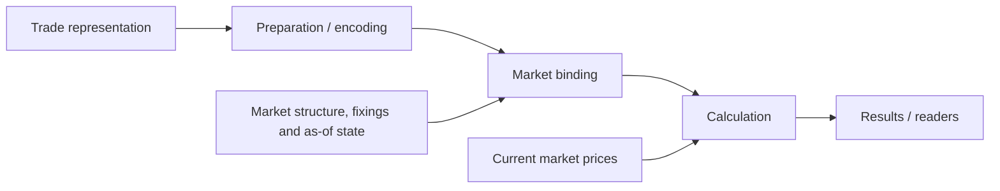

# Archived exploration: linear trade pipeline

**Status:** Archived and superseded on 3 October 2026. This is historical research, not an
engineering backlog. The [trade valuation pipeline handoff](../../engineering-tickets/trade-valuation-pipeline/README.md)
is the sole current design authority.\
**Preserved evidence:** Product scenarios, independent arithmetic, input-identity pitfalls and
the rationale for separating static terms, fixings and live prices.\
**Historical proposal:** An initial NG amount calculation followed by dated observations and
compression through the delivery sequence recorded below.

The original proposal and its acceptance language are retained below for context. Its
imperatives, completion checklist and implementation sequence are not work to pick up.
In particular, the current pipeline supersedes these earlier choices:

| Earlier direction in this archive | Current direction |
|---|---|
| Separate preparation/encoding stage and a kernel-first delivery sequence | CreateTrades privately resolves and encodes; implementation follows the current handoff's small end-to-end path |
| Generic defaults/labels and an incomplete input contract | Library-owned instrument fields, exact header matching, no undeclared fields and disjoint template/ticket field sources |
| Component or trade results retained on every tick, with aggregates as extra views | Evaluate the supplied compatible collection; retain payment groups when their economics require it; evaluate a singleton for an individual result |
| Product-specific Excel creators after the NG slice | One general CreateTrades boundary; no obsolete futures-specific creator or compatibility API |
| Scenario inventory and completion checklist as committed scope | Historical coverage ideas; the current handoff defines v1, including its explicit exclusions |

The agreed public path is instrument definitions and an optional template, then
`_CreateTrades` -> `_PrepareTrades` -> `_EvaluateTrades` -> pure result readers. An explicit
prepared handle replaces the private history-store proposal in the separately archived
[preparation-reuse exploration](trade-evaluation-preparation-reuse.md). Numerical specimens
remain evidence for arithmetic; their per-component arrays do not set the production result
shape. No production implementation or golden baseline is established by this archive.

## Historical problem and intended outcome

We have a specified static NG trade example and can represent markets as arrays. We also have a standalone
dense-matrix experiment demonstrating linear calculation and compression. We need a
production boundary between those pieces that preserves economic meaning, resolves shared
work once, and uses the same numerical path for one or many trades.

A price change should supply new values to an already prepared calculation. It should not
reconstruct trade meaning, parse contract codes, regenerate contractual schedules or repeat
unit conversion. Fixing arrivals and market-structure changes must update the appropriate
binding without mutating the accepted deal.

Deliver a small, inspectable pipeline with five responsibilities:



These are ownership boundaries, not a requirement for five public Excel handles, five
classes, or exactly five PRs. Use the existing index, specification, conventions, handle
store and reader mechanisms where they already do the required job.

## Historical scope and terminology

- A **trade** is a consummated deal. Its agreed execution price is static; changing market
  prices and published fixings are separate inputs.
- A **template** supplies shared selections/defaults. Shared contract specifications supply
  authoritative product facts. Resolve defaults once; later template edits must not rewrite
  an existing deal, and a default cannot override a listed product's contract facts.
- A **trade occurrence** is a retained input row, even if its label and terms duplicate
  another row. Labels alone are not deduplication keys.
- A **component** is one independently attributable output amount: for example a futures
  price-difference P&L row or a payment component. One trade may have several components.
- An **observation** is a required price with an economic identity. A current contract mark
  and a dated settlement are different observations.
- **Compression** means an algebraically equivalent derived representation, within stated
  floating-point tolerances. It does not authorize economic, legal or operational netting.

This parent covers the kernel contract, scenario fixtures, the NG Excel release, and the
subsequent dated-observation/compression milestones below. Broad scenario coverage means
the representation must demonstrate those cases; it does not claim every surveyed exchange
product already has a production constructor, verified schedule or settlement engine.

Discounting, risk reporting, margin and delivery accounting, nonlinear payoffs, durable result
storage and a general template language are outside implementation scope. Preserve their
required identities and payment metadata. A future extension may value eligible payments
after amount calculation, using each payment's own date and treatment.

## Historical numerical contract

Let R be the number of output components, O the number of unique required observations,
and M the number of independent current market inputs. Proposed descriptive names below
are not a committed public API.

| Input/output | Shape | Meaning |
|---|---|---|
| `A` | `(R, O)` | Signed contractual exposures, with quantities and unit scales resolved |
| `c` | `(R,)` | Static constants from agreed trade terms |
| `x` | `(O,)` | Prices of the required observations, in the declared column order |
| `amounts` | `(R,)` | One amount per retained component |

```python
amounts = A @ x + c
```

The same kernel can consume a compressed representation:

```python
x = B @ p + k
W = A @ B
b = c + A @ k
amounts = W @ p + b
```

Here `B` has shape `(O, M)`, `p` is `(M,)`, and `k` is `(O,)`. `B` expresses the declared
projection from current inputs; `k` supplies known fixing contributions. `W` is `(R, M)`
and `b` is `(R,)`. The arrays `A,c` are contractual; `B,k,W,b` belong to a particular valid
market binding. Never store fixing-dependent `b` as an immutable trade term.

The kernel takes aligned numeric arrays and a `WorkCounter`, and returns an array. It does
not parse product names, handles, dates, contract codes or settlement policies. Numerical
code is vectorized. The seam checks types/shapes once, preparation and binding establish
semantic validity, and the internal kernel trusts that contract.

Use owned/read-only `float64` numerical state consistent with existing objects. Preserve
two-dimensional coefficient matrices and one-dimensional outputs for a single component.
One trade can still have multiple components. A fully known amount must work with zero
remaining market inputs; do not introduce a dummy price to calculate a constant.

Define explicit comparison tolerances and independently worked expected results. Full and
compressed calculations need numerical agreement, not universal bit-for-bit agreement.

## Historical five-piece proposal

### 1. Trade representation: preserve the accepted deal

**Inputs:** Shared definitions/template selections and individual executed terms.\
**Output:** An immutable trade batch, preserving order and every occurrence.

For the first release, use the current [CreateTrades contract](../../engineering-tickets/trade-valuation-pipeline/create-trade.md)
to resolve static Index/specification facts with completed instrument fields, then encode
the resulting terms. Do not create one Python pricing object per row or move current market
state into this object. The [NG acceptance example](../../engineering-tickets/trade-valuation-pipeline/ng-creation-preparation-example.md)
supplies the trade rows and independent expected quantities and amounts.

As products are added, retain product identity, settlement treatment, actual contractual
legs, explicit strip constituents and payment terms. Exchange, clearing house and clearing
firm/account are distinct references when needed. Reuse conventions rather than making
users repeat them. The full field survey is a checklist, not a prerequisite capture form.

**Acceptance:** One and N use the same input contract; repeated IDs/rows survive; agreed
prices remain unchanged by market updates; selected contract facts remain authoritative.

### 2. Preparation / encoding: resolve contractual requirements

**Input:** Static trades and their referenced definitions.\
**Output:** An encoded batch with required observations, `A,c`, units and component attribution.

Resolve lot multipliers, quantity/price units, signs, explicit contract identities,
contractual observation dates/weights and payment ownership once. Retain a reference to
the source trades plus row-to-trade, component and actual-leg mappings as applicable.
Keep payment dates, currency and settlement/measure metadata with their components.

Share identical schedules and exact observation requirements. A dated observation key
needs the authoritative index/source definition, contract, observation kind and date;
include further identity dimensions when a supported product requires them. A display
name or equal price is insufficient. Product names are not observation identity: an Asian
and a penswap can require the same settlement.

For NG, the observation axis is just the distinct required current contract marks. For an
Asian, resolve the actual observation schedule before any grouping by contract. A strip
resolves to explicit constituent months with declared quantity allocation; it is not
automatically one average spanning the entire period.

**Acceptance:** Encoding is immutable and independent of current prices and fixing status.
Its dense table can be inspected, and it reproduces the hand-worked exposures/constants.

### 3. Market binding: supply and align the requirements

**Inputs:** Encoded requirements and the supplied market's identity, structure, as-of state,
fixings and declared projection model.\
**Output:** A valid mapping to market inputs, known contributions, and derived coefficients.

Resolve observation identities to actual market positions. Gather each shared required
point once per calculation batch where practical. Validate coverage, units, source/index
compatibility, the declared column order and as-of consistency; never silently substitute another
contract, infer identity from values, or project a missing required historical fixing.
A zero fixing is valid. Corrected fixings invalidate dependent compressed constants.

A projection that assigns today's contract price to several future observation dates is
an explicit model choice. Allow distinct dated projected prices within a contract. A
listed monthly-average or basis future's own current market price is a separate input
from a daily or multi-index reconstruction. Selecting one route must not double-count
fixings or invent trade legs.

Binding validity must depend on the relevant market axis, fixing state and projection
assumptions, not merely the length of an array. A price-only refresh on an unchanged axis
reuses binding. A changed axis/date/fixing state must revalidate and rebuild affected
derived state. Define this lifecycle before adding caching.

**Acceptance:** Correctly binds an NG market with extra untraded months; rejects uncovered
contracts and incompatible identities; cannot reuse stale positions after a coverage
change; later dated fixtures handle partial, complete and corrected fixings.

### 4. Calculation: one numerical path

**Inputs:** Validated coefficients, aligned prices and offsets.\
**Output:** One numeric amount per component, with measured work.

Evaluate the affine expression through the same array path for one or many components.
Keep a dense full-observation reference for checking derived compression. The arithmetic
does not decide whether a row represents futures P&L, an unpaid payment or settled cash.

The first NG measure is **price-difference P&L relative to agreed trade price**. It is not
a claim about outstanding variation margin, futures PV or a discounted terminal payment.
Subsequent swap fixtures produce payment amounts under their declared projection.

**Acceptance:** Hand-worked amounts, signs and units match; full and compressed paths
agree across independent price changes and fixing transitions; coefficients that net to
zero do not cause nonzero constants to be discarded. No scalar numerical loop per trade.

### 5. Results and readers: make the computation inspectable

**Inputs:** Component amounts and references to their encoded trades and market snapshot.\
**Output:** An immutable result with named measure, currency, attribution and readback.

Use the existing handle store for in-session lifetime. Store enough source references to
explain which trades, market snapshot and binding produced the amounts. Reading a result
must display stored data without repricing or rebinding. Durable histories are a separate
future concern.

Provide views of original terms, the labeled encoded matrix/constants, bound market inputs,
component/trade results and explicitly compatible contract totals. Preserve original
components when exposing aggregates. Different payment dates/treatments and currencies
must survive; no implicit FX conversion or cross-currency total. Totals must declare and
partition by measure and currency. Futures price-difference P&L and swap payment amounts
must not silently share a total merely because they reference the same contract and currency.
Keep the component dates and settlement treatments even in a permitted amount-summary view.

**Acceptance:** Excel can explain an amount from its original deal through the actual
coefficient row and selected prices. Readers preserve order and duplicates. Two otherwise
identical payments with different dates remain separately available for later valuation.

## Historical scenario inventory, not current release scope

Every economic shape below needs an executable synthetic fixture with a declared input
route, expected component/observation mapping and independently calculated amount. Invalid
input cases also need explicit rejection tests. Label synthetic calendars. A deferred
real-product adapter or unverified exchange convention must be recorded separately; it
does not waive the underlying representation fixture. Verify the real product's conventions
before promoting a fixture into a production product implementation.

| Scenario | What must be demonstrated | Delivery boundary |
|---|---|---|
| NG buys/sells in Z26 and F27 | One/N equivalence, signed lot conversion, exact month binding, individual and contract totals | First NG release |
| Opposite NG quantities at different agreed prices | Zero net exposure retains the price constant: +10 lots at 3.10 and -10 at 3.20, at 10,000 MMBtu/lot, give +10,000 USD | Kernel/NG fixtures |
| Duplicate occurrences and shared schedules | Shared preparation does not erase either trade or change input order | First NG release; dated extension |
| Bilateral future lookalike | Same linear amount machinery, explicit bilateral payment date and treatment | Fixture now; product follow-on |
| Cleared swap versus listed future | Clearing venue alone does not determine product identity or settlement treatment; shared arithmetic preserves those distinctions | Metadata/measure fixture; verify supported product terms later |
| Listed penultimate product and bilateral penswap | Own listed market mark versus a specified dated settlement projection; retain both product identities | Binding fixtures; verify dates before production |
| Last-three-day average | Three actual eligible observations with explicit weights; partial fixing keeps original denominator | Dated extension |
| CFD / genuine two-index difference | Specify the actual payoff first; signed exposures to each required index with its own conventions/dates | Fixture now; product follow-on |
| Standalone Waha basis future | Its independently traded/fixing index remains one index; no synthetic legs inferred from the word basis | Identity fixture |
| Ethane monthly averaging | Distinguish a direct listed monthly mark from a daily-average projection; preserve eligible dates, weights and price/quantity units | Dated extension |
| Ethane Z6F7 strip, later Cal27 | Resolve explicit years and monthly constituents; declare lots per month versus total allocation; retain each schedule/payment | Component extension within this parent |
| WTI average across a futures roll | Daily references can move between contracts within one averaging period; test both sides of the declared roll boundary | Dated extension; verify actual rule before production |
| Mixed futures, Asian and penswap | Shared observations where identical; current marks remain distinct from dated settlements; separate or reject totals across different result measures | Full/compact and reader fixtures |
| Identical exposures with different payment dates | Shared observations but separate payment components and dates; amount aggregation preserves source detail | Representation/reader fixture; no discounting required |
| Equal values at different market points | A bump to one point affects only its declared dependencies; never deduplicate by price value | Binding fixture |
| Separate daily projections within one contract | Daily price points remain independently addressable; flat monthly projection is replaceable | Dated extension |
| Fixing arrival, correction, zero/missing fixing, fully fixed component | Correct known/projected split, no remaining-weight renormalization, visible missing-data failure, no stale compression | Dated extension |
| NG, WTI, RB, HO, ethane, copper and carbon field checks | Lot and price-unit normalization; physical/financial treatment and relevant asset/vintage identity survive; currencies remain partitioned | Definition/fixture coverage; not all product launches |
| Known amount with no current price dependency | Empty remaining price axis is valid for the kernel; source market limitations are explicit | Kernel fixture |
| Declared/labeled market axis reordered, extended or shortened | Correct remapping or visible incompatibility; raw unlabeled values still require correct upstream ordering | NG binding and dated extension |

The phrase “CFD” alone does not define a payoff. WTI roll-on-expiry behavior, penultimate
date selection, eligible reporting days, strip quantity conventions and applicable units
must be pinned in each product fixture. The existing four-observation oil example is
illustrative and must not be presented as a verified monthly exchange schedule.

## Preserved worked arithmetic from the proposed first release

Use the existing four NG deals. These market prices are synthetic test inputs.

| Trade | Contract | Signed lots | Agreed price | Signed MMBtu | Constant |
|---|---|---:|---:|---:|---:|
| NG-001 | Z26 | 10 | 3.10 | 100,000 | -310,000 |
| NG-002 | Z26 | -4 | 3.15 | -40,000 | 126,000 |
| NG-003 | F27 | 7 | 3.40 | 70,000 | -238,000 |
| NG-004 | F27 | -12 | 3.35 | -120,000 | 402,000 |

```text
required points = [NG Z26 current mark, NG F27 current mark]

A = [[100000,       0],       p = [3.20, 3.50]
     [-40000,       0],       c = [-310000, 126000, -238000, 402000]
     [     0,   70000],
     [     0, -120000]]

A @ p + c = [10000, -2000, 7000, -18000] USD
contract totals: Z26 = 8000; F27 = -11000
```

Run each deal alone and recover its batch row. Bump Z26 by 0.01 USD/MMBtu: the four
changes must be `[1000, -400, 0, 0]` USD. Use a market containing additional months to
prove the result depends on resolved identities rather than incidental input positions.

## Superseded implementation slices

Each numbered slice should be reviewable on its own. Split further if code review cannot
reason about its changes independently; do not combine all five responsibilities into one PR.

| Slice / suggested child-ticket title | Deliverable and exit criterion |
|---|---|
| 1. Define and implement the linear amount kernel contract | Array-only kernel, component/result metadata contract, worked NG and fully known-amount tests, baseline work counters; define the full scenario test inventory and seed manual-array fixtures, completing it in slices 5-6 |
| 2. Resolve and encode NG trade rows into static exposures | Current CreateTrades design -> required point identities, normalized `A,c` and source mappings; exact worked-example agreement, immutability and shared-work budgets; no Market dependency |
| 3. Bind encoded NG trades to the existing Market | Identity/coverage checks, market-position mapping, aligned gathers, defined binding validity and price-update path; reject stale/unsupported coverage and show no re-encoding on ticks |
| 4. Publish and inspect the NG calculation in Excel | Existing handle/readback integration and a worked workbook showing terms, encoding, bound prices, individual results and compatible totals; actual Excel single/batch and price-update checks |
| 5. Extend encoding/binding to dated observations and components | Explicit reviewed schedules for single-date and averaging examples, fixings, separate daily projections, rolling references and a two-month strip; preserve differing payment dates and parent attribution; extend the market input contract only as required by these examples |
| 6. Validate compression and aggregation under updates | Full-versus-compact equivalence across the scenario suite, known/projected transitions and corrections; compatible aggregate views with retained detail; measured preparation, binding, calculation and temporary memory |

Slice 4 is the **first usable release**, not completion of the entire parent. Slices 5-6
complete the broader representation proof. Product-specific Excel creators and production
convention adapters can then follow in the requested order: bilateral lookalikes,
penultimate variants, then CFD/last-three-day/Asian products as their terms are established.
Do not require a universal product registry or all surveyed contracts to finish this parent.

Slice 5 is the most likely to need two PRs: static schedule/component encoding first,
then fixing/projection binding. These are six delivery milestones, not a six-PR ceiling.

## Historical update and performance acceptance ideas

| Event | Required behavior |
|---|---|
| First calculation | Encode, bind, gather, calculate and publish; count each boundary separately |
| Read an unchanged result | No encoding, binding or kernel execution |
| Explicit unchanged recalculation | Reuse valid preparation/binding; document whether existing publication machinery reuses the result or the kernel executes again |
| One current-price update, unchanged axis/model | No code parsing, schedule generation or unit conversion; gather prices and calculate through the existing binding |
| Fixing arrival/correction or projection change | Preserve static encoding; update dependent binding/offsets and compression before calculation |
| Valuation-date or market-coverage change | Revalidate covered observations, fixing expectations and positions; no silent reuse of a stale axis |
| Trade/definition change | Create new immutable terms/encoding; invalidate dependent binding and results |

Use `WorkCounter` and budget tests under `tests/performance` for preparation builds,
schedule work, observation/point resolution, market points gathered, components processed,
matrix dimensions and numerical work. Measure retained and peak temporary allocation,
including dense intermediates and sharing across repeated schedules.

Dense matrices are the first inspection/reference representation. Production storage may
later use indexed gathers or sparse arrays if measured workloads justify them; retain the
same semantic contract and a dense inspection path. Do not assume that `matmul` makes a
large mostly empty representation efficient. A compact full-batch refresh is acceptable;
selective recalculation is not required in this parent.

Report cold, unchanged, price-update and fixing/structure-update measurements with their
boundaries stated. Timings inform design; deterministic work and allocation budgets gate
tests. Previous-project benchmark claims are background, not Goosedove performance evidence.

## Implementation observations recorded during the exploration

- The initial NG example shares one Index and specification across its rows. Broader
  input batching need not become a prerequisite for proving this example.
- Static contract positions address the full index schedule. `Market.price_vector` starts at
  `Market.first_contract`. Binding must account for this offset and verify coverage.
- The futures calendar's first scheduled contract is a lower boundary, never its prompt
  contract. The NG market fixture needs a preceding boundary and coverage of the as-of
  date and both traded months; the worked example's two-contract static schedule is not
  automatically a complete valuation fixture.
- Index names are display labels. Establish a validated identity/reference contract;
  requiring the same immutable Index reference is a viable narrow first implementation.
  A matching text label or vector length alone cannot prove compatibility.
- `PriceVector` carries an index label and ordered values, not per-value contract IDs.
  The NG adapter validates the declared schedule/coverage relationship but cannot detect
  a same-length permutation of raw prices. Correct ordering remains an upstream input
  contract. Supporting arbitrary labeled price order requires an explicit input adapter;
  matching Index references alone does not verify market-data provenance or ordering.
- Existing `MarketHistory` supplies prompt-period fixings, not arbitrary historical
  settlements for every contract/date pair. Slice 5 must explicitly resolve this input
  gap rather than silently treating those histories as interchangeable.
- Existing `Market` requires remaining unfixed periods. The kernel must handle known-only
  amounts, while expired-contract pricing and a fully fixed Market adapter remain explicit
  support decisions. The first NG release accepts only contracts covered by its live market.
- Agree on observation/source identity and projection selection, binding invalidation,
  measure names, unit normalization, and numerical tolerances before each corresponding
  implementation. These are review decisions, not permission to infer absent economics.

## Superseded parent completion checklist

- Five responsibilities have explicit inputs, outputs and owners in code.
- Kernel contract and independent expected fixtures are reviewed.
- NG one/N encoding, binding, calculation and Excel readback work end to end.
- Dated observations, fixing transitions, roll references and strip components are
  exercised through the same numerical contract.
- Every economic shape above has an executable synthetic fixture, including mixed
  measures, units/currencies and separate daily projections. Deferred real-product
  adapters/conventions are recorded separately and do not substitute for those fixtures.
- Full and compressed amounts agree, with attribution and constants preserved.
- Payment dates, currencies and result measures survive calculation and aggregation.
- Price refreshes reuse valid encoding/binding; stale state fails or is rebuilt.
- Readers do no pricing; existing handles provide in-session ownership.
- Work/memory budgets and the repository's `check.ps1` pass for each implementation PR.

## Research references and current replacement links

- [Dense worked example and equations](../../linear-trade-matrices.md)
- [Runnable NumPy specimen](../../../tools/examples/linear_trade_matrices.py)
- [Current trade creation contract](../../engineering-tickets/trade-valuation-pipeline/create-trade.md)
- [Self-contained NG acceptance example](../../engineering-tickets/trade-valuation-pipeline/ng-creation-preparation-example.md)
- [Existing Market implementation](../../../src/goosedove/market/market.py)
- [Contract field survey and prior-engineer assessment](../../futures-trade-field-review.md)
- [Independent review scope and measurement questions](../../independent-review-brief.md)

The standalone specimen proves a proposed algebra and contains illustrative schedules.
It is a reference for this work, not an already completed production pipeline.
