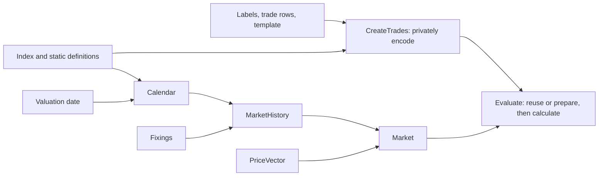

# Archived exploration: private trade preparation reuse

**Status:** Archived and superseded on 3 October 2026. This is historical research, not an
engineering backlog; no implementation is delivered by this document.\
**Original proposal date:** 30 September 2026.\
**Current authority:** [Trade valuation pipeline handoff](../../engineering-tickets/trade-valuation-pipeline/README.md).\
**Related research:** [Archived linear trade pipeline](linear-trade-pipeline.md),
[financial validation and golden harness](../../engineering-tickets/ethane-golden-validation-harness.md),
and [PR119](https://github.com/gobbles404/goosedove/pull/119), reviewed at `60ae5d2`.

The hidden history store, two-call worksheet API, signatures and delivery sequence below
were considered and superseded. They must not be implemented alongside the agreed pipeline.
The current approach is:

```text
Instrument definition + optional template + ticket fields
    -> CreateTrades (private resolution and static encoding)
    -> PrepareTrades(trades, history) -> explicit prepared handle
    -> EvaluateTrades(prepared, market) -> aggregate valuation and risk result
    -> pure result readers
```

No separate history cache is required for this first implementation. Evaluation consumes a
compatible preparation; it does not secretly prepare or search a cache. Current headers are
`fields`, not `labels`; they exactly match the instrument definition. Template/ticket field
sets are disjoint, and even equal duplicate sources fail. The collection is the evaluation
unit; per-trade tick outputs and per-row preparation sharing are not requirements.

The remainder preserves the original reasoning, illustrative arrays and independent answers.
All statements of agreement, acceptance and delivery below belong to that superseded
proposal. Useful arithmetic and the requirement to avoid repeated fixing work remain
evidence; the explicit-handle ownership and acceptance contract lives in the current handoff.
PR119 is revisable numerical evidence, not the authority for public pipeline boundaries.

## Historical problem and intended outcome

A market price update should evaluate an already prepared calculation. It should not encode
the trade again, regenerate its observation schedule, gather historical fixings again, or
recalculate the set portion of its floating leg.

The superseded proposal exposed two trade operations to Excel:

```excel
TradeBook = _CreateTrades(Index, Labels, TradeRows, [Template])
Amounts   = _Evaluate(TradeBook, Market)
```

The bracketed template argument is optional-signature notation, not literal Excel syntax.
Encoding is private to trade creation. Binding and compression are private to evaluation.
The caller supplies the market explicitly: the trade's index identifies its reference and
contract definitions; the market supplies a particular valuation date, fixing history and
price snapshot. The same trades can be evaluated against several markets.

The central acceptance requirement is:

> With the same encoded trade object and the same market-history object, a new price vector
> reuses the prepared set floating amount and live exposure. Preparation builds must not
> increase on ordinary price ticks.

PR119 provides the numerical separation needed for this behavior. At the reviewed commit,
it does not provide these worksheet functions, the agreed trade/template/encoder contract,
or the retained preparation store. Existing local experiments are not evidence that this
end-to-end surface has shipped. This ticket refines the parent pipeline's worksheet surface,
economic names and reuse policy; it does not require five public pipeline objects.

## Superseded worksheet surface and trade ownership

Proposed argument order:

```python
_CreateTrades(index, labels, trade_rows, template=None) -> TradeBatch
_Evaluate(trades, market) -> Evaluation
```

`Labels` are column headings for `TradeRows`, not trade identifiers or deduplication keys.
For example:

```python
labels = ["Trade", "Contract", "Quantity", "AgreedPrice"]
trade_rows = [
    ["T1", "Z26", 100, 70],
    ["T2", "Z26", -40, 72],
]
```

This is an arithmetic fixture in explicit quantity units. A production constructor must
state whether its quantity field is lots or another unit and retain the units. It must also
settle its required booking fields, including trade date; the short fixture is not the
complete production schema.

- Associate the actual index object with the trade batch. Initially, one batch references
  one index; an index name alone is not sufficient identity.
- Use the existing seam's labelled-table pattern to validate headings, types and shapes
  once. Product meaning and semantic checks belong in the library.
- Resolve supplied defaults and explicit terms once, preserving the accepted deal.
  A template supplies defaults, not market state. Define precedence and conflicting-field
  errors when implementing templates. A later edit creates a new object through its Excel
  dependency; it never mutates an already constructed trade.
- Create and retain static encoding privately during construction. Keep contractual facts
  and their derived encoding distinct internally. There is no public `EncodeTrades` cell.
- Preserve row order, duplicate rows and duplicate display IDs as separate occurrences.
  Preserve component-to-occurrence attribution when a trade eventually has several components.
- Use one batch path for one or N rows. Do not introduce a per-trade numerical execution loop.

Each `_CreateTrades` call returns one handle for the complete batch supplied in `TradeRows`,
whether it contains one row or many. Encoding, preparation and evaluation operate on arrays
for that batch. For one component per trade, leg amounts have shape `(N,)` and the live
coefficient matrix has shape `(N, M)`, where M is the number of market columns. More generally,
use R component rows and preserve their mapping to the N trade occurrences. A single trade
uses the same array shapes with N equal to one; it does not select another pricing path.

A general template system is not a prerequisite for the first release. The proposed optional
slot records the intended surface; begin with an explicitly supported schema and defaults.
All static inputs used by encoding must participate in construction dependencies. In
particular, settle how unit-conversion definitions reach the encoder: the current index
validates against conversions during its creation but does not retain the conversion table.
Do not obtain those definitions through an untracked ambient lookup.

## Historical economic components and object proposal

For a fixed/float trade, retain these meanings:

| Name | Meaning | Dependency |
|---|---|---|
| `fixed_leg` | Signed contractual fixed amount, such as minus quantity times agreed price | Encoded trade terms and their static definitions |
| `floating_leg_set` | Weighted contribution from observations whose applicable fixings are known | Encoded trade and market history |
| `live_coefficients` | Remaining signed exposure by output component and current market column | Encoded trade and market history |
| `floating_leg_live` | Remaining exposure evaluated at the current prices | Prepared coefficients and price vector |
| `amount` | `fixed_leg + floating_leg_set + floating_leg_live` | All of the above |

“Set” means determined by fixings, not cash already paid. The fixed leg remains distinct
from the set portion of the floating leg. Neither is renamed “constant” in the proposed
trade-facing vocabulary. Internally, pre-add `fixed_leg + floating_leg_set` once as
`fixed_plus_set`, while retaining both components for inspection. A tick can then perform
one matrix-vector multiplication and one addition.

These economic names describe the fixed/float example. Sharing arithmetic must not redefine
every future as a swap or conflate an undiscounted amount with futures margin cash or PV.
The first product adapter must state the measure it returns.

The proposed retained objects are:

| Object | Contents and ownership |
|---|---|
| `TradeBatch` | Immutable executed terms, source index and a reference to private encoding |
| `EncodedTrades` | Observation identities, static coefficient terms, fixed amounts, units and component/occurrence mappings; no as-of, fixings or current marks |
| `MarketHistory` | Existing calendar, including as-of and fixing flags, plus applicable fixed observations and their prints |
| `Prepared` | References to its encoded input and history; set floating amounts, live coefficient matrix and pre-added fixed-plus-set amounts |
| `Market` | Existing history reference and current price-vector snapshot |
| `Evaluation` | Amounts with their component/occurrence attribution; final Excel return form to be decided |

Numerical storage is owned and read-only, consistent with the existing kernel. The preparation
store belongs to valuation infrastructure. Do not put mutable market-dependent caches on a
static trade or store a current market/price vector in preparation.

## Superseded Excel graph and change-detection proposal

The existing market graph provides the relevant split:



In normal dependency-driven recalculation, a price update changes the price vector and
market while leaving the history object in place. The existing observed creator mechanism
also reuses a live creator with unchanged arguments during recalculation. A fixing edit
creates new fixing/history objects. An as-of edit creates a new valuation-date/calendar/history
chain. None of this mutates the existing objects.

Reuse requires both comparisons to be true:

```python
prepared.encoded is trades.encoded
prepared.history is market.market_history
```

Python `is` compares object identity. It does not compare fixing arrays. Excel handle text
has already been resolved into objects at the seam; the numerical library does not parse
handles or worksheet addresses.

| Event | Static encoding | Preparation | Live calculation |
|---|---|---|---|
| New price vector, same history | Reuse | Reuse | Recalculate |
| Fixing arrival/correction producing new history | Reuse | Build for new pair | Recalculate |
| Valuation-date change producing new history | Reuse | Build for new pair | Recalculate |
| Trade amendment or changed encoding definitions | New encoding | Build for new pair | Recalculate |
| Another price scenario over the same history | Reuse | Share | Calculate separate results |
| Another history for the same trades | Reuse | Separate entry | Calculate separate results |

This is deliberately conservative. Any new history object is a preparation miss, even if
the edited fixing is irrelevant to this batch or the new as-of leaves its fixing flags
unchanged. Selective updating is a later measured optimization. Applicability of fixings
remains the product/calendar's rule; object-change detection does not define that rule.

## Superseded private-store lookup, ownership and lifetime

The logical key is **encoded-object identity plus history-object identity**:

```text
(E12, H17) -> Preparation A
(E12, H18) -> Preparation B
(E13, H17) -> Preparation C
```

E12 and E13 identify whole encoded batches, not individual trade labels. Initially, adding,
removing or amending a row creates a new batch encoding and therefore a new preparation key.
Reuse of unchanged trades inside an amended batch is a separate optimization. This boundary
still permits later selective repricing of affected component rows within an unchanged batch
when only some market prices change; it does not require every row to be repriced together.

There is no single “last history” shared by all evaluations. Prices are not part of the key.
Equal-looking but distinct objects may miss the store; correctness does not require content
deduplication. A lookup must not hash or compare the arrays inside an object on each tick.

An implementation may use `(id(encoded), id(history))` while the entry strongly retains both
objects, preventing those identities from being reused during the entry's lifetime. These
are runtime identities, not persistent keys. Identity tokens alone are not enough ownership.

The lookup is straightforward; its lifetime is a required engineering decision:

1. Scope the store to the current Excel runtime. Retain entries for their live valuation
   uses and release references when those uses end. Define the ownership anchor explicitly.
2. Preserve an entry across replacement of the market handle on ordinary ticks. Existing
   observed-call ownership follows the full argument set; a new market handle can mean a
   different evaluation subscription. Releasing an entry with each obsolete result before
   its replacement acquires it would defeat reuse.
3. Demonstrate both callback orders: old use released before replacement acquisition, and
   replacement acquisition before old release. Choose an explicit handoff or stable owner
   that supports both; a dictionary alone does not solve this.
4. Allow simultaneous consumers, including separate workbooks, to share a pair safely.
   Releasing one consumer must preserve others. After the final logical use is gone, return
   retained entries and references to the appropriate baseline.
5. Keep entry count and retained bytes stable across repeated price-only updates. Do not
   accumulate one entry per tick, retain an unbounded history of unused pairs, or rely on a
   timeout to establish correctness.
6. Preparation failures publish no entry; evaluation failures release partial ownership
   appropriately and never substitute an earlier successful result. Define any synchronization
   required by the actual host execution model.

This ticket specifies those guarantees, not an already implemented ownership mechanism.
Agree the mechanism before wiring a production `_Evaluate` surface to the store.

## Superseded private-pipeline pseudocode

This is pseudocode for responsibilities, not a second implementation of the kernel. Reuse
PR119's binding and compression arithmetic. Work counters are explicit on library work and
are supplied by the wrapper, not additional worksheet arguments. Lease/owner plumbing is
omitted below pending the lifecycle decision above.

```python
def _CreateTrades(index, labels, trade_rows, template=None):
    records = resolve_trade_inputs(index, labels, trade_rows, template)
    encoded = encode(index, records, counter)
    return TradeBatch(index=index, records=records, encoded=encoded)


def _Evaluate(trades, market):
    encoded = trades.encoded
    history = market.market_history
    prepared = get_preparation(encoded, history, counter)

    floating_leg_live = matvec(
        prepared.live_coefficients,
        market.price_vector.prices,
        counter,
    )
    amount = prepared.fixed_plus_set + floating_leg_live

    return Evaluation(
        occurrences=encoded.occurrences,
        components=encoded.components,
        fixed_leg=encoded.fixed_leg,
        floating_leg_set=prepared.floating_leg_set,
        floating_leg_live=floating_leg_live,
        amount=amount,
    )


def get_preparation(encoded, history, counter):
    # Matches both input references by identity; no array hashing.
    prepared = preparation_store.find(encoded, history, counter)
    if prepared is not None:
        return prepared

    prepared = prepare(encoded, history, counter)
    preparation_store.retain(prepared, counter)
    return prepared


def prepare(encoded, history, counter):
    # Establish compatible index, observation coverage and market-column order.
    binding = bind_observations(encoded.index, encoded.observations, history, counter)
    floating_leg_set, live_coefficients = fold_terms(encoded, binding, counter)

    return Prepared(
        encoded=encoded,
        history=history,
        floating_leg_set=floating_leg_set,
        live_coefficients=live_coefficients,
        fixed_plus_set=encoded.fixed_leg + floating_leg_set,
    )
```

Preparation derives market-column positions from the history's calendar/schedule. The
current `PriceVector` contains an index name and positional prices, not contract identities.
The current market's name/count checks cannot detect a same-length permutation of those
prices. Establish and document the required order; do not claim object identity verifies
arbitrary vendor columns. If a future market axis can change independently of history, its
identity must become a preparation dependency before that behavior is supported.

## Preserved independent worked arithmetic

Use the two trades above with two explicit, equally weighted observations. Prices are USD
per quantity unit, so no hidden conversion applies. This is an independent arithmetic
fixture, not a certification of an exchange contract's observation calendar.

```python
encoded.fixed_leg = [-7000, 2880]
encoded.term_component = [0, 0, 1, 1]
encoded.term_observation = [0, 1, 0, 1]
encoded.term_coefficient = [50, 50, -20, -20]
```

With the first observation fixed at 68 and the second still floating:

```python
prepared.floating_leg_set = [3400, -1360]
prepared.live_coefficients = [[50], [-20]]
prepared.fixed_plus_set = [-3600, 1520]
```

| State | T1 amount | T2 amount | Required preparation behavior |
|---|---:|---:|---|
| First print 68; remaining mark 74 | 100 | 40 | Build once |
| Same history; mark moves to 75 | 150 | 20 | Reuse; zero preparation builds |
| First print corrected to 69; mark 75 | 200 | 0 | New history, refresh; encoding unchanged |
| Second observation fixes at 73; first stays 69 | 100 | 40 | New history; remove remaining live exposure |
| Further market price changes | 100 | 40 | Fully fixed amounts remain unchanged |

Before the second fixing, market sensitivities are +50 and -20. After it, both are zero.
Also establish these independent expectations:

- Amend T1 quantity to 200 at first print 69/mark 75: amount 400, sensitivity 100; new encoding.
- Evaluate either trade alone: its amount agrees with its row in the batch.
- Include two occurrences of T1 at first print 69/mark 75: retain two rows of 200, total 400.
- Offset +100 at agreed 70 with -100 at agreed 72: combined sensitivity is zero and combined
  amount is 200 at every common average. Compression must retain the fixed amounts.

The kernel supports an `(R, 0)` matrix and empty mark vector for a wholly fixed calculation.
The existing `Market` constructor rejects a calendar with no unfixed period. Prove the zero-mark
case at the numerical boundary now and make an explicit integration decision before claiming
support for wholly fixed markets through `_Evaluate`; do not introduce a dummy price. Fully
fixed trades within a market that still has other live contracts also need a test.

## Historical acceptance ideas and superseded delivery sequence

Financial answers alone do not establish reuse. Add observable work and lifetime checks:

- Count encoding builds, preparation lookups/hits/builds, observations and terms traversed,
  dense cells allocated/processed, and kernel calls. Report retained entries/bytes and release
  behavior. Add counters using the existing `WorkCounter` conventions.
- A price-only update has zero encoding builds, zero preparation builds, zero fixing gathers
  and zero observation/term traversals in preparation. Existing price ingestion, market
  construction, matrix multiplication and result publication still have their own costs.
- Verify actual call paths and allocations as well as counter increments. No dense coefficient
  rectangle is rebuilt or copied on a preparation hit. Allow measured price/result allocations.
- Repeated ticks use the same prepared object and current prices, including ownership handoff.
  Same-history scenarios share preparation while their results remain independent. Different
  histories stay separate; returning to a still-retained pair reuses its entry.
- Cover new trades, amendments, fixing arrivals/corrections, as-of changes, invalid index or
  observation coverage, missing required fixings, and recovery after failure. Structural
  changes must never reuse an incompatible mapping.
- In live Excel, verify price-cell edits, fixing/as-of edits, unchanged recalculation, two
  consumers, different-workbook consumers, deletion and closure. Release of one consumer must
  not invalidate another. Close the final use and establish the expected baseline.
- Pin meaningful work/allocation budgets at small and representative batch sizes. Record
  timing as evidence, not a test threshold. One and N use the same numerical path.

Suggested delivery slices:

1. **Private preparation contract and lifecycle proof.** Decide the ownership anchor and
   prove pair lookup, reuse, invalidation and handoff with small immutable fixtures and the
   worked answers. Use the existing kernel; no broad product framework is required.
2. **Minimal NG trade creation.** Implement the agreed labelled-table surface, explicit index
   association and private static encoding. Establish required fields/units and the supported
   defaults. Validate one/N, signs, multiple contracts and duplicate occurrences.
3. **Excel evaluation integration.** Connect the real trade and market objects through the
   retained preparation path. Resolve whether `_Evaluate` spills a table or publishes a result
   handle, and any reader ownership. Add the live Excel lifecycle and tick-work evidence.
4. **First averaging-product integration.** Use the reviewed ethane examples to prove set/live
   transitions through a real encoder and calendar, then connect to the financial-validation
   and golden plan. The synthetic two-observation fixture remains a small independent check.

The lifecycle proof includes the set/live arithmetic before NG shipping; real averaging
product support is a subsequent slice. Each slice should be a focused PR, split further if
host ownership work deserves its own review. Do not present this parent as one large PR.

Financial expectations are hand-worked independently. Actual library outputs become goldens
only after the production path exists. Preserve existing snapshots and inputs for a separate
baseline review when behavior changes; the agreed exception permits a genuinely new case
and its first golden together. Prototype output is not a production-library golden.

Discounting, payment-date valuation, futures variation-margin accounting, two-index spreads,
nonlinear products, selective incremental fixing updates, sparse-matrix selection and durable
result storage remain separate work. Preserve the component identities they will need.

The superseded proposal defined completion as a working first product through its then-agreed
public surface, verified Excel ownership and measured tick reuse for the identity-keyed
preparation store, and averaging integration checked against independent answers. These are
recorded historical exit criteria, not the completion criteria for the current pipeline.
