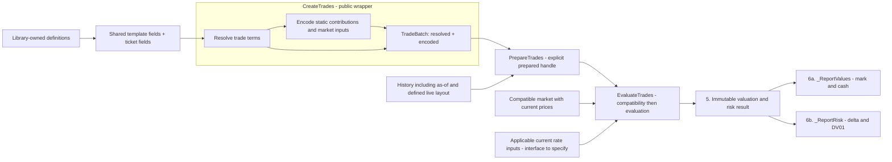

# Trade valuation pipeline: design and engineering handoff

**Status:** Agreed design, 3 October 2026, carrying the decisions of the engineering review of the same day. No production implementation in this packet.\
**Purpose:** Make the responsibilities and connections understandable before choosing their implementation.\
**Reading order:** This overview, instrument definitions, CreateTrades and its retained state, then the worked example and individual responsibility documents.

**Where it stands:** the pipeline this packet designed is built. [docs/architecture.md](../../architecture.md) says how it fits together, and the function pages under [docs/library/trades/](../../library/trades/kernel.md) say what each function does today; where a page and a ticket here differ, the page is current and the ticket is the plan as it was. A ticket still open says so in its status line.

## How to use this handoff

This packet is the authoritative design for the next trade implementation. Read it alongside
the linked instrument-reader and template function specifications. Its agreed boundaries and
economic meanings govern the work; its explicitly open questions still need decisions in
their implementation slices. Internal types and array layouts remain engineering choices.
Surface any proposed change to an agreed boundary or economic meaning for design discussion.

**Naming update, agreed 10 October, built in #174:** The broad instrument called `future` in the
prototype is renamed `fixed_float`, keeping the existing cleared/bilateral routes, by the
[rename-only ticket](rename-instrument-fixed-float.md), the first slice of the bilateral arc.
The [bilateral representation inventory](bilateral-discounting-and-dv01.md#trade-representation-field-inventory)
records the agreed fields, new counterparty and nonnegative marketing reserve, and the
agreed direct curve input at evaluation. Existing pages and examples using `future` migrated
with the rename; futures index/schedule names remain.
[Counterparty and marketing reserve](booking-fields-and-marketing-reserve.md) followed in #175
and the [calculation kernel](bilateral-calculation-kernel.md) in #176, privately, both reviewed.
The public curve argument to evaluation and the readers' columns, DV01 the analytic signed
sensitivity of the discounted mark to a one basis point rise, and both nominal and discounted lot
deltas reported, are built in #177, [bilateral valuation and risk in Excel](bilateral-excel-integration.md),
as the [bilateral plan](bilateral-discounting-and-dv01.md) records; owner UAT follows.

**Reporting update, 11 October, built in #178:** the [risk reporting and aggregation series](aggregate-evaluated-results.md)
records the agreed direction, `_ReportRisk(results, risk, bucket)`, every argument required, one
risk or `all`, day, month or year, and the saved Total above the dated rows. The
[first ticket](unified-risk-reporting.md) is built: the report on one evaluated batch with the
DV01 by payment time, `_ReportDelta` retired and every kept caller migrated. The
[second ticket](aggregate-risk-kernel.md) is built in #179 privately: the collector of saved
risk across evaluated batches, grouped by index object and by curve and currency, nothing
priced again. The [third ticket](aggregate-risk-excel-integration.md) is built in #180:
`_AggregateResults(result_handles)` over a cell, a row or a column of results handles, and
`_ReportRisk` taking the collection's handle beside a single result's, the two seam forms
inside it.
This supersedes the older reader defaults and layouts in the pages below.

| Material | How engineering should use it |
|---|---|
| This packet and its linked function specifications | Current pipeline, field policy, responsibilities and acceptance targets |
| [Trade surface UAT notes](surface-uat-notes.md) | Running observations and owner decisions from Excel UAT, including delta in lots, trade identifiers, date-helper inputs, ticket period precedence, readable index names and results readback ordering |
| [Shift a date by a text offset](date-offset-utility.md) | `util_ShiftDate(date, offset, [holiday_calendar])`: an explicit date plus a signed `bd`, `cd` or `em` count, an optional holiday calendar, one date out and no valuation context; UAT item 9, built in #171 |
| [Compound date offsets](compound-date-offsets.md) | Built in #181: one or more instructions applied left to right, `+3em+25cd-1bd+1bd`, in `util_ShiftDate` and in `payment_time_lag` alike, one shared reading and arithmetic; the anchors and the payment-after-observation check unchanged, no roll at the end, the rule read back as written; UAT item 9 |
| [Contract codes and dates on one ticket](contract-codes-and-dates.md) | Each row chooses its period, complete dates taking precedence over a code kept as entered text, blank and empty-text absence scoped to the three period fields; UAT item 4, built in #172 |
| [BAL dates from a valuation-date handle](date-helper-inputs.md) | Explicit handle supplies BAL `as_of`; future periods start at their first day, expired periods fail in both helpers, and users freeze booking dates by pasting values; UAT item 3, built in #173 |
| [Half-year strip labels](half-year-strips.md) | Built in #182: `1H27` and `2H27` in either case as strips in `contract_code` and in the two date helpers, six ordinary monthly components with the existing quantity, observation and payment rules, `H27` still March; UAT item 15 |
| [Combine holiday calendars](combine-holiday-calendars.md) | Built in #183: `_CombineHolidayCalendars(calendar_handles)`, one or many calendar handles combined into an ordinary calendar closed on every day any of them is closed, for `payment_holiday_calendar` and `util_ShiftDate`; UAT item 16 |
| [Risk reporting by pricing contract month](risk-contract-month-bucketing.md) | Built in #186 as two commits: the month and year delta buckets follow the pricing contract's period, and the period spills run from the valuation month through the last period held, zero between, a saved risk before the start refused rather than hidden; the day view and the payment-date DV01 keep their meanings; UAT item 17 |
| [Brokerage and clearing applicability](reserve-fee-applicability.md) | Built in #188 as two commits: brokerage charges the trades naming a broker, `none` in any case naming none, and clearing the cleared route, the rates the selected specification's and no fee computed where it does not charge; then the instrument descriptions of `broker`, `clearing_house`, `route` and `settlement_method` say what each controls; UAT item 18 |
| [Reject nonfinite trade arithmetic](reject-nonfinite-trade-arithmetic.md) | Built in #190: each producing stage checks the numbers it makes before they enter its record, the conversion products, quote quantities, coefficients, fixed legs, group sums and slot exposures of the encoding, the set amounts, sensitivities and unsettled totals of the preparation, the live contributions, the cleared live amount and the cleared mark of the evaluation, each refused by its operation and the most specific trade, slot, group, contract or the batch, under numpy's flags down; the global live sum moved into the cleared path; nothing published by a failed creator |
| [Cross gamma of commodity delta to one discount curve](single-curve-cross-gamma.md) | Built in #197 as two commits: the bilateral path saves the analytic cross-gamma, each live slot's discounted lots times -0.0001 times its payment's time fraction, on the delta's four axes with its total; then the `cross_gamma` selector, `all` widened by its column, the collection's cross groups by index and curve pair with a cleared pair's known zero shown, and the two readbacks' columns; one curve per batch, the next ticket's several |
| [Linear interpolation of contract prices](interpolate-contract-prices.md) | Built in #198: `util_InterpolateContracts(index, anchor_contracts, anchor_prices)` infers every month from the first anchor's through the last's on the index's schedule and spills each contract with its futures expiry and the price on the line between its anchors, weighted by the calendar days between the expiries; codes or CME months in, no handle out, the sheet still choosing the prompt-aligned rows for `_CreatePriceVector`; the schedule's monthly reader moved beside the contract codes for the trades and the interpolation to share; UAT item 21 |
| [Bump a discount curve](bump-discount-curve.md) | Built in #199: `util_BumpDiscountCurve(curve, bump_bps)` returns an ordinary curve after a signed parallel shift of the continuously compounded zero rates, every stored day moved from the curve's own start, ACT/365F, through the curve's own constructor so its checks stand; inspect it with `util_ReadHandle` and re-evaluate on it to check the DV01 and the cross-gamma against centered differences; UAT item 22 |
| [Cashflow instrument](cashflow-instrument.md) | Built in #200, the first of two PRs: the `cashflow` instrument in the catalog; `_CreateCashflows(fields, cashflow_rows, template)` booking known signed USD amounts on explicit payment days from a template and a ticket, the amounts summed once per payment day; `_EvaluateCashflows(cashflows, valuation_date, discount_curve)` discounting the unpaid ones with their DV01 and counting the paid ones cash; the reports and the readback taking the results, the payment arithmetic shared with the bilateral trades; the collection through `_AggregateResults` built in #202, slice 2 of the named-curve arc; UAT item 23 |
| [Named discount curves within one trade batch](multiple-discount-curves.md) | Agreed arc, built in #201, #202 and #203, the three slices stacked: `_CollectDiscountCurves` gathers named curves; every bilateral trade requires its static `discount_curve_key`, including singleton evaluation. Three stacked slices since 18 October: the contributions, labels and the collection of trades and cashflows, then the keyed booking, the mixed-curve evaluation and the worksheet cutover; the cashflow aggregation folded into slice 2. UAT item 24; template-based quoting follows the completed worksheet cutover. |
| [Named curves and their collection](named-curves-slice-1.md) | Built in #201, slice 1 of the named-curve arc: `_CreateDiscountCurve(name, header_row, table)`, the name in the handle, `30512:discount_curve:SOFR:2`, and last on every row of the readback, the bump keeping it; `_CollectDiscountCurves(curve_handles)` as a reference-only collection with a compact handle and a membership readback, each name once; every curve creation migrated, the kept workbook's sixteen in place with its economics unchanged; evaluation untouched until slice 3 |
| [Curve-owned contributions, named labels and the collection of trades and cashflows](named-curves-slice-2.md) | Built in #202, slice 2 of the named-curve arc: saved DV01 and cross-gamma as contributions owned by their curve on every result, one each from today's single-curve evaluator and one rate contribution from a batch of cashflows; labels with curve names, `SOFR USD dv01`, same-name snapshots qualified on both sides; `_AggregateResults` over trade and cashflow results in one range, cashflow-only and mixed collections, a cashflow moving its curve's DV01 and nothing else; every economic number unchanged, the kept workbook relabeled in place |
| [Keyed booking, mixed-curve evaluation and the worksheet cutover](named-curves-slice-3.md) | Built in #203, slice 3 of the named-curve arc: `discount_curve_key` on every bilateral row, required there and refused on the cleared route, read by the curve's name rule; payment groups keyed, each discounted on its own curve, one contribution of each kind per curve used; `_EvaluateTrades(prepared, market, [discount_curve_set])` taking the collection, a singleton included, the direct-curve form removed; the parent's hand-priced acceptance; the complete migration, 22 kept-workbook evaluations over 15 curve cells and 7 templates, the smoke, the lifetime, the host, the suites and the pages; slice 2's gaps closed |
| [Template-based quoting](template-based-quoting.md) | Proposed fast follow after named curves: `_CreateQuoteTemplate(instrument, fields, values)` selects quote fields from shared instrument definitions; `_Quote(market, contract_code, template, [discount_curve_set])` returns a whole-period price. CAL27 in June retains fixings and live projections; bilateral payment dates on or before as_of use factor 1, future payments the selected curve. Supersedes the [four-input prototype](quoting-prototype.md); UAT item 25. |
| [Rename future to fixed_float](rename-instrument-fixed-float.md) | The catalog's one instrument renamed `fixed_float`, the same fields, rules, numbers and work budgets, `future` refused as any other word; the first slice of the bilateral arc, built in #174 |
| [Counterparty and marketing reserve](booking-fields-and-marketing-reserve.md) | `counterparty` required with a bilateral route and refused with a cleared one, a label kept per row; `marketing_reserve` an optional nonnegative amount booked once per ticket row, summed into the reserves `_ReportReserves` shows; UAT items 8 and 11, built in #175 |
| [Bilateral calculation kernel](bilateral-calculation-kernel.md) | Built in #176, privately: payment-group NPV on a curve anchored at `as_of`, nominal and discounted lot vectors and analytic DV01, hand-priced and measured inside the existing evaluator; the public curve argument and the readers are #177's |
| [Bilateral valuation and risk in Excel](bilateral-excel-integration.md) | Built in #177: the optional curve on `_EvaluateTrades`, `nominal_delta` and `delta` in both risk reports with DV01 in the scalar one, the results readback's discounted contract risk and payment-group facts, the workbook, smoke, host and lifetime acceptance; owner UAT follows |
| [Risk reporting and aggregation](aggregate-evaluated-results.md) | The series: one risk reader for an evaluated batch and, later, a collection of them, a required risk and bucket, wide columns and the saved Total first; the report first, the collector next |
| [Unified risk reporting with totals first](unified-risk-reporting.md) | Built in #178: `_ReportRisk(results, risk, bucket)`, `nominal_delta`, `delta`, `dv01` or `all` by day, month or year, the DV01 by payment time saved at evaluation on axes the encoding makes once, `_ReportDelta` retired and every caller migrated |
| [Collector kernel for evaluated risk](aggregate-risk-kernel.md) | Built in #179, privately: one or many results combined by the exact index object and by the curve object and currency, the saved vectors summed onto the unions of the saved axes, saved totals, every occurrence counted, refusals by position; the Excel creator and the reader's acceptance of its handle follow |
| [Aggregate evaluated risk in Excel](aggregate-risk-excel-integration.md) | Built in #180: `_AggregateResults(result_handles)`, a cell, a row or a column of results handles collected in the order given, every one counted, into one handle; `_ReportRisk` taking that handle or a single result's through one declaration of two kinds; the readback's membership rows; the two seam forms, a vector of handles of one kind and a handle of one of two kinds, decisions 44 and 45 |
| [Delta by day, month and year](daily-risk-vector.md) | Saved lot-delta vectors aggregated by observation time across payment groups; `_ReportDelta` selected the reporting bucket until #178 retired it into `_ReportRisk`; built in #166 |
| [Brokerage and clearing reserve totals](reserve-totals.md) | Static positive cost totals from entry specifications, booked once when a batch is made, carried on the evaluated results and read through `_ReportReserves`; since #175 the marketing reserve is the optional amount a row books, summed the same way; built in #170 |
| [Readable index names](readable-index-names.md) | A required `display_name` right after `name`, a description kept on the index and shown beside the name in readback, read by nothing else; built in #169 |
| [Numeric trade IDs](numeric-trade-ids.md) | `trade_id` as the source system's whole number of at most 15 digits, numeric entry and readback, text refused, duplicates kept; built in #168 |
| [IFERC basis futures](iferc-basis-futures.md) | Cleared financial basis futures on an IFERC index through the existing functions: the month's published index the one `lastday` observation, payment counted from last trading; built in #167 |
| [Calendar driven Asian pricing references](calendar-driven-asian-references.md) | Generic daily reference resolution from the index schedule/calendar, separating averaging month and payment ownership from the futures supplying prices; built in #165 |
| [Lot-delta reporting](lot-delta-reporting.md) | Engineering ticket for delta in an explicitly designated index-specific lot, preserving monetary valuation coefficients |
| [Bilateral discounting and DV01](bilateral-discounting-and-dv01.md) | Planning ticket after the mixed-fields prototype: payment-level discounting, rate preparation, risk conventions and acceptance examples; open choices are marked |
| [Golden harness plan](../ethane-golden-validation-harness.md) | Active plan for independent financial expectations and separately reviewed production snapshots |
| [Contract survey](../../futures-trade-field-review.md) | Product facts and examples for checking coverage, not a second trade schema |
| [Dense matrix specimen](../../linear-trade-matrices.md) and PR119 | Evidence for arithmetic and measured work; their helper names, component outputs and layouts do not prescribe production APIs or tick work |
| [Archived pipeline](../../archive/trade-pipeline/linear-trade-pipeline.md) and [archived preparation proposal](../../archive/trade-pipeline/trade-evaluation-preparation-reuse.md) | Design history only; their superseded APIs and delivery plans are not additional backlogs |

## Intended outcome

Start from a library-owned instrument definition. CreateTrades resolves the accepted terms
and statically encodes their contributions and market inputs. Binding connects those inputs
to a supplied market state; evaluation produces named valuation and risk measures.
The target has **two route-specific value fields plus shared delta and DV01**, all completed
before the results handle is published. The agreed pairs are `bilateral_mark`/`bilateral_cash`
and `cleared_mark`/`cleared_cash`. [Result fields by route](result-fields-by-route.md) defines
their meanings and the proposed cumulative scope and date-driven settlement convention;
detailed risk conventions remain open. One result has separate valuation and risk sections
with shared context; [evaluation](04-evaluation.md) coordinates small private operations that
reuse current inputs and amounts. Margining is outside this initial model. The first undiscounted amount specimen
is an intermediate step, not that full result.
Readers consume the resulting snapshot without repricing it. **The supplied collection is
the unit being valued:** one aggregate result for its compatible amounts and market risks.
For an individual trade, evaluate a collection containing that trade. One and many use the
same path; every occurrence contributes, including duplicates. Retained source trade facts
do not imply that each evaluation also computes individual trade values.

The instrument catalog is a prerequisite. Resolution and encoding are private children of
the public CreateTrades operation; subsequent responsibilities have their own boundaries.
They do not require a worksheet function, public handle or class for every responsibility.
Engineering should be able to show each input and output independently while keeping
the normal Excel workflow short. Cash records have their own approved meanings and schemas;
they are not forced to carry the executed fields of a commodity trade.



`_ReportValues(results)` and `_ReportRisk(results)` are the two result reports, committed
from the start. They close the initial **trade-to-results pipeline**: both spill what
evaluation stored, with no further market access or valuation, and `util_ReadHandle` on
the same handle is a debugging spill of its stored contents that replaces neither. A
leg-decomposition view can follow later; it is not a prerequisite for this first path.

This is an end-to-end design, not an end-to-end implementation claim. Static index/product
definitions and market creation supply upstream inputs. Detailed schemas, Excel declarations,
the rate-input interface and risk conventions still need specification within the existing
boundaries. The next implementation should trace a small worked collection through this
complete path, rather than introduce more pipeline stages.

| Stage artifact | Question it settles |
|---|---|
| [0. Instrument definitions](00-instrument-definitions.md) | Which instruments, fields, values and combinations may users construct? |
| [CreateTrades and retained state](create-trade.md) | How do the two private children create one immutable trade batch, and what does its handle retain? |
| [1. Resolution and representation](01-trade-representation.md) | What deal was agreed, under which definitions? First child of CreateTrades. |
| [2. Static encoding](02-static-encoding.md) | Which numerical contributions and market inputs follow from the resolved terms? Second child of CreateTrades. |
| [3. Market binding](03-market-binding.md) | Which market inputs come from history, and which from the live market? |
| [4. Evaluation](04-evaluation.md) | Which numerical operation produces the requested measure and risk? |
| [5. Results](05-results.md) | What do the returned numbers mean, and which inputs produced them? |
| [6. Readers](06-readers.md) | How does Excel inspect those results without new valuation work? |
| [Worked example](worked-example.md) | Can we trace the same trades and independently known answers through all six? |
| [NG creation/preparation example](ng-creation-preparation-example.md) | How do five signed occurrences compress to two exposures, with independently checked values and a separate toy payment lifecycle? |
| [Excel trade-input binding](excel-trade-input-binding.md) | What seam extension, reference lifetimes and fully fixed behavior does the agreed surface need? |
| [Prepared matrix walkthrough](prepared-matrix.md) | How do many trade contributions become one batch exposure vector before evaluation? |
| [Aggregation performance](aggregation-performance.md) | What does a synthetic 100/1,000/10,000/100,000-trade timing show, and what does it exclude? |
| [Batch boundaries and discounting](batch-boundaries-and-discounting.md) | How do the one template, the one index, payment groups and current rate inputs fit before final compression? |
| [Fixing and payment state](fixing-and-payment-state.md) | What does an ICE Henry Hub calendar strip establish, and how does a known price differ from paid cash? |
| [Proposed result fields by route](result-fields-by-route.md) | How do encoded payment dates move bilateral amounts into modeled cash, and which values/risks does each route return? |
| [Dated exposure and market alignment](dated-exposure.md) | How does the kernel's axis become the observation date, with the contract pricing that date as its reference, so that an observation fixing on its own day is set while the rest stay live? |

These documents specify input/output meaning, dependencies, a toy payload and acceptance
conditions. The plural CreateTrades/PrepareTrades/EvaluateTrades boundaries are agreed design
names; detailed schemas/signatures remain drafts and do not commit to a storage format.

The agreed supporting readers for the instrument-definition stage are
[_ListInstruments](../../library/instruments/list-instruments.md) and
[_ShowInstrument](../../library/instruments/show-instrument.md). They inspect library-owned
schemas without market inputs. List spills instrument and description; Show takes an
instrument identifier as text and spills one column per instrument field. The first column
contains `field`, `description`, `required`, `required_when`, `type`, `options` and `rule` as
row labels, giving seven rows and N + 1 columns for N fields. Field names span the first row
to match trade-row entry; metadata includes conditional requirements and the source of
contextual choices. Both return tables
from the same definitions used by construction, built in #137. Specifications
for template creation and the CreateTrades wrapper now accompany them; final worksheet
declarations and later functions follow their own reviews. A library-owned schema does not
require building a separate product-catalog system:
the existing static definition objects can supply the initial reference facts.

The template constructor is [_CreateTradeTemplate](../../library/trades/trade-template.md),
`_CreateTradeTemplate(instrument, fields, values)`, with a small defaults row. Its partial
typed values and reference cells are the seam extension agreed in the
[Excel binding page](excel-trade-input-binding.md), built in #138; the constructor and
[_CreateTrades](../../library/trades/create-trades.md) are built in #139, ticket I4.

The [instrument field sketch](instrument-field-sketch.md) records the current schema pass:
the trade selects a library-defined `schedule_method` and a `quantity_per` of month or calday;
templates can default both. Exact/CFD and physical-delivery handling are outside v1. Pricing
observations and payment dates remain separate. The sketch proposes method definitions,
calendar-day quantity semantics and library homes without implementing them. Existing
contract specifications retain their lot/quantity/fee responsibility. The proposed future
family can accommodate supported bilateral lookalikes without discarding their actual terms.

The next refinement admits monthly strips through the existing period grammar: CAL27 and
Z27-X28 resolve to monthly components, each with its schedule method, quantity allocation
and payment date. Explicit date-window inputs remain deferred. Specification data comes
from Index, with the selected row named by the template/ticket. The future field is
fixed_price. Trade creation is built in #139, as [create-trades.md](../../library/trades/create-trades.md) records.

The [cleared payment review](fixing-and-payment-state.md#cleared-payment-convention-selected-rule-and-resolved-date)
records the accepted starting point: payment_time_lag, a string such as "+1bd", and
payment_holiday_calendar, supplied in the trade row or template and required when
`settlement_method` is `financial`; the pre-expiry physical NG path supplies neither. The
supported product definition establishes the actual traded contract's last-trading-day
anchor and strict-after counting. PHH uses "+1bd" and ETE "+2bd". CreateTrades parses the
lag once and stores a resolved payment_date per monthly component. Reuse the existing
HolidayCalendar handle and NumPy business-day arithmetic. [R1](penultimate-trades.md) now
specifies penultimate booking: derive the pen expiry by stepping back one pricing business
day from the underlying NYMEX expiry, then apply the entered payment lag from that pen
expiry on the payment calendar. Retain both dates during creation. The existing schedule
keeps its underlying expiry; no extra schedule field or adjusted-lag workaround is needed.
Pricing and payment calendars retain their separate meanings. R1 includes PHH and ICE WTI
examples and identifies the latter's modeled payment deadline explicitly.
Broader bilateral payment conventions remain deferred; their limited coverage is accepted
for this first step. This design agreement does not imply implementation. Exact-date inputs
and zero-day adjustment semantics also remain deferred.

The larger grouping is: **instrument definitions -> CreateTrades (resolve, then encode) ->
market binding and preparation -> evaluation -> results -> readers and reporting views**.
The agreed first approach retains preparation in an explicit `_PrepareTrades` handle.
Market input descriptors identify the data to bind; they contain no current prices or
history-dependent flags at creation.

## How to reason backward, then build forward

First work backward from the requested outputs:

1. Name the measure and risk axes: projected unpaid payment amount, entry-price P&L or NPV;
   USD per price unit, delta in lots, or a specifically defined rates risk.
2. Identify the evaluation inputs needed to produce those outputs. NPV requires payment
   dates and valuation treatment; DV01 requires a defined curve bump, not just a price matrix.
3. Identify the bound observations, market coordinates and known amounts those inputs require.
4. Identify the static quantities, schedules, conversions and component ownership that binding needs.
5. Identify the executed fields and shared definitions needed to create those static facts.
6. Establish the approved instrument schema and allowed combinations that constrain those fields.

Then trace the worked example forward and implement a small complete path. Do not build all
possible trade representations before evaluating one example, or force every future product
to conform to PR119's present record names.

The arithmetic should become straightforward when these contracts are correct. Economic
meaning, dependency validity and ownership still need explicit decisions; they do not follow
automatically from matrix multiplication.

## Intent we should preserve

- A trade is a consummated deal. Market values do not rewrite its executed terms.
- Users select library-owned instrument definitions; they do not author new payoff schemas.
- Template and ticket fields must match the selected definition's identifiers exactly.
  Unknown fields, aliases, case/whitespace variants and arbitrary extra metadata fail;
  column order may vary. ShowInstrument exposes the accepted field names.
- A template provides shared fields under its selected instrument definition. Template and
  ticket fields must be disjoint; even equal duplicates fail. Specifications and conventions
  provide static reference facts through the Index.
- CreateTrades wraps two private jobs: resolution establishes meaning; encoding derives
  static numerical contributions and market input descriptors from those resolved facts.
- Keep `fixed_leg`, `floating_leg_set` and `floating_leg_live` distinct for fixed/float products.
- Bind from explicit inputs. The index identifies the reference; it does not choose an ambient market.
- Fees are reserves: a specification's brokerage and clearing rates are retained facts and
  never enter a trade's valuation.
- The unit tables and the work counter travel inside the library; neither is a worksheet
  parameter, and the agreed signatures gain no argument for them.
- Ordinary commodity-price updates should perform no contract parsing, calendar generation,
  static encoding or historical-fixing folding once a valid preparation is retained.
- Preserve trade occurrences, observation identities, market axes, units and payment ownership.
- Keep evaluation and risk in one coherent input context. Readers never produce a new valuation.
- Optimize the demonstrated workload. Full-batch vectorized evaluation is an acceptable starting point.

“Volatile price vector” here means frequently changing values. It is not a requirement to
register every worksheet function as an Excel-volatile function.

## Agreed worksheet boundaries

```python
_CreateTradeTemplate(instrument, fields, values)    -> template_handle
_CreateTrades(index, fields, trade_rows, template)  -> trades_handle
_PrepareTrades(trades, history)                     -> prepared_trades_handle
_EvaluateTrades(prepared, market)                   -> results_handle
_ReportValues(results), _ReportRisk(results)        -> tables
```

Plural names express the agreed cardinality contract: one handle represents one or many
trade occurrences, and a single occurrence uses the same batch path. Cardinality refers
to trades inside a handle; accepting or combining several handles is a separate future
interface question. For the initial compatible undiscounted amount measure, preparation
sums exposure by identified live market input and retains aggregate fixed/set amounts.
Evaluation prices that aggregate vector. This supersedes the earlier assumption that every
batch evaluation must also return one result per trade. Original occurrences and payment
facts remain in the retained source batch; duplicate occurrences contribute twice.

The creation call is settled. The template is required and last; it selects the instrument,
and CreateTrades takes the instrument from it, so there is no instrument argument and no
path without a template. The index is supplied exactly once, as the first argument, and
applies to the whole batch: it is not a template field and not a ticket column, and the
template retains no index, so one template serves any compatible index. CreateTrades
resolves the completed terms against the supplied index's conventions, schedule and the
specification the terms name; an incompatible term fails by name, with no fallback or
substitution, and compatibility means the specification name, the units and the supported
product and schedule-method combination together. The batch retains the index it was
resolved against. The same index can underlie a future or a swap, and the template says
which; a cash instrument has no index, and its call is specified when cash is built.

fields is the agreed column-header argument. No labels argument is included; aliasing is
a separate future use case. trade_id remains optional attribution in the trade fields,
independent of the retained identity of every occurrence. Every call represents one or
many trade rows. Resolution and encoding
are private children of CreateTrades, whose handle retains both outputs. `_ReportValues` and
`_ReportRisk` take the evaluated results handle and spill its stored scalar aggregates, mark
and cash under the route's labels, the total delta and DV01 where supported; the delta by
contract stays in the result, retained for later use and spilled by neither. Their layouts
are pinned in the pull request that builds them, and [readers](06-readers.md) says what each
shows.

`_PrepareTrades` applies complete supplied history to the static encoding, retaining
the batch's `floating_leg_set` and summed live exposure vector. Its fixed-leg total can be
retained from static creation. History carries as-of context. The initial
signature assumes that its live layout/projection is determined by history and retained
static definitions; any independently variable mapping needs an explicit dependency.
`_EvaluateTrades` checks market compatibility, obtains the aligned live prices and evaluates.
It does not silently prepare again if the market's history or layout is incompatible.
Summing is done during preparation, not rebuilt by every price tick. The initial single
aggregate assumes compatible amount meaning and currency. Future NPV support must apply
payment-specific treatment before summing; the single undiscounted total is insufficient
for discounting several payment dates. Preserve those source facts without pricing unused
per-trade outputs now.

| Change | Initial work policy |
|---|---|
| Trade or used static definitions | Create, prepare, evaluate |
| Fixing arrival/correction or as-of change | Prepare the whole batch from history, evaluate |
| Live prices only, compatible history/layout | Evaluate the retained preparation |
| Reader selection | Read existing results |

This selects the explicit preparation handle over the earlier private-store candidate for
the first implementation. Preparation inside CreateTrades is also outside the agreed static
creation boundary. Excel handle ownership and release still need integration proof, but
a separate history cache, incremental fixing patches and per-row preparation reuse are not
prerequisites. Do not feed live prices into the preparation formula.

## What PR119 contributes

[PR119](https://github.com/gobbles404/goosedove/pull/119), last checked at `60ae5d2`, is an
experiment we can retain, change or replace. It does not define the pipeline's domain model.

| Existing piece | Evidence/useful role | Missing surrounding contract |
|---|---|---|
| `Terms` | Static coefficients and fixed amounts | Actual trade encoder, observation identities, units and attribution |
| `Binding` | Fixed flags, prints and live mark positions | Adapter from meaningful observations and real history/layout |
| `Compressed` | Folded set contributions and live exposures | Ownership, validity and retention across Excel updates |
| `compressed_amounts` | Small full-batch tick calculation | Evaluation measure, valuation treatment, risk/output contract |
| Numerical examples and work budgets | Starting evidence for arithmetic and cost | Independent financial acceptance and end-to-end Excel behavior |

The market/history split predates the new kernel and remains useful evidence. Neither it nor
the kernel automatically provides the prepared-handle lifecycle. Preserve independent expected answers
and useful tests even if their present production implementation is replaced. A failing
comparison should be understood, not removed merely because architecture changes.

## Suggested delivery and review gates

### Handoff readiness: one concrete function-contract pass

The packet is ready for engineering review and scoping. Before authorizing an end-to-end
implementation against it, complete one focused pass through the first supported example.
The architecture and responsibility boundaries are established; several public calls and
payloads are still illustrative. This pass should fill those contracts rather than reopen
the pipeline or require every future instrument to be designed.

| Boundary | Already established | What the concrete pass must finish |
|---|---|---|
| Instrument inspection | Library-owned definitions; list and field-detail spills | Approved first future field set, exact supported product/treatment and constructible combinations |
| Template | Instrument first; optional partial shared fields; template/ticket overlap fails even for equal values; blank is not omission; required and last on CreateTrades | Build the agreed [seam extension](excel-trade-input-binding.md), instrument-selected tables with exact headers and reference cells |
| CreateTrades | Private resolution plus encoding; one immutable batch for one or many occurrences; fields names the column headers; the instrument from the required template, the index the first argument | Ticket column names/types/units and the first batch compatibility rules |
| PrepareTrades | Explicit history/as-of input; complete rebuild on history changes; retained set amounts and live exposure; [worked payload](ng-creation-preparation-example.md); the history's index must be the batch's | Review the concrete mapping; a fully fixed batch inside a valid market is the supported case, and a market whose whole calendar has ended is deferred |
| EvaluateTrades | Small orchestration; shared inputs; completed mark/cash/delta/DV01 result; the market's history must be the prepared history | First product's numerical definitions and units; identify the separate rates-input/DV01 decisions needed before bilateral support |
| The two result reports | `_ReportValues(results)` and `_ReportRisk(results)`, spilling stored aggregates of the same completed snapshot | Expected spill headers, units, coordinates and shapes, including the singleton and a contract whose delta has gone to zero |

For each callable boundary, capture the worksheet call, one toy input table, the logical
output/array shapes, validation ownership, and which input changes require work. State
examples of rejected inputs and the offending field/row. Exact error prose can follow the
existing seam conventions. Private helpers need clear typed array contracts, not frozen
class hierarchies or a worksheet function for each substep.

The proposed schema uses `quantity` plus `quantity_unit` and `contract_code`; validate their
meanings for the first product without introducing silent field aliases. Contract codes and
strips are read in either case, `Z26` or `z26`, `CAL27` or `cal27`; field names are exact.

The [NG creation/preparation example](ng-creation-preparation-example.md) now specifies the
small collection: opposite signs, two contracts and a duplicate occurrence, with static and
prepared arrays and independent hand answers. Its real NG portion covers open-contract
economic marks. A separately labeled toy product checks fixing and payment transitions;
it does not invent financial settlement for physical NG. The fixture also identifies the
preceding schedule contract needed to build the real market calendar.

Then use the existing [average fixture](worked-example.md) as a design check for partial
fixings and different payment dates. Show hand answers and expected reader cells before
building snapshots. The existing fixture proves amounts and illustrative PV/delta; its
bare discount factors do not define DV01, and it is not yet a complete Excel function trace.

Separate the first delivery from the broader design check. A narrow cleared NG path can
start before bilateral rates are implemented. Specify the actual listed product and the
lifecycle covered: an open-position specimen must not imply support for physical delivery
or treat expiry automatically as a financial payoff. In an explicitly undiscounted specimen
with no finalized components, zero cash and zero DV01 are supported answers, not substitutes
for unimplemented lifecycle or bilateral rate risk. Fully fixed/payment-date behavior needs
its own supported path before that scope is claimed.

Pin event acceptance alongside numerical answers: a price tick performs no creation or
fixing fold; a fixing correction/as-of change prepares afresh; a reader performs no pricing;
duplicates count and aggregate equals summed compatible singleton results. Include wrong
market identity/order, required missing fixings, date cutoff and handle release in the slice
where each behavior is introduced. Exact work counts can be proposed by engineering from
the selected representation; zero unwanted work at these boundaries is part of the contract.

Three current-code gaps must be visible in the relevant implementation slices:

- [Template transport](../../library/trades/trade-template.md), a gap until #138 and #139 built it:
  the [Excel binding page](excel-trade-input-binding.md) specifies the agreed extension,
  instrument-selected tables with exact headers and reference cells, its error order and its
  dependency/lifetime acceptance cases; inputs.md records it when it is built.
- The current PriceVector's display name and positional values cannot verify a silently
  permuted input, and Market rejects an entirely fixed calendar. The positional alignment
  limit is accepted and made explicit. The Market is not changed: a fully fixed batch inside
  a valid market is supported and reads zero live prices, and a market whose whole calendar
  has ended is deferred, with no dummy quote or inserted contract standing in for it.
- Current Market carries no rate context. DiscountCurve provides dated factors but no
  agreed rate bump. Specify the rate interface, bump/sign and axes before bilateral DV01;
  this is not a prerequisite for the narrow undiscounted cleared specimen.

Engineering can choose internal module/class names, compact versus dense storage, and
temporary allocation strategy while preserving the agreed contracts and measured work.
Have engineering map existing main/PR119 components to reuse, adapt or replace at the start
of its slice; neither wholesale reuse nor wholesale replacement is preselected.
Review a small runnable path and its independent expected answers before broadening scope.

### Delivery: the tickets

The contract review is done; its decisions are in these pages. Each ticket is one focused
pull request, reviewed on its own, and the pages are the ticket: a pull request builds what
its pages say and changes the pages where it learns something. While dependencies are open,
stack on their branch; once they are merged, start from main containing those dependencies.

| | Ticket | What it proves | After |
|---|---|---|---|
| D1 | the packet carries the review's decisions | these pages agree with the decisions and with one another | |
| D2 | the NG example as a complete booking | the NG template complete under its own definition; a three-contract schedule and G27 in the toy market, so every state has a valid market | D1 |
| I1 | the NG kernel | private modules for static encoding from resolved terms, preparation against a real history and evaluation against a real market; every hand answer of the NG example and the toy lifecycle pinned; batch equals summed singletons; duplicates count; a fixed batch inside a live market; an expired physical component refused; a tick folds nothing | D2; built in #136, [kernel.md](../../library/trades/kernel.md) |
| I2 | `_ListInstruments` and `_ShowInstrument` with the `future` definition | the field set in code and on a sheet; the cell-wise table builder | D1; built in #137, [list-instruments.md](../../library/instruments/list-instruments.md) and [show-instrument.md](../../library/instruments/show-instrument.md) |
| I3 | the seam extension: instrument-selected tables and reference cells | the transport, proved with probes and recorded in inputs.md | I2; built in #138, [inputs.md](../../seam/inputs.md) decision 42 |
| I4 | `_CreateTradeTemplate` and `_CreateTrades` | resolution and encoding on the sheet: disjoint fields, codes to schedule rows with every code read, lots to quantity, compatibility with the index, payment dates for financial products | I1, I3; built in #139, [trade-template.md](../../library/trades/trade-template.md) and [create-trades.md](../../library/trades/create-trades.md) |
| I4a | dated exposure and market alignment | the kernel's axis becomes the observation date within its payment group, the reference the contract pricing that date, derived and retained; the dated live exposures, the gather of unique live quotes onto them and the dated contributions; the NG numbers kept, a daily toy and offsetting dates by hand | I4; built in #140, [dated-exposure.md](dated-exposure.md) and [kernel.md](../../library/trades/kernel.md) |
| I5 | `_PrepareTrades`, `_EvaluateTrades`, `_ReportValues`, `_ReportRisk` | the Excel path and its work counts: a tick reuses the preparation, a history change makes a new one, the reports spill stored aggregates | I4a; built in #141, [prepare-trades.md](../../library/trades/prepare-trades.md), [evaluate-trades.md](../../library/trades/evaluate-trades.md), [report-values.md](../../library/trades/report-values.md) and [report-risk.md](../../library/trades/report-risk.md) |
| R1 | [penultimate futures and payment dates](penultimate-trades.md) | public penultimate booking for PHH and ICE WTI: derive pen expiry from underlying expiry, apply the payment lag from pen expiry, retain the dates, reuse dated preparation/evaluation and prove the lifecycle | I5; built in #144 on #143, the page as a ticket, with the PHH lifecycle in the kept workbook |
| I6 | the toy cash lifecycle | the financial test product, payment dates, the cash bucket, the seven states on a sheet | I5; built in #142 on I5 alone, [the example page](ng-creation-preparation-example.md#on-a-sheet), the toy paying by its lag on its own calendar under `lastday`; R1 adds penultimate support beside it |
| I7 | [quantity units from the index's specifications](quantity-unit-selection.md) | `quantity_unit` names one of the index's contract specifications and `contract_specification` goes; one selection, resolved once at creation, the kernel's quantities a count of it; the Show spill, the spills, the examples and the kept workbook cut over | R1; built in #145, stacked on #144 |
| R3 | [calendar month Asian trades](asian-trades.md) | public asian booking: every pricing day of the contract's calendar month, an equal share each, the payment counted from the last of them, through the existing creators, preparation, evaluation and reports; the synthetic ethane lifecycle, the two-month strip of 22 and 20 days, its duplicate, tick reuse and the live input's meaning pinned by hand | R2; built in #158 on the prototype stack above #157, the page as a ticket |
| R4 | [calendar day quantities and fixed BAL trade periods](trade-periods-and-bal.md) | slice A, `quantity_per = calday` beside `month` kept unprorated: the entered quantity per calendar day, weekends and holidays included, each component's quantity the entered quantity times the calendar days of its contract's month, formed once at creation, the encoding converting it, the days and the month's quantity read back beside the entered quantity; slice B, BAL parsing with a reference date through `util_StartDate` and `util_EndDate`; slice C, explicit dates through creation and valuation | R3; built as three stacked PRs above #158, A in #159, B in #160 and C in #161, the page as a ticket |
| R5 | [multiple payment dates in one trade batch](multiple-payment-groups.md) | payment groups by contract and resolved payment day: two payment days on one contract value and move to cash independently through the existing pipeline, the reports aggregate and the stored contract delta unique; the hand-priced lifecycle, the partial asian periods, the opposite positions, the matching days, the singletons and the work by group and slot pinned | R4; built in #162 on the prototype stack above #161, the page as a ticket |
| R6 | [mixed fields in one trade batch](mixed-trade-fields.md) | `schedule_method`, `quantity_unit` and `quantity_per` per row of one ticket, each distinct text resolved once and normalized at creation into the common compression and evaluation; the hand-priced four-row example, its lifecycle, the singletons, the explicit periods and the work by distinct selection pinned | R5; built in #163 on the prototype stack above #162, the page as a ticket |
| R2 | [last three pricing days](last3day-trades.md) | public last3day booking: three equally weighted observations per component, the expiry and the two business days before it, the payment counted from the last of them, through the existing creators, preparation, evaluation and reports; the synthetic lifecycle, the strip, its duplicate and tick reuse pinned by hand | I8; built in #157 on the prototype stack above #156, the page as a ticket |
| I8 | [zero quantities in trade entry](zero-quantities.md) | a numeric zero quantity accepted from the template or the ticket, a row kept ready for a deal, encoded, prepared and evaluated like any other and contributing nothing; the rows retained, the contract axis kept, every other rule unchanged | I7; built in #146, stacked on #145 |

Averaging is built, the last three days in #157 and the calendar month with its ethane example in
#158, the calendar day quantity basis in #159, slice A of
[trade-periods-and-bal.md](trade-periods-and-bal.md), and its balance-of-period labels in #160, slice B;
the explicit dates through creation and valuation, slice C, in #161, and payment groups by contract
and payment day in #162, [multiple-payment-groups.md](multiple-payment-groups.md), and units, methods
and bases mixed in one batch in #163, [mixed-trade-fields.md](mixed-trade-fields.md); payment
valuation with a defined DV01 follows. Use one thin vertical example early, then broaden each stage as new cases demand.
PR119 is closed and is evidence only. The ticket packet specifies implementation work;
editing it changes no production code.

The [golden harness plan](../ethane-golden-validation-harness.md) supplies the separate
financial-reference and snapshot workflow. Snapshots of a standalone specimen do not become
production goldens. Required comparisons include first evaluation, unchanged repeat, commodity
tick, fixing update, date roll, trade amendment, rate-input change when supported, and reader-only calls.

## Decisions to make before their implementation slice

| Decision | Needed by |
|---|---|
| The `future` field set is the [Show page](../../library/instruments/show-instrument.md)'s, `lastday` the one schedule method supported first; static reference facts and the disjoint template/ticket policy are established | Instrument-definition slice, I2 |
| Settled: the required template carries the instrument and the index is the first argument; a cash instrument's call is specified when cash is built | |
| First product's exact mark/cash semantics, risk units and required booking fields; mark/cash naming and rejection of duplicate field sources are established | Trade/encoding slice |
| Observation identity, publication cutoff, missing-fixing policy and forward projection | Binding slice |
| Settled: the library's unit tables, passed inside the library and never a worksheet parameter; the risk axis is the batch's contracts in static order | |
| Ownership/release of the selected explicit prepared handle across updates/workbooks | Excel integration slice |
| Deferred: a market whose whole calendar has ended; a fully fixed batch inside a valid market is supported | |
| Settled names `_ReportValues(results)` and `_ReportRisk(results)`; their layouts, pinned when built; the cutoff and cumulative scope as proposed; common risk conventions open | Result/report slice, I5 |
| Discounting treatment, payment currency, curve association and DV01 definition | Rates slice |

Dense versus sparse arrays, shared exposure-pattern evaluation, selective repricing, incremental
fixing edits, row-level cache reuse and broad product inheritance are not prerequisites for those contracts. Measure before
choosing them. Report unsupported measures explicitly; a zero result is not a placeholder.

## Accepted constraints

Boundaries the owner settled in the review of #136 to #146 and the hardening that followed, as of 7 October 2026. They are current decisions, not open questions, and the library pages link here rather than restating them.

| Constraint | Where it bites |
|---|---|
| `quantity_unit` names one of the index's specifications exactly as the index spells it: no alias, no trimming, no case folding, and nothing inferred from the name, a row called `MMBTU` being trusted at whatever size the index states | [create-trades.md](../../library/trades/create-trades.md), [quantity-unit-selection.md](quantity-unit-selection.md) |
| A row kept ready at a quantity of zero is a row like any other: coverage, expiry, identity and the payment rules apply to it, and a spare row that fails them fails the batch, the refusal naming what the rule names | [zero-quantities.md](zero-quantities.md) |
| `trade_date` is kept with the terms and read by nothing; a rule on it is a separate discussion | [kernel.md](../../library/trades/kernel.md) |
| The price vector is positional and carries no labels: the first quote is the first unfixed contract's and the rest follow the schedule, so a vector left in place across a roll is the desk's to move; labels are deferred | [evaluate-trades.md](../../library/trades/evaluate-trades.md), [market.md](../../library/market/market.md#when-the-first-contract-rolls) |
| A penultimate future settles financially; a physical trade uses `lastday`, its observation and expiry one day | [penultimate-trades.md](penultimate-trades.md) |
| A schedule-date refusal names its contract and no trade row, the schedule's day being every row's | [create-trades.md](../../library/trades/create-trades.md) |
| A blank or empty cell in a ticket's rows is named after the width and the headers since #172, because the field a header names says whether its cells may hold nothing, the three period fields alone, inputs.md decision 43, where #138's review had each argument checked alone before the binding; a wrong shape is still named before any cell, decision 15, since #151 | [inputs.md](../../seam/inputs.md) |
| The calendar checks a schedule's span before the order of its expiries, the guard against an unreadable calendar first | [calendar.md](../../library/calendar/calendar.md) |

Open questions, each waiting for its own discussion and none a prerequisite for the work above: a rule on `trade_date`; the penultimate method given an already shifted schedule; tying a specification to a schedule method, a route or a settlement; whether a physical `lastday` trade whose expiry the market closes should be refused at creation; the risk spill's value basis and index; schedule months increasing down the rows; the observations tied to the component count; the schedule's boundary contract accepted at creation and refused at preparation; the payment calendar and the units in the spills; and naming the trade in the market's coverage refusal.

## Relationship to earlier artifacts

The earlier [pipeline parent](../../archive/trade-pipeline/linear-trade-pipeline.md) and
[preparation-reuse ticket](../../archive/trade-pipeline/trade-evaluation-preparation-reuse.md)
are archived. In particular, the private history store, mandatory per-trade tick results and
earlier delivery sequence do not carry forward. The explicit PrepareTrades handle and
aggregate evaluation described here supersede them. Preserve useful financial examples
when replacing a specimen implementation, and validate the new path against independently
reviewed expectations.
