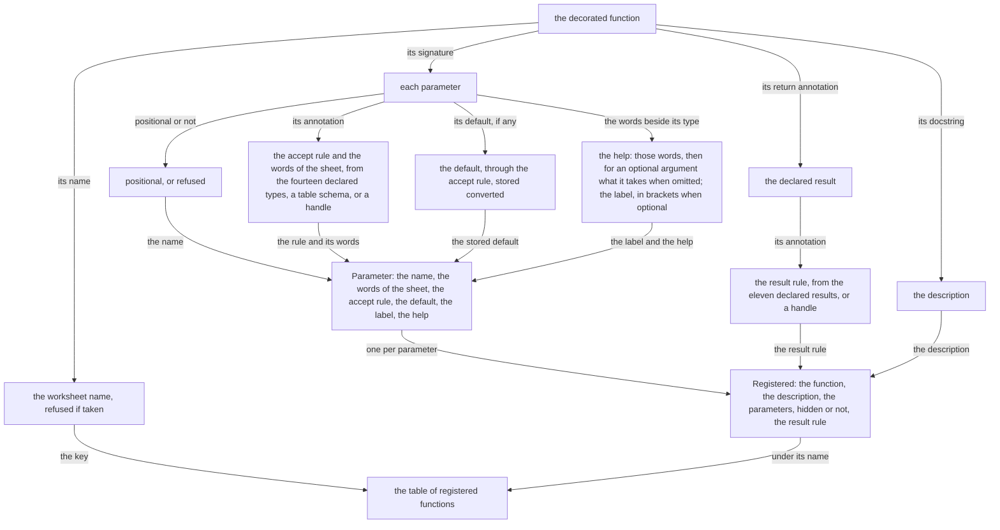
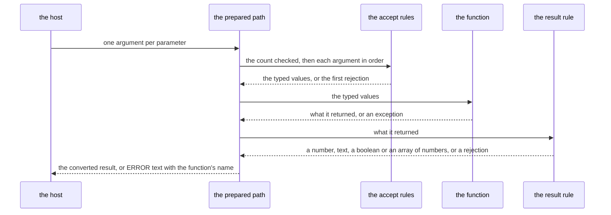
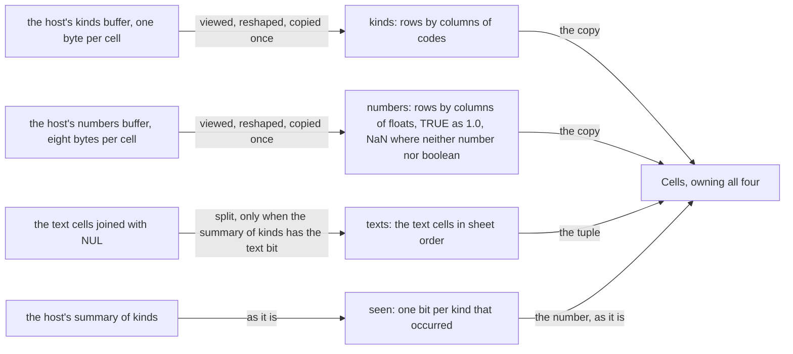

# The bridge

The seam is the one place Excel and Python talk: when a cell holds `=Add(1, 2)`, the seam carries the 1 and the 2 into Python and the 3 back. It has two sides. The host is the C# add-in between Excel and Python; it reads the sheet's cells, hands them over, and shows what comes back. The bridge is the Python side, one module: it registers worksheet functions, checks their arguments, and converts their results. This page explains the bridge in plain words, for the owner coming back after months and for an engineer maintaining it. What may cross is decided in [inputs.md](inputs.md) and [outputs.md](outputs.md); this page is the mechanism that applies those decisions. The host's side is [host.md](host.md).

## One module, four names

The host uses four names from the bridge and nothing else. When Excel loads the add-in, the host starts Python, imports the bridge, and fetches two values from the bridge that it keeps for the whole session; it also keeps things of its own, which [host.md](host.md) lists. One is `MISSING`, the value that stands for an argument a formula left out. The other is `cells_from_buffers`, the function that turns a range, the cells of A1:B3 say as the host read them off the sheet, into the object Python works on. Then it asks `function_specs()` once for the list of worksheet functions, and for each name it asks `entry(name)` once for that function's prepared path. The prepared path is the one function the host calls with each recalculation's inputs; everything that depends on the function alone was resolved before the first call, so for `Add` it already knows both parameters are numbers and the result is a number.

The host keeps each prepared path beside the C# function it registers with Excel under that name; how that function is built is in [host.md](host.md). A call after that hands the prepared path the arguments and nothing else; the host never again asks Python for anything by name. A pin is a test that holds a fact still, a count or a message, so a change that moves it fails; `tests/performance/HostWorkBudgets.cs` pins that at zero name lookups per call, and [baseline.md](baseline.md) records the counts, the host's own tally of what it did on one call.

Importing the bridge imports the package `goosedove.excel` first, whose `__init__.py` is the catalogue: the module that imports every module of worksheet functions, the bridge, the globals and then the probes. A probe is a hidden worksheet function, one absent from Excel's function wizard but still callable by name in a formula, that does no work beyond crossing the seam, so its cost is the seam's own cost; `Add(1, 2)` is one. So every module of worksheet functions has run, and every function is registered, before the host asks for the list. A new module of worksheet functions is added to the catalogue and nowhere else. What registers at import is `Ping`, the bridge's own; the sixteen probes; and the library's functions, one module per group, the globals, the index definitions and the market data today, each of which the library's pages describe.

`function_specs()` returns one tuple per function, a fixed list Python cannot change, in registration order, and the host reads each by position: the name, the description, one pair per argument holding the label Excel shows and its help, and whether the function is hidden. Every probe is hidden; `Ping` and the library's functions are not; `tests/unit/test_bridge.py` pins both.

## Declaring a worksheet function

A worksheet function is a plain Python function with one line written above it, `@excel_function`; that line is a decorator, and it runs when the module is imported. Registration is what that line does: it reads the function's signature, its parameters with their types and defaults and its return type, checks it, builds the prepared path, and stores it under the function's name. The signature is the whole contract. A declared type is an annotation, the type written after a parameter's colon or after the return arrow, `NumberColumn` and `float` in the example below; it decides which rule handles the value, for a parameter its accept rule, the one function for that declared type that returns the typed value or rejects it, and which words every message about it uses. Here is a function that takes a column of numbers and an optional factor and returns a column:

```python
@excel_function
def Scale(values: NumberColumn, factor: float = 1.0) -> NumberColumn:
    """Every value times the factor."""
    return NumberColumn(values * factor)
```

`excel_function` registers a function that Excel lists in its wizard; the probes use `probe`, from the probes module, which registers hidden. Both are one call to `register`, and both run when the decorator is applied, at import. So every check in this section happens once, and a bad declaration stops the host's start-up instead of failing later in a cell: the add-in still loads, `=GoosedoveStatus()` shows the error, and no worksheet function reaches a cell.

Registration reads four things: the function's own name, which becomes the worksheet name; its parameters, each with whether it is positional, its annotation, and its default; its return annotation; and its docstring, the quoted sentence under its first line, `"""Every value times the factor."""` in the example, with surrounding spaces removed, which becomes the description Excel shows, or empty text when there is none. It refuses, with a `TypeError` naming the function, and the parameter where one is at fault:

- a name already registered: `Number is already registered`;
- a parameter the host cannot pass by position, one that must be passed by name or one that takes any number of values: `Keyed: put is keyword-only, which the host cannot pass`;
- an annotation outside the fourteen declared input types, the table schemas, and `Handle[Kind]` around a class the library defines: `Later: x declares list[str], which the seam cannot receive`; a handle around one of the seam's own types, or around a table, is refused the same way, `Read: x declares Handle[str], which the seam cannot receive`;
- a parameter with no annotation, refused the same way, though the message shows Python's name for an empty annotation rather than a plain word;
- an annotation written as text, which is what `from __future__ import annotations` makes of every annotation, so a module of worksheet functions must not use it;
- a default the parameter's own accept rule rejects: `Wrong: x defaults to text 'x', expected number`;
- the form of an argument that may be left out with nothing in its place, `X | None`, without `None` as its default or with another: `Undefaulted: x declares float | None and no default, expected None`, `Defaulted: x declares float | None and defaults to number 1.0, expected None`; a table or a bare mixed range inside the form is refused as it is on its own, since neither takes a default, while a handle inside it is the form's own case since #103, declared as if required and resolving as one when given;
- a table with no row of text before it to hold its headers: `Bare: trades declares a table with no row of text before it to hold its headers`;
- a default on a table: `Defaulted: table declares a table, which takes no default`. A table's columns are checked against its schema on the call, so a default could not be checked at registration as every other default is, and a header row before a table cannot have a default of its own, since a parameter with a default must come last;
- a schema whose column is not a column type, whose columns are one header without regard to case, or which has no columns: `Grid2: wide column values declares goosedove.excel.bridge.NumberArray, which is not a column type`;
- a default on a handle: `ReadWithDefault: curve declares a handle, which takes no default`. The store holds nothing at registration, so there is nothing a default could name; the form `curve: Handle[Curve] | None = None` is not a default but the argument left out, and registers;
- a creator of any kind: `MakeAny declares Handle[object] as its result; a creator names what it makes`. `Handle[object]` is a parameter's declaration only;
- a mixed range on its own, on a function Excel lists: `Value: values declares MixedArray, which a function Excel lists takes only as a table, a row of text and a schema`, [inputs.md](inputs.md) decision 38; a hidden probe may still take one, as the seam's instrument;
- no return annotation, `-> None`, or a return annotation outside the eleven declared result types and `Handle[Kind]`: `Boxed declares Handle[float] as its result, which the seam cannot send`;
- and, once the declaration itself has passed, what Excel is told. The words beside a parameter, `x: Annotated[float, "One number to multiply."]`, are that argument's help, and anything else beside the type is refused: `Loud: x declares typing.Annotated[float, 'a', 'b'], expected one text beside the type, the argument's help`. A function Excel lists must have a docstring and help on every argument, `Mute has no docstring; a function Excel lists says what it does`, `Quiet: x has no help; a function Excel lists says what each argument takes`; a hidden probe may say nothing. Either text longer than the 253 characters Excel shows is refused, `Long: x's help is 254 characters, expected at most 253`, rather than cut without a word, and a line that does not end with a period is refused, `Trailing: x's help does not end with a period`, because what registration adds follows it. A docstring's lines are joined into one, so a long function line may wrap in the code. An optional argument's help ends with what it takes when omitted, in the words of the sheet, `One multiplier. 1 when omitted.`, and its label is its name in brackets, `[factor]`; an argument that may be left out with nothing in its place keeps its sentence alone under a bracketed label, `[option_expiry]`, since there is nothing to name; a default the help cannot show, a mixed range say, is refused, `Shown: values defaults to 1x1 mixed array, which the help cannot show`. `tests/unit/test_help.py` pins all of it.

`tests/unit/test_type_validation.py`, `tests/unit/test_table_validation.py`, `tests/unit/test_result_validation.py` and `tests/unit/test_handles.py` pin those texts, except three. The unannotated parameter has no test, nor does an annotation written as text, nor a text-array return: `TextColumn` and `TextRow` can be taken but not returned, and a function declaring one as its result is refused with `declares goosedove.excel.bridge.TextColumn as its result, which the seam cannot send`.

A default goes through its parameter's accept rule, and every accept rule calls `None` blank, so `None` is never an ordinary default. One form of declaration says something else with it: `option_expiry: DateColumn | None = None` declares an argument that may be left out with nothing in its place. Registration reads the type inside the form, `DateColumn`, for the accept rule and the words of the sheet, and stores `None` as the default without running the rule on it; so a formula that leaves the argument out hands the function `None`, and a blank cell in that slot still fails as a blank, `option_expiry is blank, expected column of dates`. Blank and missing are different facts: a blank is a cell with nothing in it and arrives as `None`, missing is an argument the formula left out and arrives as `MISSING`, and only `MISSING` takes a default, so `=Times(5, A1)` with A1 empty fails and `=Times(5)` takes the default factor of 1. `tests/unit/test_type_validation.py` pins the form: what a left-out argument hands over, a blank in its slot, a supplied value through the type's own rule, and the refusals.

## What registration resolves

For each parameter, registration resolves five things and stores them in a `Parameter` record. The first is the words of the sheet: the plain names messages use for what a cell holds and for each declared type, such as "number", "whole number", "column of dates". The second is the accept rule; the rule for `float` takes 2.5 and returns 2.5, and rejects TRUE. The third is the default, `MISSING` when the argument is required, or `None` when it may be left out with nothing in its place. The fourth and fifth are what Excel is told: the label, the name itself or `[factor]` for an optional argument, and the help, the words beside the parameter followed, for an optional argument, by what it takes when omitted, and by nothing for one that may be left out with nothing in its place. A default is run through the accept rule at registration and stored already converted. `Scale`'s factor is stored as the float 1.0; a `Date` parameter defaulting to 46164.0 stores 2026-05-22 as a numpy day; numpy is the number library the bridge uses for arrays, and its day is a date held as a whole count of days. A `NumberColumn` defaulting to 2.0 stores a one-element array. At call time a missing argument receives that stored value, and nothing checks it again.

For the return, registration resolves the result rule: the one function for that declared result type that converts what the function returned into what the host can show, or rejects it; the rule for `Date` turns the day 2026-05-22 into 46164.0, the number Excel shows as that date. The `Registered` record holds the function, the description, the tuple of parameters, whether it is hidden, and the result rule. Its `run` method is the prepared path. For `Scale`, the path already knows the first argument must be a column of numbers, the second a number defaulting to 1.0, and the result a column.

This shows what registration reads from a decorated function and what it builds from each piece.



The records live in one table keyed by name, filled once at import, and `function_specs()` reads that table. `entry(name)` returns the prepared path for the host to keep; an unregistered name raises `KeyError` there, at registration, never in a cell. `call(name, args)` reaches the same path by name for callers that hold no entry, which is the tests.

## One call through the prepared path

A trip is one crossing from the host into Python and back: one call of one function, so every recalculation of `=Add(1, 2)` is one trip. On each trip the prepared path does four things in order, and catches any failure among them once. It builds the arguments, which is type validation, the whole check of every argument against the function's signature: the count is checked first, and a mismatch fails with `expected 2 arguments, got 1`; then each argument is checked left to right against its parameter, stopping at the first rejection. It calls the function with the typed values. It converts what came back with the result rule. And it turns any failure on that line into cell text: `#ERROR`, the function's name, a colon, and the message.

The check of one argument is short. If the value is `MISSING` and the parameter has a default, the default is returned and the accept rule does not run. Otherwise the accept rule runs. A rejection that names no cell becomes the argument's name, what arrived, and the words expected: `price is text 'Brent', expected number`. A rejection that names a cell inside a range becomes the argument's name, the cell, what that cell holds, and the cell's words: `values cell (3, 1) is blank, expected number`.

Three kinds of exception are caught, and each makes a different text. `TypeValidationError` is the public failure for an argument whose type or shape is wrong; it becomes `#ERROR Add: b is boolean TRUE, expected number`. `_BadResult` is raised inside a result rule and carries the text that follows the name; it becomes `#ERROR OutText: returned empty text, expected text`. Any other `Exception` from the function body keeps its type name and its message: `#ERROR Fail: ValueError: as asked`. Nothing else is caught, so a `KeyboardInterrupt` or `SystemExit` raised in a function body passes through to the host. `tests/unit/test_bridge.py` pins the first and third texts; `tests/unit/test_result_validation.py` pins the second.

This is one trip in order, from the host's call to what it gets back.



The way in is type validation, before the function runs; the way out is the conversion of the result after it. Both are pinned by a ledger: the exact list of which of the bridge's own functions ran during one call and how many times, recorded by a profiler, a tool that watches a call and notes every function it entered, and compared whole by the tests. `tests/performance/test_seam_budgets.py` pins `Add(1.0, 2.0)` at seven entries: the prepared path, the argument builder, the function, and the number result rule once each, the check of one argument and the number rule twice each, and once the unwrapping of a numpy scalar, a single number numpy hands back in its own wrapper, into the plain Python number it holds. It pins `Fail()` at three, the prepared path, the argument builder, and the function, because a failing body is never converted. And it pins `Add("x", 2.0)` as stopping at the first rejection: one check of one argument, one rule, one rejection, one description.

## The declared input types

A scalar is one value on its own: a number, text, a boolean, a blank cell, or a missing argument; in `=Times(5, )` the 5 is a scalar and the second argument is missing. An array is many values laid out in rows and columns, as numpy holds them. The bridge sees every range as `Cells`, described in the next section, which holds its arrays. A view is another name for the same memory, and a copy is new memory holding the same values. Flat means one-dimensional: a single run of values with no rows and columns. Nine of the range and date types are named labels: `Date` on a numpy day, the number, date and boolean ranges on numpy arrays, and the text ranges on tuples, so the seam can tell one shape of numbers from another; the label says what shape is expected and how a result is laid out. Each declared input type has one accept rule, and this table names it. The rules and decisions are in [inputs.md](inputs.md); this table is the mechanism. Two declarations are not labels: a table's schema is a class of its own, whose columns name their column types, as the section on tables says; and a handle is the seam's alias `Handle` around a class the library defines, as the section on handles says.

| Declared | Words of the sheet | Accept rule | Hands the function |
|---|---|---|---|
| `float` | number | `_number` | a float |
| `int` | whole number | `_whole` | a Python int |
| `str` | text | `_text` | the text |
| `bool` | boolean | `_boolean` | the boolean |
| `Date` | date | `_date` | a numpy day |
| `NumberArray` | array of numbers | `_numbers` | the range's numbers array, in the sheet's shape |
| `NumberColumn` | column of numbers | `_column` | a flat view of the one column |
| `NumberRow` | row of numbers | `_row` | a flat view of the one row |
| `DateColumn` | column of dates | `_date_column` | a flat array of numpy days |
| `DateRow` | row of dates | `_date_row` | a flat array of numpy days |
| `TextColumn` | column of text | `_text_column` | the host's tuple of texts, as it is |
| `TextRow` | row of text | `_text_row` | the host's tuple of texts, as it is |
| `BooleanColumn` | column of booleans | `_boolean_column` | a flat array of booleans, converted from the 1.0 and 0.0 the host wrote |
| `MixedArray` | mixed array | `_mixed` | a record holding the range's own kinds, numbers and texts; for a hidden probe, and as the body under a table's schema |
| a subclass of `Table` | table | `_mixed`, then `_refine` | the schema's record, one typed column per header |
| `Handle[Kind]` | the kind's words, then handle: `discount curve handle`; `a handle` for `Handle[object]`, any kind | `_resolve` | the object the handle stands for |

The scalar accept rules match exactly. A Python bool is an int, so the number rule rejects a bool before it accepts an int or float, as [inputs.md](inputs.md) rule 1 requires. Whole means no fraction and within 2^53 either side, the largest whole number a cell holds exactly and the line the way out holds, so whatever a creator keeps can be read back ([inputs.md](inputs.md) decision 41); `tests/unit/test_type_validation.py` pins that every whole number from −2^53 to 2^53 passes and that 1E16, whole and beyond, fails as `x is number 1e+16, beyond what a cell holds exactly`, the way out's words, since `expected whole number` would be false. A date is a whole serial inside the calendar. What a serial and the calendar are, and why serial 60 is rejected, is [inputs.md](inputs.md) rule 6 and decision 13; here the date rule checks a number, then no fraction, then the calendar, in that order, the three tests the range rule makes over every cell, and never the whole-number rule's bound: a serial of 1E19 is not a date, and says so, rather than beyond what a cell holds.

A cell's kind is which of five things it holds, a number, text, a boolean, a blank, or a missing argument, each with a code the host and the bridge share: number 0, text 1, boolean 2, blank 3, missing 4. Four rules apply across the range types, in this order: a scalar becomes a range; shape; kind; value.

A scalar into a range slot becomes a 1×1 range, and text into a text row or column becomes a one-text tuple: `SumArray(5.0)` is 5.0, and `"x"` into a row of text is `("x",)`. A rejected scalar in a range slot is named as the whole argument, with the range's words: `values is text 'x', expected array of numbers`. The reverse never happens. A range into a scalar slot fails with its shape, even a 1×1 range: `x is 1x1 array, expected number`.

Shape before cells. The column and row types check the shape first, and a wrong shape rejects the whole argument by its shape before any cell is looked at: a 1×2 range holding a blank into a column slot fails as `values is 1x2 array, expected column of numbers`, not on the blank. A column or row that passes is handed over flat, a one-dimensional array or a tuple, while `NumberArray` keeps the sheet's shape. Nothing is reordered: the first value of a column holding 3, 1, 2 is 3.

Kind next. The summary of kinds is one number from the host with one bit per kind it saw in the range, so for a range of only numbers it is 1 and for a range with one text cell among numbers it is 3. A look is one pass over a whole range at once, one numpy operation; a walk is visiting cells one by one in Python, which the bridge never does on the host's path. The summary of kinds settles the kind check when it can: when it is exactly "only numbers", the numbers rule hands over the range's numbers array with no look; when it is exactly "only text", the text rule hands over the host's tuple with no look; when it is exactly "only booleans", the boolean rule converts the 1.0 and 0.0 the host wrote into booleans in one conversion and no look.

Otherwise one look names the cell. A mask is an array of yes-or-no flags, one per cell, made in one look; here it is yes wherever the kind code is not the one wanted. The position of the first yes is the bad cell's place counting across then down. Dividing that by the column count gives a row and a column, counted the way INDEX counts: from 1, within the range, so the second cell of the first row is cell (1, 2). The cell's own value is then read by its kind for the message, `values cell (2, 2) is text 'x', expected number`; a text cell's text is found by counting the text codes before it, one more look. `tests/unit/test_range_validation.py` holds a property test, one that tries many random ranges rather than a chosen few: for any range up to 12 by 12 with a blank or a text at (r, c) among numbers and another at the last cell, the message names (r, c); and over a column of up to 12 rows, a number among text or a serial 60 among dates at row r is named (r, 1).

Value last, and only two rules look at what a value means. Empty text: a range whose summary of kinds is only text is then searched for an empty text, and the first one is named, `names cell (2, 1) is empty text, expected text`. Its place among the texts is its place among the cells, since every cell is text, so no look at the kinds is needed. The calendar: a range of dates always takes one look at the values, whatever the summary of kinds says, because the calendar is a value rule. One mask flags cells with a fraction, below 61, or above 2958465; when the summary of kinds is not only numbers, the kinds mask is added to it; the first flagged cell is named as above, `dates cell (2, 1) is number 60.0, expected date`. A blank cell fails the value mask by itself: its number is NaN, numpy's not-a-number, which no test for a whole number passes. So the no-look claim holds for numbers and text and not for dates, and the date look is a look, not a walk.

What that costs is pinned. For ten thousand numbers into `SumArray`, `tests/performance/test_seam_budgets.py` pins the numpy ledger, the list of what the bridge asked numpy to do, its copies and reductions, a reduction being the folding of an array to one number as SUM does, at the sum itself and nothing else, and for `Dot` over two such columns at nothing at all. A ceiling is the most memory a call may take at its peak, measured once and pinned with a slack of 1,024 bytes for the small objects any call makes. `tests/performance/test_seam_allocation.py` pins a range of numbers in under that slack alone, measured 192 bytes on 2026-09-11 by its comment, down from 77,008 when every range paid a look. A bad cell at row 5,001 of 10,000 runs the same eight bridge functions once each whatever the cell holds. The rejected range's ceiling is 2 bytes per cell plus the slack, its two masks: measured 20,640 with the text in the last cell, down from 87,247 at the first baseline (the test's own comment says 87,239; [history.md](history.md) lists the eight-byte difference as open), when the kinds were compared against a named code object rather than a plain integer.

## Cells, and owning a range

`Cells` is what every range arrives as. It has four fields. `kinds` is a two-dimensional array of one code per cell, one byte each. `numbers` is a two-dimensional array of one float per cell: the value of number and boolean cells, TRUE as 1.0, and NaN elsewhere. `texts` is a tuple of every text cell in sheet order, so the k-th text is the k-th text code in `kinds`. `seen` is the host's summary of kinds. The record cannot be changed once made, two are never compared, and nothing in it re-checks what the host sent.

A buffer is memory the host fills and holds still so Python can read it where it lies. The host scans a range once, writing one byte per cell into a kinds buffer and eight bytes per cell into a numbers buffer, collecting the text cells, and setting the bits of the summary of kinds as it goes; then it hands Python the two addresses. Owning a range is Python copying those buffers into arrays it keeps, because the host will refill them for the next range. `cells_from_buffers` does that. It takes the two addresses, the rows and columns, the text cells joined into one string with a NUL character, an invisible zero character, between each, and the summary of kinds. It views each buffer as a numpy array where it lies, reshapes it to rows by columns, and copies it once.

The text is split only when the summary of kinds has the text bit, otherwise `texts` is the empty tuple; splitting `"x\0"` gives `("x", "")`, so an empty text cell survives to be named. Nothing here looks at the kinds: the summary of kinds is the host's, made during its one scan, and the bridge takes it as it is.

This shows where each field comes from and what is copied.



`tests/performance/test_seam_budgets.py` pins owning ten thousand cells at two views, two reshapes and two copies on the numpy ledger, with or without a text cell, and `tests/performance/test_seam_allocation.py` pins its ceiling at 9 bytes per cell plus the slack, its two copies; [baseline.md](baseline.md) records 90,752 bytes. The host counts a range in as two trips, one to own it and one for the prepared path, and three Python objects built to carry it, the rows, the columns and the summary of kinds; that table is in [baseline.md](baseline.md).

After the accept rule, a function taking numbers or text gets the range's own arrays, not copies. `NumberArray` hands over the numbers array itself. `NumberColumn` and `NumberRow` hand over a view of its first column or row. The text types hand over the host's tuple as it is, with nothing built to carry it; `tests/performance/test_seam_allocation.py` pins a column of ten thousand texts under the slack alone, measured 192 bytes by its comment, down from 160,635 when the tuple went into a numpy array and back out before PR #43. Only the date types build something: a new array of days made from the numbers in one look.

`Cells.from_rows` builds the same object from Python values, for tests. `Cells.from_rows([[1.0, "x"], [None, True]])` classifies each value, fills the kinds and the numbers, collects the texts, and sets the bits of the summary of kinds the host would have set; `tests/unit/test_bridge.py` pins that a row holding a number, a text, a blank, a boolean and a missing argument has all five bits. It rejects an empty range, since Excel never sends fewer than one cell. It is the one loop over cells in the bridge, and it is a test helper, not the host's path.

## The mixed range, and what the function receives

Every other range type hands over a bare array or list, because every cell in it holds the same kind of thing. A mixed range cannot, so `MixedArray` is a record with three fields. `kinds` and `texts` are the ones `Cells` holds, and `numeric_slots` is its numbers under a name that says what it is. The three are the same objects, handed on and not copied.

The name matters. `numeric_slots` is storage, not an array of numbers: a number cell's value sits there, a boolean sits there as 1.0 or 0.0, and a text cell holds NaN as a placeholder the host wrote. So the kinds say what any slot means, and summing the slots alone would count TRUE as one and poison every text cell. `shape` is the rectangle's rows and columns, read from the kinds.

Accepting one is two tests and no look. The host's summary settles the kinds: a mixed range may hold number, text and boolean, so the rule asks whether any other bit is set, which is one integer test whatever the range's size. Then it looks for an empty text, which is the one thing the summary cannot answer, because the host records which kinds occurred and not whether a text has characters in it. That scan is a C-level pass over the text cells, so a range with no text pays nothing.

The rule itself costs nothing measurable. The same ten thousand numeric cells cost 42.2 microseconds under the numeric rule and 42.4 under the mixed one on the host's clock, and 314 against 315 per formula in Excel. What a mixed range costs beyond a numeric one is the text it holds, and almost none of that is the scan: checking one text cell for emptiness is about seven nanoseconds, while carrying one across is about seventy on the host's clock and a hundred and twenty in Excel. The host has always paid that for text, and this rule did not add it.

Rejecting one is where the work is. Blank and missing are found by one compare against the highest kind a mixed range may hold, which works because those three are the lowest codes; a test pins that, so reordering the kinds fails loudly rather than quietly admitting a blank. An empty text is flagged into the same array, by turning its place among the texts into its place among the cells. Both causes then sit in one array, so the earliest cell in sheet order wins with no comparing of positions, and the same function that names a bad cell for every other range type names this one. Locating an empty text is the most expensive rejection the seam has, about ten bytes a cell against one for a blank, which is the price of a failure and is pinned as such.

## A table: a header row and a schema

A table is what a person lays out on a sheet: a header row naming the columns, and a body with one kind of thing per column. It crosses as two arguments, the header row as a `TextRow` and the body as a mixed range, and the function declares a schema: a class deriving from `Table`, one line per column, the header name and its column type, which is any of `NumberColumn`, `DateColumn`, `TextColumn` and `BooleanColumn`. The schema is part of the signature. A header is to a column what a parameter name is to an argument.

```python
class Trades(Table):
    date: DateColumn
    product: TextColumn
    quantity: NumberColumn
    cleared: BooleanColumn


@excel_function
def TotalQuantity(header_row: TextRow, trades: Trades) -> float:
    """Sum of quantity over a table of trades."""
    return float(trades.quantity.sum())
```

Registration reads the schema once, as it reads a signature: each column's name and column type, matched without regard to case, and the parameter before the table, which must be a row of text, because that is where the headers come from. It refuses a table with no row of text before it, a column whose type is not a column type, two columns that are one header without regard to case, and a schema with no columns, each with the function's name, so a bad schema stops the add-in's start-up as a bad annotation does. What it keeps is the schema: the record class to build, the two parameter names for messages, and the columns by position and by name.

On each call the prepared path does what it always did first: every argument alone, left to right, the header row as a row of text and the body as a mixed range, so a blank in the body is the mixed rule's failure with the mixed rule's words. Then, for each table, it binds and refines. Binding matches the headers to the schema: the count against the body's width, then each header in order, either unknown or already given, then any name the headers left out; the earliest offending header wins. Four headers cost four lookups, and nothing is done per row. Refinement then takes the columns in sheet order and checks each against its column type with one look: the kinds settle a column of numbers, text or booleans, one compare of that column's kind codes, and the slots settle a column of dates, the same three tests the date rule makes over a whole range, because a text slot is NaN and a boolean slot is 1.0 or 0.0, and neither is a whole serial inside the calendar. The first flagged cell is named as INDEX counts within the whole body, with the column's own position, so `trades cell (2, 1) is number 46277.5, expected date` says which column and which row.

What the function receives is the schema's record, a frozen object with one typed attribute per column, aligned by row: `trades.date` is an array of numpy days, `trades.product` a tuple of texts, `trades.quantity` an array of numbers and `trades.cleared` an array of booleans. Nothing is rebuilt. A column of numbers is a view of the mixed storage. A column of dates is converted once, by the same two steps the date rule uses. A column of booleans is one conversion of its slots. A column of text is gathered once: the k-th text cell of the body is the k-th text, so each cell's place among the texts is the count of text cells above its row plus the count to its left, found for the whole body in one mask and one cumulative sum the first time a column of text is bound, and the texts are then picked out by those places from an array of them, with nothing made per row. The headers were consumed by the binding; the record does not carry them, and the header-row parameter receives the tuple it always did, which the function has no use for.

What that costs is pinned. `tests/performance/test_seam_budgets.py` pins a table of ten thousand cells, 2,500 rows of the four columns above, at every bridge function once, and on the numpy ledger at one look per column, three conversions, one array of the texts, one cumulative sum and three sums, whatever the number of rows. `tests/performance/test_seam_allocation.py` pins its peak at 14 bytes per cell plus the slack, measured 135,266 bytes on 2026-09-13: the conversions of the date column, the placing and gathering of the text column, the boolean column, and one 1-byte mask per column. A bad cell deep in a column is found by that column's look and named without a walk, and the columns after it are never looked at. On the host a table is two ranges in, the header row and the body, and `tests/performance/HostWorkBudgets.cs` pins it at three trips, eight objects and the cells and text cells of both; the host carries a table as it carries any two ranges, and knows nothing of schemas.

`MixedArray` stays for a function that wants the raw record, as `CountMixed` does. Reordered columns bind by name and work; a header with a space in it does not, and the message quotes the space.

## A handle: one store, and the text

A handle is text in a cell that stands for an object the seam holds, such as a curve. The declaration is one alias, `Handle`, written around a class the library defines: `-> Handle[DiscountCurve]` on a creator, `curve: Handle[DiscountCurve]` on a consumer. To the type checker the alias is the class itself, so a function body needs no cast; to registration it is the mark that selects publishing on the way out and resolving on the way in. The kind is the class inside the brackets, and its words on the sheet are its name in lowercase words, `discount curve`; its tag in the text is the same with underscores. A class of the seam's own inside the brackets, a table, or a bare `Handle` refuses to register as an unknown annotation does, and a handle parameter takes no default, because the store holds nothing at registration.

```python
@excel_function
def _CreateDiscountCurve(header_row: TextRow, table: DiscountCurveTable) -> Handle[DiscountCurve]:
    """Creates a daily discount-curve handle. Its last date is the latest the library prices."""
    return discount_curve(table.date, table.discount_factor)


@excel_function
def util_ReadHandle(handle: Handle[object]) -> MixedArray:
    """Reads the object behind a handle and spills it as a table."""
    return shown(handle)
```

The store is one dictionary in the bridge, from a handle's text to the kind the seam verified and a strong reference to the object. Nothing else holds an object, and the library never sees the text. Publishing, `_publish`, runs as a result rule: the object must be of exactly the declared class, or it is refused as any result is, `returned a Python list, expected discount curve`; then the text is made, the entry stored, and the text returned. The text is `kind:session:number`: the tag, six hex characters drawn once when Python starts, and a running number shared by every kind, six digits at least, `discount_curve:3f9a1c:000002`. The session part is what keeps text saved in a workbook from naming an object of a later session; the number never repeats within one. A creator that raises never reaches the rule, so a failure is never published and the number does not move.

Resolving, `_resolve`, runs as an accept rule, and its faults come in the order [inputs.md](inputs.md) decision 35 gives: the text rule first, so a number, a blank, a missing argument, an empty text or an array fail in the seam's usual words; then text beginning `#ERROR `, a creator's failure relayed by a reference to its cell, `curve is the creator's failure, expected discount curve handle: #ERROR _CreateDiscountCurve: ...`, the creator's own text carried whole at the end, and when the text relayed is itself such a relay the creator's text is taken out of it and carried on unchanged, so a chain of consumers of any length shows one message and quoting never compounds; then one dictionary lookup, which finds nothing, `curve is text 'discount_curve:000000:000001' naming no live object, expected discount curve handle`, or an entry of another kind, `curve is valuation date handle 'valuation_date:3f9a1c:000001', expected discount curve handle`; otherwise the function receives the object itself. The kind is compared by identity against what the store recorded; the text's own prefix proves nothing, and nothing in the text is parsed. A parameter declared `Handle[object]` takes the object behind any handle: the same rule runs with that one comparison skipped, and its words name no kind, `handle is number 3.0, expected a handle` ([inputs.md](inputs.md) decision 40). Only a parameter may say so; a creator names what it makes, and `Handle[object]` as a result refuses to register.

What that costs is pinned. `tests/performance/test_seam_budgets.py` pins `_CreateValuationDate` at the two-scalar call, the library's builder and one publication; `_CreateDiscountCurve` at 3,631 rows at the table path, the builder, the interpolation that fills the days between the anchors and one publication, with five looks, two conversions, the two ranges of days the interpolation asks for and its one conversion on the numpy ledger; `util_ReadHandle` at a text call, one lookup, the kind's table built a column at a time and the mixed road out; and a dead handle at one lookup and nothing else. `tests/performance/test_seam_allocation.py` pins a small creator under twice the slack, measured 1,176 bytes on 2026-09-14, reading it back under four times the slack, the ten-year curve from a daily table at 60 bytes per day plus the slack, measured 216,443: its two arrays at 16 bytes per day, with the table path's conversion of the date column, the builder's looks and the filling of every day on the way, and from a dozen anchors at 25 bytes per day, measured 89,602, the days it fills; and reading that curve back at its table and the road's masks. `tests/unit/test_handles.py` pins every text above with two kinds of its own, `tests/unit/test_globals.py` the creators through the seam and `tests/unit/test_utilities.py` the reader.

Every creator call publishes: two creator cells with equal inputs hold two objects, and a recalculated creator publishes anew, so the store grows until Excel closes. Release when a creator is deleted or its workbook closes, and reuse of the same handle on an unchanged recalculation, are open, specified in [handles.md](handles.md), with the evidence for the two ways of building them in [excel-dna-handles.md](excel-dna-handles.md).

## The result rules

The result rule for a declared return type converts what the function returned into one of the five things the host can show: a number, text, a boolean, an array of numbers, or a rectangle of numbers, text and booleans; for a handle it keeps the object and sends its text. The rules and decisions, and the full list of what fails, are [outputs.md](outputs.md)'s; this table is the mechanism, with the shortest phrase for what each rule rejects.

| Declared | Result rule | Rejects | Sends |
|---|---|---|---|
| `float` | `_number_out` | not a number; not finite; a whole number beyond 2^53 | a float |
| `int` | `_whole_out` | the same, a fraction, and any number beyond 2^53 | a float, since the sheet has one kind of number |
| `str` | `_text_out` | not text; empty; too long | the text |
| `bool` | `_boolean_out` | not True or False | the boolean |
| `Date` | `_date_out` | not a numpy day inside the calendar | the serial, as a float |
| `NumberArray` | `_array_out` | not a plain two-dimensional array of such numbers; empty | the array, as one unbroken run of 8-byte numbers |
| `NumberColumn` | `_column_out` | not a plain one-dimensional array of such numbers; empty | reshaped to N by 1 |
| `NumberRow` | `_row_out` | the same | reshaped to 1 by N |
| `DateColumn` | `_date_column_out` | not a one-dimensional array of such days; empty | serials, N by 1 |
| `DateRow` | `_date_row_out` | the same | serials, 1 by N |
| `Handle[Kind]` | `_publish` | not an object of exactly that class; nothing | the handle, text, after keeping the object |
| `MixedArray` | `_mixed_out` | not the record; no cells; a cell holding no value; a number that is not finite; a boolean slot that is not 0 or 1; a text with a NUL, or too long | the kinds, the numbers and the texts joined with NUL, a tuple read by position |

The mixed road is the mirror of the way in. The rule checks the record as the way in checks a range: the earliest cell holding no value, a blank, a missing or an empty text, is named as INDEX counts, then a number cell must be finite and a boolean slot 0 or 1, no text may hold a NUL, since NUL separates the texts on their way across, and every text is at most what a cell holds, checked on the joined text in one encode and split per text, in one look over the units, only when the total runs past the limit. What the host receives is what it sent: the kinds, one byte per cell, the numbers, eight per cell, and the texts joined, and it lays the array out cell by cell, because Excel takes an array one tagged value per cell and there is no block of mixed cells to copy in one move; [host.md](host.md#the-way-out) says what that costs. `MixedArray.table` builds a record for the way out from rows of headings over columns of one kind each, a tuple of texts, an array of numbers, of numpy days, which go out as serials, or of booleans, filling the kinds and the slots a column at a time and gathering the texts in sheet order, so no function writes kinds by hand; the one table it cannot build, a column that holds a number on one row and a word on another, the market history's `fixing_price` since #84 and the market's `price` since #86, one helper in `utilities.py` composes from the record's three fields, the calendar's table widened by one column. It checks each column before it is copied into the slots, where the copy would hide what the rule could no longer see: only a plain one-dimensional array is taken, so a masked array is refused as the array results refuse it, and a column of whole numbers is checked against 2^53 either side, naming the cell, as the array results check before their conversion; a day outside the calendar fails there as a date result fails, naming the cell.

A numpy scalar is unwrapped first, so `np.float64(1.5)` is 1.5 and `np.bool_(False)` is False; a numpy value that cannot be unwrapped to a Python one, a longdouble say, is rejected by name. Integers are numbers: 3 goes out as 3.0, and a whole number out is a float too, because a whole number and a number are one kind on the sheet. 9007199254740993 is one past 2^53 and is rejected as `beyond what a cell holds exactly`. The finite check comes last for a number and second for a whole number, before its fraction check: NaN or infinity is `result is not a finite number` either way.

Text length is counted the way Excel's LEN counts, in UTF-16 units: most characters count as one and an emoji counts as two. `tests/unit/test_result_validation.py` pins that 16,383 emoji plus `a`, 32,767 units, passes, and 16,384 emoji, 32,768 units, is rejected as `returned text of 32768 characters, expected at most 32767`.

A date goes out as its whole serial. Only a numpy value in days is a date; a Python date, a number, a day with a time, a month or a year are rejected as `returned <what it was>, expected date`. NaT, numpy's not-a-date, is `result is not a date`, and a day before 1900-03-01 or after 9999-12-31 is `result is a date outside 1900-03-01 to 9999-12-31`. A column or row of dates is converted the same way in one look, and the first NaT or out-of-calendar day is named as `result cell (i, 1)` or `result cell (1, i)`.

Spill is how Excel lays an array result over neighbouring cells: a column spills down and a row spills across. Which way a result spills is decided by the declaration, [outputs.md](outputs.md) rule 3; here is the mechanism. A one-dimensional array of three values is reshaped to 3 by 1 when declared `NumberColumn` and to 1 by 3 when declared `NumberRow`, and a bad second value is `result cell (2, 1)` in the one case and `result cell (1, 2)` in the other. `NumberArray` keeps the two-dimensional shape as returned. A variant of numpy's array, a masked array say, is rejected by its own name, because it could hide cells behind the memory it shows.

Every array leaves contiguous, in float64, numpy's ordinary 8-byte number and the one a cell holds, and in two dimensions; `tests/unit/test_result_validation.py` pins all three. Contiguous means laid out in memory in one unbroken run, row after row, so the host can copy it straight through. The finite check on an array is one look. An array of whole numbers is first checked against 2^53 from both sides, above and below, because taking absolute values would fail on the most negative number numpy holds. Then the array is made contiguous float64, a mask marks the cells that are not finite, and the first is named as INDEX counts. `tests/unit/test_result_validation.py` holds the property test: NaN at (r, c) and infinity at the last cell names (r, c).

`tests/performance/test_seam_budgets.py` pins `EchoColumn` at no look in and one look out, with the contiguous copy handing back the same array. `tests/performance/test_seam_allocation.py` pins a column out at 1 byte per cell plus the slack, its finite mask, measured 10,385 by its comment, and an array out at 9 bytes per cell plus the slack, the array and its mask, which [baseline.md](baseline.md) records at 90,385.

## The words a message uses

One function, `describe`, says what arrived or what was returned, in the words of the sheet, and every message quotes it. A missing argument is `missing`; a blank is `blank`; a boolean is `boolean TRUE` or `boolean FALSE`. A number is `number` followed by Python's own spelling of it, so a float prints with a decimal, `number 46164.0` and `number 1e+19`, and a Python int without one, `number 9007199254740993`. Text is `text 'Brent'`, quoted, or `empty text`. A range is its shape, `2x2 array`. A numpy date is named by its unit: `date 2026-05-22`, `date with a time 2026-05-22T12:00`, `date in months 2026-05`, `date in years 2026`, and `date without a unit` for a NaT with none.

A numpy array is named by its dimensions and its kind: `2x1 array of numbers`, `1x1 array of booleans`, `1x1 array of text`, `list of 2 numbers`, `list of 1 number`, `list of 2 dates in months`, `3-dimensional array of numbers`. Number, boolean and text come from what the array holds, and a date array's word from its unit. A variant of numpy's array is `a numpy MaskedArray`, a numpy scalar that cannot be unwrapped is `a numpy longdouble`, and anything the sheet has no word for is named by Python's own, `a Python list`, `a Python date`. On the way out, a function that returned `None` is `returned nothing`.

The rest of a message is fixed text around those words. On the way in it is `is` and `expected`: `x is boolean TRUE, expected number`, `values cell (1, 2) is blank, expected number`; or `is` and why, for the one value of the expected kind that is still refused, `x is number 1e+16, beyond what a cell holds exactly`. On the way out it is `returned` and `expected`, or `result` and what is wrong: `returned a Python list, expected number`, `result is not a finite number`, `result cell (1, 2) is not a finite number`, `result cell (1, 1) is beyond what a cell holds exactly`, `returned 0x3 array of numbers, expected array of numbers with at least one cell`. `tests/unit/test_type_validation.py`, `tests/unit/test_range_validation.py` and `tests/unit/test_result_validation.py` pin every one exactly.

## MISSING

`MISSING` is one object, the single instance of a class with nothing in it, whose printed form is `MISSING`. The host keeps it from start, as the first section says, and passes it wherever a formula left an argument out, so an omitted argument costs the host one Python object fewer than a supplied one; `tests/performance/HostWorkBudgets.cs` pins `Add(1, 2)` at two objects built and `Times(5)` at one, and [baseline.md](baseline.md) records both. It can also stand inside a range, as kind code 4, in the rare cases Excel sends one there.

It is the only value that takes a default: `Rate(None)` is `x is blank, expected number` while `Rate(MISSING)` is 0.05, and a present value is still checked when a default exists, so `Rate("7%")` fails. For an argument declared `X | None = None` the default it takes is `None` itself, so `Maybe(1, MISSING, MISSING)` hands the function nothing for both of its optional arguments, while `Maybe(1, None, MISSING)` is `y is blank, expected number`. In a message it is `missing`, and into a range slot it fails as the whole argument, `values is missing, expected array of numbers`. `tests/unit/test_type_validation.py` pins the Rate cases and the scalar message; `tests/unit/test_range_validation.py` pins the range-slot one.

## The probes and what each proves

The probes are the sixteen hidden worksheet functions in the probes module. Each proves one thing the host can tell apart, on the way in or the way out, or one rule the bridge applies to what the host cannot. Together they are the knobs a capacity run turns: how many calls, how many cells in, how many cells out. They ship in the build everyone loads and stay as long as the seam does.

| Probe | In and out | Proves |
|---|---|---|
| `Zero()` | nothing in, a number out | zero arguments and no work; the floor every other count is read against |
| `Add(a, b)` | two numbers in, a number out | a number in and a number out; the reference for one call |
| `Times(x, factor=1.0)` | a number and an optional number in | only a missing argument takes the default; a blank cell fails |
| `EchoText(label)` | text in and out | text crosses both ways unchanged |
| `EchoBoolean(flag)` | a boolean in and out | TRUE arrives as a boolean, not as the number 1, and returns as one |
| `SumArray(values)` | a `NumberArray` in, a number out | a range of any shape arrives as cells; the sum proves every cell did |
| `CountArray(values)` | a `NumberArray` in, a whole number out | the control `CountMixed` is read against: the same count, reached by the numeric rule |
| `CountMixed(values)` | a `MixedArray` in, a whole number out | a rectangle of three kinds arrives as one record, and its shape says how many cells |
| `SumQuantity(header_row, trades)` | a `TextRow` and a table of a date, a text, a number and a boolean column in, a number out | a header row and a body bind by name into typed columns, one of each column type; the sum of one column proves the binding |
| `Dot(a, b)` | two `NumberColumn`s in, a number out | two ranges in one call arrive as two ranges |
| `EchoColumn(values)` | a `NumberColumn` in and out | a column in and the same column out, spilled down |
| `EchoRow(values)` | a `NumberRow` in and out | the same across; a row out costs what a column out costs |
| `EchoMixed(values)` | a `MixedArray` in and out | a rectangle of three kinds goes out as it came, one tagged value per cell: the mixed road out, read over numbers alone against `EchoColumn` and over a mixed column against that |
| `RowSums(values)` | a `NumberArray` in, a `NumberColumn` out | a grid in and one number per row out: the shape of pricing every row |
| `Grid(rows, cols)` | two whole numbers in, a `NumberArray` out | an array out from nothing in; below one row or column it raises, and the cell shows `#ERROR Grid: ValueError: ...` |
| `Fail()` | nothing in | an error in the body reaches the cell as `#ERROR Fail: ValueError: as asked` |

`Ping` is not a probe. It is the bridge's own worksheet function, listed in the wizard, and returns `goosedove <version> from <path>`, with `source checkout` in place of the version when the package is not installed.

The three looks, a column of numbers, of dates and of text, have no probe, because the host cannot tell those ranges from any other, so `FirstOfNumbers`, `FirstOfDates` and `FirstOfNames` live in `tests/performance/conftest.py` only to count the Python side; [history.md](history.md) lists the missing text and date probes as open. `CountMixed` is the exception that made the rule worth stating: the host cannot tell a mixed range apart either, but the rule that admits one is the whole point of the type, so it earns a probe and a control to be read against.

## What is deliberately absent, and why

Each absence is a choice, and each has a tenet in `PRINCIPLES.md` that decided it.

No coercion. Every case is [inputs.md](inputs.md) rules 1 and 3; the mechanism is that each accept rule matches its type exactly and nothing converts. The number rule rejects a bool by name before it accepts an int or float, because in Python a bool is an int. Integers as numbers on the way out is not coercion, per [outputs.md](outputs.md): on the sheet they are one kind. Tenet 2, fail loudly: a wrong number that looks right is the worst outcome. Tenet 1, parse at the edge: the seam is the one place untrusted input becomes typed values.

No `isinstance` on internal calls. Every `isinstance` in the bridge sits in an accept rule, a result rule, the classifier behind `Cells.from_rows`, or `describe`, checking what arrived from outside or what a function returned. The column rule does not re-check what the numbers rule returns; the prepared path does not re-check what the argument builder returns; `Cells` has no `__post_init__`. Tenet 1, trust inside: past the seam nothing re-checks what its caller already established.

No per-item loops on the host's path. The prepared path compares, flags, finds the first flag, counts and reshapes whole arrays; the only loop over cells in the bridge is inside the test helper, and the prepared path loops only over the parameters, once per argument. `tests/performance/test_seam_budgets.py` pins it: at ten thousand cells the bridge's own functions run the same number of times whatever the range holds. Tenet 3, Less. Once. Faster: first ask whether the work is needed at all, then whether it was already done.

No reload, no retired names, no compatibility shims. The table of functions is filled once at import; a second registration of a name raises; there is no way to re-register, unregister, or alias a function; the host's entry is fetched once and kept. Tenet 4, no backwards compatibility: switch everyone at once and let anything old fail loudly.

No keyword arguments, because the host passes every argument by position. No `None` as an ordinary default, because every accept rule calls it blank, and a blank is not a missing argument; what exists instead is one declared form for an argument that may be left out with nothing in its place, `X | None = None`, in which `None` is what the function receives for a left-out argument and never for a blank cell, as the section on declaring a function says. Tenet 5, words mean things: a blank is not an error, and missing is not blank.

## Where to look

| To find | Look in |
|---|---|
| the bridge itself: the declared types, `Cells` and `cells_from_buffers`, `MISSING`, the accept and result rules, the handle store and its two rules, registration, the prepared path and the three failures it catches, `describe`, `Ping` | `src/goosedove/excel/bridge.py` |
| the probes | `src/goosedove/excel/probes.py` |
| the globals' creators | `src/goosedove/excel/globals.py` |
| the index definitions' creators | `src/goosedove/excel/index_definitions.py` |
| the market data's creators | `src/goosedove/excel/market_data.py` |
| the calendar's creator | `src/goosedove/excel/calendar.py` |
| the market's creators | `src/goosedove/excel/market.py` |
| `util_ReadHandle`, and the table each kind shows | `src/goosedove/excel/utilities.py` |
| the library's first objects, a valuation date, a discount curve and the unit conversions, and their builders | `src/goosedove/globals/` |
| the index definitions, a futures schedule, a holiday calendar, index conventions and contract specifications, and their builders | `src/goosedove/index_definitions/` |
| the market data, futures fixings, IFERC fixings, Gas Daily fixings and the price vector, and their builders | `src/goosedove/market_data/` |
| the calendar, every period of an index with its contract and two flags, from any of the three schedules, and its builder | `src/goosedove/calendar/` |
| the market history, an index's calendar bound to the price fixed on each of its periods that has fixed, from the fixings of the calendar's market, and the market, the history with the current futures prices, and their builders | `src/goosedove/market/` |
| the catalogue | `src/goosedove/excel/__init__.py` |
| every handle rejection, the text's parts, and what registration refuses on a handle | `tests/unit/test_handles.py` |
| the library's functions through the seam, and the library's own rules | `tests/unit/test_globals.py`, `test_index_definitions.py`, `test_utilities.py`, `test_valuation_date.py`, `test_discount_curve.py`, `test_futures_schedule.py`, `test_holiday_calendar.py`, `test_index_conventions.py`, `test_contract_specifications.py`, `test_market_data.py`, `test_futures_fixings.py`, `test_iferc_fixings.py`, `test_gas_daily_fixings.py`, `test_price_vector.py`, `test_calendar.py`, `test_calendar_creator.py`, `test_market_history.py`, `test_market.py`, `test_market_creators.py` |
| the exact text of every scalar rejection, the form of an argument that may be left out, and what registration refuses on a parameter | `tests/unit/test_type_validation.py` |
| every range rejection, and the property that the first bad cell is named | `tests/unit/test_range_validation.py` |
| every table rejection, the precedence, the properties that the earliest column wins and that a column of text keeps its own texts, and what registration refuses on a schema | `tests/unit/test_table_validation.py` |
| every result rejection, what registration refuses on a return, and what the host is handed | `tests/unit/test_result_validation.py` |
| the four names, owning a range, `entry` and `call` | `tests/unit/test_bridge.py` |
| the ledgers, per probe | `tests/performance/test_seam_budgets.py` |
| the ceilings | `tests/performance/test_seam_allocation.py` |
| the ledger and ceiling of library code called directly, with no worksheet surface | `tests/performance/test_library_budgets.py` |
| the host's counts, per probe, and the ceilings on what the host itself allocates | `tests/performance/HostWorkBudgets.cs` |
| the three test-only looks and the profiler fixtures | `tests/performance/conftest.py` |
| where the host fetches the four names and builds the summary of kinds | `host/Goosedove.Host/AddIn.cs`, explained in [host.md](host.md) |
| the probes checked in a real Excel | `tools/excel_smoke.ps1` |
| the input rules and decisions | [inputs.md](inputs.md) |
| the result rules and decisions | [outputs.md](outputs.md) |
| the instruments, and how to read a number | [measuring.md](measuring.md), [baseline.md](baseline.md) |
| the tenets cited above | `PRINCIPLES.md` |
| one call from formula to cell, in order, and how the seam got here | [walk.md](walk.md), [history.md](history.md) |
