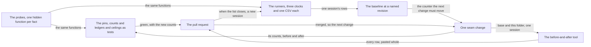

# How the seam got here

The record of how the seam was instrumented, measured and changed over two days in September 2026, kept so that nobody has to find their way through it from memory. The seam is the one place where Excel and Python talk: when `=Add(A1, B1)` runs, the seam checks that both cells hold numbers before Python adds them, and nothing else checks a type. The host is the C# add-in between Excel and Python that carries values across, built on Excel-DNA, the framework that plugs an add-in into Excel; the bridge is the Python side of the seam, where arguments are validated and results converted. This page says what was built and in what order, what each change moved, what was decided and by which tenet, what was tried and declined, and what is still open. It is written for the owner coming back after months and for an engineer maintaining the seam. The rules are in [inputs.md](inputs.md) and [outputs.md](outputs.md), the instruments in [measuring.md](measuring.md), the numbers in [baseline.md](baseline.md); this page links to them and does not restate them.

## The shape of the work

The stretch runs from pull request #26, merged at 00:39 UTC on 2026-09-11, to #42, merged at 01:15 UTC on 2026-09-12, with #43 open on top; #29 to #42 merged within about sixteen hours of one another. Before it, the input side was already closed: #14 and #15 guarded scalar and range arguments against the declared signature, #16 named that guard type validation and closed the input decisions, and #17 and #18 made every range cross as one table of cells in one pass, all between 2026-09-08 and 2026-09-09. The order inside the stretch was deliberate: probes first, then instruments, then a baseline, then one change at a time with a measurement before and after each, then a fresh baseline.

A probe is a hidden worksheet function that does no work beyond crossing the seam, so what it costs is what the seam costs; `=SumArray(A1:A100)` is a range in and one number out and nothing else. The probes stand in for the library, which had no pricing function yet, and they are the knobs every measurement turns: how many calls, how many cells in, how many cells out. A scalar is one value in one cell, such as the 3 that `=Add(1, 2)` returns. An array is the rectangle of values one formula returns, which Excel spills into the cells below and beside it, as `=Grid(2, 3)` fills two rows and three columns. A range is an array as it arrives from the sheet, cells of any kind in sheet order; `A1:J1000` arrives as a range of 10,000 cells.

The instruments are of two kinds, and the house rule separates them: work is measured by counts, and counts are tests; time is measured by tools, and no timing gates a merge. The pins are the tests under `tests/performance` that hold the host's counts, Python's ledgers of which functions ran, and the ceilings on how much memory a call may hold, each at an exact value, so a change that moves one has to say so; the files are named budgets. The three runners are three clocks over different spans of the same call, Python alone, the host without Excel, and a hidden Excel driven over COM, the Windows channel through which one program drives another; the clocks are read side by side and never subtracted from one another. A baseline is one session's numbers, one sitting of the runners on one machine, at a named revision, the short code such as aaa5259 that names one state of the code. The before-and-after tool runs all three runners on the change's base, the code it started from, and on the change in one session, so drift within the session lands on both, and a row is moved when its two spreads, the smallest and largest of its five batches printed in brackets beside the median, do not overlap. From #27 on every Excel number is on the Release build, the faster build that CI, the automated check on every pull request, ships, for the reason in the #27 row below; how a batch is timed and how to read a move are in [measuring.md](measuring.md).

This is the loop the stretch followed, from the probes to a fresh baseline, with each arrow carrying what one step hands the next.

## The timeline

The table uses the seam's words for one crossing. A trip is one crossing from the host into Python and back with the answer; a scalar call is one trip, and a range in is two. A cell's kind is what sort of thing it holds: number, text, boolean, blank or missing. Blank is a cell with nothing in it and missing is an argument the formula did not give at all, so `=Times(5)` takes its default factor and `=Times(5, C2)` with C2 empty is rejected. A buffer is memory the host fills and holds still so Python can read it where it lies, one for the cells' kinds and one for their numbers. The way in is the host scanning a range into its buffers and handing them to Python, and the way out is a result copied into the array Excel receives. Owning a range is Python taking its own copy of the two buffers so the host can reuse them for the next range.

And the words for what the host and Python do. A name lookup is the host asking Python for something by its text name, as `INDIRECT` finds a cell by its address. Objects built are the Python values the host makes to carry one call. A call is warm when nothing is being set up for the first time, so for a range the host has already scanned one at least as large. Managed bytes are memory the host's own runtime hands out on the calling thread during one call. The peak is Python's own meter of how much memory a call holds at its highest point, which sees Python objects and numpy's data and not the host's buffers. A look is one pass over a whole range at once, the way `=SUM` reads a range, leaving a mask, a yes-or-no answer per cell, and a walk visits cells one by one in a loop. The summary of kinds is one bit per kind the host saw while scanning a range, handed to Python beside the buffers. The prepared path is the Python entry for one function that the host fetches once at registration, when the add-in loads and tells Excel its functions, and calls directly ever after.

One line per pull request, in merge order. The numbers in the last column are from the body of the pull request named in the first column unless the cell names another source; microseconds are per call on the Python and host clocks and per formula in Excel, as each pull request states them.

| PR | What it is | What changed | What it moved |
|---|---|---|---|
| #26 | nine hidden probes | The placeholder functions became probes, one per fact the host can tell apart, registered hidden so the function wizard never lists them; seven placeholders the host could not tell apart became test data in the range test. | Nothing in the seam; the probes are what later changes are counted against. All 25 smoke rows passed. |
| #27 | the add-in loaded into Excel is built Release | The Excel smoke test and `tools/excel_dev.ps1` load the Release build, the one CI ships. | Nothing in the seam. The reason: the host's per-cell loop at 74 µs in the Debug build, the slower one made for stepping through code, against 20 in Release, so every Excel number from here on is on the shipped build. |
| #28 | the way out, by declaration | The result contract, now [outputs.md](outputs.md): the declared return type is read at registration, the seam converts once by it, and the host reads the result by type with one buffer request. `Zero` replaced `Nothing`; `EchoColumn` and `EchoRow` joined. | A result cost two trips and a lookup by name before, one buffer request and no trip after. |
| #29 | the RowSums probe | A grid in, one number per row out: the shape of pricing every row, which the comparison of one formula per row against arrays needed before any pricing function existed. | Nothing; a probe added. |
| #30 | every probe on both ledgers | Two Python ledgers per probe, and the peak of Python's memory per call pinned as ceilings. | Found and pinned: a 10,000-cell range in peaked at 77 KB, about 8 bytes per cell, because comparing the kinds against the enum, the named list of kinds in the code, made numpy build an 8-byte temporary before its 1-byte mask. |
| #31 | a work counter the observer supplies | Nine counters at the host's boundaries; the worksheet path passes none and pays one check per boundary that no counter is present. | The first counts: a scalar call 1 trip, 1 name lookup, 4 objects, 440 managed bytes; a range in 2 trips, 2 lookups, 7 objects, 2 buffers of 9N bytes; an array out 2 buffers of 16N bytes and 2 copies. |
| #32 | warm runners for Python and the host | Two runners with one shape, a one-table summary, and [measuring.md](measuring.md) to say how to read them. | The first host numbers without Excel: a bare call 2.4 µs, `Add` 3.4, `SumArray` 163 at ten thousand cells, of which the way in alone was 144 and the way out alone 7.6. |
| #33 | Excel timings, batching, and a local edit | The Excel runner over COM; an Excel-only floor beside every case, a formula such as `=A1+B1` timed next to the seam's so that Excel's own share shows; and `HostAdd`, a hidden C# function with the host's argument shape and no Python, as the floor under a scalar call. | The first Excel numbers: `=Add` 7.3 µs per formula at 1,000 rows beside `HostAdd` 2.2 and `=A+B` 0.4; a thousand `=RowSums(Ai:Ji)` 40 ms per recalculation against one array 0.93. |
| #34 | the baseline at 024486f | One session with all three runners plus the 10,000-row Excel control, its CSVs committed beside the document, every number a CSV row or arithmetic that names its rows. | Where the work was: a user paid about 7 µs per scalar call, and a range in was the host's scan, 158 of the host runner's 180 µs at ten thousand cells. The recommendation: declare pricing functions over arrays. |
| #35 | array, the one word for the rectangle | A rename and nothing else: `cells_from_buffers` in the bridge, the host runner's check of an array, ten arrays and one array; the old names cut, not kept beside the new. | No counter moved, as #36 confirmed by measuring the rename against its own base, a run in which nothing should move. |
| #36 | before and after, every row | The tool: the base in a temporary worktree, git's word for a second copy of the code in a folder beside this one, the three runners on both sides in one session, and a report with every row, every counter that differs, and the allocation figures. | The noise floor, from the rename against its base: 96 rows, 19 moved down and 12 up beyond the spreads, 8 by more than 5%, all of it noise within the session, since the rename changed nothing. |
| #37 | prepare the call path once, at registration | The host fetches each function's prepared path once and holds it; a call builds no name string and no argument list, and looks nothing up. | Name lookups 1 to 0 and objects 4 to 2 on a scalar call; managed bytes 440 to 312; Excel `=Add` 7.26 to 6.27 µs at 1,000 rows; host `Zero` 2.47 to 1.63. |
| #38 | the host carries which kinds it saw | The summary of kinds, recorded in the same pass as the scan and handed over beside the buffers; Python accepts an all-number or all-text range on it with no look. | The numpy calls on every accepted range to none; Python's peak for 10,000 numbers in 77,000 to 192 bytes; Excel `SumArray` over 100 cells 40.84 to 26.72 µs; Python `SumArray` at 10,000 cells 13.85 to 3.93. |
| #39 | compare the kinds against plain integers | The four array-wide compares use plain integers beside the enum, which keeps every scalar decision. | No counter and no ledger; the rejected-range ceiling 9 to 2 bytes per cell, its peak with text last 87,239 to 20,640; the three rejected Python rows at 10,000 cells from 13.76, 17.50 and 24.62 µs to 5.94, 7.97 and 9.24. |
| #40 | one pass over the range, into buffers the host keeps | The two buffers kept between calls, grown only for a larger range than any before, and the range scanned with a plain counted loop, several times faster than the loop the host used before. | A warm range in's objects 6 to 3 and buffers 2 to 0; managed bytes at 10,000 cells 90,722 to 496 (#40's own session; the first baseline's session read 90,890); the way in alone at 10,000 cells 138 to 40 µs; Excel `SumArray` over 10,000 cells 403 to 313. |
| #41 | one copy out | An array out copied once, from Python's buffer straight into the array Excel receives, held still in memory only for the length of the copy. | Buffers 2 of 16N bytes to 1 of 8N, copies 2 to 1; the way out alone at 10,000 cells 7.76 to 5.53 µs; the Excel array rows did not move, because the spill is Excel's own. |
| #42 | the baseline at aaa5259 | A fresh session, its CSVs, and every row paired with the first session's. | 139 rows, 91 moved down beyond both spreads, none up. |
| #43 | a column or row of text as the host's tuple | The text validator returns the host's own tuple, the plain ordered list of text cells the host already built, instead of copying it into a numpy array of Python objects and back into a second tuple. | The numpy calls on a text column to none; the peak at 10,000 cells 160,635 to 192 bytes; a text column's prepared call 312 to 70.7 µs at 10,000 cells; no host counter. |
| #44 | one directory for the seam | Everything written about the seam moved into `docs/seam/`, with five new pages: the index, one call step by step, the two sides, the how-to, and this record. | Nothing in the seam. Three documents were corrected against the code: the numpy operation named on the rejected path, the count of the host's memory ceilings, and one name for the summary of kinds. |
| #45 | the array of numbers says so in its name | The declared type `Array` became `NumberArray`. The words of the sheet are unchanged, so every message reads as before. | Nothing: no counter, no ledger, no ceiling, and no message. |
| #46 | the other two number types follow | `Column` became `NumberColumn` and `Row` became `NumberRow`, finishing what #45 began. | Nothing, on the same grounds as #45. |
| #47 | a range may hold three kinds together | `MixedArray`, the eighth range type: numbers, nonempty text and booleans in any combination, handed to the function as one record over the storage the host already sent. Two probes, `CountMixed` and its numeric control `CountArray`. | Nothing existing: no counter, ledger or ceiling moved. The new rows: an accepted mixed range asks numpy for nothing and peaks at 248 bytes whatever its size, and a mixed range costs what a range of numbers costs on the host, apart from the text it happens to hold. |
| #50 | the smoke count after #47, and what its review parked | Two stale counts corrected, and two items from the onboarding review of 2026-09-13 recorded in the open table below. | Nothing in the seam. |
| #51 | a table crosses as a header row and a body, bound by name into typed columns | `Table`, a schema declared beside a function, one line per column; the prepared path binds the header row to the schema and refines each body column with its column type. `BooleanColumn`, the ninth range type. One probe, `SumQuantity`, over a four-column table with one column of each type, whose rows in the host runner run after every other row. | Nothing existing: no counter, ledger or ceiling moved, except that the date column's ledger names the two helpers the date rule now shares with a table's column of dates. The new rows: a table of ten thousand cells runs every bridge function once, takes one look per column, and peaks at 135,266 bytes, about 54 bytes per row; on the Python clock it costs about 47 µs before its first row and 60 ns a row after, and the host counts it as the two ranges it is. Two findings about the host runner, in the open table below. |
| #53 | the first handles | `Handle[Kind]`, the seam's one alias around a class the library defines: a creator returns the object and its cell shows a three-part handle, `discount_curve:3f9a1c:000002`; a consumer's parameter receives the object; one store in the bridge, one publication per creator call, one lookup to resolve, every failure as text. With it the library's first two objects, a valuation date and a ten-year daily discount curve built from a `date` and `discount_factor` table, and `util_ReadDiscountFactor`, a temporary reader. The host is untouched. | Three new ledgers: a valuation date is the two-scalar call plus its builder and one publication; the curve at 3,631 rows is the table path plus five looks, two copies and one publication; the reader is a text call plus one lookup. Ceilings 1,176, 129,027 and 1,208 bytes. No existing count moved. |
| #54 | a mixed range crosses only as a table | The owner's decision, [inputs.md](inputs.md) decision 38: a function Excel lists takes a mixed range only as a table, a row of text and a schema, because without headers its columns mean nothing; registration refuses a listed function that declares `MixedArray` on its own, and the hidden probes keep the bare range as the seam's instrument. Whether a range of one kind needs headers too is not decided, and the decision says so. | Nothing: one check at registration, no counter, no ledger. |
| #55 | the help beside each argument reaches Excel | The words beside each parameter in a declaration, `Annotated[Date, "One date, ..."]`, are what Excel shows about that argument as a person types the formula and in the fx dialog, with the docstring as the function's line; registration reads both once, refuses a listed function that leaves either out or runs past the 253 characters Excel shows, and adds what the signature already says, an optional argument's name in brackets and what it takes when omitted. The host puts the label and the help on each argument's registration attribute and bundles Excel-DNA IntelliSense, installed after registration and uninstalled on unload, so one add-in gives both forms of help. The three listed functions and the `Times` probe carry help; test functions register hidden, as the seam's instruments. | Nothing per call: all of it is read once at registration. No ledger and no ceiling moved. |
| #56 | a help line says what to select | The lines beside each argument say what to select, give an example or where the value comes from, and name at most one thing that must hold; a creator's function line explains the handle once. The shape of a line is written in the library's [conventions.md](../library/conventions.md#excel-help), with the optional form shown once, so the next function finds it. Registration refuses a line that does not end with a period, since what it adds follows that sentence, and joins a docstring's lines into one. | Nothing: words at registration, no ledger and no ceiling. |
| #59 | an argument may be left out, with nothing in its place | The form `X \| None = None`, [inputs.md](inputs.md) decision 39: an argument declared so may be left out, and the function then receives `None`; a blank cell in the slot still fails as a blank, since blank arrives as `None` and left out as `MISSING`, and only `MISSING` takes a default. Registration reads the type inside the form for the rule and the words, refuses the form without `None` as its default or with another, refuses a table, a handle or a bare mixed range inside it as it does on their own, and shows the name in brackets with the help's sentence alone. The library's first use is `CreateExpirySchedule`'s `option_expiry`, for an index with no options. The host is untouched: nothing new crosses it. | Nothing per call: the check of an argument is unchanged, and a left-out argument returns the stored default as it always did. No ledger and no ceiling moved. |
| #60 | the first market definition, an expiry schedule | `CreateExpirySchedule`, the library's first function to take columns of one kind without headers and the first to declare the left-out form: a column of codes and two of dates, the third left out for an index without options, one rule of meaning, that the columns line up, and a handle out. Nothing in the seam changed; the counts of the library's functions in these pages became words, as the library's README asks. | Two new ledgers: three columns in is the text column handed over as it is, one look and two conversions per date column, the builder's two copies and one publication; with the third left out, one column's rule and one copy fewer, and the left-out argument runs nothing. Ceilings 4,928 bytes with options and 3,280 without at 120 contracts, about 32 and 17 bytes per contract. No existing count moved. |
| #64 | a handle of any kind | `Handle[object]` as a parameter's declaration, [inputs.md](inputs.md) decision 40: the resolver runs as it always did, the text rule, a relayed failure, the lookup, and skips its last step, the comparison of the store's kind with the declared one, handing over whatever the key finds; its words name no kind, `expected a handle`. A creator names what it makes, so `Handle[object]` as a result refuses to register, and a bare `Handle` still does. Wanted by `ReadHandle`. The host is untouched: what crosses is the same text. | Nothing: one comparison in the resolver becomes conditional, no function call added. No ledger and no ceiling moved. |
| #65 | a mixed array goes out, laid out cell by cell | `MixedArray` as a result, [outputs.md](outputs.md) decision 13, the mirror of the way in: the rule checks the rectangle as the way in checks one, the earliest cell holding no value named, then a number that is not finite, a boolean slot that is not 0 or 1, a text holding a NUL, and a text longer than a cell holds, that last checked on the joined text in one encode; the host receives the kinds, the numbers and the texts joined with NUL, by position, and lays the array out cell by cell, a box per number cell, a string per text cell, two shared boxes for the booleans. `MixedArray.table` builds a rectangle from rows of headings over columns of one kind each, dates to serials, so no function writes kinds by hand. One probe, `EchoMixed`, with rows in the three runners, the smoke test and the host's replay. Wanted by `ReadHandle`. | New rows, nothing existing moved. The bridge runs seven of its functions and takes three looks whatever the rectangle holds, and peaks at 50,536 bytes over ten thousand numbers and 72,213 over the mixed column. The host makes one array of references, a box per number cell and a string per text cell, `result_boxes` and `result_texts`, and allocates about 53 managed bytes per added mixed cell against 8 on the numbers road. |
| #66 | ReadHandle, and the temporary reader retired | `ReadHandle`, the library's first reader and the first function on both seam items of #64 and #65: any handle in, the object's table out, headers, a row of types, one row per element, each kind registering how it shows and a kind without a table failing in the cell. `util_ReadDiscountFactor` and the curve's lookup went with it, from the code, the smoke rows, the replay, the runners and the shared workbook. Nothing in the seam changed. | The curve's ledger loses the one scalar conversion the lookup kept. New: reading a ten-year curve back is a text call, one lookup, the table built a column at a time and the mixed road's three looks; ceilings for reading a valuation date and the curve back. |
| #67 | the second market definition, a holiday calendar | `CreateHolidayCalendar`, one column of dates in and a handle out, the second function to take a column of one kind without headers: the list is the calendar, kept as given, with no rule of its own, and `ReadHandle` shows it as one column under `holiday`. Nothing in the seam changed. | One new ledger: one column in is one look and two conversions, the builder's one copy and one publication, twelve functions once each, ten of the bridge's, the creator and its builder. Ceiling 2,908 bytes at 100 holidays, about 17 bytes per holiday, as a schedule without options. No existing count moved. |
| #68 | the third market definition, market conventions | `CreateMarketConventions`, five text scalars in, the units one index is quoted, settled and measured in, and a handle out; the codes are kept as typed and not checked yet, that check noted at the builder as a task for later. `ReadHandle` shows them as one row of five. The shared workbook gains a block per creator built since #66, inputs and creator on the left, the spill on the right. Nothing in the seam changed. | One new ledger: five texts in is the text rule five times, the builder and one publication, nothing asked of numpy. Ceilings under twice the slack, measured 281 bytes to create and 1,162 to read back. No existing count moved. |
| #69 | the fourth market definition, a contract spec | `CreateContractSpec`, a text, a whole number and two numbers in, the name, lot size and fees per lot of one contract, and a handle out; the facts are kept as given and not checked yet, noted at the builder as a task for later. `ReadHandle` shows them as one row of four, the name as text and the numbers as numbers. The shared workbook gains the spec's block and the expiry schedule's, which #60 left out. One seam rule moved, [inputs.md](inputs.md) decision 41: a whole number in is bounded at 2^53 either side, as it is on the way out, after review found a lot size of 1E16 made a spec `ReadHandle` could not show; beyond the line the argument fails in the way out's words. | One new ledger: four scalars in is the text rule once, the whole-number rule once with the number rule beneath it, the number rule twice more, the builder and one publication, nothing asked of numpy. Ceilings under twice the slack, measured 272 bytes to create and 1,205 to read back. No existing count moved; the bound is one comparison inside the whole-number rule. |
| #70 | the curve takes anchors | `CreateDiscountCurve` takes the anchors the desk supplies, dates increasing with any gaps, and the library fills every day between them by a straight line on the factor, `interpolate_discount_factors` in `src/goosedove/globals/interpolation.py`, with no worksheet surface by the owner's call; the consecutive-days rule became each date after the row above, and the curve stays the daily object `ReadHandle` spills. The interpolation page folded into the curve's. The shared workbook gains the owner's eleven-anchor sample and its 211-day spill. Review found two edges: near underflow the line fell a step below the anchor it ran to and the curve rose on its last day, so the line is held at that anchor; and two anchors 1,048,574 days apart made a curve no sheet could show, so a curve holds at most 1,048,574 days, a sheet's rows less the reader's two heading rows. Nothing in the seam changed. | The curve's ledger gains the interpolation and its two ranges of days, and loses one of the builder's two copies. Ceilings: the daily ten-year body 216,443 bytes, up from 129,027, since the interpolation now runs over every day it was given; a dozen anchors over ten years 89,602 bytes, about 25 bytes per day filled. No host count moved. |
| #71 | the unit conversions | `UnitConversions`, the library's first object with no worksheet surface: four categories of units, volume, mass, energy and usd, authored in `src/goosedove/globals/unit_conversions.py`, checked once when the module is imported and shared by reference as `UNITS`, which a calculation takes as a parameter. A conversion is one factor looked up and one multiplication over an array; a unit of another category is refused as a conversion across categories. Four units joined the page's tables: the gram, the troy ounce, the U.S. hundredweight and the kilowatt hour. The conventions sample spells its category `volume`, lowercase as the library's conventions list categories, in the code, the smoke rows, the host's replay and the shared workbook. Nothing in the seam changed. | One new ledger, in a file of its own for library code called directly: a conversion is one category lookup and two unit lookups, no builder and nothing asked of numpy that cProfile sees; a ceiling of 8 bytes per quantity plus the slack, measured 80,200 at ten thousand. No existing count moved. |
| #72 | time, the decisions ahead of the functions | A page of decisions, not a function page, `docs/library/time.md`, from a braindump the owner brought: a contract month is a unit of its own, `datetime64[M]`; a code is one spelling, `M26`, in a fixed horizon of 2000 to 2099; a schedule's contracts are in order and none skipped, the rule its builder takes when it reads codes; the nearby contract by `searchsorted` and the n-th by position; every period calendar days, weekends kept, and business days only through the holiday calendar where a contract states them, with Gas Daily daily the shape to leave room for; two `util_` readers wanted; and a table of what the braindump proposed and this repository declines, a second serial conversion and a text date parser among them. Nothing in the seam changed. | Nothing: words. No ledger and no ceiling moved. |
| #73 | index, not market, and a leading underscore | The market definitions became the index definitions, the pieces one index is defined by: the package, the module of creators, the conventions record, its creator and its handle kind, `index_conventions:`, and the pages, ahead of a creator that ties them together, which is not built. Every worksheet function the library lists leads with `_`, `_CreateDiscountCurve`, or `util_` for a utility, `util_ReadHandle`, so that typing `_` in a cell lists the library's functions and nothing of Excel's; `Ping` and the probes keep their names. The smoke rows, the host's replay and the shared workbook follow, and the workbook gains an `index` tab, one index's pieces built from editable inputs, beside the smoke blocks of `handles`. Rows above keep the names of their day. Nothing in the seam changed. | Nothing: names. No ledger and no ceiling moved; the ledgers name the renamed functions. |
| #74 | the first market data, a futures curve | `_CreateFuturesCurve`, a column of codes and a column of prices in, the price of each contract of one index, and a handle out, in a package of its own, `src/goosedove/market_data/`, beside the globals and the index definitions; one rule of meaning, that the columns line up, the prices copied and frozen, the codes kept as typed. Columns rather than a welded table, by the owner's call and on the seam's own numbers: no look and no temporary per cell for the numbers, the text tuple handed over as it is after one pass over it for an empty text, where a table would pay the header binding, a look per column and the gathers. `util_ReadHandle` shows it as two columns. The shared workbook gains its block. Nothing in the seam changed. | One new ledger: two columns in is the text column and the number column each through its shape rule and its kind rule, no look at the kinds of either and one pass over the text tuple for an empty text, the builder's one copy and one publication: fifteen calls across twelve functions, the shape and kind rules once per column, and two numpy calls, the copy and the freeze. Ceiling 8 bytes per contract plus twice the slack, measured 1,281 bytes at 120 contracts, 9,922 at 1,200 and 96,322 at 12,000. No existing count moved. |
| #75 | the second market data, daily fixings | `_CreateDailyFixings`, a header row and a table of dates and settles in, the settle of one index on each day it fixed, and a handle out, beside the futures curve in `src/goosedove/market_data/`. A table rather than two columns, by the owner's call: a history is nearer static data than a ticking curve, and a body selected as one range cannot put a date beside the wrong settle. One rule, the curve's, each date after the row above, so one fixing per day in the order a reader searches; a series pasted newest first is refused, since nothing sorts. Both columns copied and frozen. `util_ReadHandle` shows them as two columns. The shared workbook gains its block. Nothing in the seam changed. | One new ledger at the table path: the header row as any row of text, the body admitted as a mixed range and bound, one look per column, the date column to days, the builder's look at the order and its two copies, one publication: nineteen calls across eighteen functions, and on numpy three looks, two conversions, two copies and two freezes. Ceiling 30 bytes per row plus the slack, measured 7,563 bytes at 260 rows, 65,887 at 2,600 and 650,831 at 26,000. No existing count moved. |
| #76 | the third market data, monthly fixings | `_CreateMonthlyFixings`, a column of months typed as their first days and a column of prices in, the price of one index for each month it fixed, and a handle out, the daily fixings' sibling for an index that fixes once a month. Two columns for the sheet's ergonomics, by the owner's call. Three rules: one price per month; each date the first day of its month, so that `May-26`, which a cell stores as the 26th, is refused rather than read as its month; and each month after the row above, the owner's no duplicates and ascending. The first function to hold a contract month as `datetime64[M]`, the unit time.md decided, made by the builder from the days; `util_ReadHandle` spills a month as its first day under the month type, since a month cannot cross the seam. The shared workbook gains its block. Nothing in the seam changed. | One new ledger: the date column through its look and conversion, the number column on the summary alone, the builder's two looks and its months made from the days, one copy and one publication: seventeen calls across fourteen functions, three looks, four conversions, one copy and two freezes. Ceiling 40 bytes per month plus the slack, measured 4,472 bytes at 120 months, 32,527 at 1,200 and 313,327 at 12,000. No existing count moved. |
| #78 | contract specifications, one row per contract | `_CreateContractSpecifications` replaces `_CreateContractSpec` after use: a header row and a table in, one contract per row, its name, lot size and two fees, and a handle out, so an index traded as NYMEX lots and as ICE lots of gas has a row for each. Two rules, each name once and each lot size whole, the lot sizes crossing as the numbers the cells hold and going back out as they came, so the one-contract form's line at 2^53 is not drawn; the rest still a task for later. The record holds columns, the reader shows one row per contract, and the shared workbook's two blocks become tables. Nothing in the seam changed: a column of whole numbers was proposed for it and the owner declined, the existing types carrying the table as they carry every other. | The specifications' ledger moves from four scalars to the table path: the header row, the body bound, the names gathered, the three number columns as views, the builder's look at the lot sizes, three copies and one publication, twenty-one calls across eighteen functions, five looks, three copies and one publication; a ceiling of 100 bytes per contract plus twice the slack, measured 12,163 at 120 contracts and 3,037 at two. No other count moved. |
| #79 | daily fixings checked against a holiday calendar | `_CreateDailyFixings` takes a third argument, the market's holiday calendar by handle, the first creator to take a handle in, `util_ReadHandle` having taken any handle since #66: decisions 34 to 37 carry a creator's argument for the first time, and nothing in the seam changed. Three rules in the builder, in order: each date after the row above, as before; each date a business day, Monday to Friday and not a holiday, at either end as in the middle; and no business day between the first date and the last without a fixing, which with the first two holding is each date being the business day after the one above, one `busday_offset` over the column. Numpy's business-day functions over the calendar's list, as [time.md](../library/time.md) decided, and the week mask its fork left open, decided Monday to Friday. The message names the row, the day and its reason, a Saturday, a Sunday, a holiday, or the business day without a fixing. The first and last dates bound the check; a holiday outside them changes nothing. Nothing is filled in and nothing sorted. The shared workbook's block takes its calendar. | The ledger grows by the handle's text rule and its one lookup and the builder's two looks: twenty-two calls across twenty functions from nineteen across eighteen, and on numpy five looks from three, the business-day calls raising no event the fixture reads. Ceiling 45 bytes per row plus the slack from 30, measured 11,482 bytes at 260 rows from 7,563, 93,326 at 2,600 and 912,278 at 26,000, the business day after each date being a full-size temporary. No other count moved. |
| #80 | the expiry schedule's publication dates | `_CreateExpirySchedule` takes a fourth column, `publication_date`, the day each contract's settle is published, for an index that settles monthly, declared `DateColumn \| None = None` as the third is, [inputs.md](inputs.md) decision 39: left out, the schedule keeps None; given, one date per code, copied and frozen, the existing rule and nothing more, no ordering, uniqueness or calendar. Either optional column may be left out on its own, `=_CreateExpirySchedule(A2:A7, B2:B7, , D2:D7)` arriving with its empty slot as an argument left out. `util_ReadHandle` shows the publication dates last, after the options when the schedule has them. The shared workbook's block gains the column and a creator that takes it without the options. Nothing in the seam changed. | The schedule's ledgers move by the accept rule once more, four arguments in place of three: thirty-four calls across fifteen functions with every column, from twenty-six with three, twenty-seven with the publication dates and the options left out, and twenty with two columns, from nineteen; on numpy one look, two conversions, one copy and one freeze per date column given. Ceilings: 48 bytes per contract plus twice the slack with every column, measured 7,312 at 120 contracts and 59,180 at 1,200; 32 with three columns either way and 17 with two, as before. No other count moved. |
| #81 | monthly fixings dated by publication, checked against the schedule | `_CreateMonthlyFixings` takes the days the index's settles were published, a column of prices and the index's expiry schedule by handle, after use showed a monthly settle appears on a day of its own, Waha's January 2026 index on 5 January as Platts announced, and not on the first of its month. Five rules in the builder, in order: the schedule has publication dates; one price per date; each date after the row above; each date one the schedule publishes on, before its first and after its last as much as between; and no publication between the first date and the last without a fixing, which with the rest holding is each date being the schedule's next publication after the one above, one `searchsorted` over the column against `np.unique` of the schedule's dates, read as a set and neither written to nor kept. What the schedule says is authoritative, a weekend or a holiday included: no calendar is taken. The record holds publication dates as days and prices, the month unit of [time.md](../library/time.md) no longer held by anything; `util_ReadHandle` shows `publication_date` over `datetime64[D]`. The shared workbook's block becomes Waha's, with its schedule beneath it. Nothing in the seam changed. | The ledger moves from seventeen calls across fourteen functions to twenty across sixteen, the handle's text rule and its one lookup; on numpy four looks from three, the two conversions from four since nothing goes to months and back, two copies from one plus np.unique's flatten, sort and two asanyarray, and one searchsorted. Ceiling 60 bytes per fixing plus twice the slack from 40 plus the slack, measured 7,631 bytes at 120 fixings against a schedule of 120 contracts from 4,472, 62,622 at 1,200 and 613,422 at 12,000. No other count moved. |
| #82 | the calendar, every day with its prompt contract and two flags | `_CreateCalendar`, the first function of a fifth group and the first to take three handles, the valuation date's, the expiry schedule's and the holiday calendar's: every calendar day from the day after the schedule's first future expires to the day its last expires, the contract prompt on each, the expiry day belonging to the contract expiring on it and the day after to the next contract, whether the market is open, Monday to Friday and not a listed holiday, and whether the day is before the valuation date's day, the day itself never past whatever its fraction. Three rules on the schedule, the calendar's and not the schedule's: two contracts or more, the first only bounding the calendar and never prompt; each code once, as typed, by exact equality; each future expiring after the one above; and the last within a sheet's rows of the first, the curve's bound, found in review, so whatever is created can be read back. The record keeps the three objects by reference and four frozen columns, the days from one `arange`, the prompt rows from one `searchsorted`, the flags from `is_busday` and one comparison, made once; the reader shows them as they are and takes each day's code from the schedule, rebuilding nothing. Two forks of [time.md](../library/time.md) decided: the expiry day is the expiring contract's, and codes are labels here, unread. The shared workbook gains the block, and a page under a new `docs/library/calendar/`. Nothing in the seam changed. | Two new ledgers. Creating: three handles, each the text rule and one lookup, the builder's one look, and one publication, fourteen calls across eight functions; on numpy one look, one arange, one searchsorted and four freezes, is_busday and the comparison raising no event the fixture reads. Reading back: fifteen calls across thirteen functions, no arange and no searchsorted, the codes gathered as one array and the table's usual road out. Ceilings: 25 bytes per day plus twice the slack to create, measured 8,620 at 360 days, 66,741 at 3,630 and 661,841 at 36,630; 20 bytes per cell plus twice the slack to read back, measured 26,308 at 360 days. No other count moved. |
| #83 | the futures curve removed | `_CreateFuturesCurve` and `FuturesCurve`, built in #74, are gone: the market the pricing will take is prepared once and combined with a vector of prices, and a standalone curve had no place in it. The creator, its `__all__` entry, the object and its builder, the reader's table, the page, the unit, seam, help, reader, ledger, ceiling and host tests, the smoke rows and the shared workbook's block were deleted, not kept, aliased or listed as retired; the daily fixings' wrong-kind tests hand a valuation date instead, and the monthly fixings' text-for-price smoke row borrows the schedule's codes. The current descriptions, the seam README, working.md, bridge.md, the reader's page and the fixings' pages, stopped advertising it; #74's own row above stands, and inputs.md decision 38 and conventions.md keep its record in the past tense. Nothing in the seam changed. | Two ledgers and one ceiling deleted with the function, fifteen calls across twelve functions and 8 bytes per contract; no remaining count moved. |
| #84 | the market history, a calendar bound to the fixings on its past business days | `_CreateMarketHistory`, the first function of a sixth group, the market, and the first to take two handles, the calendar's and the daily fixings': the calendar kept as it is, the object itself and every row it has, and the settle fixed on each of its past business days taken from the fixings, one for every such day and none for any other, the first object that reads the market data against the calendar. Three rules in the builder, in order, each naming the earliest offending date: no fixing on or after the valuation date's day, inside the calendar or out, whatever the day's fraction; no fixing inside the calendar on a day it closes, since the two then disagree about a holiday; and a fixing on every past business day, the first and the last included. A fixing's row is its day count from the calendar's first day, one subtraction, since the calendar's days are consecutive; fixings beyond the calendar on either side are allowed and unused, and nothing is sorted, filled in, carried forward or substituted. The record keeps the calendar by reference and two frozen columns, the rows and the prices, absence being a row not listed, so zero is a price. `util_ReadHandle` shows the calendar's columns and `fixing_price`, a number where the day fixed and the word `closed` or `unfixed` where it did not, the first column of two kinds, composed from the record's three fields since the table builder takes columns of one kind; outputs.md decision 13 records the exception. The shared workbook gains the block, and a page under a new `docs/library/market/`. Nothing in the seam changed. | Two new ledgers. Creating: two handles, each the text rule and one lookup, the builder's three looks, its subtraction to rows and its zeros over the days, and one publication, eleven calls across eight functions; on numpy three looks, one astype, one zeros and two freezes, no arange, no searchsorted. Reading back: the calendar's own reading, fifteen calls across thirteen functions, plus the history's table and the calendar's, seventeen across fifteen, the four empties of the wider kinds, the slots, the pairs of texts and their mask on top of the calendar's, nothing of the calendar made again. Ceilings: 6 bytes per day plus twice the slack to create, measured 3,681 at 360 days with 76 fixings, 16,641 at 3,600 and 148,641 at 36,600; 30 bytes per cell plus twice the slack to read back, measured 51,267 at 360 days, 629,741 at 3,600 and 6,528,344 at 36,600. No other count moved. |
| #85 | the price vector, one column of prices snapped as it stands | `_CreatePriceVector`, the hot market data: one column of futures prices without a header, as a vendor's feed rewrites it about once a second, taken as it stands each time the sheet recalculates and kept as given, a zero, a negative price and a repeat included, nothing sorted, rounded, deduplicated, padded, cut or bounded, and what a position means left to the market that will read it. One column of numbers at the seam's existing rule, the fourth function to take a column without headers; the builder has no rule of its own, one copy, one freeze and one publication, and `util_ReadHandle` shows the column under `price` and `float64`. Each call publishes anew, an unchanged column included, and earlier handles stand under the handle contract, release still open. A typed Excel-DNA `double[,]` transport was measured in an experiment outside the repository and deferred, the decision on the page: a few microseconds and a few kilobytes per call at 50 to 150 prices, against a second path to maintain and a coercing input contract. The shared workbook gains the block. Nothing in the seam changed. | One new ledger: the column on the host's summary, no look, the builder's copy and freeze, one publication, ten calls across ten functions; on numpy one copy and one freeze, nothing else. Ceiling 8 bytes per price plus twice the slack, measured 1,273 bytes at 120 prices and 80,314 at 10,000, 392 for a single cell; reading back 21 bytes per cell plus the slack, measured 2,492 at 120 prices and 140,812 at 10,000. No other count moved. |
| #86 | the market, the history with the current futures prices | `_CreateMarket`, the market itself and the hot operation: the market history and a price vector by handle, kept as they are, and one number found, the schedule row of the contract prompt on the valuation day, so that the vector's first quote is that contract's and the rest follow the schedule through its last, the contract expiring on the valuation day quoted on it, a contract with no open day left still counted, and the fixing standing where a day has fixed. Two rules on scalars, in order: the valuation date within the calendar's days, the first and the last included, a calendar starting after it or ending before it refused rather than extended; and exactly one quote per contract from the valuation day's prompt through the last, the count being all that can be checked, since the sheet keeps the order. The valuation day's row is its day count from the calendar's first day, and its prompt row is read there: no search, no array, no copy. `util_ReadHandle` shows the calendar's columns and `price`, the fixing on each past business day, the prompt contract's quote on each business day from the valuation day on, gathered for those rows alone since a past day's prompt may precede the first quoted, and `closed` on the rest, through one helper the history's reader now shares. The shared workbook gains the block. Nothing in the seam changed. | Two new ledgers. Creating: eleven calls across eight functions and no numpy call, the same at a year of days with nine quotes, ten years with one and a year with 246; ceiling twice the slack, measured 984 bytes at every size. Reading back: eighteen calls across sixteen functions, the calendar's own, the helper's and one flatnonzero for the live rows, six empties; 30 bytes per cell plus twice the slack, measured 50,931 at 360 days and 501,307 at 3,600. The history's readback moves by the helper, eighteen calls across sixteen functions from seventeen across fifteen and seven empties from six, measured 53,627 at 360 days from 51,267, its ceiling unchanged. No other count moved. |
| #93 | the repository restored to its state after #86 | One commit, merged as 9187777, whose tree is exactly the tree of ada6de3, the merge of #86, reached by resetting the index and the working tree to it; history is preserved and nothing is rewritten. Reversed, newest first: #92, the delivery schedule creator and record; #91, the publication schedule creator and record; #89, the WTI, Henry Hub and LME copper validation workbooks with their validators; #88, monthly market-history support, its readback, its publication-order rule, and the one change to the seam itself among the five, a handle parameter of several kinds; #87, the calendar's `fixing_mode` argument and the daily or monthly distinction. Retained: everything through #86, the expiry schedule's optional publication-date column of #80 and the monthly fixings creator of #81 among it, which nothing consumes at this baseline. The reason: the monthly-reference design is being reconsidered, and the working daily path, calendar to market history to market, stands as #86 left it while it is. This page went back with the rest, so the rows those five pull requests wrote, and the inputs.md decision #88 added, are in git history at c21c449 and not here. | Nothing forward: every ledger and ceiling is #86's pin again, which the tree carries and which pass, 985 tests, and no dependency, lock or CI file differs, so the tree is byte for byte one CI passed on 19 September. |
| #97 | the IFERC schedule | `_CreateIfercSchedule`, the fifth index definition and the IFERC market's own object: the contract months of one index settled on Inside FERC's monthly index, three columns of one kind without headers, `contract_code`, `last_trading_date` and `publication_date`, paired by position and all required, kept as typed and as given, each date column copied and frozen, with one rule, one row per code, the last trading dates named before the publication dates, `last_trading_date has 2 dates, expected 3, one per contract_code`. The exchange's date and the publisher's side by side in the object of the market that has both, beside the futures expiry schedule, whose optional publication column and its reader stand as they are; nothing reads it yet but `util_ReadHandle`, which spills the three columns. The shared workbook gains the block. Nothing in the seam changed. | One new ledger: the text column handed over as it is, one look and two conversions per date column, the builder's two copies and freezes, one publication, twenty-six calls across fifteen functions; on numpy two looks, four conversions, two copies and two freezes. Ceiling 32 bytes per contract month plus twice the slack, measured 4,928 bytes at 120 contract months and 39,516 at 1,200, the expiry schedule with options' figures to the byte. No other count moved. |
| #98 | the Gas Daily schedule | `_CreateGasDailySchedule`, the sixth index definition and the Gas Daily market's own object: the contract months of one index settled on Gas Daily's daily midpoint, three columns of one kind without headers, `contract_code`, `first_date` and `last_date`, the first and last day of gas each month's price covers, paired by position and all required, kept as typed and as given, each date column copied and frozen, with one rule, one row per code, the first dates named before the last, `first_date has 2 dates, expected 3, one per contract_code`. A flow day's month is the month it flows in, so the schedule holds a calendar month's bounds and no last trading day, and Platts' flow-date values carry every weekend and holiday, so it holds no trade dates, packages or holidays; nothing reads it yet but `util_ReadHandle`, which spills the three columns. The shared workbook gains the block, and its IFERC block's readback is rewritten to spill. Nothing in the seam changed. | One new ledger, the IFERC schedule's to the call: twenty-six calls across fifteen functions; on numpy two looks, four conversions, two copies and two freezes. Ceiling 32 bytes per contract month plus twice the slack, measured 4,928 bytes at 120 contract months and 39,516 at 1,200, the IFERC schedule's figures to the byte. No other count moved. |
| #99 | the IFERC fixings | `_CreateIfercFixings`, the IFERC market's own fixings: Inside FERC's index for each contract month whose index has been published, two columns of one kind without headers, `contract_code` and `price`, paired by position and both required, kept as typed and as given, the prices copied and frozen, with two rules, one price per code, `price has 3 prices, expected 4, one per contract_code`, and each code once, `contract_code row 3 is 'G26', already given at row 2`. Keyed by the month, since the IFERC schedule holds the day each index printed; what must hold between these months and the schedule's is the history's rule. `_CreateMonthlyFixings`, dated by publication and checked against the expiry schedule's optional publication column, went with this build, its page, record, tests, smoke rows, host replay and workbook block with it, and the column it alone read stands until its own pull request. The shared workbook's block is replaced. Nothing in the seam changed. | One new ledger: the text column handed over as it is, the number column accepted on the host's summary, the builder's count and its one pass over the codes, one copy and one publication, fifteen calls across twelve functions; on numpy one copy and one freeze. Ceiling 80 bytes per month plus twice the slack, measured 10,600 bytes at 120 months, most of it the set the codes are checked for repeats through, and 41,348 at 1,200, 34 bytes per month. The monthly fixings' ledger and ceiling go with it. No other count moved. |
| #100 | the Gas Daily fixings | `_CreateGasDailyFixings`, the Gas Daily market's own fixings: the midpoint Platts printed for each day gas flowed, two columns of one kind without headers, `flow_date` and `price`, paired by position and both required, one row for every calendar day from the first to the last as Platts' flow-date values date them, weekends and holidays included, both columns copied and frozen, with two rules, one price per flow day, `price has 5 prices, expected 6, one per flow_date`, and each flow day the day after the row above, `flow_date row 4 is 2026-09-07, expected 2026-09-06, the day after row 3's 2026-09-05`, one comparison that names a repeat, a skip and a series newest first alike. No holiday calendar and no schedule, since no day is closed and a flow day's month is its own; the library moves no date and carries nothing forward, and a day Platts printed nothing for is a gap the desk cannot fill. time.md's sentence that a weekend day's price is the one assessed on the last business day before it is amended: it is the one Platts printed for it. The shared workbook gains the block. Nothing in the seam changed. | One new ledger: the date column through its look and its conversion to days, the number column accepted on the host's summary, the builder's one look over the days, two copies and one publication, seventeen calls across fourteen functions; on numpy two looks, two conversions, two copies and two freezes. Ceiling 40 bytes per flow day plus twice the slack, measured 13,108 bytes at a year of flow days, 36 bytes per day, and 121,513 at ten years, 33 bytes per day. No other count moved. |
| #101 | the futures fixings, two columns and the name | `_CreateDailyFixings` is `_CreateFuturesFixings`, the futures market's own fixings beside the IFERC and Gas Daily fixings, and takes two columns of one kind without headers, `date` and `settle`, paired by position, and the market's holiday calendar by handle, instead of a header row and a table: the desk found the table clunky in use, and the fixings family takes one form. A fourth rule comes with the columns and goes first, one settle per date, `settle has 3 settles, expected 4, one per date`; the three of #79 stand word for word. The record, `FuturesFixings`, its readers and its spill keep their shape; the market history takes its fixings as `futures_fixings`, its three messages and the seam's handle words with it. The table path stays for the discount curve and the contract specifications. The shared workbook's two creator cells are re-entered. Nothing in the seam changed. | The fixings' ledger moves from the table path to the column path: twenty calls across sixteen functions, down from twenty-two across twenty, the date column through its look and its conversion to days and the settle column accepted on the host's summary; on numpy four looks, down from five, the column's two conversions, two copies and two freezes. Ceiling 45 bytes per row plus the slack, unchanged, measured 11,202 bytes at 260 rows, 280 below the table path's 11,482, 93,102 at 2,600 and 912,102 at 26,000. No other count moved. |
| #102 | the futures schedule, two dates per contract and the name | `_CreateExpirySchedule` is `_CreateFuturesSchedule`, the futures market's own schedule beside the IFERC and Gas Daily schedules: three columns of one kind without headers, `contract_code`, as the sibling schedules name it, `future_expiry` and `option_expiry`, the third left out for an index without options, and the one rule of #60, one row per code, `future_expiry has 5 dates, expected 6, one per contract_code`. The `publication_date` column of #80, read by nothing since #99, goes: a future's settle is traded to its expiry, and the IFERC schedule holds the publication day beside each month. The record, `FuturesSchedule`, keeps its codes and two date columns; the calendar takes the schedule as `futures_schedule`, its handle words and its message for a schedule of one contract with it, and reads nothing new. The shared workbook's schedule block loses its publication column and its old Waha block goes. Nothing in the seam changed. | The schedule's ledgers drop the four-column case: three columns in, twenty-six calls across fifteen functions, and two columns in, unchanged; on numpy two looks, four conversions, two copies and two freezes. Ceilings 32 bytes per contract with options and 17 without, plus twice the slack, unchanged, the four-column ceiling gone. No other count moved. |
| #103 | a handle that may be left out | The form of decision 39 now takes a handle: `holiday_calendar: Handle[HolidayCalendar] | None = None` registers, the function receives `None` for the argument left out and the object otherwise, a blank cell fails as a blank in the handle's words, a handle of another kind and text naming no live object fail as they always have, and any other default on a handle is refused as before; decisions 36 and 39 amended. The handle inside the form is declared as if required, since the form's `None` is the argument's absence and not a default the store would have to hold. Wanted by the calendar over any schedule, whose holiday calendar is left out for a market with no closed days. Two probes of the tests' own; no function Excel lists changes. | No count moved: an argument left out costs the accept rule's one call, as any left-out argument does, and a handle given costs its text rule and one lookup, as before. |
| #104 | the calendar over any schedule | `_CreateCalendar(valuation_date, schedule, [holiday_calendar])`: the schedule is any handle, decision 40's form, and its kind chooses the calendar, read off the object as the spill reads a handle's kind; a futures schedule gives the calendar of #82, a Gas Daily schedule every flow day from the first month's first day to the last month's last, each on its month, and an IFERC schedule one row per month dated by its publication day; the holiday calendar is required with a futures schedule and refused with the other two, the first handle a formula may leave out, decision 39's form of #103. One record for the three, holding its kind, with the columns `contract`, `is_priced` and `is_fixed` for `prompt_contract`, `is_business_day` and `is_past`; a period is fixed when its price is known, a futures day before the valuation day, a Gas Daily flow day on or before it, an IFERC month whose publication day is before it. The market history and the market read the renamed columns, and the history takes a futures calendar alone until its own ticket. The shared workbook gains an IFERC and a Gas Daily calendar block. Nothing in the seam changed. | The futures calendar's ledger grows by the builder's dispatch and its two helpers, seventeen calls across eleven functions from fourteen across eight, numpy unchanged; two new ledgers, seventeen calls across thirteen functions each, a year of flow days with two looks, one arange, one searchsorted, one empty for the priced flag and four freezes on numpy, and ten years of months with one look, one copy, one arange, one empty and four freezes; ceilings 25 bytes per flow day and 80 per month, plus twice the slack, measured 7,969 bytes at 365 flow days and 67,351 at 3,653, and 10,504 at 120 months and 41,224 at 1,200, the set the codes are checked through being most of the small count; the futures ceiling and the reader's unchanged. No other count moved. |
| #105 | the market history over any calendar | `_CreateMarketHistory(calendar, fixings)`: the fixings are any handle, decision 40's form, and their kind chooses the binder, read off the object as the calendar reads its schedule's; futures fixings bind to a futures calendar under the three rules of #84, the argument named `fixings` in their messages and the closed day named so; Gas Daily fixings bind to a Gas Daily calendar, a print on every flow day through the valuation day required and one after it refused; IFERC fixings bind to an IFERC calendar by code, every published month's index required, an index for an unpublished month or for a code the calendar does not hold refused, and the indices landing in the calendar's order whatever order they came in. Fixings of another market than the calendar's, and an object that is not fixings, are refused naming both. One record and one spill for the three. The market takes a futures history alone until its own ticket, refusing the other two by the calendar's kind. The shared workbook gains an IFERC and a Gas Daily history block. Nothing in the seam changed. | The futures history's ledger grows by the builder's dispatch, its check of the calendar's kind, its coverage helper and its freeze, fifteen calls across twelve functions from eleven across eight, numpy unchanged at ten calls; two new ledgers, the Gas Daily history's fifteen calls across twelve functions with eight numpy calls, two looks, one astype, one zeros, two setflags and two reduces, and the IFERC history's fourteen across eleven with nine, one array, two looks, one zeros, one argsort, two setflags and two reduces; no arange and no searchsorted in any of the three. The reader's, the market's and the calendars' ledgers unchanged. Two new ceilings: a Gas Daily history 30 bytes per calendar day, 7,404 measured at 365 days with 254 prints and 95,752 at 3,652 days all fixed, and its reader 30 per cell; an IFERC history 100 bytes per month, 12,544 at 120 months and 105,204 at 1,200, the dict of codes to rows most of it, and its reader 35 per cell at 120 months. The futures ceilings unchanged. |
| #106 | the market over any history | `_CreateMarket(market_history, price_vector)` takes any history: the vector holds one quote per contract from the contract of the first unfixed period through the schedule's last, the row of that period read off the calendar, which counts its fixed flags once when it is made and holds the row as `first_unfixed`, the review having moved the count out of the market; on a futures calendar it is the valuation day and its contract the prompt, as before; on a Gas Daily calendar the day after the valuation day, so the first quote is the balance of that month and a month ending on the valuation day is not quoted; on an IFERC calendar the first month whose index has not published, the one publishing on the valuation day included. Two rules of #86 went: the kind guard of #105, and the rule that the valuation date lie within the calendar's days, so a futures calendar valued before its first day is a market from its first day on; a history with no unfixed period is refused, `market_history has no unfixed period, expected at least one to quote`. Where a quote comes from is the sheet's, the IFERC forward behind a Gas Daily month included. The shared workbook gains an IFERC and a Gas Daily market block. Nothing in the seam changed. | The market's ledger is unchanged, eleven calls across eight functions and not one numpy call, and holds over a Gas Daily and an IFERC history alike; the three calendars count their fixed flags once when they are made, numpy's own routine, which the ledger does not see; the reader's ledger is one for the three kinds. Ceilings: the market's record 217 to 218 bytes on each kind, under twice the slack as before; its reader 48,612 bytes at 365 Gas Daily days, 27 per cell, and 20,163 at 120 IFERC months, 34 per cell, under 30 and 35 per cell, the futures reader's ceiling unchanged. |
| #107 | the index behind one reference price | `_CreateIndex(name, schedule, index_conventions, contract_specifications, [holiday_calendar])`: a name, a label kept as typed, bound to four objects the sheet holds, the schedule any handle whose kind the library reads off the object, the conventions and the specifications typed handles, and the holiday calendar in decision 39's form, required with a futures schedule and refused with the other two, the calendar's rules in the calendar's words. The record holds the kind and the four objects by reference; nothing is copied or checked again. `util_ReadHandle` spills one row, the name, the kind, the counts of contracts and of specifications and whether a holiday calendar was given. The kinds, the words that name an object and the two holiday rules move from `calendar.py` into `index_definitions/kind.py`, read by the index, the calendar and the history from one place. Nothing reads the index yet; the calendar's next ticket takes it. The shared workbook gains three index blocks. Nothing in the seam changed. | A futures index is twenty-one calls across ten functions, text through its rule, four handles through the text rule and one lookup each, the dispatch, the holiday rule and one publication, and not one numpy call; an IFERC index nineteen across ten, one handle fewer and the other holiday rule. Reading one back is fifteen calls across twelve functions and twenty numpy calls, the mixed road's for one row of five cells with the two counts' exactness looks. The futures calendar's ledger grows by the shared holiday rule, eighteen calls across twelve functions from seventeen across eleven; the Gas Daily and IFERC calendars' ledgers keep their counts under the rule's new name. Ceilings: the index 241 bytes and its reader 1,131, both under twice the slack. |
| #108 | the calendar and the futures fixings take the index | `_CreateCalendar(valuation_date, index)`: the index in place of the schedule and the holiday calendar, the calendar reading the kind the index holds and taking the holiday calendar through it, the `Handle[object]` schedule of #104 and the holiday calendar that could be left out gone from this creator; the record holds the valuation date and the index and drops its own kind, schedule and holiday calendar, which the history, the market and the spill read through the index; the futures rule's first message names the argument, `index has 1 contract, expected at least 2`; the kind rule and the two holiday rules leave the calendar's page for the index's, where they stood since #107. `_CreateFuturesFixings(date, settle, index)`: the index in place of the holiday calendar, read through it, an index of another kind refused first, `index is a Gas Daily index, expected a futures index`, and the record keeping the index beside its two columns. The shared workbook's calendars and futures fixings re-entered through index cells, one index added. Nothing in the seam changed. | The futures calendar's ledger falls from eighteen calls across twelve functions to fifteen across twelve, one handle fewer through the text rule and the lookup; the Gas Daily and IFERC calendars' from seventeen across thirteen to fifteen across twelve, the holiday refusal gone with the argument; the futures fixings' grows from twenty calls across sixteen functions to twenty-one across seventeen, the holiday calendar read off the index. Numpy's counts and every ceiling unchanged. |
| #109 | the history over one index, the IFERC and Gas Daily fixings over theirs | `_CreateIfercFixings(contract_code, price, index)` and `_CreateGasDailyFixings(flow_date, price, index)`: the index by handle, as the futures fixings take it since #108, kept by reference in each record, `IfercFixings(index, codes, prices)` and `GasDailyFixings(index, dates, prices)`, an index of another kind refused first, `index is a futures index, expected an IFERC index`; the IFERC creator reads the index's schedule and refuses a code that is none of its months, `contract_code row 2 is 'K26', expected one of the index's months`, in one pass with the repeat check, the earliest offending row named, so the history's rule of #105 that every code is a month of the calendar moves to where the codes are typed. `_CreateMarketHistory(calendar, fixings)`, its signature unchanged: the fixings must be over the calendar's index, one reference comparison, `fixings is over another index, 'Henry Hub IFERC', expected the calendar's, 'Henry Hub NYMEX'`, the same name shown twice when two cells made two indices; the kind rule of #105 goes, a fixings kind being its index's kind, and so does the futures rule of #84 against a fixing on a day the calendar closes, both having been checked against the index's one holiday calendar. The smoke gains an IFERC index over the fixings' own four months and the identity refusals; the host's replay one `Index` name and the same; the workbook's IFERC and Gas Daily fixings take their index cells. Nothing in the seam changed. | The IFERC fixings' ledger grows from fifteen calls across twelve functions to eighteen across fourteen, and the Gas Daily fixings' from seventeen across fourteen to twenty across sixteen, the handle's text rule and lookup and the builder's kind check; the three histories' ledgers keep their counts, the kind check's one call now the index comparison's, and the futures history's numpy calls fall from ten to eight, the closed-day look gone. Every ceiling unchanged, the IFERC fixings striking codes off one set of the index's months where they were checked for repeats through one set of themselves. |
| #110 | the conventions' codes checked, the specifications' lot sizes and fees | `_CreateIndexConventions`, its signature, record and read-back unchanged: five rules against the unit tables, the two currency units first, `quote_currency_unit is 'usd', expected USD or CENT`, then the quantity type, `quantity_type is 'Volume', expected volume, mass or energy`, `usd` no quantity type, then the two quantity units judged by it, `quote_quantity_unit is 'MMBTU', expected a volume unit, GAL, BBL, L or M3`, the codes matched exactly and the lists drawn from the tables in their order; the builder takes the collection, `UNITS`, from the worksheet function, reads it by key and converts nothing, the factor between two units being the instrument's to look up once. `_CreateContractSpecifications`, its signature unchanged: two rules after the two of #78, a lot size of 1 or more, `lot_size row 1 is 0.0, expected 1 or more`, and each fee 0 or more, `brokerage_rate_per_lot row 2 is -0.75, expected 0 or more`, a rebate no fee; the fees stated as costs per lot in the index's settlement currency, checked by nothing. The help lines list the codes. The two follow-ups pinned on 26 September resolved. Nothing in the seam changed. | The conventions' ledger is unchanged, seven calls across seven functions and not one numpy call, the five lookups being dictionary reads; the specifications' ledger keeps its twenty-one calls across eighteen functions, its numpy calls rising from twenty-two to twenty-eight, three more looks and their three reductions, one per new rule. Every ceiling unchanged. |
| #112 | the price vector named for its index, the market checking the name | `_CreatePriceVector(index_name, prices)`: the index's name first, ordinary text, the cell `_CreateIndex` was given it from or a literal, kept as typed in a new first field of the record, `PriceVector(index_name, prices)`, never a lookup and no index object held, so the vector depends on its prices and its name cell and not on the index cell; the spill unchanged, one `price` column and no name. `_CreateMarket`, its signature unchanged: one rule before its two, the vector's name compared exactly with the name the history's index was created with, `price_vector names index 'Brent', expected market_history's index 'WTI NYMEX'`, on every kind of history; two indices of one name pass, and a wrongly labelled column does, the label being all the vector carries. The name takes the seam's text rule as `_CreateIndex`'s does, `index_name is blank, expected text`; nothing in the seam changed. | The vector's ledger gains the name's two calls, `_validate` and `_text`, twelve calls across eleven functions, its numpy calls unchanged at the copy and the freeze; the market's ledger unchanged, the comparison being no call. Every ceiling unchanged. |
| #113 | the handle's text: the index's name and the count alone | Every handle is `kind:count`, `futures_schedule:4`, or `kind:index-name:count` for the index, the calendar, the three fixings, the market history, the price vector and the market, `market:WTI NYMEX:36`, the name the index was created with written whole as typed and the runtime's publication count, a plain number; the session part of #53 is gone, and the count starts again with each Python, so a saved text names nothing until today's count passes its number and can then equal a new publication's text of the same kind and name; handles.md records that as a known limitation, reproduced in Excel under manual calculation, accepted by the owner for the handle-lifecycle work to handle. The seam reads the name through a path prepared at registration from the declared kind, `_NAMED` in the bridge, and measures the whole text in UTF-16 units before storing it, `returned handle of 32790 characters, expected at most 32767`, the count unmoved on any failure. Lookup by the whole text, the stored kind, the failure words and every spill unchanged; no creator gained an argument. | Every ledger unchanged, the name read by a C-level attribute path the profiler does not count; every ceiling unchanged, the text shorter by the session part and longer by the name. |
| #114 | handles living as long as their creators: release and reuse through Excel's live-data subscription | Every creator's call is observed through Excel-DNA's `ExcelAsyncUtil.Observe`: the seam's `function_specs` says which functions create a handle, from the declared result, and the host gives those an observed delegate; a creator's `publisher` path returns the value and whether the call published, told by the count having moved; one small `Publication` class runs the path once inside `Subscribe`, hands the value to Excel before returning, and on `Dispose`, once, calls the seam's new `release(text)`, which takes exactly one entry out of the store. Equal creator calls share one object and handle, in one workbook or two, and the count moves only for a new publication. A failure owns nothing, and an Excel error among the arguments is the value, found in the plain path's order. The known limitation of a creator cut in manual calculation mode is recorded with its remedy, a full calculation. `GoosedoveHandles`, hidden, reports the store's live count, the price bytes of its vectors and the host's counts. | Every Python ledger unchanged, the plain path untouched and a creator's publish path one more call above it; the host's pins unchanged. In hidden Excel: a chain of eleven creators reused on a full calculation with nothing published, a changed price releasing the old vector and market, the last workbook closing to nothing; a thousand updates of a 150-price vector settling to eleven live and 1,200 price bytes at every checkpoint, released to nothing at the close. |
| #115 | the lot's unit on the contract specifications | `_CreateContractSpecifications` takes a fifth column, `lot_unit`, the unit each lot size is in, kept as typed and checked against the unit tables' quantity categories, `lot_unit row 2 is 'usd', expected a volume, mass or energy unit`, after the lot sizes and before the fees; the record and the spill carry it. A row is the desk's word for a quantity of the index, a contract or a bare unit with a lot size of 1, so a trade says a word and a count. `_CreateIndex`, its signature unchanged, gains a third rule after the holiday rules: every lot unit is a unit of the conventions' quantity type, `specifications row 2 lot_unit is 'MMBTU', expected a volume unit, GAL, BBL, L or M3`, barrels and gallons standing together under a volume index. Both builders take the unit tables from the worksheet function, as the conventions do; the conventions' message helpers are shared. Nothing in the seam changed. | The specifications' ledger: 23 calls across 19 functions, from 21 across 18, the second text column and the measures read once, the set of quantity units built inline and no call; its numpy calls unchanged. The conventions' ledger gains the shared helper's call, 8 across 8. The index's ledgers unchanged. Every ceiling unchanged. |
| #116 | the process ID first in every handle | Every handle is `pid:kind:count` or `pid:kind:index-name:count`, `30512:market:WTI NYMEX:36`, `30512:futures_schedule:4`: the process ID of the Excel the object lives in, the number Windows gives the running program, read once when the seam starts since Python runs inside Excel's process, whole in decimal with nothing cut, hashed or padded, then the text of #113. Two Excels running at once never publish one text for two objects, and a text from one, or one saved before the ID led the text, names nothing in the other, through the lookup error that was already there; the known limitation of #113 narrows to a process ID Windows reuses after a restart. The count, the store, release and reuse are as #114 left them, and the host never reads the ID. | Every Python ledger unchanged and every ceiling unchanged, the text longer by the ID and a colon. In hidden Excel: every handle leading with the Excel's own process ID, read from its window; two Excels at once showing the same kinds, names and counts under two IDs, a vector of one naming nothing in the other, and a workbook saved by one recreated under the other's ID on a full calculation. |
| #117 | the retention run's verdict | `tools/performance/handle_retention.ps1` no longer exits clean over a wrong reading or a retained publication: after every update the run waits within the patience for Excel to report its calculation done, a wait that runs out failing the update whatever the cell holds, then reads the market's first quote once as a number, and a blank, text, an Excel error or another number fails the run, a later read within the patience telling only whether the number arrived late; every checkpoint waits within the patience for the baseline's live count and asserts it, the close asserts an empty store, and any release missed or failed fails the run; the verdict comes after the owned Excel's cleanup, and `-Fault` proves it by expecting the wrong price and the wrong count. The cell's text and the clock stay as diagnostics and decide nothing. | Evidence, never a gate: a thousand updates of a 150-price vector settling at eleven live and 1,200 price bytes at every checkpoint, every reading the expected number, released to nothing at the close; the fault run exiting nonzero with the two failures named. |

Two things happened between #37 and #41 that the table does not show. #37 renamed the host runner's two stage rows from the methods they timed to the stages, way in and way out, so a rename never splits their history again. #39 found a stray search over the whole disk, left behind by an earlier review agent and running on one core since 18:21, which explained the ten-thousand-cell host rows that had flipped in #38's measurement; it was stopped, and #39's pasted run is the third of three that agreed on every row the change touched.

## The two baselines

Both baselines are the same document at two revisions, and the earlier one stays in git history: the baseline at 024486f was committed at 134d6d3 by #34, and the baseline at aaa5259 at c548966 by #42, which is [baseline.md](baseline.md) today. How the two sessions compare, which rows are noise and which are read, is in [baseline.md](baseline.md) under What moved since 024486f; the headline rows are in its table there, twenty-six pairs, and [baseline/since-024486f.md](baseline/since-024486f.md) pairs every row. The Excel floors `HostAdd`, `+` and `SUM` sat still between the sessions, which is why the sessions compare.

The counts moved as the changes said they would; the change that moved each is named in baseline.md under What moved since 024486f.

| The host did, for | at 024486f | at aaa5259 |
|---|---|---|
| a scalar call, `Add(1, 2)` | 1 trip, 1 name lookup, 4 objects; 440 managed bytes | 1 trip, 0 lookups, 2 objects; 312 managed bytes |
| a range in, N cells | 2 trips, 2 lookups, 7 objects, 2 buffers of 9N bytes on every call; 90,890 managed bytes at 10,000 cells | 2 trips, 0 lookups, 3 objects, no buffer on a warm call; 496 managed bytes at one to ten thousand cells |
| an array out, N cells | 2 buffers of 16N bytes, 2 copies | 1 buffer of 8N bytes, 1 copy |
| Python's peak, a range of 10,000 numbers in | 77,008 bytes | 192 bytes |
| Python's peak, a rejected range of 10,000 cells | 87,247 bytes | 20,640 bytes |

What did not move is as telling: `Grid` did not move in Python because none of the five changes touched the Python side of an array out. The second baseline's conclusion is the first one's with the margins widened: declare pricing functions over arrays, and never read a range per row. The counters stand at the floor the design allows, and what remains on the host's clock is per call; both are set out in [baseline.md](baseline.md) under What this says about the library's formulas.

## The decisions and their tenets

[PRINCIPLES.md](../../PRINCIPLES.md) asks each pull request to name the tenet that decided a hard call and to record any conflict it surfaced. These are the calls this stretch made, each with what its pull request cited. Not all of these are tenets: a tenet is numbered as in PRINCIPLES.md, and a golden rule as in [golden-rules.md](../golden-rules.md), where the three measurement rules are 27 to 29 and cut over is 21; carry what was already learned is #38's own words, resting on tenet 1. The input and output rules themselves are the numbered lists under Decided in [inputs.md](inputs.md) and [outputs.md](outputs.md), and are not repeated here.

| Decision | Where | Tenet or rule cited |
|---|---|---|
| The probes live apart from the machinery: the bridge is machinery, the probes are the seam's instruments, and the catalogue, `src/goosedove/excel/__init__.py`, the list of modules whose functions Excel sees, is a third thing. | #26 | tenet 6, One job per thing |
| Every Excel number is taken on the Release build. | #27 | None cited; a measured reason, in the #27 row above |
| The declared return type is the contract, and a wrong-kind result names the function, what came back and what was expected, where before the cell showed a bare value error. | #28, outputs.md | tenet 2, Fail loudly |
| Counts are tests, and the worksheet path builds no counter. | #31 | golden rule 28, Measure counts before time |
| Timings live in tools and never gate a merge; the layers are separate clocks, read side by side and never subtracted. | #32 | golden rule 29, Measured, not estimated |
| Every timing has an Excel-only floor beside it and a stated scope. | #33 | golden rule 27, Baseline before you touch it; golden rule 29, Measured, not estimated |
| Every number in a baseline is a CSV row or arithmetic that names its rows. The plan's model sentence, that an array formula costs about one call plus N cells, is not what the rows showed, so the document states the measured version: an array formula's fixed cost is several scalar calls. | #34, under Conflicts | golden rule 29, Measured, not estimated; tenet 5, Words mean things, plain words for the owner of the sheet |
| Array is Excel's word for the rectangle a formula returns, and the old word is cut everywhere, not kept beside the new. | #35 | tenet 5, Words mean things; golden rule 21, Cut over |
| A move is read as real when it is large, consistent across sizes, and where the change aimed; every row is reported, not the convenient ones. | #36 | golden rule 29, Measured, not estimated |
| The call path is prepared once at registration, and a call carries its arguments and nothing else. | #37 | tenet 1, Excel is the client, resolve once, then dispatch from the resolution; tenet 3, Less |
| The host carries the summary of kinds it learned in its one pass, and Python takes no second look at what the host inspected once. | #38, inputs.md decision 21 | #38's own words, carry what was already learned, which is tenet 1, Excel is the client, nothing re-checks what its caller already established; tenet 3, Less |
| The array-wide compares use plain integers; the enum keeps every scalar decision, so the house rule of matching over enums holds. | #39 | golden rule 29, Measured, not estimated; tenet 5, Words mean things |
| The buffers are made once and kept, on Excel's main thread, because Excel calls every registered function there and none is registered as safe to call from several threads at once. | #40, inputs.md decision 21 | tenet 3, Once and Less |
| A result crosses the host once; the code that handles a raw memory address to do it, which C# calls unsafe, is confined to one place behind a length check and named in the project file. | #41 | tenet 3, Once |
| A baseline replaces the last one whole, in its own pull request, with no source change beside it, as #41 asked for and #42 did. | #42, measuring.md | golden rule 27, Baseline before you touch it; golden rule 28, Measure counts before time |
| A text column is handed over as the host's tuple; a container that carried the same values in a new shape is removed rather than made faster. | #43 | tenet 3, Less and Once |
| A declared type says what it holds: `Array` became `NumberArray`, since it accepts numbers only and its name did not say so. The word array survives, which is what #35 decided; what changed is that the type now names its kind, as `DateColumn` and `TextColumn` already did. `Column` and `Row` were left alone at the time, still meaning numbers by omission, and #46 finished the set a day later. | #45 | tenet 5, Words mean things; golden rule 21, Cut over |
| Every declared range type names its kind: `Column` and `Row` became `NumberColumn` and `NumberRow`, so the seven read as three shapes across three kinds and none means numbers by omission. | #46 | tenet 5, Words mean things |
| A range may mix its kinds, and mixing is permitted rather than required: `MixedArray` takes numbers, nonempty text and booleans in any combination, and a rectangle of one of them is a mix of one. It is an input only, it rejects blank, missing and empty text as every other type does, and it names the earliest offending cell in sheet order whichever way the cell offends, so the order the checks run in never decides the message. A specification was written and reviewed before any of it was built. | #47 | tenet 1, parse at the edge; tenet 3, Less; inputs.md decisions 22 to 26 |
| A table is a header row and a body, bound by name into typed columns at the seam. The schema is part of the declaration, so binding a header to a column is type, not meaning: a header is to a column what a parameter name is to an argument. Headers bind in any order and without regard to case, and nothing else is forgiven; a bad cell is named within the whole body after the headers and after every column before it. | #51 | tenet 1, parse at the edge, and resolve once; tenet 5, words mean things; inputs.md decisions 27 to 33 |

## Proposed, measured and declined

After the second baseline the owner proposed three low-level items, and a review measured each before anything was built; item 1, a column of text handed over as the host's tuple, became #43, and the other two were declined. The numbers in the next two paragraphs are the review's own, taken on 2026-09-11, and are not in a committed document; #43's body carries item 2's one-line summary under Not done, and item 3 is recorded nowhere but here.

Item 2 was to make the way in aware of the declared type, so that an all-text range skips the numbers buffer, the one number per cell that the host fills for every range, with a NaN, the not-a-number value, in each text cell's slot. It was declined on two grounds. The host's summary of kinds already carries the one condition under which that buffer goes unused, and a declaration proves nothing about what Excel actually supplied, so registration has nothing to add. On the clock, the host's NaN store is about a nanosecond per text cell and was not readable at any size: the way in for a hundred-cell text column measured 11.43 µs before and 11.33 after, with overlapping spreads. A Python-only version that skipped the numbers copy for all-text ranges saved 8 bytes per cell and about 0.4 µs at a hundred cells, unreadable on the whole-call clock, at the price of a second, read-only view of the numbers, one that pretends to hold a number per cell without storing them, which every future reader would have to know about.

Item 3 was to fold the date checks into one helper compiled to machine code. It was declined outright: the most it could save was about 5 µs per hundred-cell call; the three ways to compile Python-side code, a C extension, Cython or numba, each bring a compiler step the repository does not have; and a helper in the C# host pays a second trip. A numpy-only rearrangement of the same checks, converting once to whole numbers, shifting in place by Excel's epoch, the day its serials count from, and viewing the result as days, was prototyped and measured at a peak of 9 bytes per cell instead of 17, about 90,500 bytes at ten thousand cells instead of 171,192, and about 8.2 µs instead of 10.5 at a hundred cells; the owner passed on it for now, so it sits in the open table below rather than here.

The pull requests declined four more things in their Not done sections, with reasons rather than deferrals. #33 added no rows for Excel's whole-sheet recalculation calls, because the full case of an arrangement, one way of laying the same formulas on the sheet, recalculates all its formulas whether Excel has marked them as needing it or not, and the edit case recalculates only the cells that depend on the one changed, which are the two things a user feels. #36 does not run each side twice, because the batch spreads carry one run's noise and the noise floor is recorded. #39 left the second mask in a rejected range, the count of text cells before the bad one, which is paid for an answer that is always zero under today's rules, because in every validator the first flagged text cell is the first text cell; it would matter only if a rule ever accepted some text and rejected other cells. #40 left Python's two copies of the host's buffers when it owns a range, because Python must own what it validates and the host overwrites its buffers on the next range.

One plan changed direction on the way. #38 said the planned plain-integer compare was moot on the accepted path, since after the summary of kinds the compare runs only when a range is rejected; #39 then made it anyway for the rejected path alone, because the measured cost there was 7.9 µs and 76,792 bytes at ten thousand cells against 1.5 µs and the 1-byte mask, and pinned the lower ceiling.

## Open and parked

Each open item is listed with where it stands and what would decide it. A handle is text in a cell that stands for a live object such as a curve, held by the add-in; a `TextArray` is a two-dimensional range of text as a declared type.

| Item | Where it stands | What would decide it |
|---|---|---|
| Handles: batches, and a calculation on open | Built: `Handle[Kind]`, the store, publishing on the way out and resolving on the way in, with every failure as text, in #53 ([inputs.md](inputs.md) decisions 34 to 37, [outputs.md](outputs.md) decisions 10 to 12, [bridge.md](bridge.md#a-handle-one-store-and-the-text)); the text as it reads today in #113 and #116; reuse of one publication by equal live creator calls and its release when Excel disconnects the last, in #114, through Excel's live-data subscription as [excel-dna-handles.md](excel-dna-handles.md) found, rather than caller-keyed replacement or Excel-DNA's own store. Open, in [handles.md](handles.md#open): a creator returning one handle per row, and whether the add-in requests a full calculation when a workbook opens, the user's full calculation being the supported way until then. | The first creator that takes several rows, with its return and error rules agreed first; the owner, for a calculation on open. |
| `TextArray` | Possible under the same rules as the text column and row, not built (inputs.md, decision 12). After #43 the text validator no longer carries the range's shape, so a `TextArray` type would have to rebuild the rows and columns itself. Since #47 a rectangle of text alone is already accepted as a `MixedArray`, which carries its shape, so what a `TextArray` would add is only that text alone is required rather than permitted. | The first function that needs the requirement, not merely the shape. |
| Text ranges out | Named in the output contract and not built (outputs.md, decision 2). | The first function that returns one. |
| The scalar date path | The validator builds a numpy date value for each scalar. The review after #42 measured a number in at 1.07 µs, a date in at 3.27, and a date in and back out at 11.14; a per-row formula with a date pays this on every row, the calls the baseline says are still worth holding down, and it costs more per formula than either range item saved per call. Found in passing, not addressed. | A date probe with rows in the runners, so the saving of a plain-serial path can be read on a whole-call clock. |
| The empty-text bit | After #43 the scan for empty text is nearly all of a large text call, 71 of 71 µs at ten thousand cells and 0.7 of 2.0 at a hundred, per #43's body. #47 gave it a second payer and a runner row: a mixed range of ten thousand texts costs about 70 µs on the Python clock for the same scan, and a mixed range with no text costs 1.7. The scan is a pass over the tuple of texts and not a numpy operation, so the numpy ledger does not see it, the pins call both accepted paths no look, and a change to its cost would move no pin. What the bit would save is that scan alone, about seven nanoseconds a text cell; carrying a text cell across costs ten times more and this would not touch it. One more bit in the host's summary of kinds would let both accepted paths skip it. | The owner, because it changes what decision 21 says the summary of kinds carries. The measurement it was waiting for now exists. |
| No text probe and no date probe | There are sixteen probes, and none of them takes a text or a date range alone ([bridge.md](bridge.md) lists them), and `EchoText` takes one scalar. So no runner has a row for a text or a date range, the before-and-after tool cannot see a change to those paths, and every whole-call share for them is arithmetic across two clocks. | The next tooling pull request, named in #43: a text probe and a date probe with rows in all three runners. #47's `CountMixed` gives the text path a runner row, under the mixed declaration rather than the text one, and #51's `SumQuantity` gives a column of text and a column of dates a runner row each, under a table's declaration. |
| The host runner's calibration cliff, and where a new scenario runs | Found while measuring #51. The host runner doubles a row's iterations until a batch takes 50 ms, so a row whose per-call time sits near that threshold can be measured with 2,048 iterations a batch on one side and 1,024 on the other, and a few percent of drift then reads as ten or twenty: `SumArray` at ten thousand cells read 12 to 21% up in three passes that split that way and 3 to 6% up in two that did not, and 9% up with the target doubled on this tree alone. Separately, what a scenario allocates changes where the next scenario's input lies in memory: with the table rows among the others, the ten-thousand-cell rows on this tree read a few percent up, the way in alone included; with the table rows run after every other row, those rows read flat. The Python runner showed neither, since it builds every input before any clock starts. | A fixed iteration count per row, taken from the base's CSV and used on both sides, or a longer batch target; and a rule, kept by #51, that a new scenario runs after every existing one. Until then, read the iteration counts in `batches.csv` before reading a row that moved alone. |
| The Excel runner's race on the add-in file | The runner rebuilds the add-in before the Excel of the previous run has let go of the file; the second baseline's 10,000-row control failed once for this and was rerun by hand four minutes later (#42, and baseline.md's account of the session). | A wait or retry between quitting the previous Excel and rebuilding, or one build per session shared by both runs. |
| Two unexplained spreads | In the second baseline's session the host runner's `SumArray` at 100,000 cells ran 687 to 1,297 µs with no memory reclaimed by the host's runtime in any batch, and the way out alone at 10,000 cells ran 5.6 to 14.7 with the same bytes allocated and reclaimed in every batch (baseline.md). | A rerun that records more than the CSV does, or the next baseline showing the rows tight. |
| The numpy rearrangement of the date checks | Prototyped and measured after #42, 17 to 9 bytes per cell and 10.5 to about 8.2 µs at a hundred cells; passed on for now. | A date probe, so the saving can be read on the whole-call clock and judged against the working workload. |
| No capacity number | Set aside in #26, named undone in #33, and #34 said it waits for a recalculation budget. | A recalculation budget: how long a full recalculation of a working sheet may take. |
| The crossover below a hundred rows | The size from which an array beats one call per row lies somewhere below a hundred rows and was not measured in Excel; the host's curve does not stand in for Excel's (baseline.md; #42 under Not done). | An Excel sweep of the arrangements between ten and a hundred rows. |
| The tool runs once per side, without the 10,000-row control | The Excel side of a before-and-after run is the 1,000-row workload only; the control enters a comparison only when both sides are run by hand (#36, under Not done). | A choice to spend the session time, if a change ever aims at the control's sizes. |
| The Excel runner in CI, and the operating system | The Excel runner has never run in CI, and no runner records the operating system (#33 and #34, under Not done). | A machine with Excel in CI, and one line in each environment file. |
| The byte-order mark | The Excel runner writes its environment file with a byte-order mark, an invisible marker some Windows tools put at the start of a text file, stripped by hand for both baselines (#34 and #42). | A one-line fix in the runner. |
| A comment eight bytes off | The rejected-range ceiling's comment says the peak was 87,239 before #39; the 024486f CSV says 87,247, and #38's own table said 87,247 before and 87,239 after (#42, under Not done). | Quote the CSV in the comment, in a pull request that changes nothing else. |
| The seam's share inside Excel | No clock measured the seam's share inside Excel or what Excel spends on the spill; the baseline sets the three clocks side by side. | A clock inside the host that runs under Excel, which would be a fourth instrument. |
| A tenet still to be written | PRINCIPLES.md carries one confirmed tenet tied to the measurement topic: same inputs, same outputs is a hard guarantee. | Writing it, in a pull request that changes nothing else. |
| A result taller or wider than a sheet | The way out hands the host any rectangle, and Excel shows `#VALUE!` for one beyond 1,048,576 rows or 16,384 columns, with no word from the seam; even `ROWS` of it fails. Found in review of #70, on a curve two thousand years long, which the curve now refuses to build; a schedule or calendar read back from a whole-column input would still reach it. | One rule in the result rules, a comparison per array result, in the seam's words: `result is 1048577x2, more than a sheet's 1048576 rows`. |
| The text-column pin in the baseline | baseline.md describes the seam at aaa5259 and does not carry #43's ceiling for a column of text, 192 bytes at ten thousand cells. | The next baseline. |

Three things are not open but are worth knowing so they are not reopened by accident. References to other workbooks and workbooks on the 1904 date system are unsupported by policy, and newer Excel errors such as the spill error arrive as the value error, known and left alone; all three are in inputs.md under Decided and Not supported.

## Picking the work up again

Start from [baseline.md](baseline.md), which says where the work is now and which counters stand at the design's floor, and from [measuring.md](measuring.md), which says what each instrument includes and leaves out. A seam change begins with the counter, ledger or ceiling it means to move; a change that moves none of them is not the change it claims to be. Write the change and let the pins fail, then re-pin them in the same pull request with the counts before and after stated in its body, as every seam change in this stretch did; the pins are the claim and move with the source, while a baseline document lands in its own pull request, as #42 did. This differs from golden rule 24, that a behavior and its baseline never move together, only in name: the pins are the claim a seam change makes and move with it, while a baseline document is the record and lands alone. Run the before-and-after tool against the change's base, with the machine otherwise idle, and paste its report whole, reading it as [measuring.md](measuring.md) says. Run the whole check before opening the pull request, format, lint, types, the Python tests, the host tests and the Excel smoke test, and fix what it reports.

The pull request follows the template in the repository, six headings in order: What; Counts, before and after, where "not applicable" is an answer; Tenets, the tenet that decided a hard call; Conflicts, the forks surfaced, or none; Checked in Excel, the smoke rows that matter; and Not done, which says what a reader might expect and will not find. The title names its kind and scope first, `feat(seam)`, `feat(host)`, `chore(tools)` or `docs`, then what it does, and a pull request has one purpose. Counts go in the pull request as its evidence and no timing gates a merge; the timings are the record that says whether the counts mattered. When a list of changes closes, a fresh session at the merged revision becomes the next baseline in its own pull request, replacing the last one whole, saying what moved, and keeping the paired rows beside its CSVs, as [measuring.md](measuring.md) says. The next such list, as it stands after #43, begins with the text and date probes, because until they exist the tool is blind to those paths.

## Where to look

| To find | Go to |
|---|---|
| The input rules and decisions | [inputs.md](inputs.md) |
| The result rules and decisions | [outputs.md](outputs.md) |
| The instruments, the commands, and how to read a number | [measuring.md](measuring.md) |
| The numbers at aaa5259, and every row paired with the first session | [baseline.md](baseline.md), [baseline/since-024486f.md](baseline/since-024486f.md), the CSVs in `docs/seam/baseline/` |
| The first baseline, at 024486f | `docs/baseline.md` at commit 134d6d3, in git history |
| One call across the seam as it stands, and the two sides | [walk.md](walk.md), [host.md](host.md), [bridge.md](bridge.md) |
| The tenets, the general learnings, and the rules | [PRINCIPLES.md](../../PRINCIPLES.md), [golden-rules.md](../golden-rules.md), `CLAUDE.md` |
| The pull request template | `.github/PULL_REQUEST_TEMPLATE.md` |
| The bridge, the prepared path `Registered.run`, and `cells_from_buffers` | `src/goosedove/excel/bridge.py` |
| The probes | `src/goosedove/excel/probes.py` |
| The host, its counters, and `HostAdd` | `host/Goosedove.Host/AddIn.cs`, `host/Goosedove.Host/WorkCounter.cs` |
| The Python pins: ledgers and ceilings | `tests/performance/test_seam_budgets.py`, `tests/performance/test_seam_allocation.py`, `tests/performance/conftest.py`; the library's own, for code with no worksheet surface, `tests/performance/test_library_budgets.py` |
| The host pins, linked into the host's test project | `tests/performance/HostWorkBudgets.cs` |
| The three runners, the summary, the before-and-after tool and its comparison | `tools/performance/measure_python.py`, `tools/performance/Goosedove.Host.Measure/`, `tools/performance/measure_excel.ps1`, `tools/performance/summarize.py`, `tools/performance/before_after.ps1`, `tools/performance/compare.py` |
| The race on the add-in file | `tools/performance/measure_excel.ps1`, the build at lines 34 and 35 and the quit at line 278 |
| The whole check, the Python-side measurement, and the Excel smoke test | `check.ps1`, `measure.ps1`, `tools/excel_smoke.ps1` |
| The pull requests themselves, with every report pasted | GitHub, #26 to #43 |
