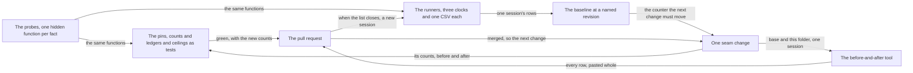

# How the seam got here

The record of how the seam was instrumented, measured and changed over two days in September 2026, kept so that nobody has to find their way through it from memory. The seam is the one place where Excel and Python talk: when `=Add(A1, B1)` runs, the seam checks that both cells hold numbers before Python adds them, and nothing else checks a type. The host is the C# add-in between Excel and Python that carries values across, built on Excel-DNA, the framework that plugs an add-in into Excel; the bridge is the Python side of the seam, where arguments are validated and results converted. This page says what was built and in what order, what each change moved, what was decided and by which tenet, what was tried and declined, and what is still open. It is written for the owner coming back after months and for an engineer maintaining the seam. The rules are in [inputs.md](inputs.md) and [outputs.md](outputs.md), the instruments in [measuring.md](measuring.md), the numbers in [baseline.md](baseline.md); this page links to them and does not restate them.

## The shape of the work

The stretch runs from pull request #26, merged at 00:39 UTC on 2026-09-11, to #42, merged at 01:15 UTC on 2026-09-12, with #43 open on top; #29 to #42 merged within about sixteen hours of one another. Before it, the input side was already closed: #14 and #15 guarded scalar and range arguments against the declared signature, #16 named that guard type validation and closed the input decisions, and #17 and #18 made every range cross as one table of cells in one pass, all between 2026-09-08 and 2026-09-09. The order inside the stretch was deliberate: probes first, then instruments, then a baseline, then one change at a time with a measurement before and after each, then a fresh baseline.

A probe is a hidden worksheet function that does no work beyond crossing the seam, so what it costs is what the seam costs; `=SumArray(A1:A100)` is a range in and one number out and nothing else. The probes stand in for the library, which had no pricing function yet, and they are the knobs every measurement turns: how many calls, how many cells in, how many cells out. A scalar is one value in one cell, such as the 3 that `=Add(1, 2)` returns. An array is the rectangle of values one formula returns, which Excel spills into the cells below and beside it, as `=Grid(2, 3)` fills two rows and three columns. A range is an array as it arrives from the sheet, cells of any kind in sheet order; `A1:J1000` arrives as a range of 10,000 cells.

The instruments are of two kinds, and the house rule separates them: work is measured by counts, and counts are tests; time is measured by tools, and no timing gates a merge. The pins are the tests under `tests/performance` that hold the host's counts, Python's ledgers of which functions ran, and the ceilings on how much memory a call may hold, each at an exact value, so a change that moves one has to say so; the files are named budgets. The three runners are three clocks over different spans of the same call, Python alone, the host without Excel, and a hidden Excel driven over COM, the Windows channel through which one program drives another; the clocks are read side by side and never subtracted from one another. A baseline is one session's numbers, one sitting of the runners on one machine, at a named revision, the short code such as aaa5259 that names one state of the code. The before-and-after tool runs all three runners on the change's base, the code it started from, and on the change in one session, so drift within the session lands on both, and a row is moved when its two spreads, the smallest and largest of its five batches printed in brackets beside the median, do not overlap. From #27 on every Excel number is on the Release build, the faster build that CI, the automated check on every pull request, ships, for the reason in the #27 row below; how a batch is timed and how to read a move are in [measuring.md](measuring.md).

This is the loop the stretch followed, from the probes to a fresh baseline, with each arrow carrying what one step hands the next.

## The timeline

The table uses the seam's words for one crossing. A trip is one crossing from the host into Python and back with the answer; a scalar call is one trip, and a range in is two. A cell's kind is what sort of thing it holds: number, text, boolean, blank or missing. Blank is a cell with nothing in it and missing is an argument the formula did not give at all, so `=Times(5)` takes its default factor and `=Times(5, C2)` with C2 empty is rejected. A buffer is memory the host fills and holds still so Python can read it where it lies, one for the cells' kinds and one for their numbers. The way in is the host scanning a range into its buffers and handing them to Python, and the way out is a result copied into the array Excel receives. Owning a range is Python taking its own copy of the two buffers so the host can reuse them for the next range.

And the words for what the host and Python do. A name lookup is the host asking Python for something by its text name, as `INDIRECT` finds a cell by its address. Objects built are the Python values the host makes to carry one call. A call is warm when nothing is being set up for the first time, so for a range the host has already scanned one at least as large. Managed bytes are memory the host's own runtime hands out on the calling thread during one call. The peak is Python's own meter of how much memory a call holds at its highest point, which sees Python objects and numpy's data and not the host's buffers. A look is one pass over a whole range at once, the way `=SUM` reads a range, leaving a mask, a yes-or-no answer per cell, and a walk visits cells one by one in a loop. The summary of kinds is one bit per kind the host saw while scanning a range, handed to Python beside the buffers. The prepared path is the Python entry for one function that the host fetches once at registration, when the add-in loads and tells Excel its functions, and calls directly ever after.

One line per pull request, in merge order. The numbers in the last column are from the body of the pull request named in the first column unless the cell names another source; microseconds are per call on the Python and host clocks and per formula in Excel, as each pull request states them.

| PR | What it is | What changed | What it moved |
|---|---|---|---|
| #26 | nine hidden probes | The placeholder functions became probes, one per fact the host can tell apart, registered hidden so the function wizard never lists them; seven placeholders the host could not tell apart became test data in the range test. | Nothing in the seam; the probes are what later changes are counted against. All 25 smoke rows passed. |
| #27 | the add-in loaded into Excel is built Release | The Excel smoke test and `tools/excel_dev.ps1` load the Release build, the one CI ships. | Nothing in the seam. The reason: the host's per-cell loop at 74 µs in the Debug build, the slower one made for stepping through code, against 20 in Release, so every Excel number from here on is on the shipped build. |
| #28 | the way out, by declaration | The result contract, now [outputs.md](outputs.md): the declared return type is read at registration, the seam converts once by it, and the host reads the result by type with one buffer request. `Zero` replaced `Nothing`; `EchoColumn` and `EchoRow` joined. | A result cost two trips and a lookup by name before, one buffer request and no trip after. |
| #29 | the RowSums probe | A grid in, one number per row out: the shape of pricing every row, which the comparison of one formula per row against arrays needed before any pricing function existed. | Nothing; a probe added. |
| #30 | every probe on both ledgers | Two Python ledgers per probe, and the peak of Python's memory per call pinned as ceilings. | Found and pinned: a 10,000-cell range in peaked at 77 KB, about 8 bytes per cell, because comparing the kinds against the enum, the named list of kinds in the code, made numpy build an 8-byte temporary before its 1-byte mask. |
| #31 | a work counter the observer supplies | Nine counters at the host's boundaries; the worksheet path passes none and pays one check per boundary that no counter is present. | The first counts: a scalar call 1 trip, 1 name lookup, 4 objects, 440 managed bytes; a range in 2 trips, 2 lookups, 7 objects, 2 buffers of 9N bytes; an array out 2 buffers of 16N bytes and 2 copies. |
| #32 | warm runners for Python and the host | Two runners with one shape, a one-table summary, and [measuring.md](measuring.md) to say how to read them. | The first host numbers without Excel: a bare call 2.4 µs, `Add` 3.4, `SumArray` 163 at ten thousand cells, of which the way in alone was 144 and the way out alone 7.6. |
| #33 | Excel timings, batching, and a local edit | The Excel runner over COM; an Excel-only floor beside every case, a formula such as `=A1+B1` timed next to the seam's so that Excel's own share shows; and `HostAdd`, a hidden C# function with the host's argument shape and no Python, as the floor under a scalar call. | The first Excel numbers: `=Add` 7.3 µs per formula at 1,000 rows beside `HostAdd` 2.2 and `=A+B` 0.4; a thousand `=RowSums(Ai:Ji)` 40 ms per recalculation against one array 0.93. |
| #34 | the baseline at 024486f | One session with all three runners plus the 10,000-row Excel control, its CSVs committed beside the document, every number a CSV row or arithmetic that names its rows. | Where the work was: a user paid about 7 µs per scalar call, and a range in was the host's scan, 158 of the host runner's 180 µs at ten thousand cells. The recommendation: declare pricing functions over arrays. |
| #35 | array, the one word for the rectangle | A rename and nothing else: `cells_from_buffers` in the bridge, the host runner's check of an array, ten arrays and one array; the old names cut, not kept beside the new. | No counter moved, as #36 confirmed by measuring the rename against its own base, a run in which nothing should move. |
| #36 | before and after, every row | The tool: the base in a temporary worktree, git's word for a second copy of the code in a folder beside this one, the three runners on both sides in one session, and a report with every row, every counter that differs, and the allocation figures. | The noise floor, from the rename against its base: 96 rows, 19 moved down and 12 up beyond the spreads, 8 by more than 5%, all of it noise within the session, since the rename changed nothing. |
| #37 | prepare the call path once, at registration | The host fetches each function's prepared path once and holds it; a call builds no name string and no argument list, and looks nothing up. | Name lookups 1 to 0 and objects 4 to 2 on a scalar call; managed bytes 440 to 312; Excel `=Add` 7.26 to 6.27 µs at 1,000 rows; host `Zero` 2.47 to 1.63. |
| #38 | the host carries which kinds it saw | The summary of kinds, recorded in the same pass as the scan and handed over beside the buffers; Python accepts an all-number or all-text range on it with no look. | The numpy calls on every accepted range to none; Python's peak for 10,000 numbers in 77,000 to 192 bytes; Excel `SumArray` over 100 cells 40.84 to 26.72 µs; Python `SumArray` at 10,000 cells 13.85 to 3.93. |
| #39 | compare the kinds against plain integers | The four array-wide compares use plain integers beside the enum, which keeps every scalar decision. | No counter and no ledger; the rejected-range ceiling 9 to 2 bytes per cell, its peak with text last 87,239 to 20,640; the three rejected Python rows at 10,000 cells from 13.76, 17.50 and 24.62 µs to 5.94, 7.97 and 9.24. |
| #40 | one pass over the range, into buffers the host keeps | The two buffers kept between calls, grown only for a larger range than any before, and the range scanned with a plain counted loop, several times faster than the loop the host used before. | A warm range in's objects 6 to 3 and buffers 2 to 0; managed bytes at 10,000 cells 90,722 to 496 (#40's own session; the first baseline's session read 90,890); the way in alone at 10,000 cells 138 to 40 µs; Excel `SumArray` over 10,000 cells 403 to 313. |
| #41 | one copy out | An array out copied once, from Python's buffer straight into the array Excel receives, held still in memory only for the length of the copy. | Buffers 2 of 16N bytes to 1 of 8N, copies 2 to 1; the way out alone at 10,000 cells 7.76 to 5.53 µs; the Excel array rows did not move, because the spill is Excel's own. |
| #42 | the baseline at aaa5259 | A fresh session, its CSVs, and every row paired with the first session's. | 139 rows, 91 moved down beyond both spreads, none up. |
| #43 | a column or row of text as the host's tuple | The text validator returns the host's own tuple, the plain ordered list of text cells the host already built, instead of copying it into a numpy array of Python objects and back into a second tuple. | The numpy calls on a text column to none; the peak at 10,000 cells 160,635 to 192 bytes; a text column's prepared call 312 to 70.7 µs at 10,000 cells; no host counter. |
| #44 | one directory for the seam | Everything written about the seam moved into `docs/seam/`, with five new pages: the index, one call step by step, the two sides, the how-to, and this record. | Nothing in the seam. Three documents were corrected against the code: the numpy operation named on the rejected path, the count of the host's memory ceilings, and one name for the summary of kinds. |
| #45 | the array of numbers says so in its name | The declared type `Array` became `NumberArray`. The words of the sheet are unchanged, so every message reads as before. | Nothing: no counter, no ledger, no ceiling, and no message. |

Two things happened between #37 and #41 that the table does not show. #37 renamed the host runner's two stage rows from the methods they timed to the stages, way in and way out, so a rename never splits their history again. #39 found a stray search over the whole disk, left behind by an earlier review agent and running on one core since 18:21, which explained the ten-thousand-cell host rows that had flipped in #38's measurement; it was stopped, and #39's pasted run is the third of three that agreed on every row the change touched.

## The two baselines

Both baselines are the same document at two revisions, and the earlier one stays in git history: the baseline at 024486f was committed at 134d6d3 by #34, and the baseline at aaa5259 at c548966 by #42, which is [baseline.md](baseline.md) today. How the two sessions compare, which rows are noise and which are read, is in [baseline.md](baseline.md) under What moved since 024486f; the headline rows are in its table there, twenty-six pairs, and [baseline/since-024486f.md](baseline/since-024486f.md) pairs every row. The Excel floors `HostAdd`, `+` and `SUM` sat still between the sessions, which is why the sessions compare.

The counts moved as the changes said they would; the change that moved each is named in baseline.md under What moved since 024486f.

| The host did, for | at 024486f | at aaa5259 |
|---|---|---|
| a scalar call, `Add(1, 2)` | 1 trip, 1 name lookup, 4 objects; 440 managed bytes | 1 trip, 0 lookups, 2 objects; 312 managed bytes |
| a range in, N cells | 2 trips, 2 lookups, 7 objects, 2 buffers of 9N bytes on every call; 90,890 managed bytes at 10,000 cells | 2 trips, 0 lookups, 3 objects, no buffer on a warm call; 496 managed bytes at one to ten thousand cells |
| an array out, N cells | 2 buffers of 16N bytes, 2 copies | 1 buffer of 8N bytes, 1 copy |
| Python's peak, a range of 10,000 numbers in | 77,008 bytes | 192 bytes |
| Python's peak, a rejected range of 10,000 cells | 87,247 bytes | 20,640 bytes |

What did not move is as telling: `Grid` did not move in Python because none of the five changes touched the Python side of an array out. The second baseline's conclusion is the first one's with the margins widened: declare pricing functions over arrays, and never read a range per row. The counters stand at the floor the design allows, and what remains on the host's clock is per call; both are set out in [baseline.md](baseline.md) under What this says about the library's formulas.

## The decisions and their tenets

[PRINCIPLES.md](../../PRINCIPLES.md) asks each pull request to name the tenet that decided a hard call and to record any conflict it surfaced. These are the calls this stretch made, each with what its pull request cited. Not all of these are tenets: a tenet is numbered as in PRINCIPLES.md, and a golden rule as in [golden-rules.md](../golden-rules.md), where the three measurement rules are 27 to 29 and cut over is 21; carry what was already learned is #38's own words, resting on tenet 1. The input and output rules themselves are the numbered lists under Decided in [inputs.md](inputs.md) and [outputs.md](outputs.md), and are not repeated here.

| Decision | Where | Tenet or rule cited |
|---|---|---|
| The probes live apart from the machinery: the bridge is machinery, the probes are the seam's instruments, and the catalogue, `src/goosedove/excel/__init__.py`, the list of modules whose functions Excel sees, is a third thing. | #26 | tenet 6, One job per thing |
| Every Excel number is taken on the Release build. | #27 | None cited; a measured reason, in the #27 row above |
| The declared return type is the contract, and a wrong-kind result names the function, what came back and what was expected, where before the cell showed a bare value error. | #28, outputs.md | tenet 2, Fail loudly |
| Counts are tests, and the worksheet path builds no counter. | #31 | golden rule 28, Measure counts before time |
| Timings live in tools and never gate a merge; the layers are separate clocks, read side by side and never subtracted. | #32 | golden rule 29, Measured, not estimated |
| Every timing has an Excel-only floor beside it and a stated scope. | #33 | golden rule 27, Baseline before you touch it; golden rule 29, Measured, not estimated |
| Every number in a baseline is a CSV row or arithmetic that names its rows. The plan's model sentence, that an array formula costs about one call plus N cells, is not what the rows showed, so the document states the measured version: an array formula's fixed cost is several scalar calls. | #34, under Conflicts | golden rule 29, Measured, not estimated; tenet 5, Words mean things, plain words for the owner of the sheet |
| Array is Excel's word for the rectangle a formula returns, and the old word is cut everywhere, not kept beside the new. | #35 | tenet 5, Words mean things; golden rule 21, Cut over |
| A move is read as real when it is large, consistent across sizes, and where the change aimed; every row is reported, not the convenient ones. | #36 | golden rule 29, Measured, not estimated |
| The call path is prepared once at registration, and a call carries its arguments and nothing else. | #37 | tenet 1, Excel is the client, resolve once, then dispatch from the resolution; tenet 3, Less |
| The host carries the summary of kinds it learned in its one pass, and Python takes no second look at what the host inspected once. | #38, inputs.md decision 21 | #38's own words, carry what was already learned, which is tenet 1, Excel is the client, nothing re-checks what its caller already established; tenet 3, Less |
| The array-wide compares use plain integers; the enum keeps every scalar decision, so the house rule of matching over enums holds. | #39 | golden rule 29, Measured, not estimated; tenet 5, Words mean things |
| The buffers are made once and kept, on Excel's main thread, because Excel calls every registered function there and none is registered as safe to call from several threads at once. | #40, inputs.md decision 21 | tenet 3, Once and Less |
| A result crosses the host once; the code that handles a raw memory address to do it, which C# calls unsafe, is confined to one place behind a length check and named in the project file. | #41 | tenet 3, Once |
| A baseline replaces the last one whole, in its own pull request, with no source change beside it, as #41 asked for and #42 did. | #42, measuring.md | golden rule 27, Baseline before you touch it; golden rule 28, Measure counts before time |
| A text column is handed over as the host's tuple; a container that carried the same values in a new shape is removed rather than made faster. | #43 | tenet 3, Less and Once |
| A declared type says what it holds: `Array` became `NumberArray`, since it accepts numbers only and its name did not say so. The word array survives, which is what #35 decided; what changed is that the type now names its kind, as `DateColumn` and `TextColumn` already did. `Column` and `Row` keep their names and still mean numbers by omission, which the owner chose and this table records. | #45 | tenet 5, Words mean things; golden rule 21, Cut over |

## Proposed, measured and declined

After the second baseline the owner proposed three low-level items, and a review measured each before anything was built; item 1, a column of text handed over as the host's tuple, became #43, and the other two were declined. The numbers in the next two paragraphs are the review's own, taken on 2026-09-11, and are not in a committed document; #43's body carries item 2's one-line summary under Not done, and item 3 is recorded nowhere but here.

Item 2 was to make the way in aware of the declared type, so that an all-text range skips the numbers buffer, the one number per cell that the host fills for every range, with a NaN, the not-a-number value, in each text cell's slot. It was declined on two grounds. The host's summary of kinds already carries the one condition under which that buffer goes unused, and a declaration proves nothing about what Excel actually supplied, so registration has nothing to add. On the clock, the host's NaN store is about a nanosecond per text cell and was not readable at any size: the way in for a hundred-cell text column measured 11.43 µs before and 11.33 after, with overlapping spreads. A Python-only version that skipped the numbers copy for all-text ranges saved 8 bytes per cell and about 0.4 µs at a hundred cells, unreadable on the whole-call clock, at the price of a second, read-only view of the numbers, one that pretends to hold a number per cell without storing them, which every future reader would have to know about.

Item 3 was to fold the date checks into one helper compiled to machine code. It was declined outright: the most it could save was about 5 µs per hundred-cell call; the three ways to compile Python-side code, a C extension, Cython or numba, each bring a compiler step the repository does not have; and a helper in the C# host pays a second trip. A numpy-only rearrangement of the same checks, converting once to whole numbers, shifting in place by Excel's epoch, the day its serials count from, and viewing the result as days, was prototyped and measured at a peak of 9 bytes per cell instead of 17, about 90,500 bytes at ten thousand cells instead of 171,192, and about 8.2 µs instead of 10.5 at a hundred cells; the owner passed on it for now, so it sits in the open table below rather than here.

The pull requests declined four more things in their Not done sections, with reasons rather than deferrals. #33 added no rows for Excel's whole-sheet recalculation calls, because the full case of an arrangement, one way of laying the same formulas on the sheet, recalculates all its formulas whether Excel has marked them as needing it or not, and the edit case recalculates only the cells that depend on the one changed, which are the two things a user feels. #36 does not run each side twice, because the batch spreads carry one run's noise and the noise floor is recorded. #39 left the second mask in a rejected range, the count of text cells before the bad one, which is paid for an answer that is always zero under today's rules, because in every validator the first flagged text cell is the first text cell; it would matter only if a rule ever accepted some text and rejected other cells. #40 left Python's two copies of the host's buffers when it owns a range, because Python must own what it validates and the host overwrites its buffers on the next range.

One plan changed direction on the way. #38 said the planned plain-integer compare was moot on the accepted path, since after the summary of kinds the compare runs only when a range is rejected; #39 then made it anyway for the rejected path alone, because the measured cost there was 7.9 µs and 76,792 bytes at ten thousand cells against 1.5 µs and the 1-byte mask, and pinned the lower ceiling.

## Open and parked

Each open item is listed with where it stands and what would decide it. A handle is text in a cell that stands for a live object such as a curve, held by the add-in; a `TextArray` is a two-dimensional range of text as a declared type.

| Item | Where it stands | What would decide it |
|---|---|---|
| Handles, in both directions | Parked since #28 and the input close: text that must name a live object of its kind on the way in, the object stored by the seam with its handle text in the cell on the way out ([inputs.md](inputs.md) and [outputs.md](outputs.md), under Parked). | The first builder function; the text's format, the store and columns of handles are designed then. |
| `TextArray` | Possible under the same rules as the text column and row, not built (inputs.md, decision 12). After #43 the text validator no longer carries the range's shape, so a `TextArray` type would have to rebuild the rows and columns itself. | The first function that needs one. |
| Text ranges out | Named in the output contract and not built (outputs.md, decision 2). | The first function that returns one. |
| The scalar date path | The validator builds a numpy date value for each scalar. The review after #42 measured a number in at 1.07 µs, a date in at 3.27, and a date in and back out at 11.14; a per-row formula with a date pays this on every row, the calls the baseline says are still worth holding down, and it costs more per formula than either range item saved per call. Found in passing, not addressed. | A date probe with rows in the runners, so the saving of a plain-serial path can be read on a whole-call clock. |
| The empty-text bit | After #43 the scan for empty text is nearly all of a large text call, 71 of 71 µs at ten thousand cells and 0.7 of 2.0 at a hundred, per #43's body. One more bit in the host's summary of kinds would let the accepted path skip it. | The owner, because it changes what decision 21 says the summary of kinds carries. |
| No text probe and no date probe | There are twelve probes, none of which takes a text or a date range ([bridge.md](bridge.md) lists them), and `EchoText` takes one scalar. So no runner has a row for a text or a date range, the before-and-after tool cannot see a change to those paths, and every whole-call share for them is arithmetic across two clocks. | The next tooling pull request, named in #43: a text probe and a date probe with rows in all three runners. |
| The Excel runner's race on the add-in file | The runner rebuilds the add-in before the Excel of the previous run has let go of the file; the second baseline's 10,000-row control failed once for this and was rerun by hand four minutes later (#42, and baseline.md's account of the session). | A wait or retry between quitting the previous Excel and rebuilding, or one build per session shared by both runs. |
| Two unexplained spreads | In the second baseline's session the host runner's `SumArray` at 100,000 cells ran 687 to 1,297 µs with no memory reclaimed by the host's runtime in any batch, and the way out alone at 10,000 cells ran 5.6 to 14.7 with the same bytes allocated and reclaimed in every batch (baseline.md). | A rerun that records more than the CSV does, or the next baseline showing the rows tight. |
| The numpy rearrangement of the date checks | Prototyped and measured after #42, 17 to 9 bytes per cell and 10.5 to about 8.2 µs at a hundred cells; passed on for now. | A date probe, so the saving can be read on the whole-call clock and judged against the working workload. |
| No capacity number | Set aside in #26, named undone in #33, and #34 said it waits for a recalculation budget. | A recalculation budget: how long a full recalculation of a working sheet may take. |
| The crossover below a hundred rows | The size from which an array beats one call per row lies somewhere below a hundred rows and was not measured in Excel; the host's curve does not stand in for Excel's (baseline.md; #42 under Not done). | An Excel sweep of the arrangements between ten and a hundred rows. |
| The tool runs once per side, without the 10,000-row control | The Excel side of a before-and-after run is the 1,000-row workload only; the control enters a comparison only when both sides are run by hand (#36, under Not done). | A choice to spend the session time, if a change ever aims at the control's sizes. |
| The Excel runner in CI, and the operating system | The Excel runner has never run in CI, and no runner records the operating system (#33 and #34, under Not done). | A machine with Excel in CI, and one line in each environment file. |
| The byte-order mark | The Excel runner writes its environment file with a byte-order mark, an invisible marker some Windows tools put at the start of a text file, stripped by hand for both baselines (#34 and #42). | A one-line fix in the runner. |
| A comment eight bytes off | The rejected-range ceiling's comment says the peak was 87,239 before #39; the 024486f CSV says 87,247, and #38's own table said 87,247 before and 87,239 after (#42, under Not done). | Quote the CSV in the comment, in a pull request that changes nothing else. |
| The seam's share inside Excel | No clock measured the seam's share inside Excel or what Excel spends on the spill; the baseline sets the three clocks side by side. | A clock inside the host that runs under Excel, which would be a fourth instrument. |
| A tenet still to be written | PRINCIPLES.md carries one confirmed tenet tied to the measurement topic: same inputs, same outputs is a hard guarantee. | Writing it, in a pull request that changes nothing else. |
| The text-column pin in the baseline | baseline.md describes the seam at aaa5259 and does not carry #43's ceiling for a column of text, 192 bytes at ten thousand cells. | The next baseline. |

Three things are not open but are worth knowing so they are not reopened by accident. References to other workbooks and workbooks on the 1904 date system are unsupported by policy, and newer Excel errors such as the spill error arrive as the value error, known and left alone; all three are in inputs.md under Decided and Not supported.

## Picking the work up again

Start from [baseline.md](baseline.md), which says where the work is now and which counters stand at the design's floor, and from [measuring.md](measuring.md), which says what each instrument includes and leaves out. A seam change begins with the counter, ledger or ceiling it means to move; a change that moves none of them is not the change it claims to be. Write the change and let the pins fail, then re-pin them in the same pull request with the counts before and after stated in its body, as every seam change in this stretch did; the pins are the claim and move with the source, while a baseline document lands in its own pull request, as #42 did. This differs from golden rule 24, that a behavior and its baseline never move together, only in name: the pins are the claim a seam change makes and move with it, while a baseline document is the record and lands alone. Run the before-and-after tool against the change's base, with the machine otherwise idle, and paste its report whole, reading it as [measuring.md](measuring.md) says. Run the whole check before opening the pull request, format, lint, types, the Python tests, the host tests and the Excel smoke test, and fix what it reports.

The pull request follows the template in the repository, six headings in order: What; Counts, before and after, where "not applicable" is an answer; Tenets, the tenet that decided a hard call; Conflicts, the forks surfaced, or none; Checked in Excel, the smoke rows that matter; and Not done, which says what a reader might expect and will not find. The title names its kind and scope first, `feat(seam)`, `feat(host)`, `chore(tools)` or `docs`, then what it does, and a pull request has one purpose. Counts go in the pull request as its evidence and no timing gates a merge; the timings are the record that says whether the counts mattered. When a list of changes closes, a fresh session at the merged revision becomes the next baseline in its own pull request, replacing the last one whole, saying what moved, and keeping the paired rows beside its CSVs, as [measuring.md](measuring.md) says. The next such list, as it stands after #43, begins with the text and date probes, because until they exist the tool is blind to those paths.

## Where to look

| To find | Go to |
|---|---|
| The input rules and decisions | [inputs.md](inputs.md) |
| The result rules and decisions | [outputs.md](outputs.md) |
| The instruments, the commands, and how to read a number | [measuring.md](measuring.md) |
| The numbers at aaa5259, and every row paired with the first session | [baseline.md](baseline.md), [baseline/since-024486f.md](baseline/since-024486f.md), the CSVs in `docs/seam/baseline/` |
| The first baseline, at 024486f | `docs/baseline.md` at commit 134d6d3, in git history |
| One call across the seam as it stands, and the two sides | [walk.md](walk.md), [host.md](host.md), [bridge.md](bridge.md) |
| The tenets, the general learnings, and the rules | [PRINCIPLES.md](../../PRINCIPLES.md), [golden-rules.md](../golden-rules.md), `CLAUDE.md` |
| The pull request template | `.github/PULL_REQUEST_TEMPLATE.md` |
| The bridge, the prepared path `Registered.run`, and `cells_from_buffers` | `src/goosedove/excel/bridge.py` |
| The probes | `src/goosedove/excel/probes.py` |
| The host, its counters, and `HostAdd` | `host/Goosedove.Host/AddIn.cs`, `host/Goosedove.Host/WorkCounter.cs` |
| The Python pins: ledgers and ceilings | `tests/performance/test_seam_budgets.py`, `tests/performance/test_seam_allocation.py`, `tests/performance/conftest.py` |
| The host pins, linked into the host's test project | `tests/performance/HostWorkBudgets.cs` |
| The three runners, the summary, the before-and-after tool and its comparison | `tools/performance/measure_python.py`, `tools/performance/Goosedove.Host.Measure/`, `tools/performance/measure_excel.ps1`, `tools/performance/summarize.py`, `tools/performance/before_after.ps1`, `tools/performance/compare.py` |
| The race on the add-in file | `tools/performance/measure_excel.ps1`, the build at lines 34 and 35 and the quit at line 278 |
| The whole check, the Python-side measurement, and the Excel smoke test | `check.ps1`, `measure.ps1`, `tools/excel_smoke.ps1` |
| The pull requests themselves, with every report pasted | GitHub, #26 to #43 |
