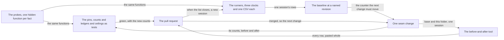

# How the seam got here

The record of how the seam was instrumented, measured and changed over two days in September 2026, kept so that nobody has to find their way through it from memory. The seam is the one place where Excel and Python talk: when `=Add(A1, B1)` runs, the seam checks that both cells hold numbers before Python adds them, and nothing else checks a type. The host is the C# add-in between Excel and Python that carries values across, built on Excel-DNA, the framework that plugs an add-in into Excel; the bridge is the Python side of the seam, where arguments are validated and results converted. This page says what was built and in what order, what each change moved, what was decided and by which tenet, what was tried and declined, and what is still open. It is written for the owner coming back after months and for an engineer maintaining the seam. The rules are in [inputs.md](inputs.md) and [outputs.md](outputs.md), the instruments in [measuring.md](measuring.md), the numbers in [baseline.md](baseline.md); this page links to them and does not restate them.

## The shape of the work

The stretch runs from pull request #26, merged at 00:39 UTC on 2026-09-11, to #42, merged at 01:15 UTC on 2026-09-12, with #43 open on top; #29 to #42 merged within about sixteen hours of one another. Before it, the input side was already closed: #14 and #15 guarded scalar and range arguments against the declared signature, #16 named that guard type validation and closed the input decisions, and #17 and #18 made every range cross as one table of cells in one pass, all between 2026-09-08 and 2026-09-09. The order inside the stretch was deliberate: probes first, then instruments, then a baseline, then one change at a time with a measurement before and after each, then a fresh baseline.

A probe is a hidden worksheet function that does no work beyond crossing the seam, so what it costs is what the seam costs; `=SumArray(A1:A100)` is a range in and one number out and nothing else. The probes stand in for the library, which had no pricing function yet, and they are the knobs every measurement turns: how many calls, how many cells in, how many cells out. A scalar is one value in one cell, such as the 3 that `=Add(1, 2)` returns. An array is the rectangle of values one formula returns, which Excel spills into the cells below and beside it, as `=Grid(2, 3)` fills two rows and three columns. A range is an array as it arrives from the sheet, cells of any kind in sheet order; `A1:J1000` arrives as a range of 10,000 cells.

The instruments are of two kinds, and the house rule separates them: work is measured by counts, and counts are tests; time is measured by tools, and no timing gates a merge. The pins are the tests under `tests/performance` that hold the host's counts, Python's ledgers of which functions ran, and the ceilings on how much memory a call may hold, each at an exact value, so a change that moves one has to say so; the files are named budgets. The three runners are three clocks over different spans of the same call, Python alone, the host without Excel, and a hidden Excel driven over COM, the Windows channel through which one program drives another; the clocks are read side by side and never subtracted from one another. A baseline is one session's numbers, one sitting of the runners on one machine, at a named revision, the short code such as aaa5259 that names one state of the code. The before-and-after tool runs all three runners on the change's base, the code it started from, and on the change in one session, so drift within the session lands on both, and a row is moved when its two spreads, the smallest and largest of its five batches printed in brackets beside the median, do not overlap. From #27 on every Excel number is on the Release build, the faster build that CI, the automated check on every pull request, ships, for the reason in the #27 row below; how a batch is timed and how to read a move are in [measuring.md](measuring.md).

This is the loop the stretch followed, from the probes to a fresh baseline, with each arrow carrying what one step hands the next.

## The timeline

The table uses the seam's words for one crossing. A trip is one crossing from the host into Python and back with the answer; a scalar call is one trip, and a range in is two. A cell's kind is what sort of thing it holds: number, text, boolean, blank or missing. Blank is a cell with nothing in it and missing is an argument the formula did not give at all, so `=Times(5)` takes its default factor and `=Times(5, C2)` with C2 empty is rejected. A buffer is memory the host fills and holds still so Python can read it where it lies, one for the cells' kinds and one for their numbers. The way in is the host scanning a range into its buffers and handing them to Python, and the way out is a result copied into the array Excel receives. Owning a range is Python taking its own copy of the two buffers so the host can reuse them for the next range.

And the words for what the host and Python do. A name lookup is the host asking Python for something by its text name, as `INDIRECT` finds a cell by its address. Objects built are the Python values the host makes to carry one call. A call is warm when nothing is being set up for the first time, so for a range the host has already scanned one at least as large. Managed bytes are memory the host's own runtime hands out on the calling thread during one call. The peak is Python's own meter of how much memory a call holds at its highest point, which sees Python objects and numpy's data and not the host's buffers. A look is one pass over a whole range at once, the way `=SUM` reads a range, leaving a mask, a yes-or-no answer per cell, and a walk visits cells one by one in a loop. The summary of kinds is one bit per kind the host saw while scanning a range, handed to Python beside the buffers. The prepared path is the Python entry for one function that the host fetches once at registration, when the add-in loads and tells Excel its functions, and calls directly ever after.

One line per pull request, in merge order. The numbers in the last column are from the body of the pull request named in the first column unless the cell names another source; microseconds are per call on the Python and host clocks and per formula in Excel, as each pull request states them.

| PR | What it is | What changed | What it moved |
|---|---|---|---|
| #26 | nine hidden probes | The placeholder functions became probes, one per fact the host can tell apart, registered hidden so the function wizard never lists them; seven placeholders the host could not tell apart became test data in the range test. | Nothing in the seam; the probes are what later changes are counted against. All 25 smoke rows passed. |
| #27 | the add-in loaded into Excel is built Release | The Excel smoke test and `tools/excel_dev.ps1` load the Release build, the one CI ships. | Nothing in the seam. The reason: the host's per-cell loop at 74 µs in the Debug build, the slower one made for stepping through code, against 20 in Release, so every Excel number from here on is on the shipped build. |
| #28 | the way out, by declaration | The result contract, now [outputs.md](outputs.md): the declared return type is read at registration, the seam converts once by it, and the host reads the result by type with one buffer request. `Zero` replaced `Nothing`; `EchoColumn` and `EchoRow` joined. | A result cost two trips and a lookup by name before, one buffer request and no trip after. |
| #29 | the RowSums probe | A grid in, one number per row out: the shape of pricing every row, which the comparison of one formula per row against arrays needed before any pricing function existed. | Nothing; a probe added. |
| #30 | every probe on both ledgers | Two Python ledgers per probe, and the peak of Python's memory per call pinned as ceilings. | Found and pinned: a 10,000-cell range in peaked at 77 KB, about 8 bytes per cell, because comparing the kinds against the enum, the named list of kinds in the code, made numpy build an 8-byte temporary before its 1-byte mask. |
| #31 | a work counter the observer supplies | Nine counters at the host's boundaries; the worksheet path passes none and pays one check per boundary that no counter is present. | The first counts: a scalar call 1 trip, 1 name lookup, 4 objects, 440 managed bytes; a range in 2 trips, 2 lookups, 7 objects, 2 buffers of 9N bytes; an array out 2 buffers of 16N bytes and 2 copies. |
| #32 | warm runners for Python and the host | Two runners with one shape, a one-table summary, and [measuring.md](measuring.md) to say how to read them. | The first host numbers without Excel: a bare call 2.4 µs, `Add` 3.4, `SumArray` 163 at ten thousand cells, of which the way in alone was 144 and the way out alone 7.6. |
| #33 | Excel timings, batching, and a local edit | The Excel runner over COM; an Excel-only floor beside every case, a formula such as `=A1+B1` timed next to the seam's so that Excel's own share shows; and `HostAdd`, a hidden C# function with the host's argument shape and no Python, as the floor under a scalar call. | The first Excel numbers: `=Add` 7.3 µs per formula at 1,000 rows beside `HostAdd` 2.2 and `=A+B` 0.4; a thousand `=RowSums(Ai:Ji)` 40 ms per recalculation against one array 0.93. |
| #34 | the baseline at 024486f | One session with all three runners plus the 10,000-row Excel control, its CSVs committed beside the document, every number a CSV row or arithmetic that names its rows. | Where the work was: a user paid about 7 µs per scalar call, and a range in was the host's scan, 158 of the host runner's 180 µs at ten thousand cells. The recommendation: declare pricing functions over arrays. |
| #35 | array, the one word for the rectangle | A rename and nothing else: `cells_from_buffers` in the bridge, the host runner's check of an array, ten arrays and one array; the old names cut, not kept beside the new. | No counter moved, as #36 confirmed by measuring the rename against its own base, a run in which nothing should move. |
| #36 | before and after, every row | The tool: the base in a temporary worktree, git's word for a second copy of the code in a folder beside this one, the three runners on both sides in one session, and a report with every row, every counter that differs, and the allocation figures. | The noise floor, from the rename against its base: 96 rows, 19 moved down and 12 up beyond the spreads, 8 by more than 5%, all of it noise within the session, since the rename changed nothing. |
| #37 | prepare the call path once, at registration | The host fetches each function's prepared path once and holds it; a call builds no name string and no argument list, and looks nothing up. | Name lookups 1 to 0 and objects 4 to 2 on a scalar call; managed bytes 440 to 312; Excel `=Add` 7.26 to 6.27 µs at 1,000 rows; host `Zero` 2.47 to 1.63. |
| #38 | the host carries which kinds it saw | The summary of kinds, recorded in the same pass as the scan and handed over beside the buffers; Python accepts an all-number or all-text range on it with no look. | The numpy calls on every accepted range to none; Python's peak for 10,000 numbers in 77,000 to 192 bytes; Excel `SumArray` over 100 cells 40.84 to 26.72 µs; Python `SumArray` at 10,000 cells 13.85 to 3.93. |
| #39 | compare the kinds against plain integers | The four array-wide compares use plain integers beside the enum, which keeps every scalar decision. | No counter and no ledger; the rejected-range ceiling 9 to 2 bytes per cell, its peak with text last 87,239 to 20,640; the three rejected Python rows at 10,000 cells from 13.76, 17.50 and 24.62 µs to 5.94, 7.97 and 9.24. |
| #40 | one pass over the range, into buffers the host keeps | The two buffers kept between calls, grown only for a larger range than any before, and the range scanned with a plain counted loop, several times faster than the loop the host used before. | A warm range in's objects 6 to 3 and buffers 2 to 0; managed bytes at 10,000 cells 90,722 to 496 (#40's own session; the first baseline's session read 90,890); the way in alone at 10,000 cells 138 to 40 µs; Excel `SumArray` over 10,000 cells 403 to 313. |
| #41 | one copy out | An array out copied once, from Python's buffer straight into the array Excel receives, held still in memory only for the length of the copy. | Buffers 2 of 16N bytes to 1 of 8N, copies 2 to 1; the way out alone at 10,000 cells 7.76 to 5.53 µs; the Excel array rows did not move, because the spill is Excel's own. |
| #42 | the baseline at aaa5259 | A fresh session, its CSVs, and every row paired with the first session's. | 139 rows, 91 moved down beyond both spreads, none up. |
| #43 | a column or row of text as the host's tuple | The text validator returns the host's own tuple, the plain ordered list of text cells the host already built, instead of copying it into a numpy array of Python objects and back into a second tuple. | The numpy calls on a text column to none; the peak at 10,000 cells 160,635 to 192 bytes; a text column's prepared call 312 to 70.7 µs at 10,000 cells; no host counter. |
| #44 | one directory for the seam | Everything written about the seam moved into `docs/seam/`, with five new pages: the index, one call step by step, the two sides, the how-to, and this record. | Nothing in the seam. Three documents were corrected against the code: the numpy operation named on the rejected path, the count of the host's memory ceilings, and one name for the summary of kinds. |
| #45 | the array of numbers says so in its name | The declared type `Array` became `NumberArray`. The words of the sheet are unchanged, so every message reads as before. | Nothing: no counter, no ledger, no ceiling, and no message. |
| #46 | the other two number types follow | `Column` became `NumberColumn` and `Row` became `NumberRow`, finishing what #45 began. | Nothing, on the same grounds as #45. |
| #47 | a range may hold three kinds together | `MixedArray`, the eighth range type: numbers, nonempty text and booleans in any combination, handed to the function as one record over the storage the host already sent. Two probes, `CountMixed` and its numeric control `CountArray`. | Nothing existing: no counter, ledger or ceiling moved. The new rows: an accepted mixed range asks numpy for nothing and peaks at 248 bytes whatever its size, and a mixed range costs what a range of numbers costs on the host, apart from the text it happens to hold. |
| #50 | the smoke count after #47, and what its review parked | Two stale counts corrected, and two items from the onboarding review of 2026-09-13 recorded in the open table below. | Nothing in the seam. |
| #51 | a table crosses as a header row and a body, bound by name into typed columns | `Table`, a schema declared beside a function, one line per column; the prepared path binds the header row to the schema and refines each body column with its column type. `BooleanColumn`, the ninth range type. One probe, `SumQuantity`, over a four-column table with one column of each type, whose rows in the host runner run after every other row. | Nothing existing: no counter, ledger or ceiling moved, except that the date column's ledger names the two helpers the date rule now shares with a table's column of dates. The new rows: a table of ten thousand cells runs every bridge function once, takes one look per column, and peaks at 135,266 bytes, about 54 bytes per row; on the Python clock it costs about 47 µs before its first row and 60 ns a row after, and the host counts it as the two ranges it is. Two findings about the host runner, in the open table below. |
| #53 | the first handles | `Handle[Kind]`, the seam's one alias around a class the library defines: a creator returns the object and its cell shows a three-part handle, `discount_curve:3f9a1c:000002`; a consumer's parameter receives the object; one store in the bridge, one publication per creator call, one lookup to resolve, every failure as text. With it the library's first two objects, a valuation date and a ten-year daily discount curve built from a `date` and `discount_factor` table, and `util_ReadDiscountFactor`, a temporary reader. The host is untouched. | Three new ledgers: a valuation date is the two-scalar call plus its builder and one publication; the curve at 3,631 rows is the table path plus five looks, two copies and one publication; the reader is a text call plus one lookup. Ceilings 1,176, 129,027 and 1,208 bytes. No existing count moved. |
| #54 | a mixed range crosses only as a table | The owner's decision, [inputs.md](inputs.md) decision 38: a function Excel lists takes a mixed range only as a table, a row of text and a schema, because without headers its columns mean nothing; registration refuses a listed function that declares `MixedArray` on its own, and the hidden probes keep the bare range as the seam's instrument. Whether a range of one kind needs headers too is not decided, and the decision says so. | Nothing: one check at registration, no counter, no ledger. |
| #55 | the help beside each argument reaches Excel | The words beside each parameter in a declaration, `Annotated[Date, "One date, ..."]`, are what Excel shows about that argument as a person types the formula and in the fx dialog, with the docstring as the function's line; registration reads both once, refuses a listed function that leaves either out or runs past the 253 characters Excel shows, and adds what the signature already says, an optional argument's name in brackets and what it takes when omitted. The host puts the label and the help on each argument's registration attribute and bundles Excel-DNA IntelliSense, installed after registration and uninstalled on unload, so one add-in gives both forms of help. The three listed functions and the `Times` probe carry help; test functions register hidden, as the seam's instruments. | Nothing per call: all of it is read once at registration. No ledger and no ceiling moved. |
| #56 | a help line says what to select | The lines beside each argument say what to select, give an example or where the value comes from, and name at most one thing that must hold; a creator's function line explains the handle once. The shape of a line is written in the library's [conventions.md](../library/conventions.md#excel-help), with the optional form shown once, so the next function finds it. Registration refuses a line that does not end with a period, since what it adds follows that sentence, and joins a docstring's lines into one. | Nothing: words at registration, no ledger and no ceiling. |
| #59 | an argument may be left out, with nothing in its place | The form `X \| None = None`, [inputs.md](inputs.md) decision 39: an argument declared so may be left out, and the function then receives `None`; a blank cell in the slot still fails as a blank, since blank arrives as `None` and left out as `MISSING`, and only `MISSING` takes a default. Registration reads the type inside the form for the rule and the words, refuses the form without `None` as its default or with another, refuses a table, a handle or a bare mixed range inside it as it does on their own, and shows the name in brackets with the help's sentence alone. The library's first use is `CreateExpirySchedule`'s `option_expiry`, for an index with no options. The host is untouched: nothing new crosses it. | Nothing per call: the check of an argument is unchanged, and a left-out argument returns the stored default as it always did. No ledger and no ceiling moved. |
| #60 | the first market definition, an expiry schedule | `CreateExpirySchedule`, the library's first function to take columns of one kind without headers and the first to declare the left-out form: a column of codes and two of dates, the third left out for an index without options, one rule of meaning, that the columns line up, and a handle out. Nothing in the seam changed; the counts of the library's functions in these pages became words, as the library's README asks. | Two new ledgers: three columns in is the text column handed over as it is, one look and two conversions per date column, the builder's two copies and one publication; with the third left out, one column's rule and one copy fewer, and the left-out argument runs nothing. Ceilings 4,928 bytes with options and 3,280 without at 120 contracts, about 32 and 17 bytes per contract. No existing count moved. |
| #64 | a handle of any kind | `Handle[object]` as a parameter's declaration, [inputs.md](inputs.md) decision 40: the resolver runs as it always did, the text rule, a relayed failure, the lookup, and skips its last step, the comparison of the store's kind with the declared one, handing over whatever the key finds; its words name no kind, `expected a handle`. A creator names what it makes, so `Handle[object]` as a result refuses to register, and a bare `Handle` still does. Wanted by `ReadHandle`. The host is untouched: what crosses is the same text. | Nothing: one comparison in the resolver becomes conditional, no function call added. No ledger and no ceiling moved. |
| #65 | a mixed array goes out, laid out cell by cell | `MixedArray` as a result, [outputs.md](outputs.md) decision 13, the mirror of the way in: the rule checks the rectangle as the way in checks one, the earliest cell holding no value named, then a number that is not finite, a boolean slot that is not 0 or 1, a text holding a NUL, and a text longer than a cell holds, that last checked on the joined text in one encode; the host receives the kinds, the numbers and the texts joined with NUL, by position, and lays the array out cell by cell, a box per number cell, a string per text cell, two shared boxes for the booleans. `MixedArray.table` builds a rectangle from rows of headings over columns of one kind each, dates to serials, so no function writes kinds by hand. One probe, `EchoMixed`, with rows in the three runners, the smoke test and the host's replay. Wanted by `ReadHandle`. | New rows, nothing existing moved. The bridge runs seven of its functions and takes three looks whatever the rectangle holds, and peaks at 50,536 bytes over ten thousand numbers and 72,213 over the mixed column. The host makes one array of references, a box per number cell and a string per text cell, `result_boxes` and `result_texts`, and allocates about 53 managed bytes per added mixed cell against 8 on the numbers road. |
| #66 | ReadHandle, and the temporary reader retired | `ReadHandle`, the library's first reader and the first function on both seam items of #64 and #65: any handle in, the object's table out, headers, a row of types, one row per element, each kind registering how it shows and a kind without a table failing in the cell. `util_ReadDiscountFactor` and the curve's lookup went with it, from the code, the smoke rows, the replay, the runners and the shared workbook. Nothing in the seam changed. | The curve's ledger loses the one scalar conversion the lookup kept. New: reading a ten-year curve back is a text call, one lookup, the table built a column at a time and the mixed road's three looks; ceilings for reading a valuation date and the curve back. |
| #67 | the second market definition, a holiday calendar | `CreateHolidayCalendar`, one column of dates in and a handle out, the second function to take a column of one kind without headers: the list is the calendar, kept as given, with no rule of its own, and `ReadHandle` shows it as one column under `holiday`. Nothing in the seam changed. | One new ledger: one column in is one look and two conversions, the builder's one copy and one publication, twelve functions once each, ten of the bridge's, the creator and its builder. Ceiling 2,908 bytes at 100 holidays, about 17 bytes per holiday, as a schedule without options. No existing count moved. |
| #68 | the third market definition, market conventions | `CreateMarketConventions`, five text scalars in, the units one index is quoted, settled and measured in, and a handle out; the codes are kept as typed and not checked yet, that check noted at the builder as a task for later. `ReadHandle` shows them as one row of five. The shared workbook gains a block per creator built since #66, inputs and creator on the left, the spill on the right. Nothing in the seam changed. | One new ledger: five texts in is the text rule five times, the builder and one publication, nothing asked of numpy. Ceilings under twice the slack, measured 281 bytes to create and 1,162 to read back. No existing count moved. |
| #69 | the fourth market definition, a contract spec | `CreateContractSpec`, a text, a whole number and two numbers in, the name, lot size and fees per lot of one contract, and a handle out; the facts are kept as given and not checked yet, noted at the builder as a task for later. `ReadHandle` shows them as one row of four, the name as text and the numbers as numbers. The shared workbook gains the spec's block and the expiry schedule's, which #60 left out. One seam rule moved, [inputs.md](inputs.md) decision 41: a whole number in is bounded at 2^53 either side, as it is on the way out, after review found a lot size of 1E16 made a spec `ReadHandle` could not show; beyond the line the argument fails in the way out's words. | One new ledger: four scalars in is the text rule once, the whole-number rule once with the number rule beneath it, the number rule twice more, the builder and one publication, nothing asked of numpy. Ceilings under twice the slack, measured 272 bytes to create and 1,205 to read back. No existing count moved; the bound is one comparison inside the whole-number rule. |
| #70 | the curve takes anchors | `CreateDiscountCurve` takes the anchors the desk supplies, dates increasing with any gaps, and the library fills every day between them by a straight line on the factor, `interpolate_discount_factors` in `src/goosedove/globals/interpolation.py`, with no worksheet surface by the owner's call; the consecutive-days rule became each date after the row above, and the curve stays the daily object `ReadHandle` spills. The interpolation page folded into the curve's. The shared workbook gains the owner's eleven-anchor sample and its 211-day spill. Review found two edges: near underflow the line fell a step below the anchor it ran to and the curve rose on its last day, so the line is held at that anchor; and two anchors 1,048,574 days apart made a curve no sheet could show, so a curve holds at most 1,048,574 days, a sheet's rows less the reader's two heading rows. Nothing in the seam changed. | The curve's ledger gains the interpolation and its two ranges of days, and loses one of the builder's two copies. Ceilings: the daily ten-year body 216,443 bytes, up from 129,027, since the interpolation now runs over every day it was given; a dozen anchors over ten years 89,602 bytes, about 25 bytes per day filled. No host count moved. |
| #71 | the unit conversions | `UnitConversions`, the library's first object with no worksheet surface: four categories of units, volume, mass, energy and usd, authored in `src/goosedove/globals/unit_conversions.py`, checked once when the module is imported and shared by reference as `UNITS`, which a calculation takes as a parameter. A conversion is one factor looked up and one multiplication over an array; a unit of another category is refused as a conversion across categories. Four units joined the page's tables: the gram, the troy ounce, the U.S. hundredweight and the kilowatt hour. The conventions sample spells its category `volume`, lowercase as the library's conventions list categories, in the code, the smoke rows, the host's replay and the shared workbook. Nothing in the seam changed. | One new ledger, in a file of its own for library code called directly: a conversion is one category lookup and two unit lookups, no builder and nothing asked of numpy that cProfile sees; a ceiling of 8 bytes per quantity plus the slack, measured 80,200 at ten thousand. No existing count moved. |
| #72 | time, the decisions ahead of the functions | A page of decisions, not a function page, `docs/library/time.md`, from a braindump the owner brought: a contract month is a unit of its own, `datetime64[M]`; a code is one spelling, `M26`, in a fixed horizon of 2000 to 2099; a schedule's contracts are in order and none skipped, the rule its builder takes when it reads codes; the nearby contract by `searchsorted` and the n-th by position; every period calendar days, weekends kept, and business days only through the holiday calendar where a contract states them, with Gas Daily daily the shape to leave room for; two `util_` readers wanted; and a table of what the braindump proposed and this repository declines, a second serial conversion and a text date parser among them. Nothing in the seam changed. | Nothing: words. No ledger and no ceiling moved. |
| #73 | index, not market, and a leading underscore | The market definitions became the index definitions, the pieces one index is defined by: the package, the module of creators, the conventions record, its creator and its handle kind, `index_conventions:`, and the pages, ahead of a creator that ties them together, which is not built. Every worksheet function the library lists leads with `_`, `_CreateDiscountCurve`, or `util_` for a utility, `util_ReadHandle`, so that typing `_` in a cell lists the library's functions and nothing of Excel's; `Ping` and the probes keep their names. The smoke rows, the host's replay and the shared workbook follow, and the workbook gains an `index` tab, one index's pieces built from editable inputs, beside the smoke blocks of `handles`. Rows above keep the names of their day. Nothing in the seam changed. | Nothing: names. No ledger and no ceiling moved; the ledgers name the renamed functions. |
| #74 | the first market data, a futures curve | `_CreateFuturesCurve`, a column of codes and a column of prices in, the price of each contract of one index, and a handle out, in a package of its own, `src/goosedove/market_data/`, beside the globals and the index definitions; one rule of meaning, that the columns line up, the prices copied and frozen, the codes kept as typed. Columns rather than a welded table, by the owner's call and on the seam's own numbers: no look and no temporary per cell for the numbers, the text tuple handed over as it is after one pass over it for an empty text, where a table would pay the header binding, a look per column and the gathers. `util_ReadHandle` shows it as two columns. The shared workbook gains its block. Nothing in the seam changed. | One new ledger: two columns in is the text column and the number column each through its shape rule and its kind rule, no look at the kinds of either and one pass over the text tuple for an empty text, the builder's one copy and one publication: fifteen calls across twelve functions, the shape and kind rules once per column, and two numpy calls, the copy and the freeze. Ceiling 8 bytes per contract plus twice the slack, measured 1,281 bytes at 120 contracts, 9,922 at 1,200 and 96,322 at 12,000. No existing count moved. |
| #75 | the second market data, daily fixings | `_CreateDailyFixings`, a header row and a table of dates and settles in, the settle of one index on each day it fixed, and a handle out, beside the futures curve in `src/goosedove/market_data/`. A table rather than two columns, by the owner's call: a history is nearer static data than a ticking curve, and a body selected as one range cannot put a date beside the wrong settle. One rule, the curve's, each date after the row above, so one fixing per day in the order a reader searches; a series pasted newest first is refused, since nothing sorts. Both columns copied and frozen. `util_ReadHandle` shows them as two columns. The shared workbook gains its block. Nothing in the seam changed. | One new ledger at the table path: the header row as any row of text, the body admitted as a mixed range and bound, one look per column, the date column to days, the builder's look at the order and its two copies, one publication: nineteen calls across eighteen functions, and on numpy three looks, two conversions, two copies and two freezes. Ceiling 30 bytes per row plus the slack, measured 7,563 bytes at 260 rows, 65,887 at 2,600 and 650,831 at 26,000. No existing count moved. |
| #76 | the third market data, monthly fixings | `_CreateMonthlyFixings`, a column of months typed as their first days and a column of prices in, the price of one index for each month it fixed, and a handle out, the daily fixings' sibling for an index that fixes once a month. Two columns for the sheet's ergonomics, by the owner's call. Three rules: one price per month; each date the first day of its month, so that `May-26`, which a cell stores as the 26th, is refused rather than read as its month; and each month after the row above, the owner's no duplicates and ascending. The first function to hold a contract month as `datetime64[M]`, the unit time.md decided, made by the builder from the days; `util_ReadHandle` spills a month as its first day under the month type, since a month cannot cross the seam. The shared workbook gains its block. Nothing in the seam changed. | One new ledger: the date column through its look and conversion, the number column on the summary alone, the builder's two looks and its months made from the days, one copy and one publication: seventeen calls across fourteen functions, three looks, four conversions, one copy and two freezes. Ceiling 40 bytes per month plus the slack, measured 4,472 bytes at 120 months, 32,527 at 1,200 and 313,327 at 12,000. No existing count moved. |
| #78 | contract specifications, one row per contract | `_CreateContractSpecifications` replaces `_CreateContractSpec` after use: a header row and a table in, one contract per row, its name, lot size and two fees, and a handle out, so an index traded as NYMEX lots and as ICE lots of gas has a row for each. Two rules, each name once and each lot size whole, the lot sizes crossing as the numbers the cells hold and going back out as they came, so the one-contract form's line at 2^53 is not drawn; the rest still a task for later. The record holds columns, the reader shows one row per contract, and the shared workbook's two blocks become tables. Nothing in the seam changed: a column of whole numbers was proposed for it and the owner declined, the existing types carrying the table as they carry every other. | The specifications' ledger moves from four scalars to the table path: the header row, the body bound, the names gathered, the three number columns as views, the builder's look at the lot sizes, three copies and one publication, twenty-one calls across eighteen functions, five looks, three copies and one publication; a ceiling of 100 bytes per contract plus twice the slack, measured 12,163 at 120 contracts and 3,037 at two. No other count moved. |
| #79 | daily fixings checked against a holiday calendar | `_CreateDailyFixings` takes a third argument, the market's holiday calendar by handle, the first creator to take a handle in, `util_ReadHandle` having taken any handle since #66: decisions 34 to 37 carry a creator's argument for the first time, and nothing in the seam changed. Three rules in the builder, in order: each date after the row above, as before; each date a business day, Monday to Friday and not a holiday, at either end as in the middle; and no business day between the first date and the last without a fixing, which with the first two holding is each date being the business day after the one above, one `busday_offset` over the column. Numpy's business-day functions over the calendar's list, as [time.md](../library/time.md) decided, and the week mask its fork left open, decided Monday to Friday. The message names the row, the day and its reason, a Saturday, a Sunday, a holiday, or the business day without a fixing. The first and last dates bound the check; a holiday outside them changes nothing. Nothing is filled in and nothing sorted. The shared workbook's block takes its calendar. | The ledger grows by the handle's text rule and its one lookup and the builder's two looks: twenty-two calls across twenty functions from nineteen across eighteen, and on numpy five looks from three, the business-day calls raising no event the fixture reads. Ceiling 45 bytes per row plus the slack from 30, measured 11,482 bytes at 260 rows from 7,563, 93,326 at 2,600 and 912,278 at 26,000, the business day after each date being a full-size temporary. No other count moved. |
| #80 | the expiry schedule's publication dates | `_CreateExpirySchedule` takes a fourth column, `publication_date`, the day each contract's settle is published, for an index that settles monthly, declared `DateColumn \| None = None` as the third is, [inputs.md](inputs.md) decision 39: left out, the schedule keeps None; given, one date per code, copied and frozen, the existing rule and nothing more, no ordering, uniqueness or calendar. Either optional column may be left out on its own, `=_CreateExpirySchedule(A2:A7, B2:B7, , D2:D7)` arriving with its empty slot as an argument left out. `util_ReadHandle` shows the publication dates last, after the options when the schedule has them. The shared workbook's block gains the column and a creator that takes it without the options. Nothing in the seam changed. | The schedule's ledgers move by the accept rule once more, four arguments in place of three: thirty-four calls across fifteen functions with every column, from twenty-six with three, twenty-seven with the publication dates and the options left out, and twenty with two columns, from nineteen; on numpy one look, two conversions, one copy and one freeze per date column given. Ceilings: 48 bytes per contract plus twice the slack with every column, measured 7,312 at 120 contracts and 59,180 at 1,200; 32 with three columns either way and 17 with two, as before. No other count moved. |
| #81 | monthly fixings dated by publication, checked against the schedule | `_CreateMonthlyFixings` takes the days the index's settles were published, a column of prices and the index's expiry schedule by handle, after use showed a monthly settle appears on a day of its own, Waha's January 2026 index on 5 January as Platts announced, and not on the first of its month. Five rules in the builder, in order: the schedule has publication dates; one price per date; each date after the row above; each date one the schedule publishes on, before its first and after its last as much as between; and no publication between the first date and the last without a fixing, which with the rest holding is each date being the schedule's next publication after the one above, one `searchsorted` over the column against `np.unique` of the schedule's dates, read as a set and neither written to nor kept. What the schedule says is authoritative, a weekend or a holiday included: no calendar is taken. The record holds publication dates as days and prices, the month unit of [time.md](../library/time.md) no longer held by anything; `util_ReadHandle` shows `publication_date` over `datetime64[D]`. The shared workbook's block becomes Waha's, with its schedule beneath it. Nothing in the seam changed. | The ledger moves from seventeen calls across fourteen functions to twenty across sixteen, the handle's text rule and its one lookup; on numpy four looks from three, the two conversions from four since nothing goes to months and back, two copies from one plus np.unique's flatten, sort and two asanyarray, and one searchsorted. Ceiling 60 bytes per fixing plus twice the slack from 40 plus the slack, measured 7,631 bytes at 120 fixings against a schedule of 120 contracts from 4,472, 62,622 at 1,200 and 613,422 at 12,000. No other count moved. |
| #82 | the calendar, every day with its prompt contract and two flags | `_CreateCalendar`, the first function of a fifth group and the first to take three handles, the valuation date's, the expiry schedule's and the holiday calendar's: every calendar day from the day after the schedule's first future expires to the day its last expires, the contract prompt on each, the expiry day belonging to the contract expiring on it and the day after to the next contract, whether the market is open, Monday to Friday and not a listed holiday, and whether the day is before the valuation date's day, the day itself never past whatever its fraction. Three rules on the schedule, the calendar's and not the schedule's: two contracts or more, the first only bounding the calendar and never prompt; each code once, as typed, by exact equality; each future expiring after the one above; and the last within a sheet's rows of the first, the curve's bound, found in review, so whatever is created can be read back. The record keeps the three objects by reference and four frozen columns, the days from one `arange`, the prompt rows from one `searchsorted`, the flags from `is_busday` and one comparison, made once; the reader shows them as they are and takes each day's code from the schedule, rebuilding nothing. Two forks of [time.md](../library/time.md) decided: the expiry day is the expiring contract's, and codes are labels here, unread. The shared workbook gains the block, and a page under a new `docs/library/calendar/`. Nothing in the seam changed. | Two new ledgers. Creating: three handles, each the text rule and one lookup, the builder's one look, and one publication, fourteen calls across eight functions; on numpy one look, one arange, one searchsorted and four freezes, is_busday and the comparison raising no event the fixture reads. Reading back: fifteen calls across thirteen functions, no arange and no searchsorted, the codes gathered as one array and the table's usual road out. Ceilings: 25 bytes per day plus twice the slack to create, measured 8,620 at 360 days, 66,741 at 3,630 and 661,841 at 36,630; 20 bytes per cell plus twice the slack to read back, measured 26,308 at 360 days. No other count moved. |
| #83 | the futures curve removed | `_CreateFuturesCurve` and `FuturesCurve`, built in #74, are gone: the market the pricing will take is prepared once and combined with a vector of prices, and a standalone curve had no place in it. The creator, its `__all__` entry, the object and its builder, the reader's table, the page, the unit, seam, help, reader, ledger, ceiling and host tests, the smoke rows and the shared workbook's block were deleted, not kept, aliased or listed as retired; the daily fixings' wrong-kind tests hand a valuation date instead, and the monthly fixings' text-for-price smoke row borrows the schedule's codes. The current descriptions, the seam README, working.md, bridge.md, the reader's page and the fixings' pages, stopped advertising it; #74's own row above stands, and inputs.md decision 38 and conventions.md keep its record in the past tense. Nothing in the seam changed. | Two ledgers and one ceiling deleted with the function, fifteen calls across twelve functions and 8 bytes per contract; no remaining count moved. |
| #84 | the market history, a calendar bound to the fixings on its past business days | `_CreateMarketHistory`, the first function of a sixth group, the market, and the first to take two handles, the calendar's and the daily fixings': the calendar kept as it is, the object itself and every row it has, and the settle fixed on each of its past business days taken from the fixings, one for every such day and none for any other, the first object that reads the market data against the calendar. Three rules in the builder, in order, each naming the earliest offending date: no fixing on or after the valuation date's day, inside the calendar or out, whatever the day's fraction; no fixing inside the calendar on a day it closes, since the two then disagree about a holiday; and a fixing on every past business day, the first and the last included. A fixing's row is its day count from the calendar's first day, one subtraction, since the calendar's days are consecutive; fixings beyond the calendar on either side are allowed and unused, and nothing is sorted, filled in, carried forward or substituted. The record keeps the calendar by reference and two frozen columns, the rows and the prices, absence being a row not listed, so zero is a price. `util_ReadHandle` shows the calendar's columns and `fixing_price`, a number where the day fixed and the word `closed` or `unfixed` where it did not, the first column of two kinds, composed from the record's three fields since the table builder takes columns of one kind; outputs.md decision 13 records the exception. The shared workbook gains the block, and a page under a new `docs/library/market/`. Nothing in the seam changed. | Two new ledgers. Creating: two handles, each the text rule and one lookup, the builder's three looks, its subtraction to rows and its zeros over the days, and one publication, eleven calls across eight functions; on numpy three looks, one astype, one zeros and two freezes, no arange, no searchsorted. Reading back: the calendar's own reading, fifteen calls across thirteen functions, plus the history's table and the calendar's, seventeen across fifteen, the four empties of the wider kinds, the slots, the pairs of texts and their mask on top of the calendar's, nothing of the calendar made again. Ceilings: 6 bytes per day plus twice the slack to create, measured 3,681 at 360 days with 76 fixings, 16,641 at 3,600 and 148,641 at 36,600; 30 bytes per cell plus twice the slack to read back, measured 51,267 at 360 days, 629,741 at 3,600 and 6,528,344 at 36,600. No other count moved. |
| #85 | the price vector, one column of prices snapped as it stands | `_CreatePriceVector`, the hot market data: one column of futures prices without a header, as a vendor's feed rewrites it about once a second, taken as it stands each time the sheet recalculates and kept as given, a zero, a negative price and a repeat included, nothing sorted, rounded, deduplicated, padded, cut or bounded, and what a position means left to the market that will read it. One column of numbers at the seam's existing rule, the fourth function to take a column without headers; the builder has no rule of its own, one copy, one freeze and one publication, and `util_ReadHandle` shows the column under `price` and `float64`. Each call publishes anew, an unchanged column included, and earlier handles stand under the handle contract, release still open. A typed Excel-DNA `double[,]` transport was measured in an experiment outside the repository and deferred, the decision on the page: a few microseconds and a few kilobytes per call at 50 to 150 prices, against a second path to maintain and a coercing input contract. The shared workbook gains the block. Nothing in the seam changed. | One new ledger: the column on the host's summary, no look, the builder's copy and freeze, one publication, ten calls across ten functions; on numpy one copy and one freeze, nothing else. Ceiling 8 bytes per price plus twice the slack, measured 1,273 bytes at 120 prices and 80,314 at 10,000, 392 for a single cell; reading back 21 bytes per cell plus the slack, measured 2,492 at 120 prices and 140,812 at 10,000. No other count moved. |
| #86 | the market, the history with the current futures prices | `_CreateMarket`, the market itself and the hot operation: the market history and a price vector by handle, kept as they are, and one number found, the schedule row of the contract prompt on the valuation day, so that the vector's first quote is that contract's and the rest follow the schedule through its last, the contract expiring on the valuation day quoted on it, a contract with no open day left still counted, and the fixing standing where a day has fixed. Two rules on scalars, in order: the valuation date within the calendar's days, the first and the last included, a calendar starting after it or ending before it refused rather than extended; and exactly one quote per contract from the valuation day's prompt through the last, the count being all that can be checked, since the sheet keeps the order. The valuation day's row is its day count from the calendar's first day, and its prompt row is read there: no search, no array, no copy. `util_ReadHandle` shows the calendar's columns and `price`, the fixing on each past business day, the prompt contract's quote on each business day from the valuation day on, gathered for those rows alone since a past day's prompt may precede the first quoted, and `closed` on the rest, through one helper the history's reader now shares. The shared workbook gains the block. Nothing in the seam changed. | Two new ledgers. Creating: eleven calls across eight functions and no numpy call, the same at a year of days with nine quotes, ten years with one and a year with 246; ceiling twice the slack, measured 984 bytes at every size. Reading back: eighteen calls across sixteen functions, the calendar's own, the helper's and one flatnonzero for the live rows, six empties; 30 bytes per cell plus twice the slack, measured 50,931 at 360 days and 501,307 at 3,600. The history's readback moves by the helper, eighteen calls across sixteen functions from seventeen across fifteen and seven empties from six, measured 53,627 at 360 days from 51,267, its ceiling unchanged. No other count moved. |
| #93 | the repository restored to its state after #86 | One commit, merged as 9187777, whose tree is exactly the tree of ada6de3, the merge of #86, reached by resetting the index and the working tree to it; history is preserved and nothing is rewritten. Reversed, newest first: #92, the delivery schedule creator and record; #91, the publication schedule creator and record; #89, the WTI, Henry Hub and LME copper validation workbooks with their validators; #88, monthly market-history support, its readback, its publication-order rule, and the one change to the seam itself among the five, a handle parameter of several kinds; #87, the calendar's `fixing_mode` argument and the daily or monthly distinction. Retained: everything through #86, the expiry schedule's optional publication-date column of #80 and the monthly fixings creator of #81 among it, which nothing consumes at this baseline. The reason: the monthly-reference design is being reconsidered, and the working daily path, calendar to market history to market, stands as #86 left it while it is. This page went back with the rest, so the rows those five pull requests wrote, and the inputs.md decision #88 added, are in git history at c21c449 and not here. | Nothing forward: every ledger and ceiling is #86's pin again, which the tree carries and which pass, 985 tests, and no dependency, lock or CI file differs, so the tree is byte for byte one CI passed on 19 September. |
| #97 | the IFERC schedule | `_CreateIfercSchedule`, the fifth index definition and the IFERC market's own object: the contract months of one index settled on Inside FERC's monthly index, three columns of one kind without headers, `contract_code`, `last_trading_date` and `publication_date`, paired by position and all required, kept as typed and as given, each date column copied and frozen, with one rule, one row per code, the last trading dates named before the publication dates, `last_trading_date has 2 dates, expected 3, one per contract_code`. The exchange's date and the publisher's side by side in the object of the market that has both, beside the futures expiry schedule, whose optional publication column and its reader stand as they are; nothing reads it yet but `util_ReadHandle`, which spills the three columns. The shared workbook gains the block. Nothing in the seam changed. | One new ledger: the text column handed over as it is, one look and two conversions per date column, the builder's two copies and freezes, one publication, twenty-six calls across fifteen functions; on numpy two looks, four conversions, two copies and two freezes. Ceiling 32 bytes per contract month plus twice the slack, measured 4,928 bytes at 120 contract months and 39,516 at 1,200, the expiry schedule with options' figures to the byte. No other count moved. |
| #98 | the Gas Daily schedule | `_CreateGasDailySchedule`, the sixth index definition and the Gas Daily market's own object: the contract months of one index settled on Gas Daily's daily midpoint, three columns of one kind without headers, `contract_code`, `first_date` and `last_date`, the first and last day of gas each month's price covers, paired by position and all required, kept as typed and as given, each date column copied and frozen, with one rule, one row per code, the first dates named before the last, `first_date has 2 dates, expected 3, one per contract_code`. A flow day's month is the month it flows in, so the schedule holds a calendar month's bounds and no last trading day, and Platts' flow-date values carry every weekend and holiday, so it holds no trade dates, packages or holidays; nothing reads it yet but `util_ReadHandle`, which spills the three columns. The shared workbook gains the block, and its IFERC block's readback is rewritten to spill. Nothing in the seam changed. | One new ledger, the IFERC schedule's to the call: twenty-six calls across fifteen functions; on numpy two looks, four conversions, two copies and two freezes. Ceiling 32 bytes per contract month plus twice the slack, measured 4,928 bytes at 120 contract months and 39,516 at 1,200, the IFERC schedule's figures to the byte. No other count moved. |
| #99 | the IFERC fixings | `_CreateIfercFixings`, the IFERC market's own fixings: Inside FERC's index for each contract month whose index has been published, two columns of one kind without headers, `contract_code` and `price`, paired by position and both required, kept as typed and as given, the prices copied and frozen, with two rules, one price per code, `price has 3 prices, expected 4, one per contract_code`, and each code once, `contract_code row 3 is 'G26', already given at row 2`. Keyed by the month, since the IFERC schedule holds the day each index printed; what must hold between these months and the schedule's is the history's rule. `_CreateMonthlyFixings`, dated by publication and checked against the expiry schedule's optional publication column, went with this build, its page, record, tests, smoke rows, host replay and workbook block with it, and the column it alone read stands until its own pull request. The shared workbook's block is replaced. Nothing in the seam changed. | One new ledger: the text column handed over as it is, the number column accepted on the host's summary, the builder's count and its one pass over the codes, one copy and one publication, fifteen calls across twelve functions; on numpy one copy and one freeze. Ceiling 80 bytes per month plus twice the slack, measured 10,600 bytes at 120 months, most of it the set the codes are checked for repeats through, and 41,348 at 1,200, 34 bytes per month. The monthly fixings' ledger and ceiling go with it. No other count moved. |
| #100 | the Gas Daily fixings | `_CreateGasDailyFixings`, the Gas Daily market's own fixings: the midpoint Platts printed for each day gas flowed, two columns of one kind without headers, `flow_date` and `price`, paired by position and both required, one row for every calendar day from the first to the last as Platts' flow-date values date them, weekends and holidays included, both columns copied and frozen, with two rules, one price per flow day, `price has 5 prices, expected 6, one per flow_date`, and each flow day the day after the row above, `flow_date row 4 is 2026-09-07, expected 2026-09-06, the day after row 3's 2026-09-05`, one comparison that names a repeat, a skip and a series newest first alike. No holiday calendar and no schedule, since no day is closed and a flow day's month is its own; the library moves no date and carries nothing forward, and a day Platts printed nothing for is a gap the desk cannot fill. time.md's sentence that a weekend day's price is the one assessed on the last business day before it is amended: it is the one Platts printed for it. The shared workbook gains the block. Nothing in the seam changed. | One new ledger: the date column through its look and its conversion to days, the number column accepted on the host's summary, the builder's one look over the days, two copies and one publication, seventeen calls across fourteen functions; on numpy two looks, two conversions, two copies and two freezes. Ceiling 40 bytes per flow day plus twice the slack, measured 13,108 bytes at a year of flow days, 36 bytes per day, and 121,513 at ten years, 33 bytes per day. No other count moved. |
| #101 | the futures fixings, two columns and the name | `_CreateDailyFixings` is `_CreateFuturesFixings`, the futures market's own fixings beside the IFERC and Gas Daily fixings, and takes two columns of one kind without headers, `date` and `settle`, paired by position, and the market's holiday calendar by handle, instead of a header row and a table: the desk found the table clunky in use, and the fixings family takes one form. A fourth rule comes with the columns and goes first, one settle per date, `settle has 3 settles, expected 4, one per date`; the three of #79 stand word for word. The record, `FuturesFixings`, its readers and its spill keep their shape; the market history takes its fixings as `futures_fixings`, its three messages and the seam's handle words with it. The table path stays for the discount curve and the contract specifications. The shared workbook's two creator cells are re-entered. Nothing in the seam changed. | The fixings' ledger moves from the table path to the column path: twenty calls across sixteen functions, down from twenty-two across twenty, the date column through its look and its conversion to days and the settle column accepted on the host's summary; on numpy four looks, down from five, the column's two conversions, two copies and two freezes. Ceiling 45 bytes per row plus the slack, unchanged, measured 11,202 bytes at 260 rows, 280 below the table path's 11,482, 93,102 at 2,600 and 912,102 at 26,000. No other count moved. |
| #102 | the futures schedule, two dates per contract and the name | `_CreateExpirySchedule` is `_CreateFuturesSchedule`, the futures market's own schedule beside the IFERC and Gas Daily schedules: three columns of one kind without headers, `contract_code`, as the sibling schedules name it, `future_expiry` and `option_expiry`, the third left out for an index without options, and the one rule of #60, one row per code, `future_expiry has 5 dates, expected 6, one per contract_code`. The `publication_date` column of #80, read by nothing since #99, goes: a future's settle is traded to its expiry, and the IFERC schedule holds the publication day beside each month. The record, `FuturesSchedule`, keeps its codes and two date columns; the calendar takes the schedule as `futures_schedule`, its handle words and its message for a schedule of one contract with it, and reads nothing new. The shared workbook's schedule block loses its publication column and its old Waha block goes. Nothing in the seam changed. | The schedule's ledgers drop the four-column case: three columns in, twenty-six calls across fifteen functions, and two columns in, unchanged; on numpy two looks, four conversions, two copies and two freezes. Ceilings 32 bytes per contract with options and 17 without, plus twice the slack, unchanged, the four-column ceiling gone. No other count moved. |
| #103 | a handle that may be left out | The form of decision 39 now takes a handle: `holiday_calendar: Handle[HolidayCalendar] | None = None` registers, the function receives `None` for the argument left out and the object otherwise, a blank cell fails as a blank in the handle's words, a handle of another kind and text naming no live object fail as they always have, and any other default on a handle is refused as before; decisions 36 and 39 amended. The handle inside the form is declared as if required, since the form's `None` is the argument's absence and not a default the store would have to hold. Wanted by the calendar over any schedule, whose holiday calendar is left out for a market with no closed days. Two probes of the tests' own; no function Excel lists changes. | No count moved: an argument left out costs the accept rule's one call, as any left-out argument does, and a handle given costs its text rule and one lookup, as before. |
| #104 | the calendar over any schedule | `_CreateCalendar(valuation_date, schedule, [holiday_calendar])`: the schedule is any handle, decision 40's form, and its kind chooses the calendar, read off the object as the spill reads a handle's kind; a futures schedule gives the calendar of #82, a Gas Daily schedule every flow day from the first month's first day to the last month's last, each on its month, and an IFERC schedule one row per month dated by its publication day; the holiday calendar is required with a futures schedule and refused with the other two, the first handle a formula may leave out, decision 39's form of #103. One record for the three, holding its kind, with the columns `contract`, `is_priced` and `is_fixed` for `prompt_contract`, `is_business_day` and `is_past`; a period is fixed when its price is known, a futures day before the valuation day, a Gas Daily flow day on or before it, an IFERC month whose publication day is before it. The market history and the market read the renamed columns, and the history takes a futures calendar alone until its own ticket. The shared workbook gains an IFERC and a Gas Daily calendar block. Nothing in the seam changed. | The futures calendar's ledger grows by the builder's dispatch and its two helpers, seventeen calls across eleven functions from fourteen across eight, numpy unchanged; two new ledgers, seventeen calls across thirteen functions each, a year of flow days with two looks, one arange, one searchsorted, one empty for the priced flag and four freezes on numpy, and ten years of months with one look, one copy, one arange, one empty and four freezes; ceilings 25 bytes per flow day and 80 per month, plus twice the slack, measured 7,969 bytes at 365 flow days and 67,351 at 3,653, and 10,504 at 120 months and 41,224 at 1,200, the set the codes are checked through being most of the small count; the futures ceiling and the reader's unchanged. No other count moved. |
| #105 | the market history over any calendar | `_CreateMarketHistory(calendar, fixings)`: the fixings are any handle, decision 40's form, and their kind chooses the binder, read off the object as the calendar reads its schedule's; futures fixings bind to a futures calendar under the three rules of #84, the argument named `fixings` in their messages and the closed day named so; Gas Daily fixings bind to a Gas Daily calendar, a print on every flow day through the valuation day required and one after it refused; IFERC fixings bind to an IFERC calendar by code, every published month's index required, an index for an unpublished month or for a code the calendar does not hold refused, and the indices landing in the calendar's order whatever order they came in. Fixings of another market than the calendar's, and an object that is not fixings, are refused naming both. One record and one spill for the three. The market takes a futures history alone until its own ticket, refusing the other two by the calendar's kind. The shared workbook gains an IFERC and a Gas Daily history block. Nothing in the seam changed. | The futures history's ledger grows by the builder's dispatch, its check of the calendar's kind, its coverage helper and its freeze, fifteen calls across twelve functions from eleven across eight, numpy unchanged at ten calls; two new ledgers, the Gas Daily history's fifteen calls across twelve functions with eight numpy calls, two looks, one astype, one zeros, two setflags and two reduces, and the IFERC history's fourteen across eleven with nine, one array, two looks, one zeros, one argsort, two setflags and two reduces; no arange and no searchsorted in any of the three. The reader's, the market's and the calendars' ledgers unchanged. Two new ceilings: a Gas Daily history 30 bytes per calendar day, 7,404 measured at 365 days with 254 prints and 95,752 at 3,652 days all fixed, and its reader 30 per cell; an IFERC history 100 bytes per month, 12,544 at 120 months and 105,204 at 1,200, the dict of codes to rows most of it, and its reader 35 per cell at 120 months. The futures ceilings unchanged. |
| #106 | the market over any history | `_CreateMarket(market_history, price_vector)` takes any history: the vector holds one quote per contract from the contract of the first unfixed period through the schedule's last, the row of that period read off the calendar, which counts its fixed flags once when it is made and holds the row as `first_unfixed`, the review having moved the count out of the market; on a futures calendar it is the valuation day and its contract the prompt, as before; on a Gas Daily calendar the day after the valuation day, so the first quote is the balance of that month and a month ending on the valuation day is not quoted; on an IFERC calendar the first month whose index has not published, the one publishing on the valuation day included. Two rules of #86 went: the kind guard of #105, and the rule that the valuation date lie within the calendar's days, so a futures calendar valued before its first day is a market from its first day on; a history with no unfixed period is refused, `market_history has no unfixed period, expected at least one to quote`. Where a quote comes from is the sheet's, the IFERC forward behind a Gas Daily month included. The shared workbook gains an IFERC and a Gas Daily market block. Nothing in the seam changed. | The market's ledger is unchanged, eleven calls across eight functions and not one numpy call, and holds over a Gas Daily and an IFERC history alike; the three calendars count their fixed flags once when they are made, numpy's own routine, which the ledger does not see; the reader's ledger is one for the three kinds. Ceilings: the market's record 217 to 218 bytes on each kind, under twice the slack as before; its reader 48,612 bytes at 365 Gas Daily days, 27 per cell, and 20,163 at 120 IFERC months, 34 per cell, under 30 and 35 per cell, the futures reader's ceiling unchanged. |
| #107 | the index behind one reference price | `_CreateIndex(name, schedule, index_conventions, contract_specifications, [holiday_calendar])`: a name, a label kept as typed, bound to four objects the sheet holds, the schedule any handle whose kind the library reads off the object, the conventions and the specifications typed handles, and the holiday calendar in decision 39's form, required with a futures schedule and refused with the other two, the calendar's rules in the calendar's words. The record holds the kind and the four objects by reference; nothing is copied or checked again. `util_ReadHandle` spills one row, the name, the kind, the counts of contracts and of specifications and whether a holiday calendar was given. The kinds, the words that name an object and the two holiday rules move from `calendar.py` into `index_definitions/kind.py`, read by the index, the calendar and the history from one place. Nothing reads the index yet; the calendar's next ticket takes it. The shared workbook gains three index blocks. Nothing in the seam changed. | A futures index is twenty-one calls across ten functions, text through its rule, four handles through the text rule and one lookup each, the dispatch, the holiday rule and one publication, and not one numpy call; an IFERC index nineteen across ten, one handle fewer and the other holiday rule. Reading one back is fifteen calls across twelve functions and twenty numpy calls, the mixed road's for one row of five cells with the two counts' exactness looks. The futures calendar's ledger grows by the shared holiday rule, eighteen calls across twelve functions from seventeen across eleven; the Gas Daily and IFERC calendars' ledgers keep their counts under the rule's new name. Ceilings: the index 241 bytes and its reader 1,131, both under twice the slack. |
| #108 | the calendar and the futures fixings take the index | `_CreateCalendar(valuation_date, index)`: the index in place of the schedule and the holiday calendar, the calendar reading the kind the index holds and taking the holiday calendar through it, the `Handle[object]` schedule of #104 and the holiday calendar that could be left out gone from this creator; the record holds the valuation date and the index and drops its own kind, schedule and holiday calendar, which the history, the market and the spill read through the index; the futures rule's first message names the argument, `index has 1 contract, expected at least 2`; the kind rule and the two holiday rules leave the calendar's page for the index's, where they stood since #107. `_CreateFuturesFixings(date, settle, index)`: the index in place of the holiday calendar, read through it, an index of another kind refused first, `index is a Gas Daily index, expected a futures index`, and the record keeping the index beside its two columns. The shared workbook's calendars and futures fixings re-entered through index cells, one index added. Nothing in the seam changed. | The futures calendar's ledger falls from eighteen calls across twelve functions to fifteen across twelve, one handle fewer through the text rule and the lookup; the Gas Daily and IFERC calendars' from seventeen across thirteen to fifteen across twelve, the holiday refusal gone with the argument; the futures fixings' grows from twenty calls across sixteen functions to twenty-one across seventeen, the holiday calendar read off the index. Numpy's counts and every ceiling unchanged. |
| #109 | the history over one index, the IFERC and Gas Daily fixings over theirs | `_CreateIfercFixings(contract_code, price, index)` and `_CreateGasDailyFixings(flow_date, price, index)`: the index by handle, as the futures fixings take it since #108, kept by reference in each record, `IfercFixings(index, codes, prices)` and `GasDailyFixings(index, dates, prices)`, an index of another kind refused first, `index is a futures index, expected an IFERC index`; the IFERC creator reads the index's schedule and refuses a code that is none of its months, `contract_code row 2 is 'K26', expected one of the index's months`, in one pass with the repeat check, the earliest offending row named, so the history's rule of #105 that every code is a month of the calendar moves to where the codes are typed. `_CreateMarketHistory(calendar, fixings)`, its signature unchanged: the fixings must be over the calendar's index, one reference comparison, `fixings is over another index, 'Henry Hub IFERC', expected the calendar's, 'Henry Hub NYMEX'`, the same name shown twice when two cells made two indices; the kind rule of #105 goes, a fixings kind being its index's kind, and so does the futures rule of #84 against a fixing on a day the calendar closes, both having been checked against the index's one holiday calendar. The smoke gains an IFERC index over the fixings' own four months and the identity refusals; the host's replay one `Index` name and the same; the workbook's IFERC and Gas Daily fixings take their index cells. Nothing in the seam changed. | The IFERC fixings' ledger grows from fifteen calls across twelve functions to eighteen across fourteen, and the Gas Daily fixings' from seventeen across fourteen to twenty across sixteen, the handle's text rule and lookup and the builder's kind check; the three histories' ledgers keep their counts, the kind check's one call now the index comparison's, and the futures history's numpy calls fall from ten to eight, the closed-day look gone. Every ceiling unchanged, the IFERC fixings striking codes off one set of the index's months where they were checked for repeats through one set of themselves. |
| #110 | the conventions' codes checked, the specifications' lot sizes and fees | `_CreateIndexConventions`, its signature, record and read-back unchanged: five rules against the unit tables, the two currency units first, `quote_currency_unit is 'usd', expected USD or CENT`, then the quantity type, `quantity_type is 'Volume', expected volume, mass or energy`, `usd` no quantity type, then the two quantity units judged by it, `quote_quantity_unit is 'MMBTU', expected a volume unit, GAL, BBL, L or M3`, the codes matched exactly and the lists drawn from the tables in their order; the builder takes the collection, `UNITS`, from the worksheet function, reads it by key and converts nothing, the factor between two units being the instrument's to look up once. `_CreateContractSpecifications`, its signature unchanged: two rules after the two of #78, a lot size of 1 or more, `lot_size row 1 is 0.0, expected 1 or more`, and each fee 0 or more, `brokerage_rate_per_lot row 2 is -0.75, expected 0 or more`, a rebate no fee; the fees stated as costs per lot in the index's settlement currency, checked by nothing. The help lines list the codes. The two follow-ups pinned on 26 September resolved. Nothing in the seam changed. | The conventions' ledger is unchanged, seven calls across seven functions and not one numpy call, the five lookups being dictionary reads; the specifications' ledger keeps its twenty-one calls across eighteen functions, its numpy calls rising from twenty-two to twenty-eight, three more looks and their three reductions, one per new rule. Every ceiling unchanged. |
| #112 | the price vector named for its index, the market checking the name | `_CreatePriceVector(index_name, prices)`: the index's name first, ordinary text, the cell `_CreateIndex` was given it from or a literal, kept as typed in a new first field of the record, `PriceVector(index_name, prices)`, never a lookup and no index object held, so the vector depends on its prices and its name cell and not on the index cell; the spill unchanged, one `price` column and no name. `_CreateMarket`, its signature unchanged: one rule before its two, the vector's name compared exactly with the name the history's index was created with, `price_vector names index 'Brent', expected market_history's index 'WTI NYMEX'`, on every kind of history; two indices of one name pass, and a wrongly labelled column does, the label being all the vector carries. The name takes the seam's text rule as `_CreateIndex`'s does, `index_name is blank, expected text`; nothing in the seam changed. | The vector's ledger gains the name's two calls, `_validate` and `_text`, twelve calls across eleven functions, its numpy calls unchanged at the copy and the freeze; the market's ledger unchanged, the comparison being no call. Every ceiling unchanged. |
| #113 | the handle's text: the index's name and the count alone | Every handle is `kind:count`, `futures_schedule:4`, or `kind:index-name:count` for the index, the calendar, the three fixings, the market history, the price vector and the market, `market:WTI NYMEX:36`, the name the index was created with written whole as typed and the runtime's publication count, a plain number; the session part of #53 is gone, and the count starts again with each Python, so a saved text names nothing until today's count passes its number and can then equal a new publication's text of the same kind and name; handles.md records that as a known limitation, reproduced in Excel under manual calculation, accepted by the owner for the handle-lifecycle work to handle. The seam reads the name through a path prepared at registration from the declared kind, `_NAMED` in the bridge, and measures the whole text in UTF-16 units before storing it, `returned handle of 32790 characters, expected at most 32767`, the count unmoved on any failure. Lookup by the whole text, the stored kind, the failure words and every spill unchanged; no creator gained an argument. | Every ledger unchanged, the name read by a C-level attribute path the profiler does not count; every ceiling unchanged, the text shorter by the session part and longer by the name. |
| #114 | handles living as long as their creators: release and reuse through Excel's live-data subscription | Every creator's call is observed through Excel-DNA's `ExcelAsyncUtil.Observe`: the seam's `function_specs` says which functions create a handle, from the declared result, and the host gives those an observed delegate; a creator's `publisher` path returns the value and whether the call published, told by the count having moved; one small `Publication` class runs the path once inside `Subscribe`, hands the value to Excel before returning, and on `Dispose`, once, calls the seam's new `release(text)`, which takes exactly one entry out of the store. Equal creator calls share one object and handle, in one workbook or two, and the count moves only for a new publication. A failure owns nothing, and an Excel error among the arguments is the value, found in the plain path's order. The known limitation of a creator cut in manual calculation mode is recorded with its remedy, a full calculation. `GoosedoveHandles`, hidden, reports the store's live count, the price bytes of its vectors and the host's counts. | Every Python ledger unchanged, the plain path untouched and a creator's publish path one more call above it; the host's pins unchanged. In hidden Excel: a chain of eleven creators reused on a full calculation with nothing published, a changed price releasing the old vector and market, the last workbook closing to nothing; a thousand updates of a 150-price vector settling to eleven live and 1,200 price bytes at every checkpoint, released to nothing at the close. |
| #115 | the lot's unit on the contract specifications | `_CreateContractSpecifications` takes a fifth column, `lot_unit`, the unit each lot size is in, kept as typed and checked against the unit tables' quantity categories, `lot_unit row 2 is 'usd', expected a volume, mass or energy unit`, after the lot sizes and before the fees; the record and the spill carry it. A row is the desk's word for a quantity of the index, a contract or a bare unit with a lot size of 1, so a trade says a word and a count. `_CreateIndex`, its signature unchanged, gains a third rule after the holiday rules: every lot unit is a unit of the conventions' quantity type, `specifications row 2 lot_unit is 'MMBTU', expected a volume unit, GAL, BBL, L or M3`, barrels and gallons standing together under a volume index. Both builders take the unit tables from the worksheet function, as the conventions do; the conventions' message helpers are shared. Nothing in the seam changed. | The specifications' ledger: 23 calls across 19 functions, from 21 across 18, the second text column and the measures read once, the set of quantity units built inline and no call; its numpy calls unchanged. The conventions' ledger gains the shared helper's call, 8 across 8. The index's ledgers unchanged. Every ceiling unchanged. |
| #116 | the process ID first in every handle | Every handle is `pid:kind:count` or `pid:kind:index-name:count`, `30512:market:WTI NYMEX:36`, `30512:futures_schedule:4`: the process ID of the Excel the object lives in, the number Windows gives the running program, read once when the seam starts since Python runs inside Excel's process, whole in decimal with nothing cut, hashed or padded, then the text of #113. Two Excels running at once never publish one text for two objects, and a text from one, or one saved before the ID led the text, names nothing in the other, through the lookup error that was already there; the known limitation of #113 narrows to a process ID Windows reuses after a restart. The count, the store, release and reuse are as #114 left them, and the host never reads the ID. | Every Python ledger unchanged and every ceiling unchanged, the text longer by the ID and a colon. In hidden Excel: every handle leading with the Excel's own process ID, read from its window; two Excels at once showing the same kinds, names and counts under two IDs, a vector of one naming nothing in the other, and a workbook saved by one recreated under the other's ID on a full calculation. |
| #117 | the retention run's verdict | `tools/performance/handle_retention.ps1` no longer exits clean over a wrong reading or a retained publication: after every update the run waits within the patience for Excel to report its calculation done, a wait that runs out failing the update whatever the cell holds, then reads the market's first quote once as a number, and a blank, text, an Excel error or another number fails the run, a later read within the patience telling only whether the number arrived late; every checkpoint waits within the patience for the baseline's live count and asserts it, the close asserts an empty store, and any release missed or failed fails the run; the verdict comes after the owned Excel's cleanup, and `-Fault` proves it by expecting the wrong price and the wrong count. The cell's text and the clock stay as diagnostics and decide nothing. | Evidence, never a gate: a thousand updates of a 150-price vector settling at eleven live and 1,200 price bytes at every checkpoint, every reading the expected number, released to nothing at the close; the fault run exiting nonzero with the two failures named. |
| #121 | the numpy ledger sees calls reported under nested modules | The budget tests' numpy ledger read only `<built-in method numpy.NAME>`, so a C function numpy reports under the module that holds it, `numpy._core._multiarray_umath.count_nonzero` or `interp`, was dropped, and a call added to either could not fail a pin. The pattern in `tests/performance/conftest.py` takes any module path and keeps the leaf, `numpy.count_nonzero`. `tests/performance/test_numpy_ledger.py` profiles real calls: the two nested functions once and twice, a function reported under numpy itself as before, no entry for a call outside numpy, and none for what cProfile cannot see, a ufunc by operator or by name and a function dispatched in C, `concatenate`, `is_busday`, `busday_offset`. A measurement correction: no calculation, ceiling or worksheet behavior changed. | Fifteen pins in `tests/performance/test_seam_budgets.py` gain one entry each and keep every other count. `numpy.count_nonzero: 1` on thirteen: the three calendars' count of their fixed periods, the mixed road out's count of its text cells on the two echo pins and the seven readers, and the rejected table's count of the text codes before its bad cell. `numpy.interp: 1` on the two discount curve pins. Every other ledger, the library budgets and every ceiling unchanged. |
| #122 | `Cells.from_rows` refuses a ragged range | The test helper sized its arrays from the first row and never looked at the length of the others. A longer row raised numpy's `IndexError`; a shorter one left its missing cells' numbers as NaN and their kinds as whatever the memory last held, so one fixture could read as a number holding NaN, a text cell with no text or a code that is no kind, under a summary saying only numbers, and differ from one run to the next. Every row now holds as many cells as the first or the helper refuses it, `row 2 holds 1 cells, expected 2, as row 1 does`, in the words of the two shape refusals of `MixedArray.table`; nothing is padded or cut, and a blank cell is written as `None`. The empty range's refusal is as it was. No fixture in the tests or the measurement tools was ragged. | Nothing: the helper is on no pinned path, so every ledger and every ceiling is unchanged. |
| #123 | less work building and converting, six changes and their pins | Six low-risk changes taken from the numpy review of #120, each its own commit, none changing a worksheet function, a signature, a record or a message. One: the allocation tests pin what a creator's publication keeps once the call has returned, and that its release frees it, read from the domain numpy registers its buffers under. Two: a table's column of text is a slice of the host's tuple, `texts[t::T]` for the column at rank t of T, where it was a mask, a cumulative sum, an array of the texts and a gather; the rule rests on every other column type refusing a text cell, stated beside the slice and held by a test over `COLUMN_TYPES`. Three: `MixedArray.table` places its texts by slice assignment into one list, where it built an object array, transposed and ravelled it. Four: futures fixings are whole by one `np.busday_count` of the first row and the last, taken as slices so one row and none need no case, and the business day after each date is made only to name the first one missing. Five: a scalar date in is one construction from the day's own number, `EPOCH_DAYS` read off `EXCEL_EPOCH`. Six: the discount curve's finite look asks `all` of the finite mask and inverts it only to name a row. | Ceilings: a table in from 14 to 5 bytes per cell, 135,186 to 43,940 bytes at ten thousand cells; futures fixings from 45 to 35 bytes per row, 11,210 to 8,624 at 260 rows; `_CreateValuationDate` from twice the slack to the slack, 1,144 to 272. Each tightened ceiling fails on the source before its change. Ledgers: the table in loses `numpy.array`, `cumsum` and two of three sums, `ufunc.reduce` 7 to 5; the rejected table `ufunc.reduce` 5 to 3; the specifications `numpy.array` 4 to 3 and `ufunc.reduce` 12 to 9; all three lose `_text_places` and its cached lambda; six readers lose `numpy.array` 1 and `ndarray.ravel` 1; the two curve ledgers go from `any` 5 to `any` 4 and `all` 1; the fixings' ledger does not move, `busday_count` being a call the ledger cannot see. New pins: 58,096, 4,160, 800 and 6,480 bytes kept by a curve, fixings, a holiday calendar and a futures calendar, and none after release. |
| #125 | the host runner writes its results as proper CSV | The host runner joined each row's fields with commas and quoted nothing. Since #65 two scenario names hold a comma, `round trip, numbers` and `round trip, mixed`, so 79 rows of `work.csv` and 50 of `batches.csv` carried one field too many, and the two scripts that read them went wrong in two ways. `compare.py` stopped on the cell count in `work.csv`, so the before-and-after comparison could not be written. `summarize.py` did not stop: in `batches.csv` the extra field put the call count where the cell count is read, so it folded the two scenarios into one named `round trip`, 73 series where there are 78, and read each batch's elapsed milliseconds as its microseconds per call. A field that holds a comma, a quote or a line break is now quoted with its own quotes doubled, as the Python and Excel runners already write theirs. No scenario is renamed, since the three layers' rows are joined by those names. | Nothing measured moved. The runner writes the rows it wrote, 390 and 352, every one with as many fields as its header; the summary reads 78 series, each with its own timings; and `tools/performance/before_after.ps1` runs to its report again. |
| #126 | the Excel tools wait for a busy Excel | Excel refuses a call from outside while it is busy, with `RPC_E_CALL_REJECTED` or `RPC_E_SERVERCALL_RETRYLATER`, and now and then the smoke or the lifetime checks stopped on it: the smoke typing its inputs, the lifetime checks typing a changed price. A refused read was worse, because nothing stopped: PowerShell answers a property read that failed with nothing and no error, so a formula's text read at the wrong moment looked empty. `tools/hidden_excel.ps1` now holds `Invoke-ExcelCall`, which makes one call and makes it again every 50 milliseconds while Excel answers with one of those two results, for thirty seconds or until the caller's deadline, and `Read-ExcelProperty`, which reads a property through `InvokeMember` so that the failure is kept, and waits the same way. The smoke and the lifetime checks make every call through them, one operation at a time: a refused read is read again without the formula being typed again, a reference is registered once, and inside the lifetime checks' bounded wait the wait's own deadline is the limit. Every other failure leaves as it came. A call still refused at its deadline fails naming the operation, the cell, the tries, the seconds and the result; the waits are kept apart from what calls return and printed as one report when a tool ends. Two writes of a reopened workbook's saved flag, needless since the close that follows never saves, are gone from the lifetime checks, so that no call into Excel is made outside the two but the cleanup's. What is said about a busy Excel is written the same on every machine, with a decimal point whatever the regional settings. A hidden Excel whose add-in the lifetime checks could not load is now ended instead of left running; the cleanup path itself is unchanged, each step tried once. `tools/excel_busy_selftest.ps1` proves the handling without Excel, and `check.ps1` and CI run it; [host.md](host.md#when-a-hidden-excel-is-busy) is the page. | Nothing measured moved: no source, host, pin or budget changed. The self-test's 42 checks pass, under a decimal comma too, and it fails for each of nine ways the helper was broken on purpose. A hidden Excel made busy on purpose by a second client refused 33 of 165 single reads with 0x80010001, and `Read-ExcelProperty` returned the text all 165 times, 35 of them after a refusal. The gate then ran five times in a row and passed each time. In one of the five the smoke was refused once, taking the range of an input cell right after a creator's formula was typed, in the loop where main stopped, and went on after 0.10 s; the other four met no busy Excel. |
| #127 | the market takes a price vector that stops before the schedule does | `_CreateMarket(market_history, price_vector)` no longer requires a quote for every contract the schedule has left: the vector holds at least one price and at most one per contract from the first unfixed period's contract through the schedule's last, the first price that contract's and the rest in the schedule's order, so a schedule can run years past the quotes the desk has. The exact count becomes two bounds in the same place, after the name and the unfixed period: `price_vector has 26 prices, expected at most 25, one per contract from 'Z26' through 'Z28'` and `price_vector has 0 prices, expected at least 1, ...`. The record is unchanged, two objects and one number, and its live-price coverage ends at the last contract quoted, read off the vector's length. One reader, `Market.live_prices`, a method and no worksheet function, hands back the quotes of the contracts asked for and refuses a contract outside the coverage by name, `requested contract 'F29' is beyond live-price coverage ending at 'Z28'` and, before the first one quoted, where NumPy would count back from the vector's end and hand over another contract's quote, `requested contract 'X26' is before live-price coverage starting at 'Z26'`; the readback is its one caller today. `util_ReadHandle` on a market ends on the last period of the last contract quoted, the history whole and a last contract of closed days alone keeping its rows: that row is found by one search down the calendar's contract column, and the calendar's columns are cut there before the table is made, whether the vector reaches the schedule's end or not. The vector still carries no contract code, so one left unchanged when the first contract rolls is taken and read one contract later, a case the exact count used to catch for a vector that reached the schedule's end; [market.md](../library/market/market.md#when-the-first-contract-rolls) records it, and labels are deferred. | Creating a market: nothing, 11 calls across 8 functions, no numpy call and a peak of 208 bytes, for a vector of any length. Reading one back, for a vector reaching the schedule's end: 18 calls across 16 functions to 20 across 18, the coverage's end and the reader; numpy 26 calls to 29, one `searchsorted`, one `any` and the `reduce` under it; the peak 80 bytes higher, 50,709 to 50,789 at 360 days and 501,085 to 501,165 at 3,600, and 48 higher for IFERC, 20,059 to 20,107, none of it per row. Reading back a vector that stops early pays for the rows it covers: one quote over a hundred years of days, 120 rows of 36,000, in 17,907 bytes, the same to the byte as over one year, and one quote over a hundred years of IFERC months in 4,922, as over ten. The calendar's and the history's readbacks make the calls they made, and their peaks rose by the cuts' small objects, whatever the length: the calendar's by 400 bytes, 26,308 to 26,708 at 360 days and 251,938 to 252,338 at 3,630, and the history's by 64, 53,405 to 53,469 at 360 days. 1,431 Python tests to 1,470, the smoke 347 formulas to 353, the host's 191 unchanged in number, and the kept workbook gains a market whose quotes stop at q26. |
| #128 | the dated fixings are taken newest first | `_CreateFuturesFixings(date, settle, index)` and `_CreateGasDailyFixings(flow_date, price, index)` take their rows as the desk keeps a series, the newest in the first row, so that a new day is a row added at the top: each date is before the row above, every business day between the last row's date and the first row's has a fixing, each flow day is the day before the row above, and the signatures do not change. The rules run on the rows as the sheet gave them, so each message names the sheet's own row, within the first rule broken, a rule earlier in the order reported before a later one on any row: `date row 2 is 2026-05-05, expected a date before row 1's 2026-05-04`, `date row 2 is 2026-05-04, expected 2026-05-05, the business day before row 1's 2026-05-06`, `flow_date row 2 is 2026-09-04, expected 2026-09-05, the day before row 1's 2026-09-06`. Then both columns are copied from the last row to the first, one copy each as before, and kept oldest first, each price beside its own day, so the market history, the market and their readbacks are unchanged and the history's messages still name the earliest offending date and no row. One direction is taken and nothing is sorted: a series of two rows or more pasted oldest first, as every series was before, fails at its second row, and a series of one row is a series either way. `util_ReadHandle` spills the two dated kinds newest first, the creator's own form, each kept column read from its last row back through a view and no copy, so the spill's two columns fed back to the creator make the same fixings, the round trip proved for the three kinds through the seam, in the host and in a real workbook. `_CreateIfercFixings` is unchanged, a code carrying no date for a direction to be read from, and its examples follow the desk; the Excel help, the pages, the smoke, the host's replay, the lifetime and retention tools and the kept workbook move to the new direction, their fixing ranges plain and turned over, the schedules, calendars, histories, markets and price vectors keeping their order. | Creating the fixings: the same calls, the two creators' ledgers unchanged, four looks and two copies for the futures and two looks and two copies for Gas Daily; the peaks 40 bytes higher at any count, the two views the copies read through, 8,624 to 8,664 at 260 futures rows and 69,464 to 69,504 at 2,600, 13,116 to 13,156 at a year of flow days and 121,521 to 121,561 at ten years. Reading the two dated kinds back: the same calls, the peak 192 bytes higher at any count, the two views the table reads through, 10,396 to 10,588 at 260 rows and 92,296 to 92,488 at 2,600, 14,071 to 14,263 at a year and 129,046 to 129,238 at ten; the IFERC readback unchanged at 6,197 for 120 months. The histories and the market: nothing, the history's peak 3,520 at 360 days and the market's 208, both as before. 1,470 Python tests to 1,492, the smoke 353 formulas to 365, the host's 191 unchanged in number, and the kept workbook's fixing ranges turned over. |
| #129 | small changes, one commit each | A kitchen-sink pull request by the owner's request: small functions and chores that need no pull request of their own, each its own commit. (1) The category codes of the unit tables take capitals, `VOLUME`, `MASS`, `ENERGY` and `USD`, like the unit codes they hold, so `_CreateIndexConventions("USD","BBL","USD","VOLUME","BBL")` reads as five codes and `quantity_type is 'volume', expected VOLUME, MASS or ENERGY` refuses the old spelling as it refuses `Volume`; the messages that name a category follow, `expected a VOLUME unit, GAL, BBL, L or M3`, `expected a VOLUME, MASS or ENERGY unit`, `unknown category 'Volume'; categories are VOLUME, MASS, ENERGY, USD`; the Excel help, the pages, the smoke, the host's replay, the lifetime and retention tools and the kept workbook's conventions cells follow. (2) `util_ReadPrompt(calendar)`, text out: the code of the contract on the calendar's first unfixed period, the contract the first price of a market over it is for, read by `Calendar.prompt_code` off the row the calendar counted when it was made, the contract on it and the schedule's code, three reads and nothing made or published, on the three kinds by their own rules; a calendar whose every period has fixed is refused, `calendar has no unfixed period, expected at least one to quote`; the help, a page, the smoke, the host's replay and the kept workbook, a reader beside each of its three calendars. (3) `util_NextFut(contract)` and (4) `util_FutToCme(contract)`, text in and text out: a contract code read for its month and year, one month letter in either case and two digits, the year after 2000, nothing else, in `src/goosedove/index_definitions/contract_codes.py`, three looks at three characters and no pattern; the next month's code in the case given, `G26` after `F26`, `F27` after `Z26`, `n26` after `m26`, and the month as CME's feeds spell it, `202601`; a strip, a season or a four-digit year refused, `contract is 'Cal27', expected a month letter and a two-digit year, such as F26`, and `Z99` refused its next, `expected a month before December 2099, the last a two-digit year can name`, the first functions to read a code for its meaning, the schedules and the market still keeping theirs as labels; the help, two pages, the smoke, the host's replay and the kept workbook, four cells under the futures schedule. (5) `util_DateToFut(date)` and (6) `util_FutToDate(contract)`: the code of the month a day falls in, in capitals, `K26` for 19 May 2026, the day read as a count of months since 1970 and a day outside 2000 to 2099 refused, `date is 2100-01-01, expected a day from 2000 to 2099, the years a two-digit code can name`; and the first day of a code's month as a date, 1 January 2026 for `F26`, the one day a code names on its own, through the same reading as the text helpers and with the same refusals, the first worksheet function to send one date back; the help, two pages, the smoke, the host's replay and the kept workbook, two cells more under the futures schedule. (7) `util_StartDate(period)` and (8) `util_EndDate(period)`: the first and the last calendar day of a contract or strip label, a month `F26`, a quarter `1Q27`, a calendar year `CAL28`, a winter `W29`, November to the March after, a summer `S28`, April to October, or two labels joined by one hyphen, `F26-Z28`, from the left's first day to the right's last, every month between included; the letters in either case, the year two digits of the fixed horizon, `W99` ending in 2100 and never wrapping; each label read for two months of numpy's unit, its first and the one after its last, in `src/goosedove/index_definitions/periods.py`, the day one conversion from each; a space, a one- or four-digit year, a fifth quarter, an empty end or a second hyphen refused naming the whole expression, `period is 'W8-W9', expected a contract or strip with two-digit years, such as F26, 1Q27, CAL28, W29, S28 or F26-Z28`, and a right end that starts or ends before the left refused, `period is 'Z28-F26', expected range endpoints in chronological order`, by both, which read the whole expression; the help, two pages holding one grammar, the smoke, the host's replay, the kept workbook's new block at the foot of the handles sheet, and time.md's parked readers, built as these, with the case decision recorded. Named `util_ReadStartDate` and `util_ReadEndDate` at first and renamed before the pull request merged, since they read no object: by the owner's call, `util_Read*` reads information from an existing library object through its handle, and every other `util_*` function derives or transforms values and is named for its result or operation, which conventions.md now says. (10) The hidden Excel tools end an Excel whose start failed, opened as #130 and taken in here: `Start-HiddenExcel` in `tools/hidden_excel.ps1` identifies and retains the new Excel's process first, through `Get-HiddenExcelProcess`, and configures it after, and a failure on the way goes through `Stop-HiddenExcel` as a completed session does, `Quit`, the references released, the process waited for five seconds and stopped if it stays, the failure that began it kept and the cleanup's own problems a warning beside it; a process that cannot be identified is quit and released and reported as unverified, and no process is ever chosen by name. Before, a failed start tried `Quit` once and verified nothing, so an Excel that refused it stayed, holding the built add-in. `tools/excel_session_selftest.ps1` proves it without Excel, a database recordset standing in for Excel so that releasing the reference is real; `check.ps1` and CI run it beside the busy self-test. The review of #130 found no fault in the tool and three things of the house's: the pages that list the gate's steps and this history had not followed, the script was named lifecycle beside the lifetime checks, and the pull request's words; the first two are resolved here, the script named for the session it checks, and the third by this row and the pull request's description standing in for #130's. (11) The allocation pins take the least of three measurements, opened as #131 and taken in here. A peak pin in `tests/performance/test_seam_allocation.py` read 4,027 bytes once against a ceiling of 1,024, on a call whose own peak is 192. tracemalloc sees every thread of the process, so an allocation the call did not make lands on a measurement now and then: another thread's, an xdist worker's receiver among them, or a resize of the store's dictionary, which lands on one call in many. An experiment on this branch reproduced the shape, one allocation on a background thread reading 4,497, 192, 192 over three samples and a full-size temporary on every call 80,288 three times; what made the 4,027 is not identified. The handle pins were the least of three warm measurements from the first, for the store's resizes; now every peak pin is, through the same `least_peak`, each sample its own untraced warmup and its own trace: the sixteen probe pins that took one measurement and the unit conversion's in `test_library_budgets.py`, which keeps the capitals of item (1) beside it. Three tests of the measure: a 4-kilobyte temporary on the traced call of one sample, whichever of the three, leaves the least under the slack, where one sample, the greatest or the mean would stand over it; a full-size temporary on every call stands in the least, 80,336 bytes around a scalar probe whose own least is 240, over the slack; a call that fails, in the warmup or under the trace, comes out as it was raised, no second sample taken and tracing stopped. A measurement correction: no ceiling, no calculation and no worksheet behavior changed; the retained-bytes pins, which take one measurement of what is held and not a peak, and the measurement tools under `tools/performance` are as they were. The review of #131 found one P3: measuring.md and the file's docstring said a disturbance cannot raise all three samples, and it can; both now say that the least leaves out what lands on one sample and is raised by what reaches all three. | (1) No ledger or ceiling moved: the category names are keys, read as before. The Python tests 1,492 to 1,493, the smoke 365 formulas unchanged in number, the host's 191 unchanged. (2) A new ledger: nine calls across nine functions, the handle's text rule and lookup, the function, the three reads and the way out for text, no numpy call; a peak of 192 bytes at a year of days and at a hundred years alike, the store's live count unchanged. The Python tests 1,493 to 1,527, the smoke 365 formulas to 376, the host's 191 to 194. (3) and (4) One ledger each, nine calls across nine functions, the text rule, the function, the library's and its one reading, the way out for text, no numpy call; a peak of 192 to 235 bytes, the store's live count unchanged; a first form with a regular expression peaked at 1,278 bytes and went for the three looks. The Python tests 1,527 to 1,584, the smoke 376 formulas to 387, the host's 194 to 207. (5) and (6) Two ledgers: the code of a day is nine calls across nine functions and two numpy conversions, the day to a count of months and that count to a number, a peak of 870 bytes; the first day of a code is ten calls across ten functions, the way out for a date among them, which puts the day in a one-day array and checks it as a column, its unit and two looks, six numpy calls none of them the library's, a peak of 1,217 bytes within twice the slack. The Python tests 1,584 to 1,617, the smoke 387 formulas to 397, the host's 207 to 217. (7) and (8) One ledger each: eleven calls across eleven functions for one label, twelve for a range, the label's reading twice, one numpy conversion of the library's and the seam's way out for a date; a peak of 1,264 bytes for a month and for the whole century alike, nothing growing with the period and nothing published. The Python tests 1,617 to 1,690, the smoke 397 formulas to 411, the host's 217 to 236. (10) No ledger or ceiling: the gate's steps eight to nine, the session self-test's 20 checks beside the busy self-test's 42, the smoke's 411 formulas and the lifetime's 43 unchanged in number. The tool broken four ways on purpose fails 8, 7, 5 and 5 of the 20, the fourth break the old startup cleanup put back; a failure injected after identification against a real Excel ended its process, the error kept and no warning. (11) Single-measurement peak pins 17 to 0, 16 in the seam's allocation file and the conversion's; every ceiling as it was. The Python tests 1,690 to 1,696, the six of the measure; the smoke and the host's unchanged. |
| #136 | the trade kernel on the NG example | Ticket I1 of the trade-valuation pipeline: `src/goosedove/trades/`, four frozen records with one builder each. `resolved_trades` holds a batch's terms as `_CreateTrades` will resolve them, one futures index and specification row, route, settlement, schedule method, lots, the occurrences and their components, refusing a non-futures index, a fractional or zero lot, a non-finite price and payment dates that do not match the settlement; `encoded` turns them into quantities in the quote unit, coefficients in the settlement currency per unit of quote price, which every price multiplies while the quantity stays the physical fact, and entry-price offsets through the unit tables, names the inputs, one per contract held in the schedule's order, and sums by input, one payment day per contract after its expiry; `prepared` applies one market history, refusing another index's, a trade on the boundary contract, a physical contract past its expiry by trade, contract, expiry and valuation date, and a financial contract expiring on a closed day, reading one settle per fixed input and settling what has paid by the inclusive cutoff; `results` evaluates against one market, refusing another history and a bilateral route, reading the live quotes by schedule row through `Market.live_prices`, one dot product, mark, cash, the preparation's delta on the batch's stable axis with zero where fixed and its total, shared, and a DV01 of zero by the undiscounted cleared model. The review found the first form converting the offset to the settlement currency and not the exposure, so a cent-quoted lot marked 2,970,000 dollars at its own cost; the coefficient fixed it, and a cents lifecycle pins it. Every number of the NG example page reproduces, 7,000 and 8,600 before expiry and the toy's seven states through 14,300 paid. Nothing imports the bridge; no worksheet function yet. | The first library code with a work counter. Encoding: one component per component, one input per input. Preparation: one input per input, one fixing read per fixed input, none per component or per calendar day. A tick: one kernel call, one quote per live input, `results` and `Market.live_prices` once each and the counter, the same at five components and at two thousand; numpy sees the market's one look with its reduction, the dot product dispatched in C and delta the preparation's. The Python tests 1,710 to 1,775, 53 examples and properties and 12 budget pins; the smoke's 411 formulas and the host's 236 unchanged. |
| #137 | the instrument catalog, listed and shown | Ticket I2 of the trade-valuation pipeline, stacked on #136. `src/goosedove/instruments/definitions.py` holds the `future` as frozen library data: a name, a description and fifteen fields, each its name, meaning, whether it is required, the condition that otherwise requires it, its type in the seam's words, text, number, date, code or holiday calendar handle, its choices and its rule; the catalog is authored and checked once there, each name once and nonempty, no cell ever blank, and `instrument(name)` matches exactly, refusing `Future` with the names there are and an empty catalog saying so. `_ListInstruments()` spills a header and one row per instrument, two text columns through the table builder; `_ShowInstrument(instrument)` spills seven rows by sixteen columns, the labels down the first column, the fields across the first row and the required row booleans among rows of text, through `MixedArray.cells`, a new builder that lays a small grid out one cell at a time with the way in's classification, since the table builder fills columns of one kind, and refuses a whole number beyond what a cell holds exactly before the float it would become could hide it, the rule the number and table results keep; the review caught the first form rounding 9007199254740993 to 9007199254740992. The Show page's table is generated from the definitions and a test keeps the two equal cell for cell; the index is no field, by the review's decision 1, and `clearing_house` is text. The kept workbook gains the two spills at the foot of its handles sheet, B1259 and B1262, with a note. No handle, no trade, market or history read. | The list: seven calls across seven functions and the mixed way out's numpy, 994 bytes. The shown future: twelve functions, the classification once per cell and the generator that feeds it, 112 each, the mixed way out's numpy, 11,204 bytes, about 100 a cell, under a hundred a cell and the slack. The Python tests 1,775 to 1,804, 24 examples, 2 help pins and 3 budget pins; the smoke 411 formulas to 425; the host's 236 to 241. |
| #138 | a row or rows of an instrument's fields cross the seam | Ticket I3 of the trade-valuation pipeline, stacked on #137: the seam extension the review agreed as its decisions 9 to 12, inputs.md decision 42. Two declaration forms beside `Handle[T]`, `FieldRow[S]` for a template's one row and `FieldRows[S]` for a ticket's rows, each after a `TextRow` of headers, `S` the type of the one parameter whose value selects the instrument, text for a name or a class whose handle holds one; registration finds that parameter and refuses none or two. On the call, after every argument has passed alone, the instrument is selected through `goosedove.instruments.fields.selected`, a dispatch the library owns, text today and the template in I4; then `_bind_fields` checks the width, each header exactly against the instrument's field names, case and all, unknown and repeated headers named in input order with the fields listed, and each column by its field's type with the table rules, text for a code and a new handle column, `_handles_of`, that finds each cell's text at its own place in the body, counted once in sheet order, and resolves it through the handle rule in row order, the first bad cell down the column named whichever way it is bad; the review caught its first form reading the text column's slice before the columns to its right had passed, and so taking a number column's text for a handle and naming a row that was not there. The function receives a `FieldValues`, the library's record, the instrument, the fields present and each typed column by name, with typed accessors; the library never imports the seam. Two probes prove it, `EchoFieldRow` spilling a bound row back with a handle cell as the words of its kind, `CountFieldRows` counting rows; the smoke has eleven rows for them, with a handle cell that refers to a creator cell as a sheet does, and the host nine rows and a fact. | Rows of three fields through CountFieldRows: twenty-two calls across eighteen functions and three looks, one per column, the same at five rows and at 2,500, the number columns views and the text column the host's tuple itself; a peak of 3,837 bytes at 2,500 rows, one mask over the rows at a time. One row with a handle cell through EchoFieldRow: the handle resolved once, the date converted once, 2,033 bytes with the echo's table. The Python tests 1,804 to 1,833, 25 examples and 4 budget pins; the smoke 425 formulas to 436; the host's 241 to 251. |
| #139 | the two trade creators | Ticket I4 of the trade-valuation pipeline, stacked on #138. `_CreateTradeTemplate(instrument, fields, values)` makes a `TradeTemplate`, the instrument and one value per field given, each read once for the rule intrinsic to its field through readers in `src/goosedove/trades/template.py`, a code from its enum, a lag of positive business days, a contract code or strip through the period grammar, nothing required and no index retained; the kind selects the instrument for the seam through `selected`. `_CreateTrades(index, fields, trade_rows, template)` resolves, in `src/goosedove/trades/resolution.py`: no field from both, every required field present, one value per batch field, the specification named among the index's, each conditional field present exactly when its condition holds, every code of the schedule read once for its month with a non-code and two rows for one month refused, each distinct ticket code read once and its months looked up in one pass of array arithmetic, a strip one component per month on its one occurrence, and for a financial settlement each component's payment day by `busday_offset` strictly after its contract's expiry on its own calendar; then the kernel, whose record gained the instrument, the clearing house and broker labels and the payment terms, the lag and the calendar beside the days they gave, and whose lot and price messages name the trade's row. The batch, `Trades`, holds the terms and the encoding and publishes as `trades:<index>:N`; `util_ReadHandle` spills a template as one row and a batch as one row per component under the definition's field names, the batch's own facts on every row. The lifetime script gained a `trades` group, in the gate, where a payment calendar's change republishes the template and the batch and a cleared template fails the batch. | Resolution: the same functions at five rows and at two thousand but for the counts that follow the distinct codes, `period_months` once each, `month_and_year` once per schedule code, nothing per row; two numpy conversions per distinct code. Through the seam: the two handles resolved once each, one look per column, one publication; a template one read per value. A template 2,412 bytes; a batch of 2,500 rows 324,317, about 130 a row, twelve retained columns. The Python tests 1,833 to 1,911, 64 examples and properties, 2 help pins, 7 budget pins and 1 allocation pin; the smoke 436 formulas to 473; the host's 251 to 260; the lifetime's 14 checks of the new group. |
| #140 | the kernel on dated slots | Ticket I4a of the trade-valuation pipeline, stacked on #139, the owner's page with the review's two narrowings: the market reference is derived from the observation day by the calendar's rule, `contract_on`, now callable from `goosedove.calendar.calendar`, and retained, an observation of a contract other than the day's pricing contract refused as unsupported since a futures history holds one settle a day; the fixing source is kept once, the batch's index and the history over it. A fifth record, `Observations`, with its builder and `observed`, the rule a schedule method is, `lastday` giving one observation per component on its contract's expiry day with the whole weight; the encoding keeps its per-component arrays, sums offsets by payment group as before, and makes the slots, the distinct days within each group, in group order and by day, with the reference and the summed exposure, each observation's coefficient times its weight, one lexsort and one bincount, and the delta axis of distinct references, an observation on a closed day refused here against the index's holiday calendar, before any history, where the first form let a live one take a quote and fail the day it fixed, the review's catch; the preparation fixes slot by slot, reads one settle per fixed slot, settles a group when every slot of it has fixed and it has paid, and sums the live exposure by reference for delta; the evaluation reads one quote per live reference, gathers the quotes onto the live slots, multiplies and sums, and retains the dated contributions. Every NG number stands, two slots for two contracts; the daily toy's four states, 180, 150, 160 and 150 with delta 30, 20, 10 and 0, its payment into 150 of cash, and the offsetting dates, -30 and -10 once the first has fixed, are pinned by hand. No worksheet function changed; `_CreateTrades` publishes the richer encoding. | Encoding: one component, one observation and one slot per each, the same functions at five rows and at two thousand, `contract_on` once. Preparation: one slot per slot and one settle per fixed slot, the same fifteen kinds of numpy call, 32 in all, at any size. A tick: one kernel call, one quote per live reference, `results` and `Market.live_prices` once each, the gather and the multiplication unseen, the sum and the freezing seen. The batch's peak 324,317 to 509,786 bytes at 2,500 rows, about 204 a row, the observations' four columns and the slots' sort added. A daily batch of two thousand trades over twenty-four contracts and fifteen days, thirty thousand observations into 360 slots: the same functions, the preparation about 86 bytes a slot and the tick about 22, nothing per trade. The Python tests 1,911 to 1,940, 22 examples and 7 budget pins; the smoke's 473, the host's 260 and the lifetime's 57 unchanged. |
| #141 | the valuation path on the sheet | Ticket I5 of the trade-valuation pipeline, stacked on #140: `_PrepareTrades(trades, history)` and `_EvaluateTrades(prepared, market)`, each two handles in and one out, over the kernel's `prepared_trades` and `trade_results`, the records renamed `PreparedTrades` and `TradeResults` so their handles read `prepared_trades:<index>:N` and `trade_results:<index>:N`, the two names added to the bridge's `_NAMED`; `_ReportValues(results)` and `_ReportRisk(results)`, one handle in and a three-row table out, the mark and the cash under the route's labels with the currency and the day, and the total delta and the DV01 with their units and the day, the stored scalars and nothing valued; `util_ReadHandle` spills a preparation and a result one row per slot, the fixed flag, the settled flag and the live exposure, the live exposure and contribution and the contract's delta named `contract_delta`, the review having read the contract's number repeated on each slot as the slot's. The NG example valued cell to cell, 7,000 and 110,000, 8,600 on a tick with the old results standing at 7,000; the toy's 30 November, -11,000 and 22,800. The smoke's chain over its history and market, the lifetime's trades group through a price tick with the preparation reused and a changed fixing remaking the history, the preparation and the results, the host's chain from its side, and the kept workbook's foot. | Preparing: two handles resolved, `prepared_trades` and nothing of the encoding, the same at five trades and at two thousand; a tick: two handles, `trade_results` and `Market.live_prices` once each, nothing of the preparation; a report: one handle, one row laid out, no kernel call, nothing published. Peaks at 2,500 trades over 24 slots: preparing 8,912 bytes, a tick 1,144, the reports 1,967 and 1,948, by slot and never by trade. The Python tests 1,940 to 1,958, 9 examples, 3 help pins and 6 budget pins; the smoke 473 formulas to 501; the host's 260 to 266; the lifetime's 57 checks to 70. |
| #142 | the toy cash lifecycle on a sheet | Ticket I6 of the trade-valuation pipeline, stacked on #141, with no function added or changed: the example page's seven states run on a sheet through `_CreateTrades`, `_PrepareTrades`, `_EvaluateTrades` and the two reports. The kept workbook's handles sheet holds them from row 1320, the index `TOY_GAS` with G27 after F27, its financial template paying two business days after each expiry on the holiday calendar, the five NG rows as one batch, a settle for every business day from 29 October to 30 December in two columns, the first print and the corrected series, and one row per state with its own valuation date, calendar, fixings, history, price vector from the prompt on, market, preparation and results, the mark, the cash and the total delta beside them: 7,000 and 8,600 with both live, the tick taking the first row's preparation as it is; 10,200 and 11,800 as Z26 fixes at 3.22 and is corrected to 3.23; -11,000 of mark and 22,800 of cash on Z26's payment day; -8,500 and 22,800 with F27 fixed and unpaid; 0 and 14,300 with both paid, G27 quoted and held by no trade. The paid state read back below. The tests run the seven states through the entries, the smoke the paid state. A series without the expiry day's settle is refused by the history before any trade is prepared, the page amended to say so. R1, the PHH payment dates, was not needed: the toy pays by its lag on its own calendar. | Nothing of the seam or the kernel; the Python tests 1,958 to 1,968, the smoke 501 formulas to 514, the host's 266 and the lifetime's 70 unchanged; the workbook 372 cells added and no other cell's value changed. |
| #144 | the penultimate method | Ticket R1 of the trade-valuation pipeline, stacked on #143, the page as a ticket: `penultimate` joins `lastday` in the kernel's `ScheduleMethod`, and `observed(method, index, contract)` gives each component the business day before its contract's expiry on the index's holiday calendar, one `numpy.busday_offset` over the components, an expiry the market is closed on refused by its contract and never rolled; resolution makes the observations once, before the payment terms, and counts each occurrence's lag from its component's observation day on the payment calendar, the day rolled back first where that calendar closes it, so the payment resolver reads the schedule's expiries no more and the encoding takes the same observations; the kernel refuses a physical settlement with the method; the definition's rule for `schedule_method` says both are built and `_ShowInstrument` shows it. No signature, spill or report changed: the pen's slot is its pen day, its reference its own contract, its fixing that day's settle, the underlying's final settle another day's. ICE PHH Z26 observes 24 November 2026 and pays the 25th, M27 25 May 2027 and the 26th, N27 25 June and the 28th; ICE WTI T F27 observes 18 December 2026 and pays the 21st, every one ICE's published last trading day; two lots of N27 at 3.00 mark 500 on the pen day at 3.10, 1,000 fixed at 3.20 on the Saturday, 1,000 of cash on the Monday. The smoke's WTI T analogue on its chain, the host's pen batch on its, and the kept workbook's PHH lifecycle, eight states as rows from row 1366. | Resolution's ledgers gain the observations' builder, made there now, and `futures_schedule_of` a third time; the pen adds `with_holiday_calendar` and `open_days` once each and one `any`, nothing per row; the encoding, the preparation and a tick unchanged. The Python tests 1,968 to 1,999, the smoke 514 formulas to 527, the host's 266 to 267, the lifetime's 70 unchanged; the workbook 323 cells added and one changed, the Show spill's rule cell, G1268. |
| #145 | the quantity unit selects the specification | Ticket I7 of the trade-valuation pipeline, stacked on #144, the owner's page of 5 October 2026: `quantity_unit` names one of the index's contract specifications, exactly as the index spells it, and the `future` loses `contract_specification`, fourteen fields where there were fifteen; the template holds the name as typed and asks nothing of it, `_CreateTrades` looks it up once in the index's names and refuses any other text with the field, the value and the names, the ticket's row named where the ticket supplied it, `LOT` and `MWH` refused like any name the index does not spell and accepted where it does; the kernel keeps `specification`, the row, as the one selection, drops its `quantity_unit` string, calls its lots `quantity` with `whole_quantities` the rule, and the encoding's quantity is `quote_quantity`; `_ShowInstrument` spills seven by fifteen, the trades spill drops the specification column and shows the name under `quantity_unit`, fifteen columns for the physical NG batch and seventeen for a financial one with a trade_id; the `payment_time_lag` rule text says the observation day. Two ICE PHH lots and 5,000 MMBTU value and risk alike; the NG, toy, PHH and WTI examples keep every number. The smoke, the host, the lifetime, with a changed unit remaking the template, the batch, the preparation and the results and the mark 7 for two barrels of 42 gallons, and the kept workbook, its four templates a column narrower and its readers following, cut over together. | Resolution's ledger: `_Fields.one_text` 6 to 5 and `_Fields.has` 16 to 15, one batch field fewer; `_Fields.where` one more, the unit named for its refusal; `lot_unit` gone, `whole_lots` now `whole_quantities`; the template creator reads eight values where it read nine; the Show lays out 105 cells where it laid out 112. Preparation and a tick unchanged; the Show spill's pin tightened from 7×16 to 7×15 cells, 12,224 to 11,524 bytes, the one ceiling that moved; the template's measured peak 2,412 to 2,331 bytes, nine fields to eight, under a ceiling that stood. The Python tests 1,999 to 2,014, the smoke 527 formulas to 532, the host's 267 unchanged, the lifetime's 70 checks to 77; the workbook 264 cells changed, the templates' columns, their readers and the Show spill. |
| #146 | a quantity of zero is a row kept ready | Ticket I8 of the trade-valuation pipeline, stacked on #145, the owner's page of 6 October 2026 after UAT of #145: a numeric zero quantity, negative zero included, is accepted from the template or the ticket and carried through creation, preparation, evaluation and the reports like any other count, contributing nothing and keeping its contract on the axis at a delta of zero; `whole_quantities` keeps the finite and whole-number rule and drops the zero refusal, the definition's `quantity` says `a signed whole count, zero included` and the Show spill follows; fractions, NaN and infinity stay refused, text, a boolean, a blank or empty text in the cell keep the seam's words, and a zero row is refused for a bad code, a bad unit, a missing quote or an expired contract as any row is. The page's example, two lots of Z26 at 3.00 and a row of F27 at 3.30 kept ready, marks 2,000 with a delta of 20,000 and 1,000 with 10,000 once the row is sold; the smoke, the host, the lifetime, typing a quantity to 0 and back, and the kept workbook, a block at row 1405, carry it. | Resolution's numpy ledger one look fewer, `ndarray.any` 12 to 11 and `ufunc.reduce` 15 to 14, 13 to 12 and 16 to 15 under penultimate; every count the creators, the preparation and the tick report unchanged; no ceiling moved. The Python tests 2,014 to 2,030, the smoke 532 formulas to 543, the host's 267 unchanged, the lifetime's 77 checks to 88; the workbook 114 cells added and the Show spill's two cells for `quantity` changed. |
| #148 | the trade tests protect the agreed behavior | Hardening before the stack lands, tests only but for one figure on a page. The 2,500-row `_CreateTrades` allocation pin had measured a refusal since #140, its Z26 expiring on the closed 25 December, and #145 published that refusal's 384,835 bytes as the batch's cost: the expiries now roll off the index's holidays, the call is checked to have published a batch, and the page says 508,917 bytes, about 204 a row, under the ceiling that stood. Then the agreed rules the suite could not tell from their alternatives, each pinned to a hand answer and each run against its alternative to see it fail: a market over a corrected history of the same index and day refused by object and valued at 11,800 once prepared again, in the kernel and through the entries; the delta contract by contract, a zero row before a held contract keeping its place on the axis, four rows with two kept ready alike in all 24 orders, and the property comparing the delta on the batch's own axis and the rows reversed, sixty examples from a fixed seed; two payment calendars in one ticket each moving the other row's day and never its own; the toy's total P&L column asserted as typed and Friday 27 November between the fixing and the payment, where an open calendar would have paid; a batch with no `quantity_unit` anywhere refused as missing, a name typed in the ticket held to the index's spelling and named with its row, the test helper that ignored its unit repaired; an infinite quantity refused in the kernel, the template and the ticket; dollars quoted and cents settled with the unit naming both; fees per lot moving no value. | 2,030 Python tests to 2,046; the smoke's 543 formulas, the host's 267 and the lifetime's 88 checks unchanged; no ledger and no ceiling moved, the batch pin now measuring 508,917 bytes against its 522,048. |
| #149 | the payment lag is held to the sheet's calendar | `_CreateTradeTemplate` and `_CreateTrades` refuse a `payment_time_lag` above 2,113,146 business days, the sheet's calendar from 1 March 1900 to 31 December 9999 end to end, where the lag is read, `payment_time_lag is '+99999999999999999999bd', expected at most 2,113,146 business days, the sheet's calendar from 1900-03-01 to 9999-12-31 end to end`, the ticket's with its row, its digits counted before any is converted so that a lag of thousands of digits, which a cell holds and Python's own conversion refuses past 4,300, is named the same way; and `_CreateTrades` refuses the first component whose payment day falls past 31 December 9999, naming the lag, the anchor and the day, `payment_time_lag is '+2100000bd', counted from 2026-11-25 to 10076-05-06, expected a payment day on or before 9999-12-31, the last a sheet can show`. Before this a twenty-digit lag reached the sheet as `OverflowError: int too big to convert`, the `int64` maximum wrapped to a negative year, and a lag within the arithmetic but past the sheet published a batch whose payment day `util_ReadHandle` refused as a date outside the calendar. Representability and no term of business: the longest lag that pays on the last day is taken, 2,080,082 business days from Z26's 25 November 2026 on an open calendar. The library's two days are pinned to the seam's serials 61 and 2958465, the library importing nothing of the seam. The private whole number a Python caller alone can hand `MixedArray.cells` is left as it is. | The resolution's numpy ledger gains one look on a financial batch, the payment days against the last day: `ndarray.any` 11 to 12 and `ufunc.reduce` 14 to 15 under lastday, 12 to 13 and 15 to 16 under penultimate, nothing per row; every other ledger and every ceiling unchanged. 2,046 Python tests to 2,051, the smoke 543 formulas to 544, the host's 267 and the lifetime's 88 unchanged. |
| #150 | the refusals name the right row and field | The first PR of the hardening pass, stacked on #149. A contract code or a payment lag the grammar refuses is named by the first row from the top that holds a bad text, the distinct texts read in the order of their first rows and no longer in the order they sort, `Z2026` on row 1 named before `F2027` on row 2, the words unchanged. The batch fields the ticket supplies, `schedule_method`, `route`, `settlement_method` and `quantity_per`, are named with the row that supplied them, `route row 1 is 'Cleared', expected cleared or bilateral`, as `quantity_unit` has been since #145 and as the page promised, the template's value keeping the template's form and the order of the checks unchanged. Two payment days for one contract are named together, the group's first component and the first paying on another day, each with its day and neither held right, `J27 pays on 2027-03-31 for trade 'R1' at row 1 and on 2027-04-01 for trade 'R4' at row 4, expected one payment day per contract`, where before the row disagreeing with the group's last was blamed and that last row's day called the contract's. The physical-penultimate refusal names `settlement_method`, the field typed, not the kernel's parameter. The pen closed-expiry refusal still names its contract and no row, by the owner's decision, and the calendar's rule order is untouched. | The resolution's call ledger gains four `_Fields.where`, one per batch field named, 4 to 8 at five rows and 26 to 30 at two thousand; its numpy ledger two `ndarray.argsort`, 4 to 6, the distinct codes and lags each sorted once by their first rows, nothing per row; the encoding's ledgers unchanged, the two-days refusal working on the failure path alone; no ceiling moved. 2,051 Python tests to 2,053; the smoke's 544 formulas, the host's 267 and the lifetime's 88 checks unchanged, the smoke and the host quoting the pen refusal in its new words. |
| #151 | a row of field values is held to its shape before its cells | The second PR of the hardening pass, stacked on #150. `FieldRow[S]`, the form a template's values cross in, checked its cells before its shape, so a range one row too tall whose extra row was blank was refused for the blank, `values cell (2, 1) is blank, expected number, nonempty text or boolean`, and the desk was sent to a cell that held nothing; decision 15 holds every row type to its shape first. The one-row check now comes before the cells, `values is 2x1 array, expected one row of field values`, whatever the extra row holds, and the rest of the order stands as decided: the instrument, the width, the headers, the cells column by column, the blank before an unknown header among them. Proved in the seam's tests, through `_CreateTradeTemplate`, in the smoke and in the host's replay. | The template creator's call ledger gains one `_shape`, the look the row types already make, and loses the `MixedArray.shape` the field row made after its cells, 1 to 2 and 3 to 2; `EchoFieldRow` crosses by the same function, and its pin, which counts the binding alone, is unchanged; nothing else moved and no ceiling moved. 2,053 Python tests to 2,055, the smoke 544 formulas to 546, the host's 267 to 268, the lifetime's 88 checks unchanged. |
| #163 | mixed units, methods and bases in one batch | The next slice of the trade-valuation pipeline, stacked on #162, [mixed-trade-fields.md](../engineering-tickets/trade-valuation-pipeline/mixed-trade-fields.md): `schedule_method`, `quantity_unit` and `quantity_per` are each row's own, the template's value or the ticket's column, the kernel keeping each occurrence's specification, method and basis as positions among the members, the resolution reading each distinct text once, the observations dispatched over the methods present and put back in component order, the encoding converting once per distinct specification, the grouping, the preparation and the tick untouched; the readback shows each row's own choices. The `a batch has one quantity_unit` refusal is gone; the route and the settlement stay one per batch. The ticket's four rows of Z26 value to the number through five states at the kernel, through the seam, on the host, in the smoke and in the kept workbook. The 2,500-row creation peak 569,243 to 668,580 bytes, 24 of them a row the three selections retained, the pin 232 to 272 a row. After review, the refusals of a part of a month, of a part without a pricing day and of a physical batch's method name the trade's row, `Z26 of trade 'B' at row 2 is covered from 2026-12-01 to 2026-12-15, part of its month, expected the whole month under penultimate; …`; the closed-expiry refusal keeps naming its contract alone. No signature changed. |
| #170 | reserve totals | The next slice of the trade-valuation pipeline, stacked on #169, [reserve-totals.md](../engineering-tickets/trade-valuation-pipeline/reserve-totals.md): `_CreateTrades` books the batch's brokerage and clearing once, each row's quantity in each month without its sign times its own specification's rates per lot, summed, marketing at zero, in the settlement currency, refusing an amount or a total past the largest number; the results carry the record by reference and `_ReportReserves(results)`, a new worksheet function, spills the three totals and the currency; `util_ReadHandle` on the results shows them once, on the first slot row, a dash below. |
| #169 | readable index names | The next slice of the trade-valuation pipeline, stacked on #168, [readable-index-names.md](../engineering-tickets/trade-valuation-pipeline/readable-index-names.md): `_CreateIndex` takes a required `display_name` right after the name, a description a reader who does not know the desk's short names would understand, kept as typed on the index and shown beside the name by `util_ReadHandle`; the seam's own refusals for a missing, blank, numeric or empty one; nothing else reads it, the handle, the price vector's match and every message keeping the name. Every kept creator, in the tests, the smoke, the lifetime and retention scripts, the host, the pages and the workbook, gives one. |
| #168 | numeric trade IDs | The next slice of the trade-valuation pipeline, stacked on #167, [numeric-trade-ids.md](../engineering-tickets/trade-valuation-pipeline/numeric-trade-ids.md): `trade_id` is a number, the source system's whole deal number of at most 15 digits, read once by the kernel's rule in the template and in the ticket, held as int64 trade IDs and read back as numbers; text, a fraction and a sixteenth digit refused by name; every kept example's label became a number, `trade 1001 at row 1`. No signature moved. |
| #167 | IFERC basis futures | The next slice of the trade-valuation pipeline, stacked on #166, [iferc-basis-futures.md](../engineering-tickets/trade-valuation-pipeline/iferc-basis-futures.md): a cleared financial `lastday` future on an IFERC index through the same functions as on a futures index, the month's published index its one observation, on the publication day, and its payment counted from the schedule's last trading day; a Gas Daily index refused by name, and on an IFERC index a physical settlement or any other method refused by name. No new worksheet function and no signature moved; the instrument help says which methods each kind takes. |
| #166 | the delta by day, month and year | The next slice of the trade-valuation pipeline, stacked on #165, [daily-risk-vector.md](../engineering-tickets/trade-valuation-pipeline/daily-risk-vector.md): `_ReportDelta(results, [bucket = "day"])`, a new worksheet function, spills the batch's lots still to price by observation day, calendar month or calendar year, one row per bucket the batch observes in, with the unit and the valuation day; the bucket exactly `day`, `month` or `year`, `day` when left out, any other word refused by name. The encoding keeps the three time axes and the preparation the three vectors, summed once from each slot's live lots and checked finite, shared by every result over it; `_ReportRisk`, `_ReportValues` and the readbacks are unchanged. |
| #165 | asian observations priced by the calendar's contract | The next slice of the trade-valuation pipeline, stacked on #164, [calendar-driven-asian-references.md](../engineering-tickets/trade-valuation-pipeline/calendar-driven-asian-references.md): an `asian` observation takes the contract the index's calendar prices its day with, which need not be the contract the trade was booked on, F27 and then G27 for a December booked as Z26 on a schedule whose contracts expire the month before; the own-contract refusal stays for `lastday`, `penultimate` and `last3day` and names the method. The prepared and results spills begin `pricing_contract` and `booked_contract` in place of `contract_code`, every later column one to the right; a slot is named by its day and the contract pricing it, the boundary refusal by the day the calendar begins and the contract that bounds it. No signature changed. |
| #164 | delta in lots of the index's reporting specification | The next slice of the trade-valuation pipeline, stacked on #163, [lot-delta-reporting.md](../engineering-tickets/trade-valuation-pipeline/lot-delta-reporting.md): `_CreateIndex` takes an optional sixth argument, `reporting_lot`, the name of one of its specifications, matched exactly and resolved once into the lot's quote quantity and the settlement currency a live lot makes per unit of quote price; an index made without one builds markets as before and refuses a batch of trades when it is made. The preparation forms the delta in lots by contract and by slot beside the monetary sensitivity, the results hold both under their own names, the monetary `delta` gone; `_ReportRisk` keeps its five columns with `delta_total` in lots and `delta_unit` reading `lots of NYMEX NG (10000 MMBTU)`; the index reads back its lot and the two conversions, or `unset`; the prepared and results spills name the monetary column `live_coefficient` and add `live_lots`, `contract_sensitivity` and `contract_lot_delta`. One signature changed, `_CreateIndex`'s, by an optional argument; every pinned delta is restated in lots by hand. After review, the results spill ends with `sensitivity_unit` and `lot_unit` on every row, and the preparation refuses a live lot, a lot delta or their total past the largest number before anything is published. |
| #162 | payment groups by contract and payment day | The next slice of the trade-valuation pipeline, stacked on #161, [multiple-payment-groups.md](../engineering-tickets/trade-valuation-pipeline/multiple-payment-groups.md): the encoding groups a financial batch's components by contract and resolved payment day, a contract whose components pay on two days being two groups, each settled on its own day, the refusal of two payment days on one contract gone and the payment-after-last-observation rule kept; the delta axis, the quotes a tick reads and the retained risk vector hold each contract once. `Encoded.groups` is `group_contract`, a payment group's contract, the groups and the slots found through one helper, and the encoding counts its groups. The prepared and results readbacks show each slot's payment day after the observation day for a financial settlement; a physical one shows none. The ticket's example, A at +1bd and B at +3bd on Z26, values to the number through six states, 180 of mark and 30 of delta through -30 beside 180 of cash to 150 of cash, at the kernel, through the seam, on the host, in the smoke and in the kept workbook. No signature changed; no mixed methods, units or bases in a batch, the next slice. |
| #161 | explicit dates through creation and valuation | Slice C of the periods ticket of the trade-valuation pipeline, stacked on #160: the `future` gains `start_date` and `end_date`, the other period form, in place of `contract_code` and never beside it, exactly one form in a batch, checked at the code's place in the definition's order. The resolution splits the dates at month ends into components, each bound to its contract by month and covering its month's days but the first from the start date and the last to the end date; the kernel takes the two days per component in place of the day count and derives the covered days, the end on or after the start and both in one month; the schedule methods take the days, `asian` observing the pricing days of the part covered, an equal share each, and the three expiry-based methods refusing a part of a month; the trades spill gains `start_date` and `end_date` before `covered_days`, and the shown future two columns. The booked period of the ticket, 15 to 31 December 2026 on the ethane index, values to the number in four states, through the helpers on `BALZ26` and the dates typed alike. The `asian` method's no-pricing-day refusal names the days covered now, not the month. No signature changed; no mixed forms, no partial month under an expiry-based method, no payment-group change. |
| #160 | the balance of a period | Slice B of the periods ticket of the trade-valuation pipeline, stacked on #159: `util_StartDate` and `util_EndDate` take an optional second argument, `reference_date`, decision 39's form, and read one `BAL` prefix in either case on any label of the grammar; the balance runs from the reference date, the first day the deal covers, to the label's last day, the reference required with a `BAL` label and held inside the label's own period, either end included, refused with the bounds and never clamped, and read for nothing with an ordinary label, so one pair of formulas serves a column of both. The grammar's reader is untouched and takes no `BAL`, so a ticket's `contract_code` refuses it as any other word; the Python callers of the two utilities pass the left-out argument explicitly and the host's rows `ExcelMissing`, since the seam holds every call to its arity. The ordinary ledgers gain the second argument's check and the prefix's look and no conversion; the balance adds the reference's two checks and one conversion, the last day for the bound. Slice C, the dates through creation and valuation, not started. |
| #159 | calendar day quantities | Slice A of the periods ticket of the trade-valuation pipeline, stacked on #158, the page as a ticket: `quantity_per = calday` on the `future` beside `month`, the public spelling replacing the unbuilt `day`. The resolution counts the calendar days of each component's contract month once over the schedule, weekends and holidays included, and the kernel takes them as a new argument, `covered_days`, one per component and positive, and forms `component_quantity` once by the basis, the entered quantity under `month` and the entered quantity times the days under `calday`, held finite; the encoding converts that quantity and nothing later recounts or scales, so a calday batch values as the month batch of its component quantities to the bit. The trades spill gains `covered_days` and `component_quantity` between the payment terms and `quote_quantity`, the entered quantity kept under `quantity`; the definition's basis texts, the choice's refusal, `expected month or calday`, the pages, the smoke, the host and the kept workbook follow. No signature changed; no partial month, no mixed basis, no payment-group change, and slices B and C of the ticket not started. |
| #158 | calendar month Asian trades | Ticket R3 of the trade-valuation pipeline, stacked on #157, the page as a ticket: `schedule_method = asian` on the `future`, the calendar-month average, through the existing creators, preparation, evaluation and reports with no signature, spill or report changed, and with it every schedule method of the definition built. `observed` takes the schedule's months as a fourth argument, the counts of months the resolution reads once off the codes through `schedule_months`, the reader made public, and gives each asian component every Monday to Friday of its contract's calendar month the index's market is open on, an equal share each, one `numpy.busday_count` over the components and one `numpy.busday_offset` over the observations; a month with no pricing day is refused by its contract, `G27 has no pricing day in 2027-02, expected a Monday to Friday of its month the index's market is open on; the asian method averages the pricing days of the contract's month`, a closed month-end is simply no observation, a day another contract prices is the encoding's existing refusal, and the payment counts from the month's last pricing day through #157's anchor. A physical `asian` is refused by the kernel by `settlement_method`; the method choice says `expected lastday, penultimate, last3day or asian`, so `Asian` and any other word fail by name. The synthetic ethane example of the page, A 4,400 gallons of Z26 at 0.25 and B -2,200 at 0.26 on an index quoted in dollars a gallon with a specification GAL of one gallon, closed on 25 December and 1 January, is pinned to the hand numbers at the kernel, through resolution and through the entries: 22 slots of 100 and a fixed leg of -528, the eight states from 88 and a delta of 2,200 to 84 of cash on 5 January, the tick to 105 on the same preparation, the corrected fixing taking a new history to 85, the payment calendar closed on the 4th paying on the 6th, the singletons summed in either order, a duplicate twice, a row kept ready on F27 at nothing, the strip Z26-F27 of 22 and 20 days at 176 with 2,200 on each month paying 5 January and 2 February and its duplicate at 352 and 4,400, and the three refusals. The pages say what a live input means under an averaging method, the projection of the remaining days and not a quote of the whole month's average, which the market does not convert. The smoke, the host and the kept workbook carry the public path, a block each. | Python tests 2,106 to 2,148, the host's 269 to 270, the smoke's 562 formulas to 578, the lifetime's 128 as it was. The resolution's ledger is as it was but for the reader's name; the asian observations run `with_holiday_calendar` once and eight numpy calls more than lastday's, the month conversions, the places and the repeats, nothing per row; the encoding, the preparation and a tick over an asian batch run the same functions as over a lastday one, on an index whose contracts expire at their month's end. The kernel budgets' index takes the desk's month codes, since the builder now reads the schedule's months. The workbook 292 cells added, the block and its spills, and one changed, the Show spill's rule. No ceiling moved. |
| #157 | the last three pricing days | Ticket R2 of the trade-valuation pipeline, stacked on #156, the page as a ticket: `schedule_method = last3day` on the `future`, the first public averaging method, through the existing creators, preparation, evaluation and reports with no signature, spill or report changed. `observed` gives each component three observations, its contract's expiry and the two business days before it on the index's pricing calendar, a third each, one `numpy.busday_offset` over the components and the three offsets at once; an expiry the market closes is refused by its contract through the check the pen now shares, `Z26 expires on 2026-12-04, a day the index's market is closed; the last3day method takes an expiry the market prices and the two business days before it`, and a day another contract prices by the encoding's existing rule. Resolution's payment anchor is each component's last observation for every method, found by one `numpy.searchsorted` over the observations in component order, so `lastday` and `penultimate` pay as before and `last3day` from the expiry; the one-observation assumption is gone from the payment terms. A physical `last3day` is refused by the kernel by `settlement_method`, the method choice says `expected lastday, penultimate or last3day, the three methods built`, and `asian` alone fails by name. The synthetic example of the page, A 60 of Z26 at 70 and B -30 at 72 on an index of X26, Z26 and F27 closed on 4 December, is pinned to the hand numbers at the kernel, through resolution and through the entries: three slots of 10 and a fixed leg of -2,040, the six states from 180 and a delta of 30 to 150 of cash, the tick to 170 on the same preparation, the corrected fixing taking a new history to 160, the singletons summed in either order, a duplicate twice, a row kept ready on F27 at nothing, the strip Z26-F27 at 42 with 3 on each month paying 9 December and 11 January and its duplicate at 84 and 6, the payment calendar closed on the 8th moving the payment to the 10th. The smoke, the host and the kept workbook carry the public path, a block each. | Python tests 2,070 to 2,106, the host's 268 to 269, the smoke's 546 formulas to 562, the lifetime's 128 as it was. Every resolution runs `_last_days` once and two numpy calls more, `numpy.arange` 4 to 5 and `ndarray.searchsorted` 1; the pen's and last3day's observations run `_with_expiries_priced` once; last3day's creation adds `ndarray.repeat`, `ndarray.ravel` and `numpy.asarray` once each and nothing per row; the encoding, the preparation and a tick over it run the same functions as over lastday. The workbook 192 cells added, the block and its spills, and one changed, the Show spill's rule. No ceiling moved. |
| #156 | what nothing reads goes | The seventh and last PR of the hardening pass, stacked on #155, a chore of four small cuts, each verified unused or behavior-preserving before it was made. `BATCH_FIELDS` in `resolution.py`, a tuple read by nothing since #139 and ordered unlike the code since #145, is removed; `FieldsSchema.one_row`, stored at registration since #138 and read by nothing, the accept rule being chosen by `_declared` from the annotation, is removed with its docstring clause; the one enum decision made by identity, the penultimate method's refusal of a physical settlement in `terms.py`, becomes a `match` over the settlement with `assert_never`, the house form, its message unchanged; and the host test file's two-line comment on the holiday calendar, split since #137 put the catalog fact between its halves and #138 the field-binding fact under the first, is whole again above the fact it describes. | No ledger, no ceiling and no count moved: 2,070 Python tests, the host's 268, the smoke's 546 and the lifetime's 128. |
| #155 | the lifetime drives the trade chain's transitions | The sixth PR of the hardening pass, stacked on #154: `tools/excel_lifetime.ps1` gains the `valuation` group, 40 checks in a hidden Excel of its own, runs the two trade groups by default, and `check.ps1` runs `core,processes,trades,valuation`. The chain's batch of two NYMEX lots of n26 at 70 is prepared, evaluated and read through the reports, 4,200 of mark and 2,000 of delta at 72.1; a second evaluation over a copy of the prices shares the results and, through a tick to 73.5, keeps the old results alive and readable at 4,200 while the live mark moves to 7,000 and nothing is released, the copy cleared releasing the old three; the valuation day moved onto n26's expiry under manual calculation with a settle for every business day from 20 May, the date, the calendar, the fixings, the history, the market, the preparation and the results remade and n26 live on its own day at the quote; the day moved past it with the 22nd's settle, 72.5, n26 fixed and paid, the two-price vector left in place refused by the market as a price too many for the one contract left, the results failing as its consumer, the report spilled showing the failure in the creator's words and the reads through INDEX showing #REF!, no number standing, the market and the results owning nothing; the vector trimmed to q26's price rebuilding them, 5,000 of cash and 0 of mark and delta; and the last workbook closed releasing all 34 publications, none missed. The counts of live, published and released publications are pinned at every step. | No code or test changed; the lifetime's 88 checks to 128 in `check.ps1`; 2,070 Python tests, the host's 268 and the smoke's 546 as they were. |
| #154 | the kept workbook's trade block shows what its pages cite | The fifth PR of the hardening pass, stacked on #153, the workbook and two pages. The financial template in B1289 is read back in F1289, the calendar as the words of its kind, as `create-trades.md` and `trade-template.md` had cited since #139 and the sheet had not held; B1296 takes the template's headers into its values, B1287:I1288, two rows where one is wanted, and is refused by the shape before any cell is read, the template page's refusal on the sheet; the block's note in D1270 says which refusals name a row and which name the field alone, since a field supplied twice or left out of both belongs to no one row. Three cells typed and one note changed on the handles sheet, the read-back's spill filling 26 more, every other cell of the block checked to show what it showed. | No code and no test changed; 2,070 Python tests, the host's 268, the smoke's 546 and the lifetime's 88 as they were. |
| #153 | the pages say what the code does | The fourth PR of the hardening pass, stacked on #152: the documentation sweep of the review of #136 to #146, every stale claim it found put right where the code stands, each checked against the code before it was written. `create-trades.md` lists the refusals in the code's order, the quantity unit before the method, the route, the settlement and the basis, and a test holds it; the pen's closed-expiry and physical-settlement refusals join its table, as do the counts of today; `calendar.md` checks the span before the order, as the code has since #140; `evaluate-trades.md` states the price vector's positional limit, and the running example's history and market handles move to I11 and I12 beside the index, outside the values' spill at A13:D15, where the review of 7 October found the market still sitting after the risk report had moved to A17; `read-handle.md` gains the four trade kinds; `conventions.md` the Prepare, Evaluate and Report verbs; the Show page says its table is kept by hand and what `util_ReadHandle` shows; the packet pages say what is built; `bridge.md` counts eighteen probes and `inputs.md` two or three arguments read together; this record's own counts are corrected, twenty-two calls through CountFieldRows, 32 numpy calls in the preparation, the Show pin that moved under #145; the risk report's help says the DV01's unit is composed, not stored; the docstrings and the comments beside the pins, the smoke's cells and the host's rows say the names and counts of today, and the lifetime script's header carries the unit change and the zero edit. The packet README gains Accepted constraints, the boundaries the owner settled in the review, apart from the open questions and linked from the pages. | 2,069 Python tests to 2,070, the order pin; no ledger or ceiling moved; the smoke's 546 formulas, the host's 268 and the lifetime's 88 checks unchanged. |
| #152 | the pen strip batch pinned by hand | The third PR of the hardening pass, stacked on #151, tests only. R1's acceptance list asked for a monthly strip, duplicate occurrences and many signed trades through one path, a batch equal to its singletons and to its rows reversed, and #144 pinned single lots and a long-short pair alone. Now the strip batch is pinned at the kernel and on the sheet: A, two lots of the N27-Q27 strip at 3.00, A again, and C, one lot of Q27 sold at 3.05, on the PHH index with U27 after Q27 so that every state has a market, through six states by hand, both live at 4,125 with 10,000 and 7,500 of delta, N27 live on its pen day, N27 fixed at 3.20 and unpaid at 5,125, N27 paid at 3,125 and 2,000 of cash, Q27 live on its pen day, and both paid at 5,500 of cash with nothing live; in each state the rows reversed and the three rows each alone summed give the same mark and cash, the delta is read contract by contract, and the quotes and fixings read are counted; the encoding's two slots fall on the pen days with 10,000 and 7,500 of exposure and pay one clearing day after each, 28 June and 28 July, the batch's rows, amounts and days read back on the sheet. No source changed. | 2,055 Python tests to 2,069; the smoke's 546 formulas, the host's 268 and the lifetime's 88 checks unchanged, no source having changed; no ledger and no ceiling moved. |

Two things happened between #37 and #41 that the table does not show. #37 renamed the host runner's two stage rows from the methods they timed to the stages, way in and way out, so a rename never splits their history again. #39 found a stray search over the whole disk, left behind by an earlier review agent and running on one core since 18:21, which explained the ten-thousand-cell host rows that had flipped in #38's measurement; it was stopped, and #39's pasted run is the third of three that agreed on every row the change touched.

## The two baselines

Both baselines are the same document at two revisions, and the earlier one stays in git history: the baseline at 024486f was committed at 134d6d3 by #34, and the baseline at aaa5259 at c548966 by #42, which is [baseline.md](baseline.md) today. How the two sessions compare, which rows are noise and which are read, is in [baseline.md](baseline.md) under What moved since 024486f; the headline rows are in its table there, twenty-six pairs, and [baseline/since-024486f.md](baseline/since-024486f.md) pairs every row. The Excel floors `HostAdd`, `+` and `SUM` sat still between the sessions, which is why the sessions compare.

The counts moved as the changes said they would; the change that moved each is named in baseline.md under What moved since 024486f.

| The host did, for | at 024486f | at aaa5259 |
|---|---|---|
| a scalar call, `Add(1, 2)` | 1 trip, 1 name lookup, 4 objects; 440 managed bytes | 1 trip, 0 lookups, 2 objects; 312 managed bytes |
| a range in, N cells | 2 trips, 2 lookups, 7 objects, 2 buffers of 9N bytes on every call; 90,890 managed bytes at 10,000 cells | 2 trips, 0 lookups, 3 objects, no buffer on a warm call; 496 managed bytes at one to ten thousand cells |
| an array out, N cells | 2 buffers of 16N bytes, 2 copies | 1 buffer of 8N bytes, 1 copy |
| Python's peak, a range of 10,000 numbers in | 77,008 bytes | 192 bytes |
| Python's peak, a rejected range of 10,000 cells | 87,247 bytes | 20,640 bytes |

What did not move is as telling: `Grid` did not move in Python because none of the five changes touched the Python side of an array out. The second baseline's conclusion is the first one's with the margins widened: declare pricing functions over arrays, and never read a range per row. The counters stand at the floor the design allows, and what remains on the host's clock is per call; both are set out in [baseline.md](baseline.md) under What this says about the library's formulas.

## The decisions and their tenets

[PRINCIPLES.md](../../PRINCIPLES.md) asks each pull request to name the tenet that decided a hard call and to record any conflict it surfaced. These are the calls this stretch made, each with what its pull request cited. Not all of these are tenets: a tenet is numbered as in PRINCIPLES.md, and a golden rule as in [golden-rules.md](../golden-rules.md), where the three measurement rules are 27 to 29 and cut over is 21; carry what was already learned is #38's own words, resting on tenet 1. The input and output rules themselves are the numbered lists under Decided in [inputs.md](inputs.md) and [outputs.md](outputs.md), and are not repeated here.

| Decision | Where | Tenet or rule cited |
|---|---|---|
| The probes live apart from the machinery: the bridge is machinery, the probes are the seam's instruments, and the catalogue, `src/goosedove/excel/__init__.py`, the list of modules whose functions Excel sees, is a third thing. | #26 | tenet 6, One job per thing |
| Every Excel number is taken on the Release build. | #27 | None cited; a measured reason, in the #27 row above |
| The declared return type is the contract, and a wrong-kind result names the function, what came back and what was expected, where before the cell showed a bare value error. | #28, outputs.md | tenet 2, Fail loudly |
| Counts are tests, and the worksheet path builds no counter. | #31 | golden rule 28, Measure counts before time |
| Timings live in tools and never gate a merge; the layers are separate clocks, read side by side and never subtracted. | #32 | golden rule 29, Measured, not estimated |
| Every timing has an Excel-only floor beside it and a stated scope. | #33 | golden rule 27, Baseline before you touch it; golden rule 29, Measured, not estimated |
| Every number in a baseline is a CSV row or arithmetic that names its rows. The plan's model sentence, that an array formula costs about one call plus N cells, is not what the rows showed, so the document states the measured version: an array formula's fixed cost is several scalar calls. | #34, under Conflicts | golden rule 29, Measured, not estimated; tenet 5, Words mean things, plain words for the owner of the sheet |
| Array is Excel's word for the rectangle a formula returns, and the old word is cut everywhere, not kept beside the new. | #35 | tenet 5, Words mean things; golden rule 21, Cut over |
| A move is read as real when it is large, consistent across sizes, and where the change aimed; every row is reported, not the convenient ones. | #36 | golden rule 29, Measured, not estimated |
| The call path is prepared once at registration, and a call carries its arguments and nothing else. | #37 | tenet 1, Excel is the client, resolve once, then dispatch from the resolution; tenet 3, Less |
| The host carries the summary of kinds it learned in its one pass, and Python takes no second look at what the host inspected once. | #38, inputs.md decision 21 | #38's own words, carry what was already learned, which is tenet 1, Excel is the client, nothing re-checks what its caller already established; tenet 3, Less |
| The array-wide compares use plain integers; the enum keeps every scalar decision, so the house rule of matching over enums holds. | #39 | golden rule 29, Measured, not estimated; tenet 5, Words mean things |
| The buffers are made once and kept, on Excel's main thread, because Excel calls every registered function there and none is registered as safe to call from several threads at once. | #40, inputs.md decision 21 | tenet 3, Once and Less |
| A result crosses the host once; the code that handles a raw memory address to do it, which C# calls unsafe, is confined to one place behind a length check and named in the project file. | #41 | tenet 3, Once |
| A baseline replaces the last one whole, in its own pull request, with no source change beside it, as #41 asked for and #42 did. | #42, measuring.md | golden rule 27, Baseline before you touch it; golden rule 28, Measure counts before time |
| A text column is handed over as the host's tuple; a container that carried the same values in a new shape is removed rather than made faster. | #43 | tenet 3, Less and Once |
| A declared type says what it holds: `Array` became `NumberArray`, since it accepts numbers only and its name did not say so. The word array survives, which is what #35 decided; what changed is that the type now names its kind, as `DateColumn` and `TextColumn` already did. `Column` and `Row` were left alone at the time, still meaning numbers by omission, and #46 finished the set a day later. | #45 | tenet 5, Words mean things; golden rule 21, Cut over |
| Every declared range type names its kind: `Column` and `Row` became `NumberColumn` and `NumberRow`, so the seven read as three shapes across three kinds and none means numbers by omission. | #46 | tenet 5, Words mean things |
| A range may mix its kinds, and mixing is permitted rather than required: `MixedArray` takes numbers, nonempty text and booleans in any combination, and a rectangle of one of them is a mix of one. It is an input only, it rejects blank, missing and empty text as every other type does, and it names the earliest offending cell in sheet order whichever way the cell offends, so the order the checks run in never decides the message. A specification was written and reviewed before any of it was built. | #47 | tenet 1, parse at the edge; tenet 3, Less; inputs.md decisions 22 to 26 |
| A table is a header row and a body, bound by name into typed columns at the seam. The schema is part of the declaration, so binding a header to a column is type, not meaning: a header is to a column what a parameter name is to an argument. Headers bind in any order and without regard to case, and nothing else is forgiven; a bad cell is named within the whole body after the headers and after every column before it. | #51 | tenet 1, parse at the edge, and resolve once; tenet 5, words mean things; inputs.md decisions 27 to 33 |

## Proposed, measured and declined

After the second baseline the owner proposed three low-level items, and a review measured each before anything was built; item 1, a column of text handed over as the host's tuple, became #43, and the other two were declined. The numbers in the next two paragraphs are the review's own, taken on 2026-09-11, and are not in a committed document; #43's body carries item 2's one-line summary under Not done, and item 3 is recorded nowhere but here.

Item 2 was to make the way in aware of the declared type, so that an all-text range skips the numbers buffer, the one number per cell that the host fills for every range, with a NaN, the not-a-number value, in each text cell's slot. It was declined on two grounds. The host's summary of kinds already carries the one condition under which that buffer goes unused, and a declaration proves nothing about what Excel actually supplied, so registration has nothing to add. On the clock, the host's NaN store is about a nanosecond per text cell and was not readable at any size: the way in for a hundred-cell text column measured 11.43 µs before and 11.33 after, with overlapping spreads. A Python-only version that skipped the numbers copy for all-text ranges saved 8 bytes per cell and about 0.4 µs at a hundred cells, unreadable on the whole-call clock, at the price of a second, read-only view of the numbers, one that pretends to hold a number per cell without storing them, which every future reader would have to know about.

Item 3 was to fold the date checks into one helper compiled to machine code. It was declined outright: the most it could save was about 5 µs per hundred-cell call; the three ways to compile Python-side code, a C extension, Cython or numba, each bring a compiler step the repository does not have; and a helper in the C# host pays a second trip. A numpy-only rearrangement of the same checks, converting once to whole numbers, shifting in place by Excel's epoch, the day its serials count from, and viewing the result as days, was prototyped and measured at a peak of 9 bytes per cell instead of 17, about 90,500 bytes at ten thousand cells instead of 171,192, and about 8.2 µs instead of 10.5 at a hundred cells; the owner passed on it for now, so it sits in the open table below rather than here.

The pull requests declined four more things in their Not done sections, with reasons rather than deferrals. #33 added no rows for Excel's whole-sheet recalculation calls, because the full case of an arrangement, one way of laying the same formulas on the sheet, recalculates all its formulas whether Excel has marked them as needing it or not, and the edit case recalculates only the cells that depend on the one changed, which are the two things a user feels. #36 does not run each side twice, because the batch spreads carry one run's noise and the noise floor is recorded. #39 left the second mask in a rejected range, the count of text cells before the bad one, which is paid for an answer that is always zero under today's rules, because in every validator the first flagged text cell is the first text cell; it would matter only if a rule ever accepted some text and rejected other cells. #40 left Python's two copies of the host's buffers when it owns a range, because Python must own what it validates and the host overwrites its buffers on the next range.

One plan changed direction on the way. #38 said the planned plain-integer compare was moot on the accepted path, since after the summary of kinds the compare runs only when a range is rejected; #39 then made it anyway for the rejected path alone, because the measured cost there was 7.9 µs and 76,792 bytes at ten thousand cells against 1.5 µs and the 1-byte mask, and pinned the lower ceiling.

## Open and parked

Each open item is listed with where it stands and what would decide it. A handle is text in a cell that stands for a live object such as a curve, held by the add-in; a `TextArray` is a two-dimensional range of text as a declared type.

| Item | Where it stands | What would decide it |
|---|---|---|
| Handles: batches, and a calculation on open | Built: `Handle[Kind]`, the store, publishing on the way out and resolving on the way in, with every failure as text, in #53 ([inputs.md](inputs.md) decisions 34 to 37, [outputs.md](outputs.md) decisions 10 to 12, [bridge.md](bridge.md#a-handle-one-store-and-the-text)); the text as it reads today in #113 and #116; reuse of one publication by equal live creator calls and its release when Excel disconnects the last, in #114, through Excel's live-data subscription as [excel-dna-handles.md](excel-dna-handles.md) found, rather than caller-keyed replacement or Excel-DNA's own store. Open, in [handles.md](handles.md#open): a creator returning one handle per row, and whether the add-in requests a full calculation when a workbook opens, the user's full calculation being the supported way until then. | The first creator that takes several rows, with its return and error rules agreed first; the owner, for a calculation on open. |
| `TextArray` | Possible under the same rules as the text column and row, not built (inputs.md, decision 12). After #43 the text validator no longer carries the range's shape, so a `TextArray` type would have to rebuild the rows and columns itself. Since #47 a rectangle of text alone is already accepted as a `MixedArray`, which carries its shape, so what a `TextArray` would add is only that text alone is required rather than permitted. | The first function that needs the requirement, not merely the shape. |
| Text ranges out | Named in the output contract and not built (outputs.md, decision 2). | The first function that returns one. |
| The scalar date path | The validator builds a numpy date value for each scalar. The review after #42 measured a number in at 1.07 µs, a date in at 3.27, and a date in and back out at 11.14; a per-row formula with a date pays this on every row, the calls the baseline says are still worth holding down, and it costs more per formula than either range item saved per call. Found in passing. The way in was shortened in #123: the validator builds the date in one construction from the day's own number, where it built a span of days and added it to the epoch, and `_CreateValuationDate` peaks at 272 bytes where it took 1,144. The way out, a date result turned back into its serial, is still deferred. | For the way out: a date probe with rows in the runners, so the saving of a plain-serial path can be read on a whole-call clock, and a decision on a second producer of the serial beside the column's. |
| The empty-text bit | After #43 the scan for empty text is nearly all of a large text call, 71 of 71 µs at ten thousand cells and 0.7 of 2.0 at a hundred, per #43's body. #47 gave it a second payer and a runner row: a mixed range of ten thousand texts costs about 70 µs on the Python clock for the same scan, and a mixed range with no text costs 1.7. The scan is a pass over the tuple of texts and not a numpy operation, so the numpy ledger does not see it, the pins call both accepted paths no look, and a change to its cost would move no pin. What the bit would save is that scan alone, about seven nanoseconds a text cell; carrying a text cell across costs ten times more and this would not touch it. One more bit in the host's summary of kinds would let both accepted paths skip it. | The owner, because it changes what decision 21 says the summary of kinds carries. The measurement it was waiting for now exists. |
| No text probe and no date probe | There are sixteen probes, and none of them takes a text or a date range alone ([bridge.md](bridge.md) lists them), and `EchoText` takes one scalar. So no runner has a row for a text or a date range, the before-and-after tool cannot see a change to those paths, and every whole-call share for them is arithmetic across two clocks. | The next tooling pull request, named in #43: a text probe and a date probe with rows in all three runners. #47's `CountMixed` gives the text path a runner row, under the mixed declaration rather than the text one, and #51's `SumQuantity` gives a column of text and a column of dates a runner row each, under a table's declaration. |
| The host runner's calibration cliff, and where a new scenario runs | Found while measuring #51. The host runner doubles a row's iterations until a batch takes 50 ms, so a row whose per-call time sits near that threshold can be measured with 2,048 iterations a batch on one side and 1,024 on the other, and a few percent of drift then reads as ten or twenty: `SumArray` at ten thousand cells read 12 to 21% up in three passes that split that way and 3 to 6% up in two that did not, and 9% up with the target doubled on this tree alone. Separately, what a scenario allocates changes where the next scenario's input lies in memory: with the table rows among the others, the ten-thousand-cell rows on this tree read a few percent up, the way in alone included; with the table rows run after every other row, those rows read flat. The Python runner showed neither, since it builds every input before any clock starts. | A fixed iteration count per row, taken from the base's CSV and used on both sides, or a longer batch target; and a rule, kept by #51, that a new scenario runs after every existing one. Until then, read the iteration counts in `batches.csv` before reading a row that moved alone. |
| The Excel runner's race on the add-in file | The runner rebuilds the add-in before the Excel of the previous run has let go of the file; the second baseline's 10,000-row control failed once for this and was rerun by hand four minutes later (#42, and baseline.md's account of the session). | A wait or retry between quitting the previous Excel and rebuilding, or one build per session shared by both runs. |
| Two unexplained spreads | In the second baseline's session the host runner's `SumArray` at 100,000 cells ran 687 to 1,297 µs with no memory reclaimed by the host's runtime in any batch, and the way out alone at 10,000 cells ran 5.6 to 14.7 with the same bytes allocated and reclaimed in every batch (baseline.md). | A rerun that records more than the CSV does, or the next baseline showing the rows tight. |
| The numpy rearrangement of the date checks | Prototyped and measured after #42, 17 to 9 bytes per cell and 10.5 to about 8.2 µs at a hundred cells; passed on for now. | A date probe, so the saving can be read on the whole-call clock and judged against the working workload. |
| No capacity number | Set aside in #26, named undone in #33, and #34 said it waits for a recalculation budget. | A recalculation budget: how long a full recalculation of a working sheet may take. |
| The crossover below a hundred rows | The size from which an array beats one call per row lies somewhere below a hundred rows and was not measured in Excel; the host's curve does not stand in for Excel's (baseline.md; #42 under Not done). | An Excel sweep of the arrangements between ten and a hundred rows. |
| The tool runs once per side, without the 10,000-row control | The Excel side of a before-and-after run is the 1,000-row workload only; the control enters a comparison only when both sides are run by hand (#36, under Not done). | A choice to spend the session time, if a change ever aims at the control's sizes. |
| The Excel runner in CI, and the operating system | The Excel runner has never run in CI, and no runner records the operating system (#33 and #34, under Not done). | A machine with Excel in CI, and one line in each environment file. |
| The byte-order mark | The Excel runner writes its environment file with a byte-order mark, an invisible marker some Windows tools put at the start of a text file, stripped by hand for both baselines (#34 and #42). | A one-line fix in the runner. |
| A comment eight bytes off | The rejected-range ceiling's comment says the peak was 87,239 before #39; the 024486f CSV says 87,247, and #38's own table said 87,247 before and 87,239 after (#42, under Not done). | Quote the CSV in the comment, in a pull request that changes nothing else. |
| The seam's share inside Excel | No clock measured the seam's share inside Excel or what Excel spends on the spill; the baseline sets the three clocks side by side. | A clock inside the host that runs under Excel, which would be a fourth instrument. |
| A tenet still to be written | PRINCIPLES.md carries one confirmed tenet tied to the measurement topic: same inputs, same outputs is a hard guarantee. | Writing it, in a pull request that changes nothing else. |
| A result taller or wider than a sheet | The way out hands the host any rectangle, and Excel shows `#VALUE!` for one beyond 1,048,576 rows or 16,384 columns, with no word from the seam; even `ROWS` of it fails. Found in review of #70, on a curve two thousand years long, which the curve now refuses to build; a schedule or calendar read back from a whole-column input would still reach it. | One rule in the result rules, a comparison per array result, in the seam's words: `result is 1048577x2, more than a sheet's 1048576 rows`. |
| The text-column pin in the baseline | baseline.md describes the seam at aaa5259 and does not carry #43's ceiling for a column of text, 192 bytes at ten thousand cells. | The next baseline. |

Three things are not open but are worth knowing so they are not reopened by accident. References to other workbooks and workbooks on the 1904 date system are unsupported by policy, and newer Excel errors such as the spill error arrive as the value error, known and left alone; all three are in inputs.md under Decided and Not supported.

## Picking the work up again

Start from [baseline.md](baseline.md), which says where the work is now and which counters stand at the design's floor, and from [measuring.md](measuring.md), which says what each instrument includes and leaves out. A seam change begins with the counter, ledger or ceiling it means to move; a change that moves none of them is not the change it claims to be. Write the change and let the pins fail, then re-pin them in the same pull request with the counts before and after stated in its body, as every seam change in this stretch did; the pins are the claim and move with the source, while a baseline document lands in its own pull request, as #42 did. This differs from golden rule 24, that a behavior and its baseline never move together, only in name: the pins are the claim a seam change makes and move with it, while a baseline document is the record and lands alone. Run the before-and-after tool against the change's base, with the machine otherwise idle, and paste its report whole, reading it as [measuring.md](measuring.md) says. Run the whole check before opening the pull request, format, lint, types, the Python tests, the host tests and the Excel smoke test, and fix what it reports.

The pull request follows the template in the repository, six headings in order: What; Counts, before and after, where "not applicable" is an answer; Tenets, the tenet that decided a hard call; Conflicts, the forks surfaced, or none; Checked in Excel, the smoke rows that matter; and Not done, which says what a reader might expect and will not find. The title names its kind and scope first, `feat(seam)`, `feat(host)`, `chore(tools)` or `docs`, then what it does, and a pull request has one purpose. Counts go in the pull request as its evidence and no timing gates a merge; the timings are the record that says whether the counts mattered. When a list of changes closes, a fresh session at the merged revision becomes the next baseline in its own pull request, replacing the last one whole, saying what moved, and keeping the paired rows beside its CSVs, as [measuring.md](measuring.md) says. The next such list, as it stands after #43, begins with the text and date probes, because until they exist the tool is blind to those paths.

## Where to look

| To find | Go to |
|---|---|
| The input rules and decisions | [inputs.md](inputs.md) |
| The result rules and decisions | [outputs.md](outputs.md) |
| The instruments, the commands, and how to read a number | [measuring.md](measuring.md) |
| The numbers at aaa5259, and every row paired with the first session | [baseline.md](baseline.md), [baseline/since-024486f.md](baseline/since-024486f.md), the CSVs in `docs/seam/baseline/` |
| The first baseline, at 024486f | `docs/baseline.md` at commit 134d6d3, in git history |
| One call across the seam as it stands, and the two sides | [walk.md](walk.md), [host.md](host.md), [bridge.md](bridge.md) |
| The tenets, the general learnings, and the rules | [PRINCIPLES.md](../../PRINCIPLES.md), [golden-rules.md](../golden-rules.md), `CLAUDE.md` |
| The pull request template | `.github/PULL_REQUEST_TEMPLATE.md` |
| The bridge, the prepared path `Registered.run`, and `cells_from_buffers` | `src/goosedove/excel/bridge.py` |
| The probes | `src/goosedove/excel/probes.py` |
| The host, its counters, and `HostAdd` | `host/Goosedove.Host/AddIn.cs`, `host/Goosedove.Host/WorkCounter.cs` |
| The Python pins: ledgers and ceilings | `tests/performance/test_seam_budgets.py`, `tests/performance/test_seam_allocation.py`, `tests/performance/conftest.py`; the library's own, for code with no worksheet surface, `tests/performance/test_library_budgets.py`; the numpy ledger itself, `tests/performance/test_numpy_ledger.py` |
| The host pins, linked into the host's test project | `tests/performance/HostWorkBudgets.cs` |
| The three runners, the summary, the before-and-after tool and its comparison | `tools/performance/measure_python.py`, `tools/performance/Goosedove.Host.Measure/`, `tools/performance/measure_excel.ps1`, `tools/performance/summarize.py`, `tools/performance/before_after.ps1`, `tools/performance/compare.py` |
| The race on the add-in file | `tools/performance/measure_excel.ps1`, the build at lines 34 and 35 and the quit at line 278 |
| The whole check, the Python-side measurement, and the Excel smoke test | `check.ps1`, `measure.ps1`, `tools/excel_smoke.ps1` |
| The pull requests themselves, with every report pasted | GitHub, #26 to #43 |
