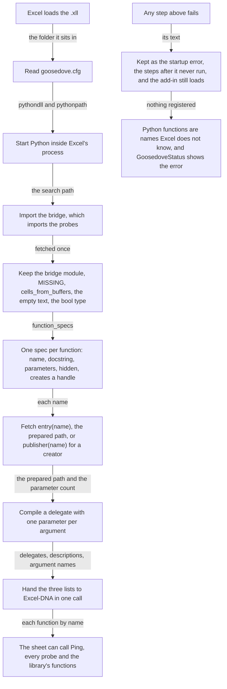
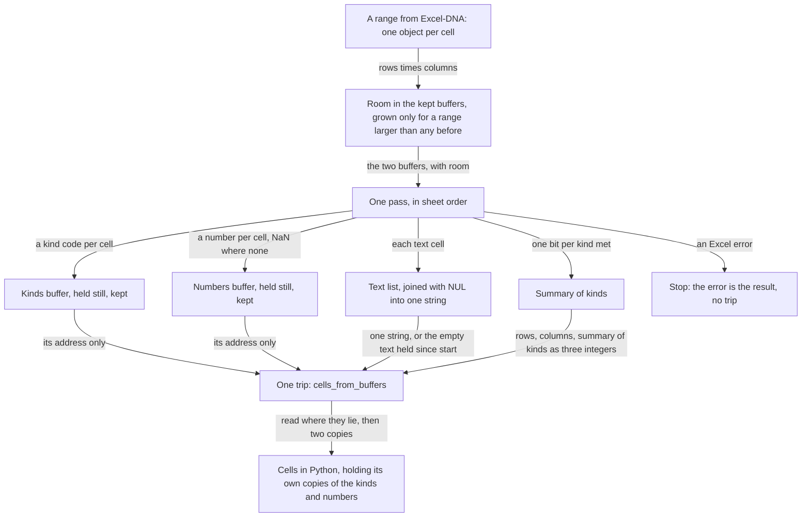
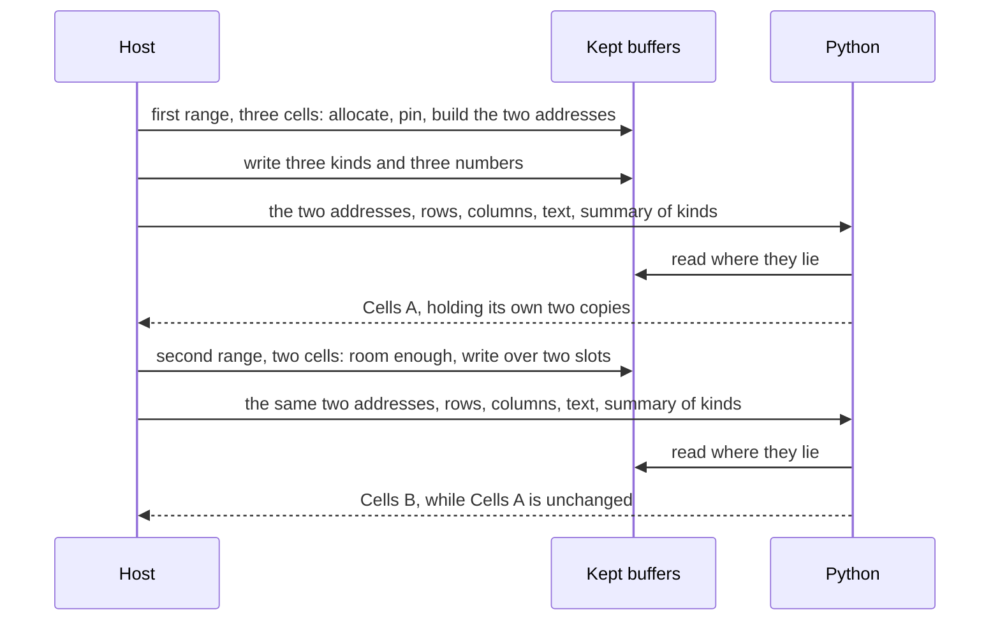

# The host

How the C# add-in between Excel and Python works, in plain words, for someone who will not read C#. It is for the owner coming back after months and needing to find the way without memory, and for an engineer about to change the seam and needing to know what each part does before opening it. What Excel may send and how it is checked is [inputs.md](inputs.md); what a function may return is [outputs.md](outputs.md); the Python side is [bridge.md](bridge.md); how the whole is measured is [measuring.md](measuring.md), and the numbers at the last baseline are in [baseline.md](baseline.md). This page is the layer between: what happens from the moment Excel loads the add-in to the moment a result lands in a cell.

## What the host is, and is not

The seam is the one place Excel and Python talk; nothing else crosses. `=Add(1,2)` crosses it once on the way in and once on the way out. The host is the C# half of the seam: the add-in Excel loads, which starts a Python inside Excel's own process and hands values across. The bridge is the Python half, `bridge.py`, which checks each argument's type and converts each result. The host never checks meaning, and never checks type beyond telling one kind of cell from another; checking is the bridge's job, once, and inputs.md and outputs.md are its map.

Two libraries do most of the work. Excel-DNA is the library that lets a C# program become an Excel add-in, an `.xll` file Excel loads, and tells the program what each cell held: it hands over 1.0 for a cell holding 1, the text for a text cell, and a value of its own for an argument left out. pythonnet is the library that lets a C# program start a Python inside its own process and call Python functions directly, with no separate program and nothing sent over a wire. What we wrote is one file, `AddIn.cs`, plus a small counter in `WorkCounter.cs`: a named tally of things the host did during one call, kept only when an observer asks for one, so a call from the sheet keeps none. The project file says the rest: .NET Framework 4.8; the ExcelDna.AddIn package at 1.9.0, though the ExcelDna.Integration assembly inside that package, the compiled library the add-in talks to, reports itself as 1.1.0, which is the number the host runner, the timing program at the end of this page, writes into its environment file and baseline.md quotes; pythonnet at 3.1.0; and two settings explained below, explicit exports and unsafe code.

Inside the one file there are eight parts, each with one job. AddIn is the start-up Excel runs. Bridge starts Python and makes every call, and Prepared holds one function's path. Marshal turns Excel's values into Python's and back. Registration asks the bridge for its functions and tells Excel about them. Status and Floor are the two worksheet functions written in C#, and Config reads the config file. The rest of this page follows them in the order they run: at start, at registration, on each call.

## At start

Excel loads the add-in once and runs its start-up, which does three things in one try, in order: read the config file, start Python, register the functions. A failure in any of them is caught and kept as the startup error, the text of what went wrong, so the add-in still loads and can say what happened instead of refusing to appear. The steps after the failure never run. So if starting Python or importing the bridge throws, registration never happens, no Python worksheet function is registered, and a formula such as `=Add(1,2)` shows `#NAME?`, Excel's own error for a name it does not know. `=GoosedoveStatus()` shows the startup error instead, because it is a C# function Excel-DNA registers regardless; that is what a user sees when the config names a Python that is not there. Loading gets that grace; a call does not: a call that fails is rejected, and the cell says why.

The config file is `goosedove.cfg`, a two-line text file beside the `.xll`, telling the host which Python to start and where the package is. One line is `pythondll=`, the path of Python's own DLL, the file that is Python itself, loaded into Excel's own process, such as `C:\python\python313.dll`; the other is `pythonpath=`, the folders Python should look in, separated by semicolons: the repository's `src` and the environment's site-packages, the folder holding its installed packages. Lines are trimmed, and blank lines and lines starting with `#` are skipped. The build script writes this file beside the built add-in with the three values it asks the project's own Python for, and git ignores it. The project file would also copy a `goosedove.cfg` from the project folder into the build if one were there; none is checked in, so the script's file is the one the add-in reads.

Starting Python means naming the DLL, starting the engine, and giving back the lock. A thread is one line of work inside a program; Excel runs several, and calls worksheet functions on its calculation thread. The GIL is Python's one lock: a thread must hold it to run Python code, and only one holds it at a time. Python starts with the starting thread holding it; the host releases it at once so whichever thread later makes a call can take it for the length of that call. Then, holding the lock, the host puts each pythonpath folder at the front of Python's search path, first entry first, and imports the bridge. Importing the bridge imports the `goosedove.excel` package first, whose only job is to import every module that registers worksheet functions: the bridge itself, with its own Ping, `probes.py` with the probes, and the library's modules, one per group of its functions. A probe is a hidden worksheet function that does no work beyond crossing the seam, so `=Add(1,2)` costs what the seam costs and nothing more; hidden means that Excel's function wizard, the Insert Function dialog listing functions and their arguments, does not show it, though it still works when typed by name. The list is then complete before the host asks for it.

Five things are fetched or made at start and held for the life of the process. The first is the imported bridge module itself, which registration asks for its functions. The other four are held because every call would otherwise pay for them. MISSING is the bridge's value for an argument the formula left out; the host hands over that one value every time and never builds or releases it. `cells_from_buffers` is the bridge's function that takes a range in; the host keeps it so a range never looks it up. An empty Python string is what a range with no text cells carries as its text. Python's own `bool` type is kept so a boolean result can be recognised without asking Python a question. The host uses seven names from the bridge in all: MISSING and `cells_from_buffers` at start; `function_specs`, `entry` and, for a creator, `publisher` at registration; and, since #114, `release` when Excel lets a publication go and `live_handles` when `GoosedoveHandles` reports the store.

## At registration

Registration happens once, at the end of start-up, and is where the host learns what functions exist and prepares each one's path, so that a call does nothing but call. It asks the bridge for `function_specs`: for every registered function, its name, its docstring, the text written at the top of the function to describe it, as the description, one pair per argument holding the label Excel shows and the help written beside that parameter, whether it is hidden, and whether it creates a handle, read off its declared result. For each one it does three things.

First it fetches the function's prepared path: `Registered.run`, the Python function that checks the arguments, runs the worksheet function and converts the result. For Add, the prepared path is fetched once when Excel starts and called on every recalculation. The host fetches it by name with `entry(name)` and keeps it beside the name, which is used only for messages; a name the bridge does not know fails here, at registration, not at the first call. A creator, a function whose spec says it creates a handle, gets `publisher(name)` instead, the path that returns the value and whether the call published, and its delegate takes the observed path below.

Second it builds a delegate: a C# function value with a fixed number of parameters, which Excel-DNA needs one of per worksheet function. Add's delegate has two parameters and calls the host with Add's prepared path built in. The host compiles each one with one parameter per declared argument; the delegate packs its arguments into an array and hands them to the prepared path, baked in as a constant, so a call never looks the function up by name. Excel-DNA reads the delegate's own signature to learn how many arguments the function takes: none for Ping, two for Add.

Third it builds what Excel-DNA needs to describe the function: the name, the docstring, the hidden flag, and one attribute per argument carrying its label, `[factor]` for an optional argument, and its help. Then all three lists, delegates, descriptions and argument attributes, go to Excel-DNA in one call. Excel's own `fx` dialog reads that registration and needs nothing more. The help beside the formula as a person types it, the signature with the current argument in bold and that argument's line under it, comes from Excel-DNA IntelliSense, bundled with the add-in as a package pinned to the same Excel-DNA version, installed right after registration and uninstalled when the add-in unloads, in `AutoClose`. The words themselves are the bridge's, prepared once at import; the host reads nothing about a function after start-up. `host/Goosedove.Host.Tests/StartupTests.cs` pins that the label and the help reach the attributes.

This shows the order of start-up and registration, and what each step hands the next.

Every probe is hidden: `=Zero()` works, and the wizard never lists Zero. `=Add(1,2)` returns 3 and proves a number goes in and out, at the seam's cost alone. There are sixteen in `probes.py`; Ping and the library's functions, one module per group under `src/goosedove/excel/`, are the Python functions registered visibly. Because the description Excel-DNA is given is the docstring, a probe's "Probe: ..." line is what the wizard would show if it were not hidden.

Explicit exports is a setting in the project file under which only methods marked as worksheet functions reach the sheet by themselves; everything else the sheet can call is registered on purpose. Three C# methods are marked as worksheet functions, GoosedoveStatus, GoosedoveHandles and HostAdd, and one as a command, GoosedovePrepareToQuit. The Python functions arrive through the lists above. A public C# method that is not marked is not a worksheet function: `=RegisterAll()` shows `#NAME?`, and the smoke test, which runs in a real Excel, checks that it does.

HostAdd is the floor: a C# worksheet function with the host's argument shape and no Python at all, so what Excel and Excel-DNA charge for any call can be measured beside what the seam adds. `=HostAdd(1,2)` shows 3 without Python running, and it is hidden like the probes. HostAdd is timed beside Add in [baseline.md](baseline.md), so Excel's and Excel-DNA's own share of a call is measured, not inferred.

The registration says nothing about threads, so Excel calls these functions on one thread, its main calculation thread. The test suite and the host runner each call on one thread of their own.

## The observed path

Since #114 a creator's delegate calls `Lifetime.Observe` in `Lifetime.cs` instead of `Bridge.Call`. The host hands Excel-DNA's `ExcelAsyncUtil.Observe` the function's name, the argument values and a factory: Excel-DNA finds the live call with the same name and values, in any open workbook, and returns its value, or calls the factory for a `Publication`, the one small class of the observed path. Its `Subscribe` runs the publisher's path once through `Bridge.Publish`, which unpacks the pair the seam returns, hands the value to Excel before it returns so a new publication never shows `#N/A` while Excel waits for its next update, and keeps the handle when the call published; the subscription never completes on its own. An Excel error among the arguments becomes the value it holds, found as the plain path finds it, in argument order and cell order, and owns nothing. Excel-DNA calls its `Dispose` when Excel disconnects the last subscriber, after a delay of Excel's, and it calls `Bridge.Release` for the one handle it owns, once however often it is called, counting a release the seam found, a miss it did not, or a failure it reports through `GoosedoveHandles` and never throws at Excel. `Bridge.Release` takes the GIL and skips, counting, once the add-in is closing or Python is gone, so no call reaches a finalized interpreter. `=GoosedoveHandles()`, hidden, reports the store's live count and the bytes of prices its vectors hold, from `live_handles()`, beside the host's counts: published, reused, released, release misses, disposal errors, skipped at close. `host/Goosedove.Host.Tests/LifetimeTests.cs` drives the publication with a fake observer; `tools/excel_lifetime.ps1` drives Excel.

## When a hidden Excel quits

The hidden Excel tools close their workbooks, run the command `GoosedovePrepareToQuit`, then call Excel's `Quit`. The command uninstalls IntelliSense, releases the Application COM reference Excel-DNA cached for it, and collects the detached event sinks inside Excel's CLR. Releasing the script's own COM references cannot release that in-process reference: without this step a hidden Excel stays alive after `Quit` and holds the `.xll` against the next build. The command is terminal and may be called again harmlessly; after it, the script must quit Excel and make no further calls to the add-in. Ordinary add-in removal only uninstalls the help, because Excel may continue running.

`AutoClose` handles explicit add-in removal; [Excel-DNA does not call it when Excel quits](https://excel-dna.net/docs/guides-advanced/detecting-excel-shutdown-and-autoclose/). The hidden tools therefore request cleanup explicitly and verify that the exact Excel process they created has exited before reporting success. Process exit is part of the smoke check, alongside the formula results. Their shared helper is `tools/hidden_excel.ps1`. It also enables events while closing each workbook: IntelliSense drops its workbook references on `WorkbookBeforeClose`, and the timing runner's disabled events would otherwise retain closed workbooks. Those closes run outside the measured batches.

Since #129, which took #130 in, startup owns the process before configuring visibility and alerts: `Get-HiddenExcelProcess` reads the new application's window, retains its process handle and verifies that it belongs to Excel. A configuration failure goes through the same shutdown routine as a completed session, including the exit check; merely trying `Quit` is not enough, since Excel can refuse it. Cleanup problems are reported without replacing the original startup error. If the process cannot be identified, the application reference is still quit and released, but the tool reports that it could not verify exit and targets no process. It never finds a replacement by name or closes another Excel. An automation process forcibly ended before its cleanup runs is outside this guarantee.

`tools/excel_session_selftest.ps1` exercises startup and shutdown failures without Excel, using a COM stand-in and a process stand-in, twenty checks. It runs in `check.ps1` and CI beside the busy-call checks. These failure checks complement the smoke and lifetime runs, which verify exit with real Excel. A build blocked by an already open or unidentified Excel must be resolved by identifying that session; the tools do not terminate it to make the build pass.

## When a hidden Excel is busy

Excel refuses a call from outside while it is busy with work of its own, and answers with one of two results, `RPC_E_CALL_REJECTED` (0x80010001) or `RPC_E_SERVERCALL_RETRYLATER` (0x8001010A). It happens now and then, on most runs in one session and almost never in another. It has been seen where the smoke types its inputs, where the lifetime checks type a changed price, and where a creator's text is read just after its formula was typed. Why Excel is busy at those moments is not known: an add-in still loading and a creator's live-data update being delivered are guesses, and in the smoke each refusal that could be placed came on the call right after a creator's formula was typed. A refused call was never made, so making it again is safe, and waiting and trying again is what [Microsoft tells a program that drives Office to do](https://learn.microsoft.com/en-us/visualstudio/vsto/threading-support-in-office?view=vs-2022).

Since #126 the smoke and the lifetime checks make every call into Excel through `Invoke-ExcelCall` in `tools/hidden_excel.ps1`. It makes the call once, and makes it again every 50 milliseconds while Excel answers with one of the two results, until the call is taken or its time runs out. The time is thirty seconds, or the caller's own deadline when it has one: a read inside the lifetime checks' bounded wait is given that wait's deadline, so waiting on a busy Excel never stretches the wait. Each call is one operation. When a formula has been typed and the read after it is refused, the read is made again and the formula is not typed twice; a COM reference is registered once, after Excel has handed it over. Every other failure leaves at once, as it came: a wrong text, a malformed count, a formula's error and a failed check fail as they always did. When the time runs out the failure names the operation, the cell, the tries, the seconds and the result, `Excel stayed busy: type formula at K12 was refused 571 time(s) over 30.0 s, the last time with RPC_E_CALL_REJECTED (0x80010001)`. What a call returns is never touched by any of this: the waits are kept in a list of their own, and each tool prints them in one report as it ends, `busy Excel: no call had to wait`, or how many calls waited, how often they were refused, the longest wait, and the first ten by name. Both are worded the same on every machine: a number is written with a decimal point whatever the regional settings.

PowerShell shows a refusal in two ways, and one of them is silent. A method call, or a property written, fails with the error. A property read with a dot does not: PowerShell answers any read that failed with nothing, so `$cell.Text` on a busy Excel is empty with no error, and a formula that showed the right text looks as if it showed none. `Read-ExcelProperty` reads a property through .NET's `InvokeMember`, which keeps the failure, and waits as `Invoke-ExcelCall` does. The helper, the smoke and the lifetime checks read every property of Excel's through it.

Ending a hidden Excel is as it was: closing the workbook, `GoosedovePrepareToQuit`, `Quit` and the releases are each tried once, in order, whatever the one before did, and the owned process is given five seconds to exit before it alone is stopped. A session whose add-in could not be loaded is ended the same way.

A run may meet no busy Excel at all, so green runs do not show that any of this works. `tools/excel_busy_selftest.ps1` does, without Excel: calls refused and then taken, refused under nested errors, refused until the deadline, and failing for another reason; a property read that fails, on a stand-in and on a real COM object, read with a dot and through `Read-ExcelProperty`; and the same words on a machine whose decimal mark is a comma. `check.ps1` runs it before the smoke, and CI runs it too.

## On each call

Every delegate calls the same C# method with the function's prepared path and the arguments. The call takes the GIL and holds it for its whole length: converting each argument, the trip, which is one crossing from the host into Python and back, reading the result, and releasing the arguments all sit inside the one lock. `=Add(1,2)` makes one trip. The method has one more branch, for a bridge module that is not there, which returns `#ERROR python did not start:` and the startup error; no formula reaches it, because when Python never started no delegate was registered, and only the host's tests, which can call the method before Python starts, could see that text.

### The way in

The way in is an argument's path from Excel into Python. A scalar is one value: a number, text, a boolean, a blank, a missing argument, or an Excel error, a value like `#N/A` or `#DIV/0!` already sitting in a cell; in `=Add(A1,2)`, A1 and 2 are scalars. An array is a rectangle of values, always two-dimensional even for one row or one column; A1:A3 arrives as a 3x1 array. A range is an array as it arrives from the sheet, cell by cell, before the seam has checked it; `=SumArray(B1:B3)` hands the host a range with "n/a" in its first cell.

Arguments are converted one at a time, in order, and each kind of value takes its own road.

| Arrives from Excel-DNA | Crosses as | Counted |
|---|---|---|
| a number | a fresh Python float | one object built |
| text | a fresh Python string | one object built |
| a boolean | a fresh Python bool | one object built |
| a blank cell | Python's None, its value for nothing | one object built: the host's own holder for None |
| a missing argument | the MISSING held since start, never built, never released | nothing |
| an Excel error | nothing: the error is the call's result, and the function is never called; a range converted before the error has already made its own trip | nothing for the error itself |
| a range | the scan below | see the scan |

Blank and missing are different facts: a blank is an empty cell the formula referred to, and missing is an argument the formula left out; the host keeps the two apart, the bridge decides what each means, and [walk.md](walk.md) shows the two side by side.

The first Excel error the host meets, in any argument, becomes the call's result, unchanged, the way Excel's own functions pass an error on, and the function is never called; it keeps an error from pricing as a blank. `=SumArray(D1:D3)` with D2 holding `NA()` shows `#N/A`.

### The scan

A range crosses in one pass, in C#, called the scan, which writes one kind code and one number per cell into two buffers the host keeps. A cell's kind is which of five things it holds: number, text, boolean, blank, or missing, coded 0 to 4; 1.5 is kind 0, "n/a" is kind 1, TRUE is kind 2, an empty cell is kind 3. The codes are the bridge's own, so nothing translates them. A buffer is memory the host fills and holds still so Python can read it where it lies, without the values being handed over one by one. The host keeps one buffer of kinds and one of numbers, big enough for the largest range seen so far.

The scan first makes sure the buffers have room for rows times columns cells, growing them only if the range is larger than any before, as the section on the kept buffers says. It clears a reused list of text cells. Then it visits cells in sheet order, row by row and left to right, as a person reads a sheet, so in A1:B2 the order is A1, B1, A2, B2.

For each cell it writes the kind and the number; where a cell holds no number it writes NaN, which means not a number, so every cell still has a slot. A number is kind 0 with its value. Text is kind 1 with NaN, and the text goes onto the list. A boolean is kind 2 with 1.0 or 0.0, a blank is kind 3 with NaN, and a missing value inside a range, which is rare, is kind 4 with NaN. Anything else in a cell, which Excel-DNA is not expected to send, rejects the call with a host error naming the type.

While it goes, the scan keeps the summary of kinds: one small number with one bit per kind it saw, so Python knows "all numbers" without looking. The summary of kinds is 1 for a range of only numbers, 3 for numbers and text together, and 31 with every kind present. A look is one pass over a whole range at once, in one operation of numpy, the number library under the bridge; a walk, visiting cells one by one in Python, is what the seam avoids. The bridge accepts a range whose summary of kinds is 1 into a slot of numbers without a look at the kinds, and only otherwise takes one look, over all the kinds at once, to name the first bad cell.

An Excel error anywhere in the range stops the scan where it is found. The error becomes the call's result, nothing is built, and no trip is made for that range; the cells visited so far, the error included, are what the counter reports. `=SumArray(F1:F2)` with F1 holding "x" and F2 holding `NA()` shows `#N/A`, not a text error, because the error wins even after text.

After the last cell, the text cells are joined with NUL: put into one string with an invisible zero character between them, so one string crosses instead of many. Cells "x", "" and "y" cross as x, NUL, NUL, y and split back into ("x", "", "y") on the other side; an empty text cell survives, and the order is kept. A range with no text passes the empty string held since start. A text cell that itself holds NUL would split into two on the other side, so the scan refuses it where it reaches it, as it does an Excel error: nothing is built, no trip is made, and the cell shows the host's own `#ERROR host:` text, which `NulRefusal` in `AddIn.cs` builds from the function, the argument's position and, inside a range, the cell; a scalar text argument is checked at the same boundary. Each text reached is looked at once, the refused one included, counted as `texts_checked`; a range of numbers pays no look, and the kept buffers serve the next call as before. The rule, its words and its place among the refusals are [inputs.md](inputs.md#nul-in-input-text)'s.

Then comes the trip that hands the range over; `=SumArray(A1:A3)` makes two trips, this one and the function's own. The host builds three Python integers, rows, columns and the summary of kinds, and a Python string for the text if there is any, and calls `cells_from_buffers` with the two buffer addresses and those values.

This shows what the scan writes where, and what crosses in the trip: two addresses that only point, and one string and three integers that are built.

On the Python side `cells_from_buffers` reads the two buffers where they lie, splits the text on NUL only when the summary of kinds says there is text, and returns a Cells, the bridge's own holder for a range, with its own copy of each, laid out rows by columns; those two copies are all that survives the call. Owning a range is Python copying the host's buffers into its own arrays, so the host may overwrite them for the next range. How Cells is built is in [bridge.md](bridge.md). A pin is a test that holds a count fixed, so a seam change must state what it moved. The Python pins in `test_seam_budgets.py` hold owning a range at exactly two reads of the buffers where they lie, two reshapes, two copies and no look, and `test_bridge.py` holds that a Cells does not change when the host's buffer does.

### The trip

With every argument converted, the host counts one trip and calls the prepared path with the arguments and nothing else. No name is looked up, no module is touched, nothing is built to carry the call beyond the arguments themselves. The prepared path checks, runs and converts by the declared return type, and returns one of five things, or text beginning `#ERROR`. The result is read as the next section says, and then every argument the host built is released. MISSING is not released, because it was never built.

### The way out

The way out is a result's path from Python back to the cell. The bridge promises one of five things, a number, text, a boolean, a two-dimensional array of doubles, the 8-byte numbers in which Excel and C# hold every number, or a tuple carrying a rectangle of numbers, text and booleans, and the host reads each by its type through Python's own runtime, without running any Python code and without a trip. A Python float becomes a double. A Python string becomes a string. A value of the bool type kept at start becomes a bool. A tuple takes the mixed road, below. Anything else is asked for a buffer.

The host asks for the buffer's dimensions, shape, item size and starting address, and never for its format, because pythonnet 3.1.0 crashes on that request (its issue 2371). A value that gives no buffer yields the cell text `#ERROR host: <name> returned a <Python type>, which the host cannot show`; the bridge's MISSING, fed to the reader in a test, shows exactly that. A buffer must have two dimensions and 8-byte items, or the cell shows `#ERROR host: <name> returned a buffer that is not an array of doubles`. Its byte length must be rows times columns times 8, or the cell shows `#ERROR host: <name> returned a buffer of N bytes for RxC doubles`. These are the bridge's promise checked, not a second validation: the bridge already rejected the call if a cell was NaN or infinite, so no NaN ever reaches the sheet.

Then the one copy. The host allocates a plain C# array of doubles, rows by columns, holds it still for the length of the copy, and copies the bytes straight from Python's buffer into it in one move. That copy is the one place the host reads memory by its address directly, which is why the project file allows unsafe code, the setting that permits exactly that. The array is what Excel-DNA hands to Excel, and Excel spills it: fills the cells below and beside the formula, as `=Grid(2,3)` in A1 fills A1:C2. No number is wrapped in an object of its own, no cell is converted one by one, and there is no second copy; `HostWorkBudgets.cs` pins an array out of ten thousand cells at one buffer, 80,000 bytes, and one copy, and nothing between.

The mixed road is the second way out, for a rectangle of numbers, text and booleans together, and it is per cell where the road above is one copy. The bridge hands over a tuple of three things by position, the mirror of what the host sends on the way in: the kinds, one byte per cell, the numbers, eight bytes per cell, 1.0 or 0.0 for a boolean and a placeholder where a cell holds text, and the text cells joined with NUL in sheet order. The host reads the two buffers as above, checking each for its shape and item size and saying so in the cell when the promise is broken, `#ERROR host: <name> returned a mixed array whose kinds are not bytes in two dimensions`, splits the joined text once, and fills an array of objects from the kinds: each number cell gets a box of its own, each text cell its own string, and each boolean one of two boxes made once. That is what Excel needs, one tagged value per cell, and there is no block of mixed cells to copy in one move, so the numbers road stays the cheaper one and a function that spills numbers alone declares numbers. `HostWorkBudgets.cs` pins a mixed array out of ten thousand cells at one array of references, a box per number cell and a string per text cell, under `result_boxes` and `result_texts`, and pins what the road allocates per added cell.

## The kept buffers

The two buffers exist so that a warm range in allocates nothing per cell in the host's own memory. Warm means measured after a first call has set everything up; for a range, one no larger than any before, so nothing is grown for it. Excel-DNA sends a range as one C# object per cell; without the buffers each range would allocate new arrays every call, and the pin that says a warm range in allocates nothing per cell could not hold. The buffers are kept between calls and grown only when a larger range comes. There is one set per thread, marked so that each thread gets its own, though Excel calls on one thread today.

Growing means allocating a new byte array and a new double array of exactly the size asked, no headroom and never shrinking, pinning both, and building two Python integers holding their addresses. Pinning is telling .NET's memory manager not to move an array, so its address stays valid while Python reads from it; the kinds buffer is pinned when it is made and stays pinned until a larger one replaces it. An address object is a Python integer holding where a pinned buffer starts, built once so a call can pass it without building anything. The new set is whole before the old one goes: if building an address fails, the new arrays are unpinned, the error is thrown, and the old buffers stay pinned and usable. When the old set does go, its two arrays are unpinned and its two address objects released. The buffers are never freed on exit; Excel closing ends the process and takes Python with it.

The counter sees growth as two buffers allocated, nine bytes per cell, one of kind plus eight of number, and two objects built. `HostWorkBudgets.cs` pins that the first range of thirty thousand cells in a process pays that, and that the next of the same size pays nothing but the three integers any range pays. Because the buffers grow to the largest range and stay, a process that has seen the host runner's 100,000-cell control keeps about 900,000 bytes pinned on that thread, nine per cell; a sheet that sends only hundreds of cells keeps a few kilobytes.

What Python copies decides why the host may overwrite. `cells_from_buffers` reads the buffers where they lie and returns copies; nothing that read them outlives the call. So on the next range the host writes over the same slots, and no Cells that any function holds changes. The trip and the copies happen while the host holds the GIL, and before the scan of the next range can start, so nothing reads a buffer while it is being written.

This shows two ranges through the same buffers: what is allocated once, what is written each time, and what Python keeps.

## Errors

A failure lands in the cell in one of four ways, and what the cell shows says which layer failed.

An Excel error in an argument, a scalar or a cell inside a range, comes back as that error itself: `#N/A` stays `#N/A`, and the function is never called. This is one of two cases where the cell shows an Excel error rather than text, and the only one where the error came in with the arguments.

A call the bridge rejects, or an exception inside Python, comes back as text beginning `#ERROR <function>:`. The prepared path catches a rejected argument, a rejected result, and any other exception, and returns text naming the function; the host reads that text as an ordinary string, and the cell shows it. `=Fail()` shows `#ERROR Fail: ValueError: as asked`, and `=Add(1,TRUE)` shows `#ERROR Add: b is boolean TRUE, expected number`. The messages are the bridge's, and inputs.md and outputs.md specify them.

A failure in the host itself comes back as text beginning `#ERROR host:`. That covers an exception escaping the trip, such as a Python error raised by `cells_from_buffers` itself, or an unknown type in a cell during the scan, whose message is the exception's own; the three checks on a result's buffer above, which write their own text; and a text holding NUL (U+0000) in an argument, refused before the trip, [inputs.md](inputs.md#nul-in-input-text).

Python never having started leaves nothing registered, so the cell shows `#NAME?`, because the formula names a function Excel was never told about, and `=GoosedoveStatus()` says why.

## The counter

After `=SumArray(A1:A100)` the counter, when one was asked for, reads trips 2, objects_built 3, cells_scanned 100. The names and what each counts are the table in [measuring.md](measuring.md); what this page adds is where each increment sits.

Every increment sits at a boundary, never inside the scan, except the early exit when an Excel error stops the scan, which records how far it got. A trip is counted just before the prepared path is called, and once inside the range trip. Objects are counted once per scalar, three at a time for a range's integers, once more for its text, and twice on growth. Buffers and bytes are counted where the kept buffers grow and where the array out is made; copies and cells where the array out is made.

The counter itself is a list of names, each with a number; adding zero does nothing, and a test reads a copy that can no longer change. The tests compare the whole list of counts, so an absent name asserts that the work did not happen. A warm scalar call's counts are objects_built 2 and trips 1, and nothing else.

`name_lookups` has no increment left anywhere in the host. Since the prepared path landed (#37) a call fetches nothing by name; the name stays in the counter's comment, in measuring.md and in the paired baseline rows in [since-024486f.md](baseline/since-024486f.md), where it goes from 1 to 3 per call before to 0 after, and the budget tests assert its absence by comparing the whole list of counts. It is a name kept so the history reads, not a counter that can fire.

The worksheet path passes no counter. Every increment first asks whether a counter is there, so with none there is nothing to build and each boundary pays one such question. The delegate calls the version of the call that takes no counter. The tests' counted calls and the host runner's one counted call per scenario use the version that takes one; the tests that meter memory and the host runner's timed calls go through the delegate, as Excel does. Nothing about a counter reaches the cell.

The host's pins are in `HostWorkBudgets.cs`; the counts they hold are the table under "What the tests pin" in [baseline.md](baseline.md), and a seam change updates both. The same file pins managed bytes, memory the host's own runtime hands out on the calling thread, per call, four ways; the figures are in baseline.md under "What the tests pin".

## Status and Ping

Four functions exist to check the add-in by typing them. `=GoosedoveStatus()` is a C# function registered even when Python failed to start; it shows the startup error, or `ok: python started and functions registered`. It is the first row of the smoke test and the gate the Excel runner, the timing script that drives a hidden Excel, refuses to pass without. `=Ping()` is the one visible Python worksheet function, defined in `bridge.py` rather than among the probes; it shows `goosedove <version> from <path>`, where the version is the installed package's or `source checkout`, and the path is where the package was imported from, so it says which goosedove Excel is running. `=HostAdd(1,2)` shows 3 with no Python, proving Excel-DNA alone works. `=GoosedoveHandles()`, since #114, reports the store's live count and what the observed path has done, as [The observed path](#the-observed-path) says. GoosedoveStatus and Ping appear in the function wizard; HostAdd and GoosedoveHandles are hidden.

## The host's own tests

The host has tests that start Python without Excel, run in CI, the checks that run on every push, and by `check.ps1`, so the seam is checked on every change on a machine with no Excel. One shared set-up starts Python once for the whole run, the way the add-in does, minus Excel: it asks `uv run python` for three things, Python's base folder, its site-packages folder and the DLL's name, and calls the same start routine the add-in calls, with the DLL's path and the two folders, the repository's `src` first. The repository root is found by climbing from the test program's folder to the one holding `pyproject.toml`. Every group of tests that needs Python shares that one set-up, and the tests run one at a time, since there is one Python. The tests' way into the seam is to prepare the path and then call it, exactly what the delegate does.

Four files hold the tests, and a fifth holds the pins. The start-up tests read a config file and check that a delegate has one parameter per declared argument and forwards them. The call tests replay the rows of the Excel smoke test without Excel, the cell text or value each formula shows, and check the shape of spilled arrays: a grid counts across then down, a column spills down, a row across, a single cell is a column of one. The marshal tests ask the bridge's own `describe` what Python received for each thing Excel can hand over, read a range's kinds, numbers, texts and summary of kinds, and check that an error wins even after text, that MISSING is the one held since start, and that a result the host cannot show says so. The lifetime tests, since #114, drive the publication with a fake observer in place of Excel: the publisher says whether a call published, an Excel error among the arguments is found in the plain path's order, a publication runs its call once and delivers the value before its subscription returns, disposal releases once however often it is called, a failure and an unsubscribed publication own nothing, a failed delivery releases and rethrows, a failing release and one that finds nothing are counted, and a release once the add-in is closing is skipped and reaches no Python. The pins are in `tests/performance/HostWorkBudgets.cs`, under `tests/performance` because budgets live there by rule; the test project links the file into itself. The host's internal parts are visible to the test project and the host runner through a declaration in the host, and to nothing else.

The command is `dotnet test host\Goosedove.Host.Tests -c Release`, which `check.ps1` runs after the Python checks; next come `tools/excel_busy_selftest.ps1`, the proof without Excel of [how the Excel steps wait for a busy Excel](#when-a-hidden-excel-is-busy), and `tools/excel_session_selftest.ps1`, the proof without Excel that [a hidden Excel whose start fails is still ended](#when-a-hidden-excel-quits), and then the Excel smoke test. The smoke test builds the add-in and its config, opens a hidden Excel of its own and drives it over COM, Windows' way for one program to drive another: it loads the `.xll`, types the input cells, places one formula per row and compares each cell's displayed text with the text expected, then closes without saving and lets every COM object go. After it, `check.ps1` runs `tools/excel_lifetime.ps1 -Groups core,processes,trades,valuation`, which builds a chain of creators in hidden Excels and checks their publications and releases, as [handles.md](handles.md#acceptance-scenarios) says. Neither touches an Excel the user has open, and neither is in CI, which has no Excel. `tools/excel_dev.ps1` builds the same add-in and opens it in a visible Excel for trying formulas by hand.

## The host runner

The host runner is the program that times each probe through the host, with Python started the way the add-in starts it and no Excel. Its command is `dotnet run --project tools/performance/Goosedove.Host.Measure -c Release`, with `--output DIR` to write elsewhere than `profiles/host-measure`. Its scenarios are the Python runner's, the script in measuring.md that times the seam with no host, built as Excel-DNA would hand them over. It writes `batches.csv`, `work.csv` and `environment.json`; [measuring.md](measuring.md) says what its clock includes and how to read its rows. CI builds the runner so it keeps compiling, and never runs it.

## Where to look

| To see | Open |
|---|---|
| start-up: the config file, starting Python, the five things held | `AddIn.AutoOpen`, `Bridge.Start`, `Config.Load` in `host/Goosedove.Host/AddIn.cs` |
| what a cell shows when Python did not start | `Bridge.StartupError`, `Status.GoosedoveStatus` in `AddIn.cs` |
| registration and the delegate | `Registration.RegisterAll`, `Registration.MakeDelegate`, `Registration.MakeObservedDelegate`, `Bridge.Prepare`, `Bridge.PreparePublisher`, `Prepared` in `AddIn.cs` |
| the observed path: the publication, its release and the counts | `Publication`, `Outcome`, `Lifetime` in `host/Goosedove.Host/Lifetime.cs`; `Bridge.Publish`, `Bridge.Release`, `Bridge.LiveHandles` in `AddIn.cs` |
| one call, the lock, the error catch | `Bridge.Call` in `AddIn.cs` |
| the way in, the scan and the range trip | `Marshal.ToPython`, `Marshal.Range`, `Marshal.CellsFromBuffers` in `AddIn.cs` |
| the kept buffers and their growth | `Marshal.Reserve` in `AddIn.cs` |
| the way out and the one copy | `Marshal.FromPython` in `AddIn.cs` |
| the three C# worksheet functions | `Status.GoosedoveStatus`, `Status.GoosedoveHandles`, `Floor.HostAdd` in `AddIn.cs` |
| the counter's names | `host/Goosedove.Host/WorkCounter.cs` |
| the project settings: framework, packages, explicit exports, unsafe code | `host/Goosedove.Host/Goosedove.Host.csproj` |
| the seven names the host uses from Python | `function_specs`, `entry`, `publisher`, `release`, `live_handles`, `cells_from_buffers`, `MISSING` in `src/goosedove/excel/bridge.py`; `Registered.run` is the prepared path and `Registered.publish` a creator's, and `Ping` sits beside them; `describe` is what the marshal tests ask |
| the probes | `src/goosedove/excel/probes.py` |
| the tests without Excel | `Python.cs`, `StartupTests.cs`, `CallTests.cs`, `MarshalTests.cs` in `host/Goosedove.Host.Tests/` |
| the pins | `tests/performance/HostWorkBudgets.cs` |
| the Python pins on owning a range, and the test that a Cells keeps its copy | `tests/performance/test_seam_budgets.py`, `tests/unit/test_bridge.py` |
| the build, and where the config file lands | `tools/host_build.ps1`; the file sits beside `host/Goosedove.Host/bin/Release/net48/Goosedove.Host-AddIn64.xll` |
| the test with Excel, and Excel by hand | `tools/excel_smoke.ps1`, `tools/excel_dev.ps1` |
| waiting for a busy Excel, the property read that keeps its failure, and their proof without Excel | `Invoke-ExcelCall`, `Read-ExcelProperty` in `tools/hidden_excel.ps1`; `tools/excel_busy_selftest.ps1` |
| starting and ending a hidden Excel, and the proof without Excel that a failed start still ends it | `Start-HiddenExcel`, `Get-HiddenExcelProcess`, `Stop-HiddenExcel` in `tools/hidden_excel.ps1`; `tools/excel_session_selftest.ps1` |
| the host runner | `Program.cs`, `Scenarios.cs`, `Measurements.cs` in `tools/performance/Goosedove.Host.Measure/` |
| everything, in order | `check.ps1` |
