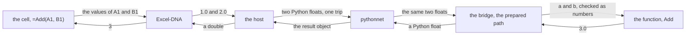
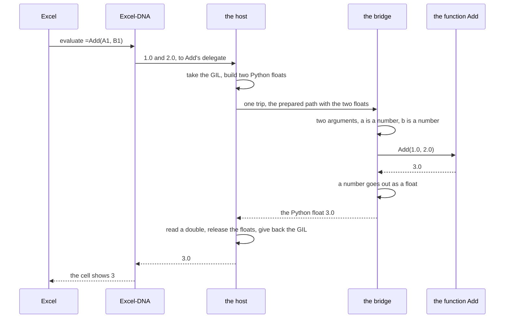
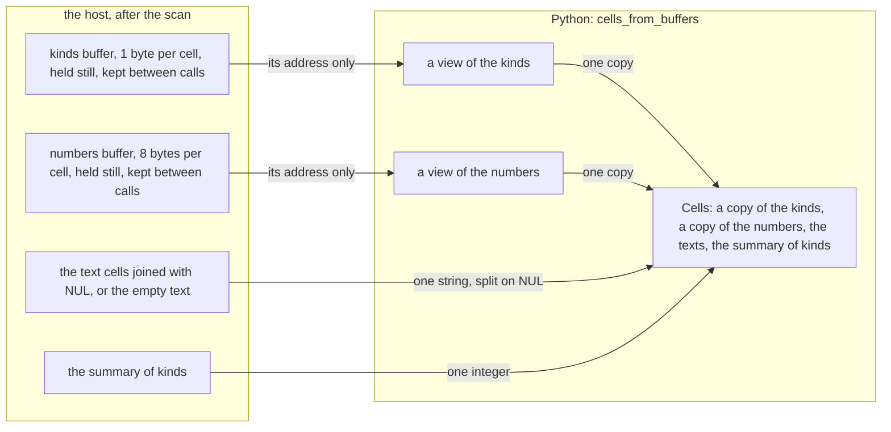
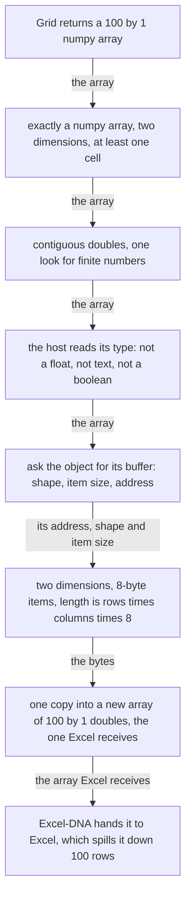

# One call, step by step

What happens from the moment Excel evaluates a formula to the moment the cell shows the answer, told once, in order, with the diagrams that show it. It is for the owner coming back after months and needing to find the way through without memory, and for the engineer keeping the seam working. Every term is defined in one sentence the first time it appears and used by the same name after. The rules a call obeys are in [inputs.md](inputs.md) and [outputs.md](outputs.md), the parts it passes through are in [host.md](host.md) and [bridge.md](bridge.md), how the numbers are taken is in [measuring.md](measuring.md), and the numbers themselves are in [baseline.md](baseline.md).

## The layers a call crosses

The seam is the one place Excel and Python talk: `=Add(1, 2)` crosses it once on the way in and once on the way out, and nothing else crosses anywhere. A call crosses six layers, from the cell to the Python function, and the answer comes back through the same six in reverse.

Excel evaluates the formula and hands the arguments to the add-in. Excel-DNA is the library that lets a C# program be an Excel add-in and tells it what each cell held; it hands over 1.0 for a cell holding 1, as a double, the host's own eight-byte number, and a marker for an argument left out. The host is the C# add-in between Excel and Python; it turns what Excel-DNA hands it into things Python can read, so 1.0 becomes a Python float, Python's own kind of number, and reads what Python returns. pythonnet is the library that lets the host start a Python inside its own process and call Python functions directly, with no separate program. The bridge is the Python side of the seam, `bridge.py`; it checks each argument's type and converts each result. The function is the worksheet function itself, written in Python.

Two more words the page needs. A trip is one crossing from the host into Python and back: `=Add(1, 2)` makes one, and a range call makes two. A probe is a hidden worksheet function that does no work beyond crossing the seam, so what it costs is what the seam costs; `Add`, `SumArray` and `Grid` below are probes, and a pricing function crosses exactly as they do.

The flowchart shows the six layers and what moves between them, out and back.

## A scalar call, step by step: =Add(A1, B1)

A scalar is one value: a number, text, a boolean, a blank, a missing argument, or an Excel error. In `=Add(A1, B1)` both arguments are scalars; say A1 holds 1 and B1 holds 2.

**The way in.** The way in is an argument's path from Excel into Python. Excel evaluates the formula and Excel-DNA reads the two cells, handing the host 1.0 and 2.0. A blank cell would arrive as a blank marker and an argument left out as a missing marker: blank and missing are different facts, a blank being an empty cell the formula referred to and missing an argument it left out, so `=Times(5, C2)` with C2 empty fails while `=Times(5)` takes the default factor. Excel-DNA calls Add's delegate: a C# function with one parameter per argument, which the host built once at registration, the moment the add-in loads and tells Excel its functions. Add's delegate gathers its two arguments into one list and calls the host with Add's prepared path built in. The prepared path is `Registered.run`, the one Python function that checks the arguments, runs the worksheet function and converts the result; the host fetched it once at registration and keeps it, so a call never looks a function up by name.

**The host's part.** The host takes the GIL, Python's one lock that a thread must hold to run Python code, and holds it for the whole call. It converts the arguments one at a time: each number becomes a fresh Python float. A blank would become None, Python's value for nothing; a missing argument becomes the one MISSING value the host fetched when Python started, never built and never released; an Excel error ends the call here, as the rejected section shows. Then the trip: the host calls the prepared path with the two floats and nothing else.

**The bridge's part.** `Registered.run` checks that two arguments came, then each against Add's own declaration, left to right: a is a number, b is a number. No coercion: TRUE fails as "b is boolean TRUE, expected number", and the text "2" fails too. Add runs, 1.0 plus 2.0. The bridge converts the result by the declared return type: a number goes out as a Python float, and a NaN, the marker for a value that is not a number, or an infinity would fail here instead of reaching the sheet.

**The way out.** The way out is a result's path from Python back to the cell. The host reads the result by its type, asking Python no question and making no trip: a Python float becomes a double. It releases the two floats it built, gives back the GIL, and returns the double to Excel-DNA, which hands it to Excel. The cell shows 3. The host's counts for the call: one trip, two objects built.

The sequence diagram shows the same call in order, one line per step.

## A range call, step by step: =SumArray(A1:A100)

An array is a rectangle of values, always two-dimensional, even for one row or one column; a range is an array as it arrives from the sheet, cell by cell, before the seam has checked it. `A1:A100` arrives as a range of 100 rows by 1 column. Say every cell holds a number.

**The scan.** Excel-DNA hands the host the range as a two-dimensional array of cells. The host takes the GIL and makes one pass over the cells in sheet order, row by row and left to right within a row: the scan. For each cell it writes two things into two buffers it keeps. A buffer is memory the host fills and holds still so Python can read it where it lies, without the values being handed over one by one; the host keeps one of kinds, a byte per cell, and one of numbers, eight bytes per cell. A cell's kind is which of five things it holds, coded 0 to 4: number, text, boolean, blank, missing, so 1.5 is kind 0, "n/a" is kind 1, TRUE is kind 2, and an empty cell is kind 3. A number cell gets its value, a boolean 1.0 or 0.0, and a text, blank or missing cell gets NaN, so every cell keeps its slot; each text also goes into a list beside the buffers, in order, to be joined at the end with NUL, an invisible zero character, into one string. The buffers are kept between calls and grown only for a larger range than any before; [host.md](host.md) says how. While it scans, the host also keeps the summary of kinds: one small number with one bit per kind the scan saw, so the summary of kinds is 1 for a range of only numbers, 3 for numbers and text together, and 31 with every kind present. The summary of kinds is what lets Python know "all numbers" without looking.

**The trip that lets Python own the range.** After the scan the host joins the text cells, when there are any, with NUL, so one string crosses instead of many; cells "x", "" and "y" cross as x NUL NUL y and split back into three, the empty one kept. A range of numbers has no text, and the host passes an empty text it made once at start. The host builds three Python integers, rows, columns and the summary of kinds, plus one Python string when there is text, and makes the first of the call's two trips: it calls `cells_from_buffers` in the bridge with the addresses of the two buffers, the shape, the text and the summary of kinds. The two addresses are Python integers built when the buffers were, so passing them builds nothing.

In Python, `cells_from_buffers` makes two views over the host's memory with numpy, the number library under the seam, one of the kinds and one of the numbers; a view is another name for the same memory, so nothing is copied yet. It splits the text on NUL only when the text bit of the summary of kinds is set. Then it reshapes each view to 100 by 1 and copies each once, and returns a Cells, the one object every range becomes in Python: the two copies, the texts and the summary of kinds. Those two copies are all that survives, because the host fills the same buffers again for the next range; a unit test writes into the host's buffer after the call and the copies do not change. This is owning a range: Python taking its own copy of the host's buffers. A pin is a test that holds today's figure fixed, so a seam change must state what it moved; the pins hold owning a range at two views, two reshapes, two copies, and nothing read from the kinds.

The diagram shows what crosses by address alone and what is copied.

**Acceptance without a look.** The second trip is the function's own: the host calls the prepared path with the Cells. `Registered.run` checks the count, then the one argument against its declaration, an array of numbers. A look is one pass over a whole range at once, done by numpy in one operation; a walk is visiting cells one by one in Python, which the seam never does on this path. Here the bridge takes neither: the summary of kinds is 1, only numbers, so the check hands `SumArray` the numbers array as it lies, with no copy and no look. The pins hold that at ten thousand cells the seam's own functions run once each and the only numpy work is the sum itself.

**The function and the result.** `SumArray` sums the array and returns a float. The bridge converts it as a number; the host reads the Python float as a double, releases the Cells, gives back the GIL, and returns the double to Excel-DNA. The cell shows the sum. A call is warm when nothing is being set up for the first time. The host's counts for the whole call, warm: two trips, three objects built, 100 cells scanned, nothing allocated; the first range larger than any before pays two buffers of nine bytes per cell and two more objects, the addresses, once.

## An array out, step by step: =Grid(100, 1)

`Grid` takes two whole numbers and returns an array of that shape counting 1, 2, 3 across then down. The way in is two scalars: two Python objects built, each checked as a whole number, so `=Grid(2.5, 3)` shows "#ERROR Grid: rows is number 2.5, expected whole number". Grid builds a numpy array of 100 rows by 1 column.

**The finite check.** The bridge converts by the declared return type, an array of numbers. It checks that the value is exactly a numpy array with two dimensions and at least one cell, holding numbers; makes it a contiguous array of doubles, laid out in one unbroken run, which for Grid's array hands back the same array with nothing copied; and takes one look for finite numbers, neither infinite nor undefined, through a one-byte mask over the cells, a yes or no per cell. A NaN anywhere fails the whole call with its cell named as INDEX counts, row then column from 1: "result cell (3, 1) is not a finite number". A column or row result has its orientation set here too, from the declaration, as [outputs.md](outputs.md) says.

**The one copy.** The host reads the result by type: not a float, not text, not a boolean, so it asks the object for its buffer, a read-only view of the array's memory with its shape and item size. It checks three things, two dimensions, eight-byte items, and a byte length equal to rows times columns times 8, and says so in the cell if any fails. Then it allocates the array Excel receives, 100 by 1 doubles, holds it still only for the length of the copy, and copies the bytes once, straight from Python's memory into it. That is the one place the host reads memory straight from an address. It releases the buffer and the result, gives back the GIL, and hands the array to Excel-DNA.

**The spill.** Excel spills an array result: it fills the cells below and beside the formula, as `=SEQUENCE(3)` fills three rows. `=Grid(100, 1)` in A1 fills A1:A100 and `=Grid(2, 3)` in A1 fills A1:C2. The array is plain doubles with no NaN in it, because a call with one fails in the bridge before it can cross. The counts, which the pin holds at ten thousand cells: one trip, two objects, one buffer of 8 bytes per cell, one copy of every cell.

The flowchart shows the way out of an array, from the function's return to the spill.

## A rejected call, and an Excel error in a cell

**Text in cell 5 of a column of numbers.** `=SumArray(A1:A10)` with A5 holding "n/a". The scan writes kind 0 and the value for cells 1 to 4; at cell 5 it writes kind 1 and NaN, adds "n/a" to the text list and sets the text bit; cells 6 to 10 are numbers again, and the summary of kinds is 3. The host builds rows, columns, the summary of kinds and the text, four objects, and makes the first trip; Python owns the range, splitting the text into one item because the text bit is set. The second trip checks the argument. Now the summary of kinds is not 1, so the bridge takes one look: it compares every kind code with 0 in one numpy operation, which gives a mask. The first yes in the mask, found in one more operation, is the fifth cell; divided by the column count, that is row 5, column 1, as INDEX counts. The bridge reads that cell by its kind, text, and finds its value by counting the text cells before it, none, so it is the first text, "n/a".

`Registered.run` turns the rejection into text, and the host reads a Python string as a string, so the cell shows "#ERROR SumArray: values cell (5, 1) is text 'n/a', expected number", text rather than an Excel error. The pins hold that call's ledger, the list of the seam's own functions that ran and how many times, fixed at ten thousand cells with the text in the middle of the column: one look and no walk. A blank in that cell lands the same way, on the same ledger. The most memory Python holds during that call, with the text in the last cell, is pinned under two one-byte masks plus a little slack. An error raised inside the function keeps its type and message, so `=Fail()` shows "#ERROR Fail: ValueError: as asked". A failure inside the host, such as a result the host cannot show, is "#ERROR host: " and the reason.

**An Excel error in a cell.** `=SumArray(D1:D3)` with D2 holding `=NA()`. The scan writes cell 1, meets the error at cell 2 and stops: it counts two cells scanned, hands the error out, builds nothing and makes no trip. The host returns the error itself as the call's result, so the cell shows #N/A, the way Excel's own functions pass an error through; this keeps an error from pricing as a blank. A scalar argument is the same: `=Add(A1, B1)` with B1 holding #N/A shows #N/A, and Python is never called; a range argument converted before the error has already made its own trip, as [host.md](host.md) says. The pin: an error at cell 5 of 10,000 counts five cells scanned and nothing else.

## What each stage costs today

The numbers here are read from [baseline.md](baseline.md), the session of 2026-09-11 at revision aaa5259, in microseconds, µs, a millionth of a second, and nanoseconds, ns, a thousandth of a microsecond. Each is one session's middle figure of five batches; how it was taken, what each of the three clocks includes, and why the columns are read side by side and never subtracted from one another is in [measuring.md](measuring.md).

| Stage | Python runner | Host runner | Excel |
|---|---:|---:|---:|
| a scalar call, `=Add` | 1.25 µs | 2.66 µs | 6.45 µs per formula down 1,000 rows; `HostAdd`, the same call with no Python, 2.40; `=A1+B1` 0.47 |
| a range of 100 numbers in, `=SumArray` | 1.9 µs | 8.1 µs, of which the way in alone is 4.7 | 25.2 µs; `=SUM` 4.7 |
| a cell in, per added cell from 100 to 10,000 | 0.2 ns | 3.7 ns, of which the way in alone is 3.3 | 30 ns; through `=SUM` 5 |
| a cell out, per added cell from 100 to 10,000, `=Grid` | 0.6 ns | 1.2 ns | 105 ns |

The counts sit under the times: a counter is a named tally of what the host did during one call, kept only when an observer asks for one, so the worksheet path pays one check that no counter is present at each boundary and nothing else. The pins hold the counts, and beside them the ceilings, a ceiling being the most a test allows, set at the measured figure plus a little room. The whole table of counts and ceilings as the tests pin them is in [baseline.md](baseline.md) under What the tests pin, and the Python ledgers are in `tests/performance/test_seam_budgets.py`. How the seam came to these figures, change by change, is in [history.md](history.md).

## What the steps say about shaping a formula

Every layer charges per call, and only the scan, the copies that own the range, the finite look, the copy out and the spill charge per cell, at nanoseconds a cell against microseconds a call. So the shape of a formula decides its cost more than its size does, and a one-row formula that takes a range is the worst shape there is. The figures behind that, and the sizes not measured, are in [baseline.md](baseline.md).

## Where to look

| To see | Go to |
|---|---|
| the host: start, the call, the scan, the way out | `host/Catalyst.Host/AddIn.cs`, the Bridge, Marshal and Registration classes |
| `HostAdd`, the same call with no Python | `test_support/Catalyst.Probes/Floor.cs` |
| the versions of Excel-DNA and pythonnet | `host/Catalyst.Host/Catalyst.Host.csproj` |
| the counters and what each name means | `host/Catalyst.Host/WorkCounter.cs` |
| the bridge: Cells, `cells_from_buffers`, the accept rules, the result rules, `Registered.run` | `src/catalyst/excel/bridge.py` |
| the probes, test support outside the library | `test_support/catalyst_probes/__init__.py` |
| the host's pinned counts and memory ceilings | `tests/performance/HostWorkBudgets.cs` |
| the Python ledgers and memory ceilings | `tests/performance/test_seam_budgets.py`, `tests/performance/test_seam_allocation.py` |
| what each thing Excel can send arrives as, and every failure's text | `host/Catalyst.Host.Tests/MarshalTests.cs`, `host/Catalyst.Host.Tests/CallTests.cs`, `tests/unit/test_bridge.py`, `tests/unit/test_type_validation.py`, `tests/unit/test_range_validation.py`, `tests/unit/test_result_validation.py` |
| what the cell shows, checked in a hidden Excel | `tools/excel_smoke.ps1` |
| the runners behind the cost table | `tools/performance/`, described in [measuring.md](measuring.md) |
